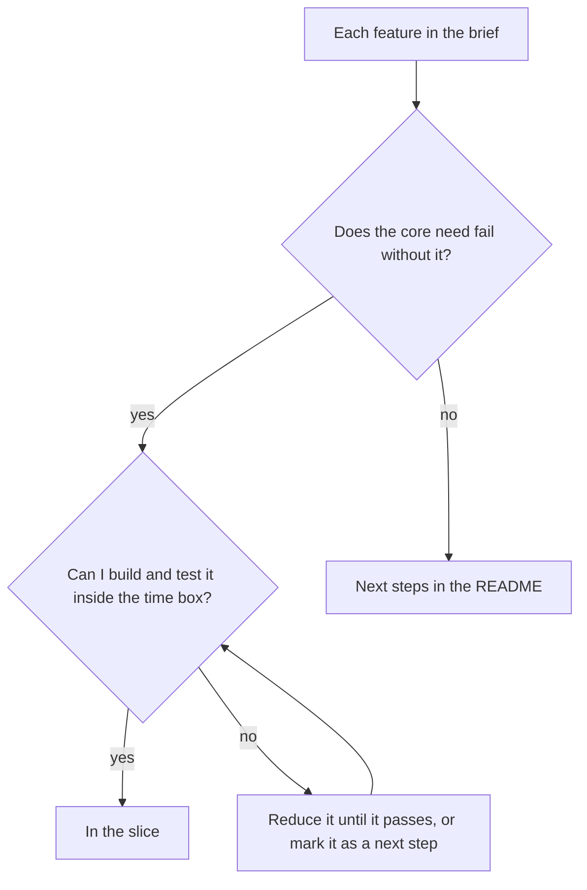

# Scoping the Brief

## Start with the everything slice

The Whitby Outdoor brief from [how take-homes are scored](/learn/fde-take-home/take-home-assignments/how-take-homes-are-scored) quotes the head of customer service:

> "We'd like a tool that reads each incoming email, looks up the order, drafts a reply in our tone of voice and sends it when it is confident. My team should see a dashboard of what came in."

The pack holds 150 anonymised emails, six policy pages and a file of 40 sample orders. The suggested time is four hours.

A candidate reads the quote as a feature list and starts on all five items at once. At the four-hour mark the order lookup works for some emails, the dashboard has two charts with test data, auto-send has no threshold, and no email goes from inbox to a correct draft. Every part has started and none is finished. Call this **the everything slice**: treating each line of the brief as a requirement, and ending with five partial features instead of one working path.

> **What you'll learn**
>
> - Read a brief for its ask, constraints, deliverables and hidden test.
> - Ask questions early, or record assumptions you can defend.
> - Cut the brief to one thin slice using two tests.
> - Budget the time box before you start building.

## Read the brief for four things

Read the brief three times before you plan. Each time, look for something different and write it down.

| What to find | Question to ask | Whitby Outdoor |
| --- | --- | --- |
| The ask | What does the user need to happen, in one sentence? | Customers get correct replies faster, with less agent typing. |
| The constraints | What limits the design? | Four hours, six policy pages, orders as a sample file, no live systems. |
| The deliverables | What exactly must I hand in? | Working code, a README, "evidence the drafts are good". |
| The hidden test | Which gap was left on purpose? | Auto-send. A wrong reply sent without review costs money and trust. |

*Table 1: Four things to find in any brief, applied to the Whitby Outdoor brief.*

The hidden test matters most. Briefs written as customer requests can contain one request that a careful engineer should push back on, or a constraint that rules out the obvious design. Here, "sends it when it is confident" is the trap. Nothing in the pack lets you measure confidence, so automatic sending cannot be justified in four hours.

## Ask, or write down your assumptions

Some teams let you email questions. Use it once, early, with three or four short questions that change your design. For Whitby: "May the tool send replies, or only draft them?" and "Which emails must always reach a person?"

If you cannot ask, or the answer does not arrive in time, decide and write the assumption down. Each assumption gets three parts.

| Assumption | Why I made it | What changes if it is wrong |
| --- | --- | --- |
| The tool drafts and an agent sends. | No way to measure confidence in four hours. | Add a review-rate threshold per email type after measuring. |
| Warranty claims and legal threats go to a person. | Wrong answers there cost the most. | Widen the drafted set once accuracy is measured. |
| Emails are English. | All 150 samples are English. | Detect language and route others to a person. |

*Table 2: An assumption log. Reviewers score a stated, reasoned assumption as judgement. An unstated one looks like a gap.*

This log goes into your README. It also gives you answers ready for the follow-up, when the interviewer asks "What if the customer wanted auto-send?"

## Cut to one thin slice

A thin slice is the smallest path from real input to useful output that a user could try. Run each feature through two tests, as Figure 1 shows.

*Figure 1: Two tests for every feature. Anything that fails either one becomes a named next step, not a half-built feature.*

For Whitby, the slice is: read an email, retrieve the relevant policy section, draft a reply that cites it, and flag the email for a person when it is a warranty claim, a legal threat or outside the policies. Order lookup passes the first test only for "where is my order?" emails, so a reduced version uses the sample orders file for those. The dashboard and auto-send fail the first test. Both become next steps, with one line each on how you would build them.

Two habits keep the slice honest.

- **Keep the evaluation in the slice.** Evidence the drafts are good is a deliverable, so it is in scope from the start.
- **Choose depth over breadth.** One path that handles awkward inputs well scores higher than three paths that handle only the happy case.

## Budget the hours before you build

Divide the time box before you write code, and write the plan down. For four hours, a split like this works.

| Block | Time | What it covers |
| --- | --- | --- |
| Scope | 20 minutes | Read three times, questions, assumption log, slice. |
| Build | 2 hours 15 minutes | The path end to end first, then the hand-off rules and citations. |
| Evaluate and fix | 45 minutes | Label 30 emails, run them, fix the worst failure. |
| Write up | 40 minutes | README, a short walkthrough recording, a clean-copy setup test. |

*Table 3: A four-hour budget. The blocks add up to 240 minutes. Write-up and evaluation get protected time.*

Set a checkpoint at the end of the second hour. If the path does not run from email to draft by then, cut further. Lesson 3, [building under the clock](/learn/fde-take-home/take-home-assignments/building-under-the-clock), covers what to cut at that checkpoint.

The walkthrough runs the whole scoping pass for the Whitby brief.

Scope the Whitby Outdoor brief in four steps. Each step shows what you do, what you write down and the mistake to avoid.

<button type="button" data-step="0" aria-pressed="false" aria-controls="scope-step-0">1. Read</button><button type="button" data-step="1" aria-pressed="false" aria-controls="scope-step-1">2. Ask</button><button type="button" data-step="2" aria-pressed="false" aria-controls="scope-step-2">3. Cut</button><button type="button" data-step="3" aria-pressed="false" aria-controls="scope-step-3">4. Budget</button>

<section id="scope-step-0" class="step-panel" aria-labelledby="scope-heading-0"><h4 id="scope-heading-0">1. Read for four things</h4><dl><dt>You do</dt><dd>Find the ask, the constraints, the deliverables and the hidden test.</dd><dt>You write</dt><dd>"Hidden test: auto-send. Nothing in the pack measures confidence."</dd><dt>Avoid</dt><dd>Turning each sentence of the quote into a feature.</dd></dl></section><section id="scope-step-1" class="step-panel" aria-labelledby="scope-heading-1"><h4 id="scope-heading-1">2. Ask or assume</h4><dl><dt>You do</dt><dd>Send three short questions, or log assumptions with reasons.</dd><dt>You write</dt><dd>"Assume draft only. If wrong, add a threshold per email type after measuring."</dd><dt>Avoid</dt><dd>Waiting a day for answers before starting.</dd></dl></section><section id="scope-step-2" class="step-panel" aria-labelledby="scope-heading-2"><h4 id="scope-heading-2">3. Cut to a thin slice</h4><dl><dt>You do</dt><dd>Run each feature through the two tests.</dd><dt>You write</dt><dd>"In: draft with citation, hand-off rules, evaluation. Next steps: dashboard, auto-send."</dd><dt>Avoid</dt><dd>Keeping a feature because it would impress.</dd></dl></section><section id="scope-step-3" class="step-panel" aria-labelledby="scope-heading-3"><h4 id="scope-heading-3">4. Budget the hours</h4><dl><dt>You do</dt><dd>Split the time box and set a checkpoint at two hours.</dd><dt>You write</dt><dd>"20 scope, 135 build, 45 evaluate, 40 write-up."</dd><dt>Avoid</dt><dd>Leaving the write-up for whatever time remains.</dd></dl></section>

<button type="button" data-walk="previous">Previous</button>

<button type="button" data-walk="next">Next step</button>

The walkthrough is a scripted illustration of one sound scoping pass, not the only one.

## Limits of this lesson

- **Scoping on an engagement.** Scoping a real customer project with stakeholders, baselines and estimates is taught in [shrinking to a first release](/learn/forward-deployed/scoping-an-fde-project/shrinking-to-a-first-release). A take-home compresses it into twenty minutes.
- **Very open briefs.** "Build something useful with this data" has no stated ask. Choose a user and a need, state them first, then apply the same tests.
- **Fictional data.** Whitby Outdoor and its brief are illustrative.

## Interview angle

Each answer is an outline to say in about a minute. Open each question and try it aloud before reading.

Interview question 1. The customer asked for automatic sending. You did not build it. Why not?

- **Answer:** Nothing in the pack let me measure when a draft is good enough to send unseen, and a wrong reply about refunds costs money and trust. I built drafting with citations and a 30-email evaluation instead. Auto-send is in next steps: measure how often agents change drafts per email type, then allow sending for a type only when changes fall below a threshold the customer sets.
- **Trade-off:** The customer's stated wish waits. Sending unmeasured replies risks a worse outcome than slower replies.
- **Follow-up to expect:** "The customer insists." Offer auto-send for one low-risk type, such as delivery-time questions, with a daily audit sample.

Interview question 2. What did you assume, and what happens if you were wrong?

- **Answer:** Three things: the tool drafts and a person sends, warranty claims and legal threats always go to a person, and emails are in English. Each is in the README with its reason and what would change. If the customer wants sending, I add a measured threshold. If other languages arrive, I detect them and route to a person until there is evidence the drafts hold up.
- **Trade-off:** Writing assumptions down takes ten minutes of the time box. It saves time in the follow-up and shows the reasoning.
- **Follow-up to expect:** "Which assumption is riskiest?" The hand-off list, because it decides which errors reach customers.

Interview question 3. The brief says only "build something useful with this support data". How do you scope it?

- **Answer:** Pick a user and a need first and state them, for example "agents spend time finding the right policy, so draft replies with citations". Then apply the two tests to each feature: does the need fail without it, and can I build and test it in the time box? Spend the first twenty minutes looking at the data to check the need is real.
- **Trade-off:** Choosing one user ignores others the team might have preferred. Stating the choice lets them judge it.
- **Follow-up to expect:** "Why that user?" Point to what the data showed, such as how many emails are policy questions.

## References

1. Malte Ubl, [Design docs at Google](https://www.industrialempathy.com/posts/design-docs-at-google/), accessed 17 November 2026. Goals and non-goals, the basis for naming what the slice leaves out.
2. Google Engineering Practices, [Small CLs](https://google.github.io/eng-practices/review/developer/small-cls.html), accessed 17 November 2026. One self-contained change at a time, the same idea as one working path.
3. The site's [problem, goal and definition of done](/learn/forward-deployed/scoping-an-fde-project/problem-goal-and-definition-of-done) and [judgement under uncertainty](/learn/fde-in-the-field/fde-role-and-boundaries/judgement-under-uncertainty) lessons.
4. The author's own experience writing and reviewing take-homes, the basis for the four things to read for and the time budget.

## Key takeaways

- Read the brief for the ask, the constraints, the deliverables and the hidden test.
- Ask a few questions early, or log each assumption with its reason and what changes if it is wrong.
- Cut every feature with two tests: does the core need fail without it, and can you build and test it in time?
- Keep evaluation inside the slice and choose depth over breadth.
- Budget the hours first, protect the write-up and set a checkpoint at two hours.

## Check yourself

1. What made the everything slice fail?

Each line of the quote became a feature, so five features started and none worked end to end. No email went from inbox to a correct draft.

2. Why is auto-send the hidden test in the Whitby brief?

The pack gives no way to measure confidence, and a wrong reply sent unseen costs money and trust. A careful engineer pushes back on it.

3. What goes into each line of an assumption log?

The assumption, why you made it and what changes if it is wrong.

