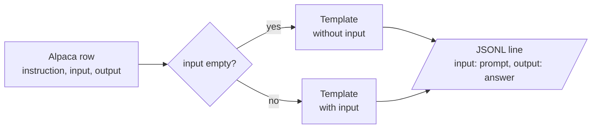

<!-- Generated by site/scripts/rag-theory-import.mjs from rag-agents-engineering. Edit the source there. -->
# Instruction tuning

<!-- subtitle: A prompt template turns each request and response into training text, and the serving prompt has to match that text exactly -->

## Instruction tuning

> **What you'll learn**
>
> - **Explain** what instruction tuning teaches a base model, and why the lesson is a pattern rather than a set of facts.
> - **Trace** an Alpaca row through a prompt template into one line of training data.
> - **Diagnose** template drift, where the serving prompt no longer matches the training text.
> - **Apply** three rules that keep training and inference in step.

Lesson 2 of T14.1 stored each example as a prompt field and an answer field. What sits between and around those fields, the headers, blank lines and end marker, is the part this lesson is about. A Larkspur engineer who fine-tunes on rows that read `### Question:` … `### Answer:` and then serves the bare customer question gets answers that start mid-sentence, the same **format mismatch** the Llama 2 chat model showed in lesson 1 of T14.1 without its `[INST]` wrapper.

**Instruction tuning is fine-tuning on pairs of a request and a good response.** It is the first step that turned the base Llama 2 of lesson 1 of T14.1 into the chat model. What it teaches is a pattern: text shaped like a request is followed by text shaped like an answer, and then the answer ends.

The notebook streams the first five rows of `tatsu-lab/alpaca`, an instruction dataset where every row has three fields:

| Field | Holds | In the five rows shown |
|---|---|---|
| `instruction` | The request | Five different tasks |
| `input` | Optional context for the request | Empty in all five |
| `output` | The answer | One response per row |

*Table 1: The fields of an Alpaca row.*

A **prompt template** turns each row into training text, and the notebook keeps two. Both open with a one-sentence preamble and use `###` headers to mark the parts:

| Part of the template | With input | Without input |
|---|---|---|
| Preamble | "Below is an instruction that describes a task, paired with an input that provides further context. Write a response that appropriately completes the request." | "Below is an instruction that describes a task. Write a response that appropriately completes the request." |
| `### Instruction:` | The row's `instruction` | The row's `instruction` |
| `### Input:` | The row's `input` | Left out |
| `### Response:` | Where the answer begins | Where the answer begins |

*Table 2: The notebook's two Alpaca templates, part by part.*

Filling a template with a row's values is what the notebook calls **hydrating** the prompt. The row's `input` field picks the template:

*Figure 1: Hydrating an Alpaca row. All five rows in the notebook take the upper branch.*

The result is written to `alpaca_processed.jsonl` with one object per line: the hydrated prompt under `input` and the answer under `output`. The names collide with Alpaca's own `input` field: read them as "model input" and "model output". The same shape works for Larkspur:

| Larkspur field | Value |
|---|---|
| `instruction` | *Does a reboot change my server IP address?* |
| `input` | Empty, so the template without input applies |
| `output` | An answer that opens with *Yes* or *No* and states the policy in a sentence |

*Table 3: A Larkspur support exchange mapped onto the Alpaca fields (illustrative).*

The notebook ends by asking the same `lamini/lamini_docs` test question to two models with the same architecture and tokenizer: the base `EleutherAI/pythia-70m`, and `lamini/lamini_docs_finetuned`, which is pythia-70m after fine-tuning on that dataset. Any difference between the two answers comes from the training rows alone. The notebook ships without saved outputs; the two answers appear only when you run it.

A model trained on hydrated rows learns their exact characters, which makes the serving prompt part of the training contract.

## The template at inference

A model learns the exact surface form of its training text, and the prompt at inference has to match it. When it does not, we call it **template drift**: the training rows used one shape and the serving code sends another. Lesson 1 of T14.1 showed the cost on Llama 2, which finished the user's sentence ("on command.") before answering.

The T14.1 notebooks hold a quiet example. Lesson 4 of T14.1 builds `### Question:` / `### Answer:` prompts, but the `lamini/lamini_docs` copy that lesson 5 of T14.1 trains on carries none of them. In all 1,260 training rows, the decoded `input_ids` are the bare question followed immediately by the bare answer (`…from Lamini models?There are several metrics…`), with no separator and no end token. The inference helper then sends the bare question, which matches that training text, so the two stay consistent by accident.

Changing either side alone breaks that accident. The planted cases below each change one side:

| Training text | Serving prompt | What the model sees |
|---|---|---|
| Bare question + bare answer | Bare question | A match by accident: the answer follows directly |
| Bare question + bare answer | `### Question:` … `### Answer:` | Headers it never saw; template drift |
| `### Question:` … `### Answer:` + answer | Bare question | No cue that an answer should start; it may continue the question |
| Template + answer + end token | Same template | A clean start and a learned stop |

*Table 4: Planted template drift. Only the last row is a match by design.*

Three rules keep training and inference in step:

- **One template, in code, used by both.** Write the formatting function once and import it in the data script and the serving code.
- **Mark where the answer starts and where it ends.** A header such as `### Answer:` tells the model to start answering; an end token (`<|endoftext|>` for Pythia) tells it, and your decoder, that the answer is over.
- **Check the tokenized row, not the string.** Decode a few prepared rows before training; [the lab in lesson 4 of T14.1](/learn/fine-tuning-and-model-adaptation/fine-tuning-fundamentals/data-preparation#lesson-data-preparation) shows what to look for.

The end token is the rule the T14.1 data breaks, and it is the one with the loudest consequence. Lesson 4 of T14.1 shows where it has to be added, and lesson 6 of T14.1 shows what a model trained without it does.

## Run the notebooks

The code for this lesson is in these notebooks. Colab runs one in your browser: install the packages its first cell imports and set the API keys it reads. To run every notebook as written, clone the repository and use its uv environment.

| Notebook | GitHub | Colab |
|---|---|---|
| Instruction tuning lab | [Open on GitHub](https://github.com/Sourav692/rag-agents-engineering/blob/main/p13_fine_tuning/m45_fine_tuning_model_adaptation/mandatory/notebook/03_instruction_tuning/03a_instruction_tuning_lab.ipynb) | [Open in Colab](https://colab.research.google.com/github/Sourav692/rag-agents-engineering/blob/main/p13_fine_tuning/m45_fine_tuning_model_adaptation/mandatory/notebook/03_instruction_tuning/03a_instruction_tuning_lab.ipynb) |
| Instruction tuning lecture (optional) | [Open on GitHub](https://github.com/Sourav692/rag-agents-engineering/blob/main/p13_fine_tuning/m45_fine_tuning_model_adaptation/optional/notebook/03_instruction_tuning/03b_instruction_tuning_lecture.ipynb) | [Open in Colab](https://colab.research.google.com/github/Sourav692/rag-agents-engineering/blob/main/p13_fine_tuning/m45_fine_tuning_model_adaptation/optional/notebook/03_instruction_tuning/03b_instruction_tuning_lecture.ipynb) |

## Key Takeaways

- Instruction tuning trains on request and response pairs. A prompt template turns each row into training text, with a variant for rows that have no `input`.
- A model learns the exact surface form of its training text, and the inference prompt must match it. Changing the training format or the serving prompt alone causes template drift.
- Write one formatting function that the data script and the serving code both import, mark where the answer starts and ends, and decode a few tokenized rows before training.

## Check yourself

1. What pattern does instruction tuning teach a base model?

That text shaped like a request is followed by text shaped like an answer, and then the answer ends. It is fine-tuning on pairs of a request and a good response, and it was the first step that turned base Llama 2 into the chat model.

2. An Alpaca row has an empty input field. Which template does the notebook fill, and what does the output line look like?

The template without input, which has a shorter preamble and no `### Input:` block, filled with the row's `instruction`. The notebook writes one object per line to `alpaca_processed.jsonl`: the hydrated prompt as `input` and the answer as `output`. A Larkspur row has the same shape, with the customer's question as the instruction.

3. The lesson 5 of T14.1 model trained on the bare question followed by the bare answer. You add a ### Answer: header to the serving prompt only. What goes wrong?

Template drift: the model now sees headers it was never trained on. Training and inference matched only by accident, and changing either side alone breaks that. Keep one formatting function in code that both the data script and the serving code import, and mark where the answer starts and ends.

