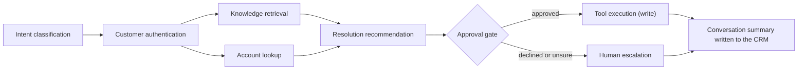

# Decomposing a Solution Into Workstreams

## Start with the box labelled "the AI"

Castlegate Retail, a fictional online retailer, approved a support assistant from a one-page plan. The plan had three boxes: the customer, "the AI" and the order system. The team estimated six weeks.

Week four showed what the middle box hid. Nobody owned customer authentication. Nobody had planned how a conversation summary reached the CRM. When the order system timed out, the assistant retried and issued the same refund twice, because no step checked whether the first call had already succeeded. Each gap was a component that was never drawn, so it never got an owner, an estimate or a test. Call this **the one-box design**: a plan that names the model and hides the work around it.

> **What you'll learn**
>
> - Break an AI workflow into components that follow the business process.
> - Separate read actions from write actions and place human gates between them.
> - Split a quality or latency complaint into layers that can be measured one at a time.
> - Classify a problem as knowledge, behaviour, freshness or permission before choosing a fix.

## Follow the workflow, not the model

Decomposition is not listing technologies. It is cutting the workflow into steps that each have one job, one owner and one way to fail. It starts only after [the discovery conversation](/learn/forward-deployed/customer-discovery/the-discovery-conversation) has fixed the user and the outcome.

Decompose along the path a request takes through the business. A customer-support agent shows the shape, in Figure 1.

*Figure 1: A customer-support agent decomposed along the business workflow. The model sits in intent classification, retrieval and the recommendation. The rest is integration, identity and record-keeping, and the write step sits behind a gate.*

The model appears in only some of those steps. Most of them are integration, identity and record-keeping work. A part that is not on the diagram never gets an owner or an estimate. So the decomposition is also the first draft of the work plan.

Document processing follows the same rule. A bank extracting data from millions of documents needs these parts:

- Ingestion, file validation and document classification.
- Optical character recognition (OCR) or multimodal extraction, with schema-constrained output.
- Confidence scoring and validation against business rules.
- Human review, correction feedback and audit storage.
- Reprocessing with model versioning.

Around those sit the operational questions: batch or online, idempotency, retries, data lineage and document-format drift.

## Separate reading from acting

Every component either reads something or changes something. Keep the two apart. A wrong read produces a bad draft. A wrong write issues a refund, restarts a service or updates a customer record.

The design principle for workflow agents is plain: assume the model will sometimes make the wrong decision, and design so the blast radius is limited. That turns into concrete parts:

- Tool schemas and read-versus-write separation.
- Idempotency, so a retry never acts twice.
- Approval gates and permissions.
- Timeouts, retries and a guard against non-termination.
- Observability, plus replay and recovery.

> **Warning:** A write-capable tool with no approval gate makes every model error a business error. Start read-only or assistive. Add write actions one at a time, behind a gate, once evaluation shows the read path is reliable.

## Split a complaint into layers

Decomposition is also how to debug. A complaint such as "answers are unreliable" or "responses are slow" covers several distinct failures. Each layer needs its own measurement.

For a RAG assistant with poor answers, separate seven failure layers: retrieval, context assembly, reasoning or synthesis, prompt or instruction, output format, evaluation, and user experience. Measure them separately:

- **Did the right passages come back?** Recall@k and precision@k.
- **Did they rank high?** Mean reciprocal rank (MRR) or normalised discounted cumulative gain (nDCG).
- **Was the answer sound?** Citation correctness, context sufficiency, answer faithfulness, answer relevance, abstention quality and end-to-end task success.

For a latency complaint, first ask which latency: time to first token, time between tokens, total completion time, or what the user perceives. Then split the path into client and network, authentication, middleware, retrieval, prompt construction, model prefill, token generation, tool calls, post-processing and streaming. Check token counts, retrieval p95 and p99, retry rates, rate-limit throttling, traffic patterns, model version, prompt changes, cache hit rates and regional routing.

## Name the kind of problem before the fix

"Would you fine-tune the model?" is a common follow-up. Classify the problem first, because each class has a different fix.

| What is going wrong | Kind of problem | Where the fix usually lives |
|---|---|---|
| The model does not know the fact | Knowledge | Retrieval or better data access |
| The model knows but behaves wrongly | Behaviour | Prompting, fine-tuning or structured output |
| The answer was right last month | Freshness | Indexing and the data pipeline |
| The user saw something they should not | Permission | Access-control-aware retrieval |

*Table 1: Four kinds of answer problem and where each fix lives.*

Fine-tuning addresses only the second row. Proposing it for the other three spends weeks on the wrong layer.

## Worked example: an agent across Salesforce, SAP, Jira and email

A customer wants an agent that reads incoming requests and acts across Salesforce, SAP, Jira and email. Decompose it before choosing a framework. The walkthrough builds the decomposition in four passes.

Decompose the cross-system agent one pass at a time. Each step shows what is added and the failure it prevents.

<button type="button" data-step="0" aria-pressed="false" aria-controls="agent-step-0">1. Intake</button><button type="button" data-step="1" aria-pressed="false" aria-controls="agent-step-1">2. Tools</button><button type="button" data-step="2" aria-pressed="false" aria-controls="agent-step-2">3. Safety</button><button type="button" data-step="3" aria-pressed="false" aria-controls="agent-step-3">4. Refund</button>

<section id="agent-step-0" class="step-panel" aria-labelledby="agent-heading-0"><h4 id="agent-heading-0">1. Read the request</h4><dl><dt>Added</dt><dd>Intent classification on each incoming request. Retrieved email content is treated as untrusted input.</dd><dt>Prevents</dt><dd>Prompt injection arriving inside an email and steering the agent.</dd></dl></section><section id="agent-step-1" class="step-panel" aria-labelledby="agent-heading-1"><h4 id="agent-heading-1">2. Turn each system into a tool</h4><dl><dt>Added</dt><dd>One tool with a schema per target system, each tagged read or write. The agent's progress is persisted state.</dd><dt>Prevents</dt><dd>Untyped calls, and a crash that forces a restart instead of a replay.</dd></dl></section><section id="agent-step-2" class="step-panel" aria-labelledby="agent-heading-2"><h4 id="agent-heading-2">3. Contain the writes</h4><dl><dt>Added</dt><dd>Approval gates and per-user permissions on write tools, idempotency on every write, timeouts, retries and a step limit, and a log of every tool call.</dd><dt>Prevents</dt><dd>Double actions on retry, a looping agent, and failures nobody can trace or replay.</dd></dl></section><section id="agent-step-3" class="step-panel" aria-labelledby="agent-heading-3"><h4 id="agent-heading-3">4. Answer the refund follow-up</h4><dl><dt>Question</dt><dd>"Should the agent issue a refund automatically?"</dd><dt>Answer</dt><dd>A refund is a write with money attached. It belongs behind a human approval gate until evaluation proves the read path and the policy check are reliable.</dd></dl></section>

<button type="button" data-walk="previous">Previous</button>

<button type="button" data-walk="next">Next step</button>

The refund answer came from the decomposition rather than from instinct. Step 3 had already placed every write behind a gate.

## Limits of this lesson

- **A decomposition is a draft.** Discovery and observation will move components, so revise it as facts arrive.
- **Metric names vary.** Retrieval and faithfulness metrics are defined differently across tools. Agree the definitions with the customer before reporting them.
- **Illustrative story.** Castlegate Retail is fictional.

## Interview angle

Each answer is an outline to say in about two minutes. Open each question and try it aloud before reading.

Interview question 1. Decompose an AI agent that handles customer-support requests end to end.

- **Answer:** Follow the request: intent classification, customer authentication, knowledge retrieval, account lookup, a resolution recommendation, tool execution, human escalation, and a summary written back to the CRM. Tag each tool read or write, gate the writes, and give each part an owner. Most parts are integration and identity work.
- **Trade-off:** A fine-grained decomposition takes longer to draw. A coarse one hides work that later blows the estimate.
- **Follow-up to expect:** "Where does the model sit?" In intent, retrieval and the recommendation only.

Interview question 2. The customer asks whether you would fine-tune the model to fix poor answers. How do you respond?

- **Answer:** Classify the problem first. A missing fact is knowledge, fixed in retrieval. A correct fact delivered wrongly is behaviour, where fine-tuning, prompting or structured output may help. A stale answer is freshness, fixed in indexing. A leaked answer is permission, fixed in access-aware retrieval.
- **Trade-off:** Fine-tuning can fix behaviour well but costs weeks and needs retraining as data changes.
- **Follow-up to expect:** "How do you tell knowledge from behaviour?" Check whether the right passage was retrieved before judging the answer.

Interview question 3. Users say the RAG assistant's answers are unreliable. Where do you start?

- **Answer:** Split the complaint into layers: retrieval, context assembly, synthesis, prompt, output format, evaluation and user experience. Measure retrieval first with recall@k and precision@k, then ranking with MRR or nDCG, then faithfulness, citation correctness and task success. Fix the first layer that fails.
- **Trade-off:** Layered measurement needs a labelled set. Without one, you are tuning prompts by feel.
- **Follow-up to expect:** "Retrieval looks fine." Move to context sufficiency and faithfulness.

Interview question 4. Latency doubled after a release. How do you decompose the problem?

- **Answer:** Ask which latency first: time to first token, time between tokens, total time or perceived time. Then split the path into client and network, authentication, middleware, retrieval, prompt construction, prefill, generation, tool calls, post-processing and streaming. Compare token counts, retrieval p95 and p99, retries, throttling, model version, prompt changes and cache hit rates.
- **Trade-off:** Tracing every hop costs set-up time. Guessing at the model usually misses a prompt that grew.
- **Follow-up to expect:** "Only some regions are slow." Check regional routing and rate limits.

## References

1. *FDE Problem Decomposition Question Bank* (the author's own question bank): cases 2 "Customer-Support Agent", 5 "Enterprise Document-Processing Platform", 6 "AI Agent for Enterprise Workflow Automation", 9 "Latency Regression in an LLM Application" and 10 "RAG System with Poor Answer Quality".
2. OWASP Gen AI Security Project, [LLM01: Prompt injection](https://genai.owasp.org/llmrisk/llm01-prompt-injection/), accessed 17 November 2026. Indirect prompt injection through external content such as websites or files, the risk behind treating retrieved email as untrusted.
3. The site's [success metrics and evaluation data](/learn/forward-deployed/customer-discovery/success-metrics-and-evaluation-data) lesson, for building the labelled set each layer needs.

## Key takeaways

- Decompose along the business workflow. Most parts are integration, identity and record-keeping, not the model.
- Keep read actions and write actions apart, and put write actions behind gates so model errors stay contained.
- Split any quality or latency complaint into layers and measure each layer on its own.
- Classify a problem as knowledge, behaviour, freshness or permission before proposing a fix.

## Check yourself

1. Why does a missing component on the decomposition diagram cause a delivery problem, not only a design problem?

A part that is not drawn gets no owner and no estimate. The decomposition is the first draft of the work plan.

2. A customer says their RAG assistant gives unreliable answers. What is the first thing to separate?

Whether the failure is in retrieval, context assembly, synthesis, the prompt, the output format, the evaluation or the user experience. Measure retrieval with recall@k and precision@k before touching the model.

3. When is fine-tuning the right fix?

When the problem is behaviour: the model has the knowledge but responds in the wrong way or format. Knowledge, freshness and permission problems are fixed in retrieval, the data pipeline or access control.

