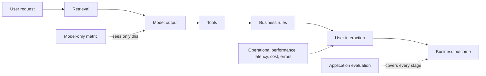

# Success Metrics and Evaluation Data

## Start with the score nobody felt

Marlow Freight, a logistics firm, called in an FDE to rescue a stalled pilot: an assistant that drafted replies to shipment queries. Every status update quoted the vendor's figure, a high score on a public question-answering benchmark. Six weeks in, the dispatchers had stopped opening the assistant. Replies arrived too slowly to use during a call, and answers about delayed shipments quoted an old tracking status. Call this **the borrowed score**: a quality number that measures the model on data the customer never sees.

> **What you'll learn**
>
> - Choose success metrics that measure a business outcome, not only model output.
> - Build an evaluation strategy when the customer has no way to measure quality.
> - Explain why an offline improvement can still feel like a regression to the customer.
> - Turn "safe enough for production" into measured comparisons.

## Measure the application, not the model

Accuracy is not a success metric until someone has said accurate at what, on which data, compared with whom. Define the metrics and the evaluation set during discovery, as soon as [the first use case](/learn/forward-deployed/customer-discovery/choosing-the-first-use-case) is chosen, because they decide what the decomposition must produce.

Model quality is not the same as application quality. A model can answer well while the application fails because retrieval missed the document, a tool call broke, a business rule was ignored, or the answer arrived too slowly to be useful.

So evaluate the complete workflow, as Figure 1 shows. Cover retrieval, tools, business rules, user interaction, operational performance and business outcomes.

*Figure 1: A model-only metric looks at one stage. Application evaluation covers retrieval, tools, business rules, user interaction, operational performance and the business outcome.*

A metric that stops at the model's output cannot see five of those six. At Marlow, the benchmark saw none of the failures. The FDE replaced it with two application measures the dispatchers recognised: time to a usable reply during a live call, and how often the quoted tracking status matched the carrier's current one. Both were failing. The second traced back to a retrieval index that refreshed only overnight.

## Pick metrics the customer would recognise

A useful success metric is one the customer already cares about. For a sales account-research assistant, six candidates fit: preparation-time reduction, brief accuracy, citation coverage, seller adoption, conversion improvement and meeting-quality improvement. Only two of them, accuracy and citation coverage, are about the AI's output. The other four are about whether people used it and whether the business moved.

A good practice drill asks for three measurable metrics per case. A balanced three covers quality, adoption and outcome. Brief accuracy, seller adoption and preparation time saved is one such set.

Pair any speed or cost target with a guardrail metric: one that must not get worse while the main one improves. "Handling time down 20%" is only a win if the resolution rate holds. Name the guardrail and its threshold up front, so a faster but worse system cannot count as success.

## Build the evaluation set before the pilot

A customer that "has no reliable way to measure quality" needs an evaluation strategy before it needs a model. The full list falls into four groups:

| What is needed | What it consists of |
|---|---|
| Data that looks like production | A representative production dataset, golden examples, ground-truth labels |
| A way to grade it | Task-specific rubrics, automated graders, human evaluation, a calibrated LLM-as-judge |
| Coverage of the risky cases | Safety and refusal tests, regression tests, slice-based analysis |
| Signal after launch | Online metrics, user feedback, statistical confidence, continuous evaluation in CI/CD |

*Table 1: The four parts of an evaluation strategy.*

When there is no labelled data, build it rather than skip it. Sample production traffic, have experts label it, use weak supervision, add synthetic examples carefully, measure how often graders agree, and send the difficult cases to human review.

Some outputs have no single right answer. For call summaries, use a rubric-based human assessment, action-item precision and recall, factual consistency, coverage of required fields, CRM update accuracy, user-edit distance and downstream task completion. Each turns "is this a good summary?" into something countable.

> **Warning:** An uncalibrated LLM-as-judge is a second untested model. Measure its agreement with human graders before trusting its scores, or a regression can hide behind a judge that agrees with itself.

## Read a regression by segment

Evaluation also settles disputes after launch. Suppose the customer says quality fell after switching to a newer model. The diagnostic plan:

1. Collect before-and-after production examples and replay a fixed evaluation set.
2. Segment by task, language, customer and input size.
3. Compare structured-output compliance, prompt compatibility, retrieval changes, latency and token usage.
4. Run human evaluation and calibrate any LLM judge.
5. Roll back or pin the model version, and A/B test future upgrades.

The harder follow-up: "the offline benchmark improved, but the customer still says quality declined." Several explanations fit:

- The benchmark may not represent production traffic.
- One customer segment may have regressed while the average rose.
- Retrieval may have changed.
- The experience may have become slower.
- Structured output may be less reliable.
- Important edge cases may have worsened.
- Users may be judging task completion rather than answer quality.

An average hides every one of these, which is why slice-based analysis belongs in the strategy from the start.

## Worked example: proving a claims assistant is safe enough

An insurer wants to automate claims processing from documents, emails and historical claims. The follow-up is "How would you prove that the system is safe enough for production?" The walkthrough builds the proof in four steps.

Turn "safe enough" into evidence for the claims assistant. Each step shows what you decide and why.

<button type="button" data-step="0" aria-pressed="false" aria-controls="claims-step-0">1. Narrow</button><button type="button" data-step="1" aria-pressed="false" aria-controls="claims-step-1">2. Compare</button><button type="button" data-step="2" aria-pressed="false" aria-controls="claims-step-2">3. Threshold</button><button type="button" data-step="3" aria-pressed="false" aria-controls="claims-step-3">4. Roll out</button>

<section id="claims-step-0" class="step-panel" aria-labelledby="claims-heading-0"><h4 id="claims-heading-0">1. Narrow what is being proved</h4><dl><dt>Decide</dt><dd>Do not promise full automation. Begin with extraction, triage, summarisation and missing-information detection.</dd><dt>Why</dt><dd>A narrower claim needs less evidence and puts less at risk.</dd></dl></section><section id="claims-step-1" class="step-panel" aria-labelledby="claims-heading-1"><h4 id="claims-heading-1">2. Compare with past human decisions</h4><dl><dt>Decide</dt><dd>Evaluate against past human decisions on real claims, and report results by claim type.</dd><dt>Why</dt><dd>A model that is safe for simple claims may not be safe for complex ones.</dd></dl></section><section id="claims-step-2" class="step-panel" aria-labelledby="claims-heading-2"><h4 id="claims-heading-2">3. Set thresholds and keep the trail</h4><dl><dt>Decide</dt><dd>Set human review thresholds on confidence. Keep explainability and an audit trail.</dd><dt>Why</dt><dd>Regulators will ask why a claim was routed, and low-confidence cases need a person.</dd></dl></section><section id="claims-step-3" class="step-panel" aria-labelledby="claims-heading-3"><h4 id="claims-heading-3">4. Roll out by claim type</h4><dl><dt>Decide</dt><dd>Roll out gradually, one claim type at a time.</dd><dt>Why</dt><dd>Automated adjudication comes later, only after the evidence and governance exist.</dd></dl></section>

<button type="button" data-walk="previous">Previous</button>

<button type="button" data-walk="next">Next step</button>

"Safe enough" became a set of measured comparisons against the human baseline, per segment, with a threshold below which a person decides.

## Limits of this lesson

- **Metrics need a baseline.** If the customer never measured the current process, the first work is measuring it.
- **Graders disagree.** Human labels carry noise too. Report agreement alongside scores.
- **Composite engagement.** Marlow Freight is illustrative, not a real customer.

## Interview angle

Each answer is an outline to say in about two minutes. Open each question and try it aloud before reading.

Interview question 1. How would you define success for an assistant that prepares sales account briefs?

- **Answer:** Pick three metrics the customer already cares about, one each for quality, adoption and outcome: brief accuracy, seller adoption and preparation time saved. Keep citation coverage, conversion and meeting quality as secondary measures. Agree the baseline before the pilot.
- **Trade-off:** Outcome metrics such as conversion move slowly and have many causes. Quality metrics move fast but do not prove value.
- **Follow-up to expect:** "Sellers say briefs are fine but do not use them." Adoption is the failing metric, so investigate the workflow.

Interview question 2. The customer has no way to measure answer quality. What do you build?

- **Answer:** An evaluation strategy before a model. Sample production traffic, have experts label it, write task rubrics, add synthetic cases carefully, and calibrate any LLM judge against the human labels. Add safety, regression and slice tests, then online metrics and user feedback after launch.
- **Trade-off:** Expert labelling costs time from busy people. Skipping it means no one can say whether a change helped.
- **Follow-up to expect:** "How many examples?" Enough per important segment to show a difference with statistical confidence, not one total for the whole set.

Interview question 3. After a model upgrade the offline benchmark improved, but the customer says quality fell. Explain how both can be true.

- **Answer:** The benchmark may not match production traffic, or one segment regressed while the average rose. Retrieval may have changed, responses may be slower, structured output may be less reliable, or users may judge task completion. I replay a fixed set, segment the results and pin the old version while investigating.
- **Trade-off:** Pinning the old model keeps users happy but delays the upgrade's gains.
- **Follow-up to expect:** "How do you stop this next time?" A/B test upgrades on segmented evaluation before release.

Interview question 4. How would you prove an insurer's claims assistant is safe enough for production?

- **Answer:** Narrow the claim to extraction, triage, summarisation and missing-information detection. Compare outputs with past human decisions per claim type. Set confidence thresholds for human review, keep an audit trail, and roll out one claim type at a time.
- **Trade-off:** Gradual rollout delays savings on complex claims. Full automation on day one risks regulatory findings.
- **Follow-up to expect:** "When can it adjudicate?" Only once the per-segment evidence and governance exist.

## References

1. *FDE Problem Decomposition Question Bank* (the author's own question bank): cases 3 "Claims-Processing Assistant", 4 "AI-Powered Sales or Account-Research Assistant", 8 "The Model Got Worse After an Upgrade", 11 "Build an Evaluation Strategy for an AI Application" and 15 "AI Assistant for Sales or Customer-Service Calls", and "Recommended Preparation Plan".
2. Zheng et al., [Judging LLM-as-a-Judge with MT-Bench and Chatbot Arena](https://arxiv.org/abs/2306.05685), arXiv 2306.05685, accessed 17 November 2026. Measuring how often an LLM judge agrees with human preferences, and the biases it shows.
3. The site's [choosing the first use case](/learn/forward-deployed/customer-discovery/choosing-the-first-use-case) lesson, which picks the use case these metrics measure.

## Key takeaways

- Model quality is not application quality. Evaluate retrieval, tools, rules, interaction, operations and outcomes.
- Choose success metrics the customer already cares about, balancing quality, adoption and business outcome.
- Build the evaluation set before the pilot, and create labels when none exist.
- Read regressions by segment, because an improved average can hide a worse slice.

## Check yourself

1. A team reports high answer accuracy on a benchmark. Why is that not yet a success metric?

It measures the model's output only. It says nothing about retrieval, tools, business rules, speed, adoption or whether the business outcome moved.

2. The customer has no labelled data. Name three ways to build an evaluation set.

Sample production traffic and have experts label it, use weak supervision, and add synthetic examples carefully. Measure grader agreement and send hard cases to human review.

3. The offline benchmark improved after a model upgrade, yet users say it got worse. Give two explanations.

The benchmark does not represent production traffic, or one segment regressed while the average rose. Slower responses or less reliable structured output are other candidates.

