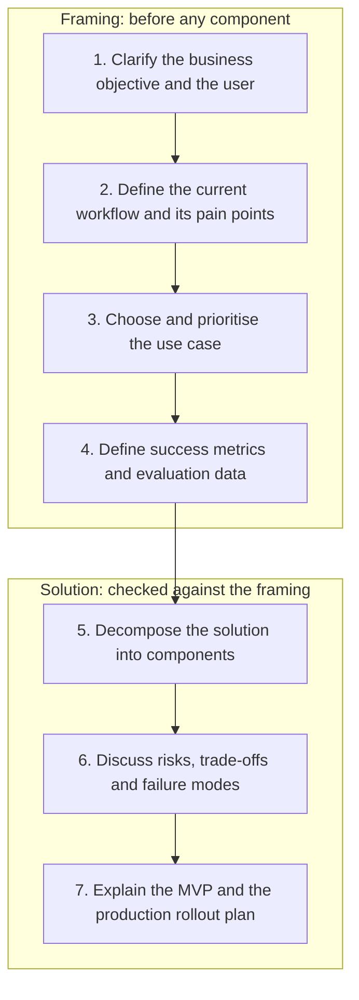

# The Discovery Conversation

## Start with the diagram drawn at the kickoff

A regional insurer's head of customer service opens the kickoff with one line: "We want AI to improve support." The FDE, keen to show momentum, has a retrieval index, an agent and three tools on the whiteboard before the coffee is cold. Three weeks later the sponsor asks how they will know in three months whether it worked. Nobody can answer, because nobody asked who handles the tickets, which ones take longest, or whether the goal was deflection, speed or quality. Call this **the premature diagram**: a design drawn before anyone agreed what it was for.

A decomposition round replays this meeting in 45 minutes, and interviewers score the same mistake.

> **What you'll learn**
>
> - Open any decomposition case with a short, reusable framing statement.
> - Ask the five families of questions that change the design: business, constraint, evaluation, architecture and rollout.
> - Name the signals an interviewer listens for.
> - Recognise the common mistakes that lose the round.

## Start from the prompt as given

The interview version of that kickoff is a one-line prompt: "A large enterprise wants to use AI to improve customer support. How would you approach it?" It is not an invitation to draw a retrieval-augmented generation (RAG) diagram. It tests whether you can turn an ambiguous ask into a user, an outcome and a set of constraints before proposing anything. Like the sponsor's line, it says nothing about who the user is, what is slow today, or how anyone would know the project worked.

A design cannot be judged against an outcome nobody stated. So the round is scored on the order of work as much as on the answer. The question bank this module draws on recommends seven steps, shown in Figure 1.

*Figure 1: The seven steps of a decomposition round. The solution first appears at step five, after four framing steps that make it checkable.*

The solution does not appear until step five. The four framing steps come first, and they are what make the later steps checkable.

## Open with one framing sentence

Say what will happen before doing it. One reusable opening fits almost every case:

- Clarify the business outcome, the primary user, the current workflow, the constraints and how success will be measured.
- Make assumptions explicit where information is missing.
- Then decompose into use-case selection, data and integrations, the AI workflow, evaluation, production architecture and rollout.

That sentence buys time without looking evasive. It also tells the interviewer the shape of the next 40 minutes, so they can steer early instead of interrupting late.

## Ask the questions that change the design

A clarifying question is only worth asking if its answer changes something. The questions fall into five families, and each family settles a different part of the design.

| What is still unknown | Questions to ask |
|---|---|
| Who benefits, and from what? (business) | Who is the user? What decision or task should improve? What is the current process? What does the problem cost today? Is the aim automation, assistance, speed, quality or revenue? |
| What limits the design? (constraints) | What latency is acceptable? What volume and concurrency are expected? What data is available, and how fresh must it be? What privacy, security and regulatory rules apply? What may the system do on its own? |
| How will anyone know it works? (evaluation) | What counts as a correct answer or a successful task? Are there historical examples or labels? What is the human baseline? Which errors are tolerable, and which must escalate? |
| What has to be built? (architecture) | What are the inputs? What processing is needed? Where do retrieval, models, tools and business rules fit? What state must persist? How is the system monitored and rolled back? |
| How does it reach users safely? (rollout) | What is the lowest-risk MVP? Which users or workflows get the pilot? What gates must pass before expansion? How will adoption and business impact be measured? |

*Table 1: The five families of clarifying questions and the part of the design each one settles.*

Five questions are usually enough to start. Pick the ones whose answers would move the design most, and state an assumption for the rest.

> **Warning:** "I would use RAG and agents" is the most common losing opening. It names a technology before naming a user or an outcome. Every later choice then has nothing to be measured against, and the interviewer marks the answer as solution-first.

## Listen for what the interviewer is scoring

Public guidance on decomposition interviews emphasises a set of signals. Read them as a checklist of behaviours, not topics:

- Clarifying before solving.
- Finding the real user and the business outcome.
- Splitting the problem into clean workstreams.
- Making assumptions explicit.
- Defining measurable success.
- Naming risks and failure modes.
- Discussing trade-offs instead of asserting one best design.
- Moving from prototype to production.
- Communicating clearly while the problem changes.

Only one of the nine is about the architecture itself. The rest are about judgement and communication.

## Avoid the ten common mistakes

The list of common mistakes mirrors the signals, and each mistake skips one kind of step:

- **Framing skipped.** Starting with "RAG and agents", never asking who the user is, and treating automation as the goal.
- **Risk skipped.** Ignoring permissions and data governance, discussing accuracy with no evaluation defined, and designing only the happy path.
- **Rollout skipped.** Forgetting human escalation, ignoring latency and cost, and treating a prototype as a production system.

The tenth mistake sums up the rest: an impressive technical answer that never connects to business impact.

## Worked example: opening the customer-support prompt

Take the support prompt from the opening story. The switcher compares the two ways the first two minutes can go.

The same customer-support prompt, opened two ways. Compare what each opening fixes before any component is drawn.

<button type="button" data-mode="solution-first" aria-pressed="false" aria-controls="solution-first-result">Solution-first opening</button>
<button type="button" data-mode="framed" aria-pressed="false" aria-controls="framed-result">Framed opening</button>

<section id="solution-first-result" class="mode-panel" data-announcement="Solution-first opening selected. Nothing is fixed."><h4>Solution-first opening</h4>
"I'd use RAG over the knowledge base with an agent that can call the ticketing and account tools."
<ul><li>User: unknown.</li><li>Success measure: unknown.</li><li>Action boundary: unknown, so the agent may write to accounts.</li></ul>
Result: every later component is a guess, and the interviewer cannot judge any of it.
</section>
<section id="framed-result" class="mode-panel" data-announcement="Framed opening selected. User, measure and boundary are fixed."><h4>Framed opening</h4>
"Before proposing anything, I'd like to pin down the outcome and the user. Who handles these tickets today, and which ticket types take the most time? Is the goal to deflect tickets, speed up agents, or improve quality? What data can a system read: a knowledge base, past tickets, account records? Can it act on accounts, or only draft replies? And how would we know in three months that it worked: handling time, resolution rate, satisfaction?"

For anything unanswered: "I'll assume agents stay in the loop and the system starts read-only."

Result: the user, the success measure and the action boundary are fixed, and each later component can be judged against them.
</section>

In a real engagement the framed questions are only the start. The next lesson, [observing the work](/learn/forward-deployed/customer-discovery/observing-the-work), covers what no meeting shows you.

## Tell the decomposition round from the design round

Many FDE loops also include an AI system design round, and the two overlap. Decomposition asks what to solve and how to break it down. System design asks how to build and run the solution once the problem is fixed. Company names for the rounds vary, so read Table 2 as a preparation guide, not a rubric.

| | Decomposition round | AI system design round |
|---|---|---|
| Main question | What should we solve, and how do we break it down? | How should we build and operate it? |
| Typical starting point | A vague customer problem | A defined product or capability, often with a scale |
| Main focus | Users, workflows, outcome, available data, constraints, scope | Architecture, data flow, models, retrieval, tools, storage, serving |
| Decisions you explain | Which problem matters, whether AI helps at all, what the MVP holds | Retrieval or fine-tuning, fixed workflow or agent, how to meet quality, latency and cost targets |
| Expected output | A scoped first version, workstreams, an initial technical approach, success criteria | An end-to-end design, component contracts, trade-offs, failure handling, evaluation and rollout |
| Common weak answer | "Let's build a RAG chatbot" before the user is known | Boxes on a whiteboard with no behaviour, bottleneck or failure explained |

*Table 2: The two rounds compared. A design round still opens with requirements, and a decomposition round still needs technical depth.*

The customer-support prompt shows the difference. As a decomposition prompt it reads "Our support team is overwhelmed. How could AI help?" The framed opening above finds the user and outcome. A good close then names the first version and its parts: "I'd start with policy lookup and reply drafting for delivery tickets, as a copilot that agents approve. It breaks into ticket classification, permission-aware retrieval, draft generation and agent review. Success is lower handling time with no drop in resolution rate."

As a design prompt the same case reads "Design that support copilot for 5,000 agents." The problem is now given, and the time goes on how the parts behave together:

- how policy documents are ingested, versioned, indexed and filtered by permission;
- how one request retrieves policies and fetches the current order;
- how the model is chosen and its context is built;
- what happens on low retrieval confidence, conflicting policies or an order API timeout;
- how concurrency, latency, token use and cost stay within budget;
- how answer quality is evaluated, failures are traced and changes are released.

Practise both openings until each is automatic.

- **Decomposition:** "Before choosing a solution, I want to understand whose workflow is failing, what outcome matters and what data we can reach."
- **System design:** "I'll confirm the requirements and scale, draw the end-to-end architecture, then work through the highest-risk quality and operational trade-offs."

Decomposition still includes technical reasoning. Once the first version is named, an interviewer may push into the data model, an API contract or the retrieval method. Be ready to go one level down on any workstream you named. The design round's method is in [the twelve-part design framework](/learn/ai-systems-design/design-framework/the-twelve-part-design-framework).

## Limits of this lesson

- **Interviews are not engagements.** A real discovery runs over days with many people. The round compresses it into minutes, so you state assumptions where a customer would give answers.
- **The question families are a starting set.** Regulated or physical-world customers add their own constraints.
- **Illustrative story.** The insurer in the opening is a composite of several engagements, not a real customer.

## Interview angle

Each answer is an outline to say in about two minutes. Open each question and try it aloud before reading.

Interview question 1. You are given a one-sentence prompt about using AI in customer support. What do you do in the first two minutes?

- **Answer:** Say the plan in one sentence: clarify the outcome, user, workflow, constraints and success measure, state assumptions, then decompose. Ask four or five questions that would change the design, such as who handles the tickets, which types take longest, whether the goal is deflection or speed, and whether the system may act on accounts. State an assumption for the rest.
- **Trade-off:** Questions cost minutes in a 45-minute round. Skipping them costs the whole design, because nothing can be checked.
- **Follow-up to expect:** "Skip the questions and give me an architecture." Give a sketch under stated assumptions, and name the one question that would change it most.

Interview question 2. The interviewer declines to answer your clarifying question. How do you continue?

- **Answer:** Replace the question with a stated assumption and carry on, for example "I'll assume the system starts read-only and agents stay in the loop." Say what would change if the assumption were wrong, so the interviewer sees the decision point.
- **Trade-off:** Assumptions keep momentum but can lock in a wrong path. Naming the reversal point keeps the design open.
- **Follow-up to expect:** "Now assume it can write to accounts." Add approval gates and per-user permissions before any write.

Interview question 3. You may only ask five clarifying questions. How do you choose them?

- **Answer:** Take one from each family where the answer moves the design: the user and the cost of the problem, what the system may do on its own, the human baseline, what state must persist, and which users get the pilot. Drop any question whose answer would not change a component.
- **Trade-off:** One per family gives breadth. A case dominated by one risk, such as regulation, may deserve two constraint questions.
- **Follow-up to expect:** "Which one matters most?" The user and outcome, because every other answer is judged against it.

Interview question 4. What do you think the interviewer is scoring in a decomposition round?

- **Answer:** Mostly judgement and communication. Clarifying before solving, finding the user and outcome, splitting into clean workstreams, explicit assumptions, measurable success, risks, trade-offs, the path from prototype to production, and clear communication as the problem shifts. Only one of those is the architecture itself.
- **Trade-off:** Over-investing in framing can leave too little time for the design. Keep framing to the first ten minutes.
- **Follow-up to expect:** "What loses the round?" An impressive technical answer with no link to business impact.

Interview question 5. How does a decomposition round differ from an AI system design round on the same problem?

- **Answer:** Decomposition starts from a vague problem and ends with a scoped first version: the user, the outcome, the workstreams and the success measure. System design starts from that defined product, often with a scale such as 5,000 agents, and ends with an end-to-end architecture: data flow, retrieval, model and context, failure handling, cost and latency, evaluation and release. Open each differently: decomposition with whose workflow is failing, design with requirements and scale.
- **Trade-off:** Treating a design round as decomposition spends the time on questions the prompt already answered. Treating decomposition as design builds a system for a problem nobody confirmed.
- **Follow-up to expect:** "In decomposition, how would the retrieval work?" Go one level down: the sources, the permission filter and how you would test retrieval on its own.

## References

1. *FDE Problem Decomposition Question Bank* (the author's own question bank): "How the Round Typically Feels", "What the Interviewer Is Evaluating", "Reusable Answer Template" and "Biggest Mistakes to Avoid".
2. The site's [observing the work](/learn/forward-deployed/customer-discovery/observing-the-work) lesson, for what interviews miss once a real engagement starts.
3. The author's own field experience, the basis for the opening story.

## Key takeaways

- Decomposition rounds score the order of work: four framing steps come before any component.
- One framing sentence tells the interviewer the plan and buys time to think.
- Ask business, constraint, evaluation, architecture and rollout questions, and only the ones whose answers change the design.
- Most interviewer signals are about judgement and communication, not architecture.
- The common mistakes each skip a framing, risk or rollout step.
- Decomposition fixes the problem and a buildable first version. System design shows how that version behaves at scale and when it fails.

## Check yourself

1. Why is "I would use RAG and agents" a weak opening even when RAG is the right answer?

It names a technology before a user or an outcome exists. Nothing later can be judged against a goal, so the answer reads as solution-first.

2. Name one question from each of the five families.

Business: who is the user? Constraint: what may the system do on its own? Evaluation: what is the human baseline? Architecture: what state must persist? Rollout: which users get the pilot?

3. What should happen to a clarifying question the interviewer declines to answer?

Replace it with a stated assumption, such as "I'll assume the system starts read-only", and carry on.

