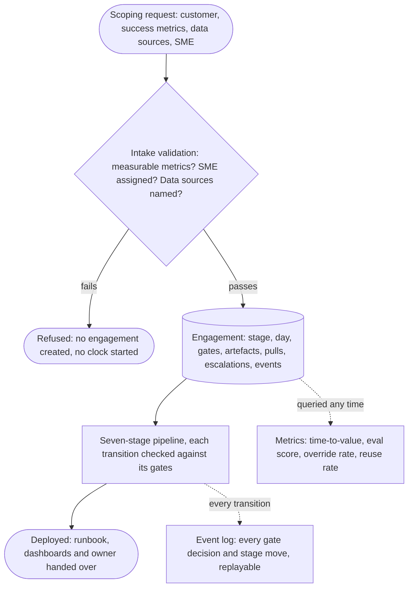
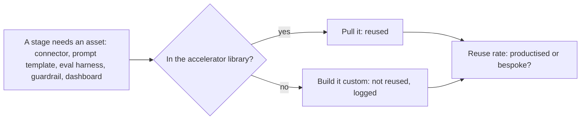

# Delivery as a Repeatable Process

## Start with the second customer

An FDE delivered a support agent for a first customer in twelve days, working evenings with one other engineer, writing three connectors from scratch and hand-tuning every prompt. The sponsor was delighted, and sales promised the same two weeks to the next customer. The second customer had a different ticketing tool and a different knowledge base, and nothing from the first build fitted without rework. The same two engineers were still supporting the first customer. Day 14 passed with the connectors half written and no agreed success metric. Call this **the heroic first delivery**: a schedule met once by effort, and promised again as if it were a process.

> **What you'll learn**
>
> - Restate the two-week delivery problem as an operating-model design question.
> - Lay out the seven stages, their day ranges and the fact that must be true to leave each.
> - Explain why intake refuses rather than warns.
> - Show how the accelerator library and the reuse rate make two weeks achievable.

## Design the assembly line, not the agent

The prompt comes from the DevRev interview preparation guide: design a delivery framework that takes a customer from a scoping doc to a deployed AI agent in under two weeks. In plain terms, a new customer arrives on day 0 with a rough page of what they want. By day 14 a real agent must be live in production for them. And it must get there the same reliable way every time, not through a fresh round of heroics per customer.

This is a process and operating-model problem, not a software architecture problem. The instinct "there is nothing to build, it is a process diagram" is wrong. The prep guide asks for an answer as a system with inputs, stages, artefacts, gates and metrics. A system with stages and gates is a state machine, and a state machine is code. The repository's delivery framework treats it with the same discipline as the RAG (retrieval-augmented generation) and agent-platform designs.

## Make speed a side effect of reuse

"Work faster" is the trap. So is "hire more people". Two weeks is possible only if most of the work existed before the customer showed up. If every engagement writes connectors, prompt templates and guardrail policies from a blank page, two weeks is a wish, not a schedule.

So the real test is whether speed can be a side effect of reuse and hard gates. Every good answer stacks two questions:

- **How is two weeks achievable for a different customer each time?** Through a library of reusable assets, such as connectors, prompt templates, tool definitions and guardrail policies, that most of each stage is assembled from.
- **How is each stage known to be safe to leave, not merely finished on time?** Through gates: named, checkable conditions signed off by the right role, never by the person closest to the work approving their own progress.

A weak answer draws seven boxes, scoping to data to build to test to launch, and stops. That is a checklist, and checklists get skipped under deadline pressure. A strong answer spends its time on what is reused versus bespoke at each stage, and on the checkable fact that must hold before the next stage may start.

## Walk the fourteen days

| Days | Stage | What must be true to leave it |
|---|---|---|
| 1–2 | Scoping and qualification | Success metrics are written down and measurable; a named customer SME (subject-matter expert) is assigned; the security review has started. Without a measurable metric or an SME, the engagement does not start |
| 3–4 | Data readiness | Sources are connected; access is live and verified, not merely requested |
| 5–7 | Configure, do not code | The agent is assembled from the accelerator library and configured for this customer; reuse versus bespoke is decided here |
| 8–9 | Evaluate and iterate | A golden set exists, the customer's SME has signed off that it is representative, and the measured baseline clears the bar |
| 10–11 | Shadow mode | The agent sees real traffic and decides what it would do, but takes no action; humans compare its answers with their own |
| 12–13 | Limited production | The agent acts for real with a human approving each action, and a rollback path has been tested, not just documented |
| 14 | Go/no-go and handover | The metric written on day 1 was met; only then are a runbook, dashboards and a named owner handed over |

*Table 1: The seven stages of the two-week delivery and the checkable fact that ends each.*

The order is not optional. Each stage feeds the next. Configuration cannot use data that is not connected. Evaluation cannot use a golden set nobody signed off. Limited production cannot start without a tested way to undo it.

Shadow mode and limited production form a two-step trust ladder. Shadow mode watches and decides without acting. Limited production acts with a human approving. Both exist for one reason: a system's first real action should never also be the first time nobody is watching.

## Refuse at intake rather than start a bad clock

Intake checks three things: measurable success metrics, an assigned SME and named data sources. If any check fails, intake refuses outright. No engagement record is created and no clock starts. Figure 1 shows the flow.

*Figure 1: Intake refuses before any clock starts. One engagement record carries the state through every stage.*

A two-week clock started against a goal nobody can measure is worse than no clock at all. It is the delivery equivalent of refusing to index a document that has no usable access-control list.

The engagement record is the single piece of state threaded through every stage. Metrics are computed from its history on demand. The event log records every gate attempt, stage move, escalation and asset pull, allowed or denied.

> **Warning: a warning at intake becomes a two-week argument at go/no-go.** If the success metric cannot be measured on day 1, it cannot be judged met on day 14. Refuse, and say which input is missing.

## Pull from the library before building

Every stage's real work is "get this asset", not "invent it". When a stage needs a connector, prompt template, evaluation harness, guardrail or dashboard, it checks the accelerator library first, as Figure 2 shows.

*Figure 2: Every asset request is either a pull or a logged custom build. Both feed the reuse rate.*

Pulling is the normal case. It costs nothing extra. Building custom is the exception, and each one is logged, because a rising count of custom builds is the early signal that two weeks is about to slip. The reuse rate, reused pulls over total pulls, turns "we mostly reuse the library" from a claim into a number.

## Worked example: the Northwind Logistics engagement

Northwind Logistics wants a tier-1 support triage agent over Zendesk, Confluence and Salesforce. At intake, two success metrics are agreed in writing:

- first-response time under 5 minutes on the top three ticket categories;
- zero-edit sends on 60% of eligible tickets by week 4.

Both can be measured from ticket timestamps and edit history, so intake accepts.

Days 1–2 assign the SME and start the security review. Days 3–4 connect the three systems. Days 5–7 pull five of the six needed assets from the library, and one guardrail policy is built custom, giving a reuse rate of 83% (5 of 6). Days 8–9 build and sign off the golden set and measure the baseline. Days 10–11 run in shadow. Days 12–13 act with approval and a tested rollback. Day 14 checks the two metrics against the numbers written on day 1.

The schedule held because almost everything was assembled. Every stage boundary was a fact. None was a date.

## Limits of this lesson

- **Proven types only.** The library speeds up the tenth customer of a known type. A new type of agent needs more bespoke work and a longer schedule.
- **Day ranges are a plan.** The fourteen days are the framework's target, not a promise. Some engagements should not be two weeks.
- **Composite engagement.** The two customers in the opening, Northwind Logistics and their figures are illustrative, not real customers.

## Interview angle

Each answer is an outline to say in about two minutes. Open each question and try it aloud before reading.

Interview question 1. Your first two-week delivery succeeded through overtime. Sales now promise two weeks to every customer. What do you change?

- **Answer:** Turn the first delivery into assets. Extract the connectors, prompt templates, guardrails and dashboards into a library, then define the seven stages with a checkable exit fact each. Add intake checks so no clock starts without a measurable metric, an SME and named sources. Track the reuse rate so you can see whether the next delivery is assembled or rebuilt.
- **Trade-off:** Building the library slows the second delivery. Skipping it makes every delivery heroic.
- **Follow-up to expect:** "Which asset first?" The one every customer of this type needs, usually the main connector.

Interview question 2. Why run shadow mode before limited production instead of going straight to human-approved actions?

- **Answer:** Shadow mode shows what the agent would do on real traffic with no risk, so humans compare its decisions with their own. Limited production then lets it act with a human approving each action and a tested rollback. The ladder means the agent's first real action is never the first time nobody is watching.
- **Trade-off:** Two days of shadow cost schedule. Skipping them finds the first wrong decision in a customer's live system.
- **Follow-up to expect:** "What would stop you leaving shadow?" Disagreement with humans above an agreed rate on a category.

Interview question 3. A customer wants to start today but cannot say how success will be measured. What do you do?

- **Answer:** Refuse at intake and say which input is missing. Offer a short session to turn their goal into a number they can measure from data they already have, such as timestamps or edit history. Start the clock only when the metric, the SME and the data sources are named.
- **Trade-off:** Refusing feels unhelpful on day 0. Starting a clock against an unmeasurable goal produces an argument on day 14.
- **Follow-up to expect:** "Their executive insists." Then the exception needs its own sign-off in writing, never a silent bypass.

Interview question 4. How would you show a leader that delivery is getting more repeatable over a year?

- **Answer:** Show the reuse rate per engagement over time, alongside the count of custom builds and the days each engagement took. A rising reuse rate with steady or falling duration shows the library is working. A rising custom-build count is the early warning that dates will slip.
- **Trade-off:** One metric can be gamed by calling everything an asset. Pair it with duration and quality at handover.
- **Follow-up to expect:** "Which custom builds should join the library?" The ones built more than once.

## References

1. Martin Fowler, [Dark Launching](https://martinfowler.com/bliki/DarkLaunching.html), accessed 18 November 2026. Running a new feature on real traffic without the user seeing it, the idea behind shadow mode.
2. Wikipedia, [Phase–gate model](https://en.wikipedia.org/wiki/Phase%E2%80%93gate_model), accessed 18 November 2026. Stages separated by decision gates.
3. Sources in this repository, the author's own material: *Theory* (Part A and §B.1–B.2), *Architecture End to End* (§1 and §3), overview, interview script (the Northwind case study) and *Scoping to Production in Two Weeks* (all sections).
4. The problem prompt is from the DevRev interview preparation guide. Its framing is summarised in our own words.

## Key takeaways

- The two-week prompt is an operating-model question: design the assembly line, not the agent.
- Speed is a side effect of a reusable accelerator library and hard, role-gated checkpoints.
- Seven stages run in a fixed order, each left only when a checkable fact holds. Shadow mode and limited production form a trust ladder.
- Intake refuses unmeasurable, SME-less or source-less requests before any clock starts.
- Track the reuse rate. A rising custom-build count is the early sign the date will slip.

## Check yourself

1. Why is "work faster" the trap in the two-week prompt?

Two weeks is repeatable only if most of each stage already exists in a reusable library. Working faster depends on heroics and fails on the next customer.

2. What is the difference between shadow mode and limited production?

Shadow mode sees real traffic and decides without acting, while humans compare. Limited production acts for real, with a human approving and a tested rollback.

3. Why does intake refuse rather than warn?

A clock started against an unmeasurable goal cannot reach a meaningful go/no-go. Refusing on day 0 is cheaper than discovering it on day 14.

