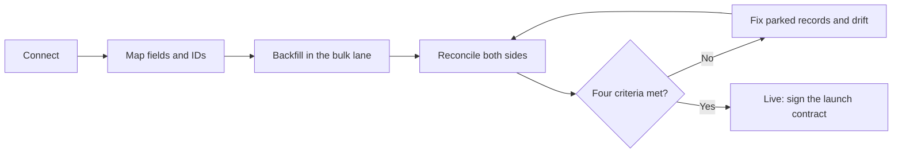

# Onboarding a New Customer Integration

## Start with the launch with no finish line

Lydford Housing, a housing association with 24,000 homes, signed up for a repairs integration that copies repair jobs from its housing system to the platform its contractors schedule from, and the vendor's FDE ran the onboarding. The go-live date was fixed in the contract, so the FDE switched on live sync that morning. The backfill of 10,200 open jobs was 60% done, nobody had compared the two systems, and alerts went to the engineer who built the connector, who moved to another customer the next week. Lydford's IT team assumed the vendor owned the integration, and the vendor assumed Lydford did. Three weeks later a tenant reported a leak that had never been booked, and Lydford found 4,080 open jobs the contractors could not see. The backfill had stopped at a record with a missing postcode, and its alert had gone to an inbox nobody read. Call this **the launch with no finish line**: an integration declared live on a date, with no agreed test of whether it was finished.

> **What you'll learn**
>
> - The onboarding sequence for a new customer integration.
> - The four completion criteria that decide when it is live.
> - What a launch contract holds, and why it is written before go-live.
> - How to make the second and tenth onboarding faster than the first.

## Onboarding is a sequence, not a date

Each new customer of an integration goes through the same steps. The order matters, because each step produces evidence the next one needs.

The walkthrough shows the sequence for Lydford as it should have run.

Lydford Housing connects its housing system to the contractors' scheduling platform. Each step shows the work and the evidence it leaves.

<button type="button" data-step="0" aria-pressed="false" aria-controls="onboard-step-0">1. Connect</button><button type="button" data-step="1" aria-pressed="false" aria-controls="onboard-step-1">2. Map</button><button type="button" data-step="2" aria-pressed="false" aria-controls="onboard-step-2">3. Backfill</button><button type="button" data-step="3" aria-pressed="false" aria-controls="onboard-step-3">4. Reconcile</button><button type="button" data-step="4" aria-pressed="false" aria-controls="onboard-step-4">5. Go live</button>

<section id="onboard-step-0" class="step-panel" aria-labelledby="onboard-heading-0"><h4 id="onboard-heading-0">1. Connect with the right credential</h4><dl><dt>Work</dt><dd>Lydford's administrator grants access with the narrowest scopes. The team checks the granted scopes against what each feature needs.</dd><dt>Evidence</dt><dd>A connection record with granted scopes and an audit entry.</dd></dl></section><section id="onboard-step-1" class="step-panel" aria-labelledby="onboard-heading-1"><h4 id="onboard-heading-1">2. Map fields and identifiers</h4><dl><dt>Work</dt><dd>Agree which fields move in which direction, how job IDs map and what happens to records that fail validation.</dd><dt>Evidence</dt><dd>A signed field map and ten real records traced end to end in a test environment.</dd></dl></section><section id="onboard-step-2" class="step-panel" aria-labelledby="onboard-heading-2"><h4 id="onboard-heading-2">3. Backfill in its own lane</h4><dl><dt>Work</dt><dd>Load the 10,200 open jobs through the bulk lane, so a slow backfill cannot delay live traffic. Failed records go to a dead-letter queue with a reason.</dd><dt>Evidence</dt><dd>Count loaded plus count parked equals count in the source.</dd></dl></section><section id="onboard-step-3" class="step-panel" aria-labelledby="onboard-heading-3"><h4 id="onboard-heading-3">4. Reconcile both sides</h4><dl><dt>Work</dt><dd>Compare counts and checksums of open jobs per estate. Fix each parked record with Lydford, such as the missing postcodes.</dd><dt>Evidence</dt><dd>Drift under the agreed threshold on three consecutive days.</dd></dl></section><section id="onboard-step-4" class="step-panel" aria-labelledby="onboard-heading-4"><h4 id="onboard-heading-4">5. Go live and hand over</h4><dl><dt>Work</dt><dd>Wire the alerts to the owning rota and fire a test alert. Name the owners on both sides. Sign the launch contract.</dd><dt>Evidence</dt><dd>A received test alert, named owners and a signed contract.</dd></dl></section>

<button type="button" data-walk="previous">Previous</button>

<button type="button" data-walk="next">Next step</button>

The walkthrough is a scripted illustration. Three of its steps have deeper lessons elsewhere: [connecting a customer's account with OAuth](/learn/production-ai/security-tenancy-prompt-injection/connecting-a-customers-account-with-oauth) for step 1, the lanes section of [capacity, latency and cost at scale](/learn/production-ai/scaling-and-reliability/capacity-latency-and-cost-at-scale) for step 3, and the integration alerts in [production monitoring](/learn/production-ai/observability-and-diagnosis/production-monitoring-metrics-drift-and-slos) for step 5.

Live sync can start in shadow during step 4: it writes to a staging copy, and reconciliation compares that copy with the source as well. The switch to writing for real waits for the completion criteria.

## Four completion criteria

An integration is live when four facts are true, each with evidence. Until then it is in onboarding, whatever the calendar says.

| Criterion | Evidence | Who confirms it |
| --- | --- | --- |
| Backfill finished | Loaded plus parked equals source count, and every parked record has a reason and an owner | Integration engineer |
| Reconciliation clean | Drift below the agreed threshold for three consecutive daily runs | Customer's data owner |
| Alerts wired | The four integration alerts route to the owning rota, and a test alert was received and acknowledged | Owning team's on-call lead |
| Owner named | A named team and person on each side, with deputies, written in the launch contract | Customer sponsor and your delivery lead |

*Table 1: Completion criteria for a customer integration. Each row is checked with evidence, not asserted.*

These criteria work like the [role-gated stage gates](/learn/forward-deployed/delivery-stages-and-gates/role-gated-stage-gates) of a delivery. Each has evidence behind it and a signer with the right role. A senior person cannot wave one through, and the delivery lead cannot confirm the customer's reconciliation.

The four are deliberately few. A longer list gets skipped under deadline pressure. These are the four whose absence caused Lydford's incident: an unfinished backfill, no comparison, alerts to nobody and no owner.

*Figure 1: The onboarding sequence. The loop between reconciliation and the criteria is where onboarding spends most of its time.*

The trade-off is a later go-live. Lydford's contract named a date, and the criteria might not be met by it. Say so early. A two-week delay agreed in advance costs less trust than 4,080 missing repair jobs found by a tenant. If the date cannot move, go live for a subset, such as one estate whose reconciliation is clean, and write the rest into the plan.

## The launch contract

A **launch contract** is a short document, one or two pages, that both sides sign when an integration goes live. It records the promises the integration makes and who keeps them. It is not the commercial contract. It sits under it and is written by the engineers and owners who run the integration.

| Section | What it says for Lydford |
| --- | --- |
| Scope | Repair jobs and completion notes, the fields in each direction, and what is out of scope |
| Freshness | New jobs reach contractors within 15 minutes during working hours |
| Volumes and limits | Expected 400 new jobs a day, the partner's rate limit and what happens above it |
| Errors | Which errors each side fixes, where parked records appear and the reply time for each |
| Owners and support | Named owners and deputies, support hours and the escalation path |
| Change notice | Notice periods for schema changes, credential rotation and maintenance |
| Exit | How to disconnect, and what happens to data already copied |

*Table 2: Sections of a launch contract, with Lydford's entries.*

Writing it before go-live is the point. Each section is a question that otherwise gets answered during an incident, by whoever is awake. "Who fixes a job with no postcode?" is easy to agree in a meeting and hard to agree at 07:00 with tenants waiting.

The trade-off is negotiation time. Agreeing freshness and error ownership can take a week with a large customer. Keep a template, so most sections start filled in and only the customer's specific numbers need agreement.

## Make the next onboarding faster

The first customer integration is a project. The tenth should be a routine. Three habits turn one into the other.

- **Keep a runbook per integration type.** The sequence, the queries for backfill counts and reconciliation, the alert definitions and the launch contract template.
- **Measure time to live.** Record the date each step finished for every customer. The step that takes longest is where to invest next, often field mapping or parked-record fixes.
- **Feed problems back to the product.** If every customer's backfill parks records for the same validation rule, change the rule or the product, not the runbook.

The [handover and ownership](/learn/forward-deployed/delivery-stages-and-gates/handover-and-ownership) lesson covers handing the whole system to its operating team. Onboarding is the smaller, repeated version: handing one customer's integration to its owners.

## Limits of this lesson

- **One-way feeds are simpler.** An integration that only reads may not need a launch contract as long as this one, but it still needs the four criteria.
- **Thresholds are judgement.** The right drift threshold and number of clean days depend on what a mismatch costs the customer.
- **Composite engagement.** Lydford Housing, its systems and figures are illustrative, not a real customer.

## Interview angle

Each answer is an outline to say in about two minutes. Open the question and try it aloud before reading.

Interview question 1. How do you decide that a new customer's integration is ready to go live?

- **Answer:** Four criteria, each with evidence and a signer. The backfill is finished: loaded plus parked equals the source count, and every parked record has an owner. Reconciliation is clean: drift below the agreed threshold for three daily runs, confirmed by the customer's data owner. Alerts are wired: routed to the owning rota and proven with a test alert. Owners are named on both sides, with deputies. Until all four hold, the integration is in onboarding, whatever the date.
- **Trade-off:** Go-live can slip past the contract date. Agree the delay early, or go live for a subset that already meets the criteria.
- **Follow-up to expect:** "The sponsor insists on the date." Offer the subset, and write down which risks the sponsor accepts for the rest.
- **Go deeper:** [Role-gated stage gates](/learn/forward-deployed/delivery-stages-and-gates/role-gated-stage-gates).

Interview question 2. What would you put in a launch contract for a two-way integration, and why write it before go-live?

- **Answer:** Scope and field directions, the freshness promise, expected volumes and rate limits, which side fixes which errors and where parked records appear, named owners and support hours, notice periods for schema changes and credential rotation, and how to exit. Writing it first turns questions that would otherwise be argued during an incident into decisions made calmly, by the people who own them.
- **Trade-off:** It can take a week with a large customer. A template keeps that to the customer-specific numbers.
- **Follow-up to expect:** "Is this the commercial contract?" No. It sits under it and is written by the people who run the integration.

## References

1. Google, [Reliable product launches at scale](https://sre.google/sre-book/reliable-product-launches/), Site Reliability Engineering, accessed 18 November 2026. Launch checklists, and making launches repeatable.
2. Microsoft, [Priority Queue pattern](https://learn.microsoft.com/en-us/azure/architecture/patterns/priority-queue), Azure architecture guidance, accessed 18 November 2026. Keeping bulk work from delaying urgent work.
3. The author's own field experience, the basis for the four completion criteria and the launch contract.

## Key takeaways

- Onboard each customer integration through a fixed sequence: connect, map, backfill, reconcile, go live.
- An integration is live when the backfill is finished, reconciliation is clean, alerts are wired and owners are named.
- Each criterion needs evidence and a signer with the right role.
- A launch contract records scope, freshness, volumes, error ownership, owners, change notice and exit, and is signed before go-live.
- Keep a runbook and measure time to live, so the tenth onboarding is routine.

## Check yourself

1. Which of the four completion criteria would have caught Lydford's missing jobs first?

Backfill finished. Loaded plus parked would not have equalled the source count, because the backfill stopped on go-live morning. Reconciliation would have caught it too, a day later.

2. Why does the customer's data owner, not your delivery lead, confirm reconciliation?

The data owner knows what a correct record looks like and accepts the risk of any mismatch. The delivery lead has an interest in going live, so the confirmation would carry less weight.

3. The contract date arrives and reconciliation is still not clean. What are your options?

Agree a short delay, or go live for a subset whose reconciliation is clean and plan the rest. Either way, write down the decision and who accepted the risk.

