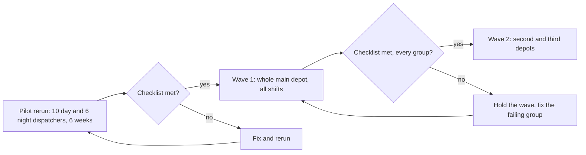

# Pilots That Predict Production

## Start with the ten friendly dispatchers

Caverly Logistics, a fictional parcel carrier, asked an FDE team for an assistant that drafts the fix for a failed delivery: a wrong address, a closed business, a damaged parcel. Dispatchers handled about 1,200 of these exceptions a day across three depots.

The team ran a three-week pilot with ten day-shift dispatchers at the main depot. All ten had volunteered. Median handling time fell from 9 minutes to 5. The dispatchers liked the tool, and the sponsor approved a rollout to all three depots, day and night shifts, about 60 people.

Two weeks later the operations director called a meeting. Exceptions reopened within a week had risen from 6% to 14%. The night shift, mostly agency staff, had stopped using the tool. Nobody had measured reopened exceptions in the pilot, and nobody from the night shift had taken part.

The pilot had answered the question "can keen people use this?" The sponsor had heard "will this work for everyone?" Call this **the friendly-room pilot**: a pilot whose users and measures were chosen, without meaning to, so that it would succeed.

> **What you'll learn**
>
> - Tell a proof of concept, a prototype, a pilot and production apart by the question each answers.
> - Choose pilot users and a duration that predict production.
> - Score a pilot on technical, adoption and business rows.
> - Expand from a few users to several departments with a checklist.

## Four stages, four questions

Teams use these words loosely. A sponsor who hears "pilot" expects a production decision, while an engineer may mean a demo on real data. Name each stage by the question it answers.

| Stage | Question it answers | Who takes part | Typical length | Exit evidence |
| --- | --- | --- | --- | --- |
| Proof of concept | Can this work at all? | FDE and one domain expert | Days to two weeks | A feasibility result on sample data |
| Prototype | Can users do the task with it? | A few friendly users | Two to six weeks | Task completion and usability notes |
| Pilot | Will it work for the real population, in real work? | A representative group, including the hardest users | Four to eight weeks, at least one business cycle | A scorecard against a baseline |
| Production | Does it keep working for everyone, run by its owners? | Everyone in scope | Ongoing | Service levels and outcome metrics |

*Table 1: Four stages by the question each answers. The lengths are planning ranges, not rules.*

A proof of concept may be fragile, and a prototype may be manual behind the scenes. A pilot runs on real work. It needs a fallback, support and an owner for incidents. Production adds the owning team, monitoring and a handover.

Who signs each gate is covered in [role-gated stage gates](/learn/forward-deployed/delivery-stages-and-gates/role-gated-stage-gates). This lesson covers what the pilot must show.

## Who takes part and how long it runs

A pilot predicts production only if its users and its conditions look like production. Volunteers are keen, skilled and forgiving. Real users include the busy, the sceptical and the new.

Choose pilot users on four points.

- **Cover every critical group.** Each shift, site, role and skill level that will use the tool. At Caverly that meant the night shift and the agency staff.
- **Include the hardest cases.** The users with the worst data, the oddest exceptions or the oldest equipment.
- **Mix the willing and the doubtful.** Keen users show the ceiling. Doubtful users show what adoption will look like.
- **Keep a comparison group.** Similar users doing the same work the old way, measured the same way.

Run the pilot for at least one full business cycle. It should meet month-end, a peak day or a holiday surge. Run it long enough for novelty to fade. People who know they are being watched often work differently for a while, which researchers call the Hawthorne effect.

Agree before the pilot starts which results mean expand, fix and rerun, or stop. Thresholds written down first cannot drift once the numbers arrive.

## A scorecard with three rows

A single number cannot tell you whether a pilot worked. Score it on three rows, each with its own question:

- **Technical:** does the system work? Availability, response time, error rate, quality on an evaluation set.
- **Adoption:** do people use it in their real work? Share of eligible cases handled through the tool, by group, and whether use holds after week two.
- **Business:** did the outcome the project was funded for improve, with no hidden cost? The target metric against the baseline, plus guard metrics such as rework, complaints and escalations.

Guard metrics catch speed that comes from skipping steps. The switcher re-reads Caverly's pilot one row at a time.

Caverly's three-week pilot: ten volunteer day-shift dispatchers at one depot. Pick a row of the scorecard to see what it shows.

<button type="button" data-mode="technical" aria-pressed="false" aria-controls="technical-result">Technical</button>
<button type="button" data-mode="adoption" aria-pressed="false" aria-controls="adoption-result">Adoption</button>
<button type="button" data-mode="business" aria-pressed="false" aria-controls="business-result">Business</button>

<section id="technical-result" class="mode-panel" data-announcement="Technical row selected. The system worked."><h4>Technical</h4><ul><li>Available 99.6% of working hours.</li><li>Drafts appeared within 3 seconds for 95% of exceptions.</li><li>A draft was produced for 97% of exceptions.</li></ul>
Green. The system works for the cases it saw.
</section>
<section id="adoption-result" class="mode-panel" data-announcement="Adoption row selected. Strong use, but only by volunteers."><h4>Adoption</h4><ul><li>All ten volunteers used it daily, for 88% of their exceptions.</li><li>No night-shift, agency or second-depot dispatcher took part.</li><li>Use by those groups is unknown, not zero and not high.</li></ul>
Green for the group tested, silent for most of the real population.
</section>
<section id="business-result" class="mode-panel" data-announcement="Business row selected. Faster, but rework more than doubled."><h4>Business</h4><ul><li>Median handling time fell from 9 to 5 minutes.</li><li>Exceptions reopened within a week rose from 6% to 14%, when measured afterwards.</li><li>At about 20 minutes per reopened case, the net saving was 2.4 minutes per exception, not 4.</li></ul>
Amber. Faster, but 8 more customers in every 100 got a second failed delivery.
</section>

The business row's arithmetic, per 100 exceptions: before, 100 × 9 minutes plus 6 reopened × 20 minutes is 1,020 minutes. After, 100 × 5 plus 14 × 20 is 780 minutes. The saving is 240 minutes, 2.4 minutes per exception.

A pilot that is faster but adds rework is not a success to expand. Find where the rework comes from. At Caverly, the drafts trusted the address on the label instead of the corrected address in the customer system. Fix that, rerun, and expand only when the guard metric is back near its baseline.

The opposite pattern also appears: a technically accurate tool that few people use. That is an adoption failure, diagnosed with the site's [diagnosing low adoption](/learn/forward-deployed/adoption-and-impact/diagnosing-low-adoption) lesson, not with more model work.

## When one group keeps failing

Averages hide groups. If the night shift fails while the day shift succeeds, the pilot average looks acceptable and the night shift still fails. Split every scorecard row by group: shift, site, role, case type.

When a critical group keeps failing, treat it as a design input:

1. **Find the difference.** Caverly's night shift handled overnight exceptions such as closed depots and missed trunk connections. The tool had seen almost none of them. Agency staff also got their logins late and were trained during the day.
2. **Decide with the sponsor.** Fix the tool or the process for that group, keep that group on the old way with a stated reason, or pause the expansion. Never leave the group failing quietly.
3. **Write a rule.** No expansion while a critical group sits below its agreed threshold.

A group is critical when the work cannot be done without it or when failure there causes harm. One night shift handling a third of the exceptions is critical. One user who prefers the old screen is not.

## From ten users to several departments

Several departments differ from ten cooperative users in more than headcount. The new users did not choose the tool. Their data, case mix and local rules differ, support requests grow, and integrations meet volumes the pilot never sent.

Expand in waves, with a check between each. Figure 1 shows the plan Caverly adopted after the meeting.

*Figure 1: Expansion in waves. Each wave starts only when the checklist holds for every group in the wave before it.*

The expansion checklist below is the check between waves.

| Area | The question to answer before the next wave |
| --- | --- |
| Scorecard | Are all three rows at their thresholds for every critical group? |
| Guard metrics | Are rework, complaints and escalations within agreed limits? |
| Support | Can the support team absorb the next wave's requests, with named people? |
| Training | Is training ready for each new role and shift, at times they work? |
| Local differences | Have the new sites' rules, data and case mix been checked? |
| Capacity | Have integrations and the system been tested at the next wave's volume? |
| Way back | Is there a tested way to return each new site to the old process? |
| Owner | Does each new department have a named owner for the tool? |

*Table 2: The expansion checklist. Each line has a named person who confirms it.*

The site's [rolling out with a way back](/learn/forward-deployed/adoption-and-impact/rolling-out-with-a-way-back) lesson covers the rollback side of each wave.

## Limits of this lesson

- **Ranges, not rules.** Stage lengths and thresholds depend on the work. A weekly process needs a longer pilot than an hourly one.
- **Comparison groups are imperfect.** Two depots never match exactly. Report the differences with the result.
- **Fictional data.** Caverly Logistics and its figures are illustrative.

## Interview angle

Each answer is an outline to say in about two minutes. Open each question and try it aloud before reading.

Interview question 1. A customer calls their working prototype "the pilot". Why does the label matter, and what must be true before something is a pilot or production?

- **Answer:** Each label promises a different decision. A prototype shows users can do the task. A pilot shows the tool works for representative users in real work, against a baseline, with a fallback and support. Production means everyone in scope uses it and the owning team runs it with monitoring. Calling a prototype a pilot invites a production decision on weak evidence.
- **Trade-off:** Strict labels slow the story to the sponsor. Loose labels lead to rollouts the evidence never supported.
- **Follow-up to expect:** "Who decides it moves on?" A named signer per gate, against criteria agreed before the stage began.

Interview question 2. How do you define technical, adoption and business success for an AI deployment?

- **Answer:** Technical: the system is available, fast and accurate enough on an agreed evaluation set. Adoption: the intended users use it for most eligible cases, by group, and keep using it after the first weeks. Business: the funded metric moves against a baseline, and guard metrics such as rework and complaints stay within limits. Set thresholds for all three before the pilot.
- **Trade-off:** Three rows take more measurement. One row lets a fast but harmful tool look like a win.
- **Follow-up to expect:** "Technical is green and business is flat. Now what?" Check adoption first, then whether the tool reaches the step that drives the outcome.

Interview question 3. Compare a proof of concept, a prototype, a pilot and production.

- **Answer:** A proof of concept asks whether it can work, on sample data, in days. A prototype asks whether users can do the task with it, with a few friendly users, over weeks. A pilot asks whether it works for the real population in real work, with representative users and a baseline, over at least one business cycle. Production asks whether it keeps working for everyone, run by its owners.
- **Trade-off:** Skipping a stage saves weeks and moves its risk into the next, more expensive one.
- **Follow-up to expect:** "Can you skip the prototype?" Sometimes, when the workflow barely changes. Never skip the pilot for a workflow change.

Interview question 4. The executive committee loved the demo and the chief executive wants it company-wide next month. What do you do?

- **Answer:** Turn enthusiasm into a plan with dates. Explain that the demo answered "can it work", not "will it work for everyone". Propose a short pilot with representative users and a scorecard, then waves with a checklist between each. Offer a date for the first wave, so the answer is "yes, in this order", not "no".
- **Trade-off:** A staged plan disappoints at first. A rushed company-wide launch that fails costs the programme its credibility.
- **Follow-up to expect:** "They insist on the date." Agree the date for a defined first wave, and put the risks of going wider in writing.

Interview question 5. Ten cooperative users love the tool. Now three departments want it. How do you expand?

- **Answer:** Treat the ten as a prototype result, not a pilot. Pick representative users from each department, including the hardest group, and rerun with a baseline. Then expand in waves, one department or site at a time, with a checklist between waves: scorecard by group, guard metrics, support capacity, training, local rules, volume tests, a way back and a named owner.
- **Trade-off:** Waves take longer than a single launch. A single launch finds every local difference at once, in production.
- **Follow-up to expect:** "One department's process differs." Check whether the tool fits it before that wave, or configure for it.

## References

1. Google SRE, [Canarying releases](https://sre.google/workbook/canarying-releases/), accessed 17 November 2026. Exposing a change to a small subset of the population and comparing it with a control.
2. Wikipedia, [Hawthorne effect](https://en.wikipedia.org/wiki/Hawthorne_effect), accessed 17 November 2026. Behaviour changing when people know they are observed.
3. The site's [role-gated stage gates](/learn/forward-deployed/delivery-stages-and-gates/role-gated-stage-gates) and [diagnosing low adoption](/learn/forward-deployed/adoption-and-impact/diagnosing-low-adoption) lessons.
4. The author's own field experience, the basis for the pilot design rules and the expansion checklist.

## Key takeaways

- Name each stage by its question: can it work, can users do the task, will it work for everyone, does it keep working.
- Choose pilot users who look like production, including the hardest group, and run at least one business cycle.
- Score technical, adoption and business rows, with guard metrics such as rework.
- Split results by group. A failing critical group blocks expansion until it is fixed or excluded by decision.
- Expand in waves, with a checklist and a named owner for each wave.

## Check yourself

1. Caverly's handling time fell by 4 minutes. Why was the real saving 2.4 minutes per exception?

Reopened exceptions rose from 6 to 14 per 100, at about 20 minutes each. That added 160 minutes per 100 exceptions, cutting the 400-minute saving to 240.

2. Why is a pilot made of volunteers a weak predictor of production?

Volunteers are keen, skilled and forgiving. Production users include busy, doubtful and new people, other shifts and harder cases, so adoption and quality usually fall.

3. What turns a failing user group from noise into a blocker?

Being critical: the work cannot be done without that group, or failure there causes harm. Then expansion waits until it is fixed or the sponsor decides to exclude it.

