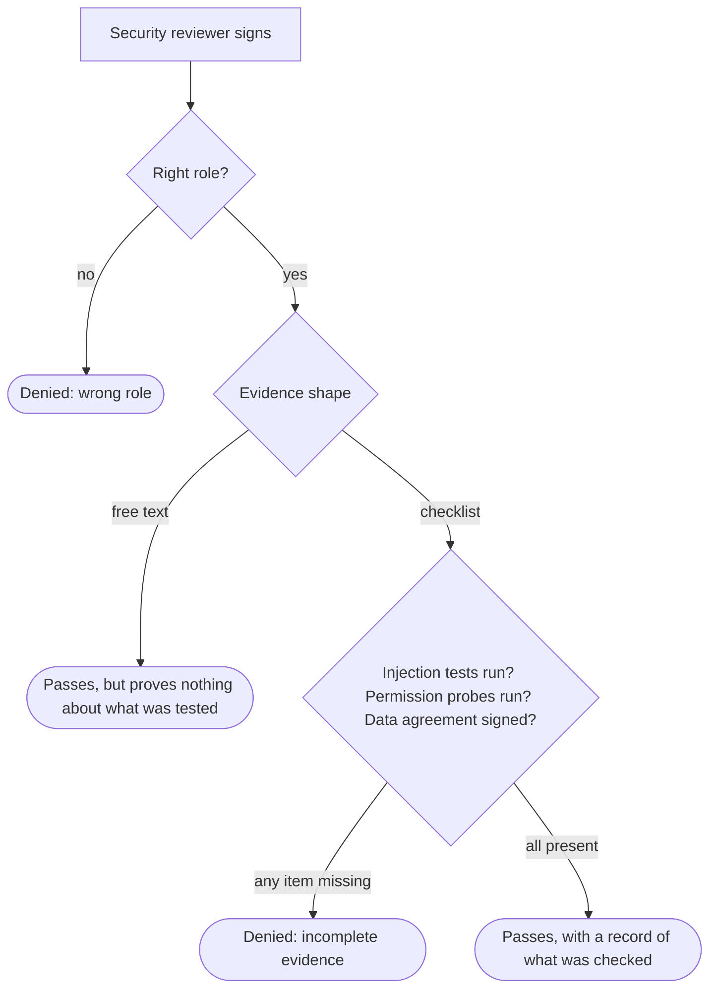

# Securing the Delivery Process

## Start with the signature that said "reviewed"

An FDE's agent for a bank passed its security gate on day 2. The right person signed, the bank's security reviewer, and the evidence field said "Reviewed, looks fine." Six weeks after go-live a penetration tester pasted an instruction into a customer message, and the agent revealed another customer's account notes. When the bank asked whether prompt-injection tests had run before the gate, the FDE could not say. The signature was real, but nobody knew what it attested to. Call this **the rubber-stamp gate**: the right signer with evidence that cannot prove anything.

> **What you'll learn**
>
> - Explain why a role-gated sign-off can still be a rubber stamp, and how to fix it.
> - Identify the two windows when the delivery process holds live customer credentials.
> - Apply residency decisions to the delivery process's own artefacts.
> - Treat running many engagements as a tenancy decision.

## Give gate evidence a required shape

The gates in [role-gated stage gates](/learn/forward-deployed/delivery-stages-and-gates/role-gated-stage-gates) stop the wrong person from signing. That is a real control. But a gate is only as strong as what counts as enough evidence, and that is a separate design question from whether the gate exists.

"Security review" can mean many things. Only one of them is what the gate should mean.

| What a thorough review might cover | Does a generic "security review passed" prove it? |
|---|---|
| Basic output validation, such as well-formed responses | No; that is a quality check, not a security check |
| Retrieval and tool-selection accuracy | No |
| Task success on real test cases | No; that belongs to the evaluation gate |
| Adversarial testing: prompt-injection attempts and permission-boundary probes | This is what the review should mean, and free text cannot prove it happened |
| Ongoing production monitoring | No; that is continuous, not a one-time gate |

*Table 1: What a security review might cover, and what a generic pass proves.*

If the evidence is a sentence such as "looks fine", a reviewer could sign after checking a paperwork item and never run one adversarial test against a system about to touch real customer data. The gate cannot tell a thorough review from a rubber stamp, because the evidence has no required shape.

The fix is to make the evidence a checklist, not a sentence. Adversarial testing done, permission boundaries tested and data agreements signed must all be explicitly present before the gate can pass. Figure 1 shows the difference. It is the same discipline as intake refusing to start without a measurable metric, applied to what a signature attests to.

*Figure 1: A role check stops the wrong signer. Only a required checklist stops the right signer from signing too early.*

> **Warning: a correct signer with free-text evidence is still a rubber stamp.** Role checks stop the wrong person. Only structured evidence stops the right person from signing too early.

## Treat delivery credentials as production secrets

Early in a fast delivery, the team connects to a customer's real systems, such as a support tool, a CRM or a knowledge base. The delivery tooling therefore holds live credentials during the engagement. This is one layer earlier than the deployed system's credential handling, and easy to miss because attention is on the product.

The exposure is concentrated in two windows:

- when sources are first connected;
- when the system starts running against the customer's real environment.

A data-access gate proves a human attested that access is live. It does not prove the credentials were stored in a vault, scoped only to what this engagement needs, and revoked cleanly at handover. Those requirements are the same as for any system holding live customer credentials.

## Apply residency to what the process creates

Per-tenant encryption and data residency are usually read as properties of the deployed system. They apply equally to the artefacts the delivery process produces. The clearest example is the golden set, built with the customer's own SMEs, which often contains real questions and real account details.

Storing that test set the same way for a regulated customer and a low-sensitivity trial is a residency gap in the delivery process itself. The tool that builds golden sets can be shared across engagements. The data it produces for each engagement must follow that customer's sensitivity tier.

## Treat many engagements as a tenancy decision

A framework that models one engagement will soon model many in parallel. The instinct is to treat that as scheduling and capacity. Underneath is the same multi-tenancy decision every customer-facing system faces, applied to the delivery process's own data.

Two questions decide it:

- Are two customers' engagement records, gate evidence and test sets separated only by a tag on shared records, the cheap default, or physically separated?
- Does a query for "all engagements" structurally exclude a competitor's data, or depend on someone remembering to filter?

Framing this as the same isolation decision made elsewhere in the stack, rather than a new scaling problem, is the stronger answer.

## Worked example: hardening the Northwind security gate

On Northwind Logistics, the security gate passes when the security reviewer signs. Harden it in three moves.

1. **Replace the free-text field with a checklist.** Prompt-injection tests run against the Zendesk ticket input, permission-boundary probes run against Salesforce, and the data agreement signed. The gate cannot pass with any item missing.
2. **Vault the delivery credentials.** Put the Zendesk, Confluence and Salesforce credentials the team uses on days 3–4 into a vault, scoped to this engagement, with revocation at the day-14 handover written into the runbook.
3. **Tier the golden set.** Tag it with Northwind's sensitivity tier and store it accordingly, separate from other customers' sets.

The gate's role check was already right. These changes make its signature mean something specific, and they bring the delivery process up to the bar the deployed agent already meets.

## Limits of this lesson

- **A checklist is a floor.** It proves named tests ran, not that they were good tests. The reviewer's skill still matters.
- **Controls vary by customer.** Regulated customers will add their own requirements on top of these.
- **Composite engagement.** Northwind Logistics and the bank are illustrative, not real customers.

## Interview angle

Each answer is an outline to say in about two minutes. Open each question and try it aloud before reading.

Interview question 1. The security gate passed with "reviewed, no issues". The customer's head of security asks what was tested. What do you do?

- **Answer:** Admit the evidence cannot answer that, then fix the gate. Re-run the review against a checklist: prompt-injection attempts on every input the agent reads, permission-boundary probes on every system it can call, and the signed data agreement. Attach the results. From now on the gate cannot pass with any item missing.
- **Trade-off:** Re-running costs days after a gate already passed. Leaving it means nobody can say what the signature covered.
- **Follow-up to expect:** "Who writes the checklist?" The security reviewer, agreed with the customer's security team at intake.

Interview question 2. Your team holds live CRM credentials for a customer during a two-week delivery. How do you handle them?

- **Answer:** Treat them as production secrets. Store them in a vault, not in a notebook or a chat message. Scope them to the objects and actions this engagement needs. Log their use. Write revocation at handover into the runbook and confirm it with the customer's administrator on day 14.
- **Trade-off:** Vaulting and scoping slow the first connection. A shared admin password is fast and becomes the breach nobody can trace.
- **Follow-up to expect:** "The customer only offers an admin account." Push for a scoped service account, and record the risk if they refuse.

Interview question 3. Where should the golden set for a regulated customer live?

- **Answer:** Wherever that customer's sensitivity tier requires, the same as their production data: the right region, encryption under their tenant's key, and access limited to the engagement. The golden set often holds real questions and account details, so it is customer data, not a test fixture. The tool that builds it can be shared. The data cannot.
- **Trade-off:** Per-tier storage adds setup work. One shared bucket for every customer is a residency breach waiting for an audit.
- **Follow-up to expect:** "When is it deleted?" At an agreed point after handover, written into the data agreement.

Interview question 4. Your delivery tracker now holds forty engagements, two of them for competing retailers. Is that a reporting question or a security question?

- **Answer:** A security question. If the engagements are separated only by a tag, any query for "all engagements" depends on someone remembering to filter. Decide tag-level or physical separation the same way you would for the product, and make the default query exclude other customers by structure, not by habit.
- **Trade-off:** Physical separation costs more to run and report across. Tag-level separation is cheap until one missed filter shows a competitor's gate evidence.
- **Follow-up to expect:** "Which would you pick?" Tag-level with enforced row-level filters for most customers, physical for those whose contracts require it.

## References

1. OWASP GenAI Security Project, [LLM01: Prompt injection](https://genai.owasp.org/llmrisk/llm01-prompt-injection/), accessed 18 November 2026. The adversarial tests a security review should cover.
2. OWASP Cheat Sheet Series, [Secrets management](https://cheatsheetseries.owasp.org/cheatsheets/Secrets_Management_Cheat_Sheet.html), accessed 18 November 2026. Storing, scoping and revoking credentials.
3. OWASP Cheat Sheet Series, [Multi-tenant security](https://cheatsheetseries.owasp.org/cheatsheets/Multi_Tenant_Security_Cheat_Sheet.html), accessed 18 November 2026. Tenant isolation choices.
4. Sources in this repository, the author's own material: *Security Gate Depth and Tenant Scale* (all sections) and *Gates, Risks and Metrics* ("Where the design is honest about its own weakness" and "Interview lens").

## Key takeaways

- A gate with the right signer can still be a rubber stamp. Make its evidence a required checklist.
- The delivery process holds live customer credentials when sources connect and when the system first runs. Vault, scope and revoke them.
- Residency and encryption apply to delivery artefacts such as golden sets, by each customer's sensitivity tier.
- Running many engagements is a tenancy decision: tag-level or physical separation, and queries that exclude other customers by structure.

## Check yourself

1. The security reviewer signed the gate with "reviewed, looks fine". What is wrong?

The evidence has no required shape. It cannot show that adversarial testing or permission probes ever happened.

2. When does the delivery process itself hold live customer credentials?

When data sources are first connected, and when the system starts running against the customer's real environment.

3. Why is "show me all engagements" a security question and not only a reporting one?

If separation is only a tag, the query depends on remembering to filter. A competitor's records could appear unless isolation is structural.

