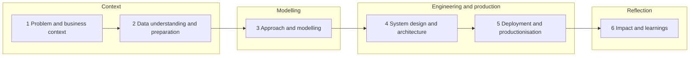

# Telling a Delivery Story in Six Stages

## Start with the eleven-minute model

A candidate in a mock round was asked, "Walk me through an end-to-end AI project you delivered." The project was a churn model for a subscription business. The candidate spent eleven of the fifteen minutes on feature engineering and why gradient boosting beat logistic regression.

When the interviewer asked how the model reached the marketing team, the candidate said "through an API". Asked what happened three months later, the candidate did not know. Asked what changed for the business, the candidate guessed.

The model is the most interesting part to talk about. A story that lingers there leaves out the five stages that show ownership. Call this **the model lecture**: an end-to-end question answered as an algorithm talk.

> **What you'll learn**
>
> - Name the six stages and the shape of investment across them.
> - Anchor every stage to business value and a number.
> - Give a first pass in three to five minutes and go deeper only where asked.
> - Meet the senior bar: what changed, not only what was built.

## Tell it in six stages

"Walk me through an end-to-end AI project" is a storytelling question in disguise. It checks ownership from business problem to measured impact. It probes five things at once: end-to-end ownership, systems thinking, production experience, trade-off awareness, and the ability to simplify for a stakeholder. Six stages cover all five, and keep the answer from becoming either a chronology or an algorithm lecture.

| # | Stage | What to cover |
|---|---|---|
| 1 | Problem and business context | What was being solved, and why it mattered to the business |
| 2 | Data understanding and preparation | Sources, quality problems, feature or corpus decisions |
| 3 | Approach and modelling | Why AI rather than rules; model or strategy choices and their trade-offs |
| 4 | System design and architecture | Pipeline, tools, infrastructure, batch or real-time |
| 5 | Deployment and productionisation | CI/CD (continuous integration and delivery), monitoring, retraining or re-evaluation, scaling |
| 6 | Impact and learnings | Business and model metrics; what would be improved |

*Table 1: The six stages of a delivery story and what each one covers.*

The shape matters. Two stages build context, one is modelling, two are engineering and production, and one is reflection. Figure 1 shows that shape. Candidates who over-invest in stage 3 under-invest in the other five.

*Figure 1: The six stages grouped by kind. Modelling is one stage of six, so it gets about one sixth of the time.*

## Lead with value and numbers

Anchor every stage to business value. Use specific numbers for accuracy, latency and revenue. Show why a choice was made, as well as that it was made. Show cross-functional work, and mention failures and iterations, which add credibility.

The opposite habits lose the round:

- jumping to algorithms without context;
- listing tools like a CV;
- describing a toy or academic project;
- skipping production;
- claiming impact without measured results.

Ignoring production is the clearest red flag, because it suggests the story ended at "we trained a model".

## Go deep only where asked

Keep the first pass to three to five minutes, then expand where the interviewer shows interest. Layered depth signals more seniority than reciting every detail up front.

Highlight decision points rather than actions. Say why gradient boosting beat logistic regression, or why hybrid retrieval beat dense retrieval, not merely that it was used.

> **Warning: the retraining loop is the detail candidates omit and senior interviewers listen for.** A model deployed with no drift monitoring or re-evaluation schedule is a model that silently degrades.

## Meet the senior bar

Execution gets a candidate into the room. Influence gets the offer. At senior level the question shifts from what was built to what changed. Describe how decisions were influenced, how work was divided and who was accountable. Highlight platform thinking and reuse. "I built a churn model" is weaker than "I built a churn platform other teams now reuse".

In the FDE (forward deployed engineer) context, the six stages gain two weights. A requirements-gathering and scoping stage comes before the build. A governance and security stage carries the most weight for an enterprise audience.

The switcher plays the same question three ways.

The question: "Walk me through an end-to-end AI project you delivered." Pick an answer to see what the interviewer hears.

<button type="button" data-mode="lecture" aria-pressed="false" aria-controls="lecture-result">Model lecture</button>
<button type="button" data-mode="six-stage" aria-pressed="false" aria-controls="six-stage-result">Six stages</button>
<button type="button" data-mode="senior" aria-pressed="false" aria-controls="senior-result">Senior bar</button>

<section id="lecture-result" class="mode-panel" data-announcement="Model lecture selected. Strong modelling, no ownership."><h4>Model lecture</h4><ul><li>Eleven minutes on features and gradient boosting.</li><li>"Deployed through an API." No monitoring, no retraining.</li><li>Impact guessed, not measured.</li></ul>
The interviewer hears a modeller, not an owner.
</section>
<section id="six-stage-result" class="mode-panel" data-announcement="Six stages selected. Ownership from problem to impact."><h4>Six stages</h4><ul><li>Problem and churn rate first, then data, modelling, architecture, deployment and impact.</li><li>Each stage has a number and a named trade-off.</li><li>Drift monitoring and monthly retraining are named.</li></ul>
The interviewer hears ownership from problem to measured impact.
</section>
<section id="senior-result" class="mode-panel" data-announcement="Senior bar selected. What changed and who reuses it."><h4>Senior bar</h4><ul><li>The six stages, plus who decided what and who was accountable.</li><li>"Other teams now reuse the platform."</li><li>Learnings that would change the next project.</li></ul>
The interviewer hears influence, which is what gets the offer.
</section>

## Worked example: a churn prediction project

The model answer opens with the business, not the algorithm.

1. **Problem.** About 18% monthly churn on a subscription platform, with significant revenue impact. The goal was to predict churn early and target retention.
2. **Data.** CRM (customer relationship management) demographics, product usage logs and support tickets. The main challenge was fragmentation and inconsistent IDs. The team built a unified customer view, with engagement frequency, usage-drop patterns and support sentiment as features.
3. **Modelling.** A logistic regression baseline, then gradient boosting to capture non-linear effects. The trade-off: slightly less interpretable, for significantly higher recall on churners (+22%).
4. **Architecture.** A lakehouse pipeline from ingestion to feature engineering, training and serving, with daily batch scoring and a feature store for train-serve consistency.
5. **Deployment.** A REST endpoint for real-time scoring wired into the marketing system for automated campaigns, plus drift monitoring, monthly retraining and an A/B testing framework.
6. **Impact.** Recall improved about 25%, targeted campaigns cut churn about 6% overall, and annual retention impact ran to millions of dollars.

Learnings close it: feature quality mattered more than model complexity, early stakeholder alignment avoided rework, and the model degraded after three months without retraining.

The modelling stage gives the recall gain as +22% and the impact stage as about 25%. Pick one figure and quote it the same way every time. The structure worked because every stage had a number, a named trade-off and a production detail. In an LLM (large language model) system, the retraining loop's equivalent is scheduled evaluation and production monitoring.

## Limits of this lesson

- **One question shape.** The six stages fit "walk me through a project". Behavioural questions about conflict or failure need a different structure.
- **Illustrative figures.** The churn project and the mock round are illustrative. Use your own project's numbers, and only numbers you can defend.
- **Time budgets vary.** Some interviewers want a two-minute summary first. Read the room and compress the stages, never drop production and impact.

## Interview angle

Each answer is an outline to say in about two minutes. Open each question and try it aloud before reading.

Interview question 1. You have three minutes to describe a project you delivered end to end. How do you spend them?

- **Answer:** About 30 seconds each on six stages: the business problem with its number, the data and its main quality problem, the modelling choice and its trade-off, the architecture, deployment with monitoring and retraining, and the measured impact. Then stop and let the interviewer pick where to go deeper.
- **Trade-off:** A short pass leaves out detail you are proud of. A long pass on modelling leaves out the stages that show ownership.
- **Follow-up to expect:** "Go deeper on deployment." Have the monitoring signal, the retraining schedule and one incident ready.

Interview question 2. The interviewer says, "Your model sounds good. What happened six months after launch?" What do they want to hear?

- **Answer:** Whether you owned the system after the launch. Name the drift monitoring, the re-evaluation or retraining schedule, and what the numbers did. If the model degraded, say when you noticed, how, and what you changed. For an LLM system, name the scheduled evaluation and the production monitors.
- **Trade-off:** Admitting a degradation feels risky. Not knowing what happened reads as no ownership.
- **Follow-up to expect:** "Who would have noticed if you had left?" Name the owning team and the alert.

Interview question 3. Your project's impact was hard to measure. How do you tell the impact stage without overclaiming?

- **Answer:** Say what was measured and what was not. Give the model metric you can stand behind, the business proxy you tracked, and the comparison you used. Name the gap, for example no control group, and what you would set up next time. A modest measured number beats a large guessed one.
- **Trade-off:** An honest number may sound small. An unmeasured claim collapses at the first follow-up.
- **Follow-up to expect:** "How would you prove it now?" Describe a comparison group or a before-and-after window with a guard metric.

Interview question 4. How does your answer change for an FDE role with an enterprise customer?

- **Answer:** Add a requirements and scoping stage before the build, and give governance and security the most weight. Show who the customer's stakeholders were, what you agreed before building, and how data access, permissions and review were handled. Close on what the customer's team now runs and reuses.
- **Trade-off:** More stages leave less time for the build. An enterprise audience cares more about safe delivery than model detail.
- **Follow-up to expect:** "Who signed off before go-live?" Name the roles and the evidence each saw.

## References

1. Google for Developers, [Rules of Machine Learning](https://developers.google.com/machine-learning/guides/rules-of-ml), accessed 18 November 2026. Monitoring model freshness and the production side of a machine learning system.
2. Wikipedia, [Concept drift](https://en.wikipedia.org/wiki/Concept_drift), accessed 18 November 2026. Why a deployed model degrades without monitoring and retraining.
3. Sources in this repository: `01_Concept_Tutorials/FDE_Handbook/10_FDE_Delivery_Operating_Model/02_End_To_End_AI_Delivery_Six_Stages.md` (all sections), the author's own material.
4. The author's own field experience, the basis for the mock-round story and the senior bar.

## Key takeaways

- Tell delivery stories in six stages, and resist over-investing in modelling.
- Anchor to business value with numbers. Ignoring production is the clearest red flag.
- Give a three-to-five-minute first pass and expand only where the interviewer leans in.
- At senior level, talk about what changed and what others reuse, not only what was built.

## Check yourself

1. What five things does "walk me through an end-to-end project" probe?

End-to-end ownership, systems thinking, production experience, trade-off awareness, and the ability to simplify for a stakeholder.

2. Why is listing tools a weak answer?

It names technologies without the decisions behind them. Interviewers want why a choice was made, not a CV of tools.

3. Restate the senior bar in one sentence.

At senior level the question moves from what was built to what changed: influence, accountability and reuse by others.

