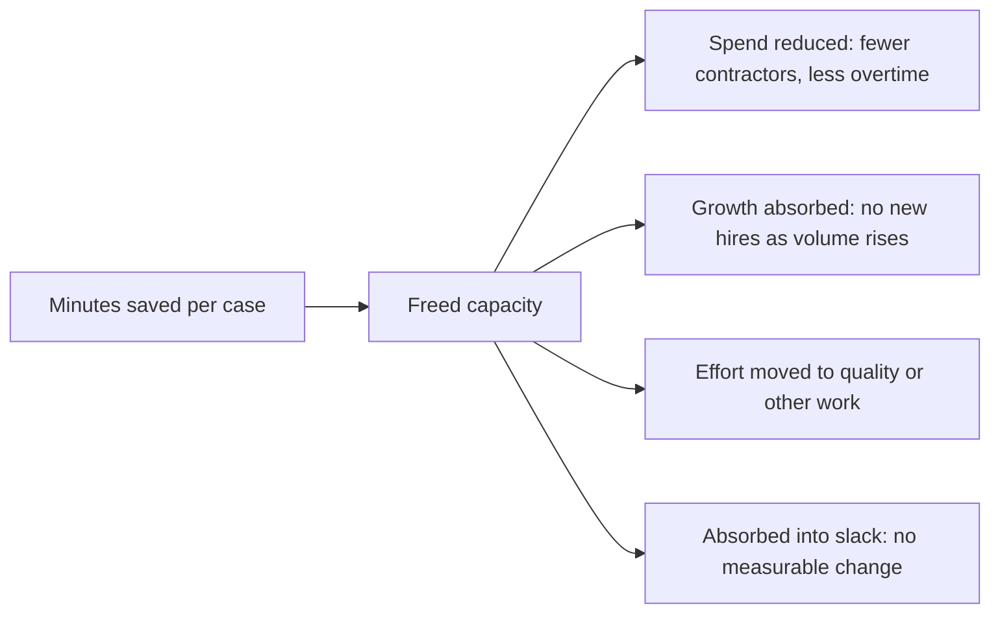

# Baselines, Value and ROI

## Start with the savings nobody could find

Wexford Retail, a fictional online retailer, handles 20,000 return requests a month. A proposal for an AI assistant promised to save four minutes on each one: 80,000 minutes, or about 1,333 staff hours a month, which the proposal valued at £26,000.

The finance director asked one question: which budget line goes down? Nobody could answer. The returns team was salaried and would stay the same size. Nobody had timed a return. The four minutes was a guess. The £26,000 described time, not money.

The FDE's job is to turn a claim like this into a number the customer can check. Call the gap between minutes saved and money saved **the phantom saving**.

> **What you'll learn**
>
> - Build a baseline when nobody measures the work today.
> - Keep time, quality, throughput and cost as separate kinds of value.
> - Explain when saved minutes become saved money.
> - Calculate ROI and payback with the assumptions stated.
> - Show how the return changes with volume, and find the break-even point.

## Building a baseline when nobody measures

A **baseline** is a measurement of the current process, taken before you change it, using the same method you will use afterwards. Without one, any improvement is a claim.

Few customers have one ready. Build it from what exists:

- **System timestamps.** Ticket, order or case systems usually record when a case opens and closes. That gives elapsed time for every case, though not effort.
- **Timed samples.** Sit with staff and time 30 to 50 real cases across a normal week. That gives effort per case.
- **Work sampling.** Note at random moments what each person is doing. That shows how time splits across tasks without timing every case.
- **Error and rework records.** Complaints, refunds reversed, cases reopened.

Record the median and the spread, not one average: a process where most cases take three minutes and a few take an hour behaves differently from one where all take seven. Agree the method and the numbers with the customer before the pilot starts, because people work differently once a change is announced.

At Wexford, a week of timed samples showed a median of six minutes per return. A trial of the assistant cut it to three. The saving was three minutes, not four.

> **Pitfall:** Measuring the baseline after the pilot starts. The announcement alone changes behaviour, and you lose the before picture.

## Four kinds of value

Value comes in different units. Keep each one separate and report it in its own unit, because they reach the business through different routes.

| Lens | What it measures | Wexford example | Reaches the business as |
| --- | --- | --- | --- |
| Time | Effort per case | Six minutes per return, down to three | Capacity, which may or may not become money |
| Quality | Errors, rework, harm | Wrong refunds, 2% of returns | Lower losses, fewer complaints |
| Throughput | Cases handled per period | Peak-season backlog of 4,000 returns | Faster service, less overtime |
| Cost | Cash spent | Agency contractors at £22 per hour | Lower spend on a named budget line |

*Table 1: Four lenses on the same change. Converting quality or throughput into minutes hides how each one pays.*

A change can score well on one lens and badly on another. A faster process that raises the error rate can lose more in wrong refunds than it saves in time. Report all four.

## When saved minutes become money

Freed time turns into money only when someone acts on it. Figure 1 shows the four paths freed capacity can take.

*Figure 1: Where freed capacity goes. Only the first path lowers spend this year. The second avoids future spend. The last path, the default, returns nothing.*

At Wexford, the in-house team would stay the same size, but the company bought about 1,000 agency contractor hours a month. Cutting contractor hours was the only path to money this year. The finance team judged that 40% of the freed hours could come out of the contractor budget. The rest would be absorbed during quieter weeks.

Ask the customer which path they will take before you count any money. If the answer is "none", report the value as capacity and quality, not cash.

## ROI with stated assumptions

**Return on investment** compares net benefit with cost. **Payback** is the time until cumulative net benefit covers the upfront cost. Both depend on assumptions. State each one beside the result.

The Wexford calculation:

| Item | Value | Source |
| --- | --- | --- |
| Returns per month | 20,000 | Order system, last 12 months |
| Minutes saved per return | 3 | Timed samples, before and during trial |
| Hours freed per month | 1,000 | 20,000 × 3 ÷ 60 |
| Share removable from contractor spend | 40% | Finance team estimate |
| Contractor rate | £22 per hour | Agency contract |
| Monthly saving | £8,800 | 400 hours × £22 |
| Running cost | £1,500 a month plus £0.125 per return | Vendor quote and model usage |
| Monthly net benefit | £4,300 | £8,800 − £4,000 − £500 support |
| Upfront build cost | £60,000 | Engagement estimate |
| Payback | about 14 months | £60,000 ÷ £4,300 |

*Table 2: Wexford's payback calculation. Every row names where its number came from.*

The running cost at 20,000 returns is £1,500 + £2,500 = £4,000, and £500 a month covers support for the assistant. The 40% share is the weakest assumption, because it rests on one team's judgement. Say so when you present it.

## How the return changes with volume

A single ROI figure hides how fragile it is. **Sensitivity analysis** changes one assumption at a time and shows how the result moves. The UK Treasury's Green Book, the government's guide to appraising spending, asks for this, along with the **switching value**: the value of an assumption at which the decision would change.

The switcher shows Wexford's payback at three monthly volumes, with every other assumption fixed.

Change the monthly return volume and see how Wexford's payback moves. All other assumptions stay as in Table 2.

<button type="button" data-mode="low" aria-pressed="false" aria-controls="low-result">14,000 returns</button>
<button type="button" data-mode="expected" aria-pressed="false" aria-controls="expected-result">20,000 returns</button>
<button type="button" data-mode="high" aria-pressed="false" aria-controls="high-result">28,000 returns</button>

<section id="low-result" class="mode-panel" data-announcement="14,000 returns selected. Payback about 25 months."><h4>14,000 returns a month</h4><ul><li>Saving: 280 contractor hours × £22 = £6,160.</li><li>Running cost £3,250, support £500.</li><li>Net benefit £2,410 a month.</li></ul>
Payback about 25 months, just past the customer's two-year limit.
</section>
<section id="expected-result" class="mode-panel" data-announcement="20,000 returns selected. Payback about 14 months."><h4>20,000 returns a month</h4><ul><li>Saving: 400 contractor hours × £22 = £8,800.</li><li>Running cost £4,000, support £500.</li><li>Net benefit £4,300 a month.</li></ul>
Payback about 14 months.
</section>
<section id="high-result" class="mode-panel" data-announcement="28,000 returns selected. Payback about 9 months."><h4>28,000 returns a month</h4><ul><li>Saving: 560 contractor hours × £22 = £12,320.</li><li>Running cost £5,000, support £500.</li><li>Net benefit £6,820 a month.</li></ul>
Payback about 9 months.
</section>

Each extra return adds £0.44 of saving (3 minutes × 40% ÷ 60 × £22) and £0.125 of running cost, a net £0.315. To pay back £60,000 within 24 months, the assistant needs £2,500 of net benefit a month, plus the £2,000 of fixed running and support costs. That is £4,500 ÷ £0.315, about 14,300 returns a month. That is the switching value for volume: below it, the project misses the two-year limit.

## When the return depends on growth

Some business cases work only if volume grows. Present those honestly:

- **Show the case at today's volume first.** If it fails there, say so.
- **Name the growth it needs** as a switching value, as above, and compare it with the customer's own forecast.
- **Shrink the bet.** A smaller first release with lower upfront cost lowers the volume needed to pay back.
- **Set a checkpoint.** Agree a date to compare real volume with the forecast, and what happens if it falls short.

## Limits of this lesson

- **Payback ignores timing and risk.** Finance teams may prefer a discounted measure such as net present value. Ask which they use.
- **Some value resists money.** Fewer errors in a safety process matter even when the cash case is weak. Report them in their own unit.
- **Fictional data.** Wexford Retail and its figures are illustrative.

## Interview angle

Each answer is an outline to say in about two minutes. Open each question and try it aloud before reading.

Interview question 1. The customer has never measured the process. How do you build a baseline?

- **Answer:** Combine what exists: system timestamps for elapsed time across all cases, a week of timed samples for effort per case, and error or rework records. Report the median and spread, use the same method after the change, and agree the numbers with the customer before the pilot is announced.
- **Trade-off:** A careful baseline costs a week. Without it, nobody can prove the pilot worked.
- **Follow-up to expect:** "There is no time for a week." Take a smaller sample and state the uncertainty.

Interview question 2. How do you describe the value of an AI project?

- **Answer:** On four separate lenses: time per case, quality, throughput and cost. Each reaches the business by a different route. I report each in its own unit rather than converting everything to minutes or money. A change can help one lens and hurt another, so I report all four.
- **Trade-off:** Four numbers are harder to present than one. One number hides the trade-offs.
- **Follow-up to expect:** "The CFO wants one number." Give the cash figure, and show the others beside it.

Interview question 3. Walk me through an ROI calculation for an automation project.

- **Answer:** Start from the baseline volume and measured minutes saved, then ask how freed hours become money: cut contractor spend, avoid hires, or nothing. Subtract running and support cost to get monthly net benefit, divide upfront cost by it for payback, and put the source of each assumption beside it.
- **Trade-off:** Stating assumptions exposes weak ones. That is the point: the customer can check them.
- **Follow-up to expect:** "Which assumption would you test first?" The share of freed time that becomes money.

Interview question 4. A stakeholder claims the tool will save 1,000 hours a month. How do you respond?

- **Answer:** Ask where the minutes per case came from and which budget line goes down. Then measure: time a sample now and during a trial. Report the measured saving, and count money only for the hours that will leave a budget, such as contractor or overtime spend.
- **Trade-off:** Challenging a sponsor's number can feel awkward. An unmeasured claim that fails at the first review is worse.
- **Follow-up to expect:** "The hours are real but the team stays." Then the value is capacity, so name what the team will do with it.

Interview question 5. The ROI only works if transaction volume doubles. What do you tell the customer?

- **Answer:** Show the case at today's volume first, then the switching value: the volume where payback meets their limit. Compare it with their own forecast. Offer a smaller first release that pays back at lower volume, and agree a checkpoint to compare real volume with the forecast.
- **Trade-off:** Honesty may slow the sale. A case built on hoped-for growth damages trust when growth stalls.
- **Follow-up to expect:** "Sales already promised the ROI." Raise it internally before the customer finds out.

## References

1. HM Treasury, [The Green Book (2026)](https://www.gov.uk/government/publications/the-green-book--2/the-green-book-2026), accessed 17 November 2026. Sensitivity analysis, switching values and optimism bias in appraisals.
2. The site's [success metrics and evaluation data](/learn/forward-deployed/customer-discovery/success-metrics-and-evaluation-data) lesson, for metrics the customer recognises.
3. The site's [observing the work](/learn/forward-deployed/customer-discovery/observing-the-work) lesson, for timed samples.
4. The author's own field experience, the basis for the baseline methods and the paths from capacity to money.

## Key takeaways

- Measure the baseline before the change is announced, with the method you will use afterwards.
- Report time, quality, throughput and cost separately, in their own units.
- Saved minutes become money only when spend goes down or future spend is avoided.
- Put the source of every assumption beside the ROI, and name the weakest one.
- Show sensitivity to volume and the switching value where the decision changes.

## Check yourself

1. Why was Wexford's original £26,000 a month a phantom saving?

The minutes were guessed, and the salaried team would not shrink. No budget line went down. The figure described time, not money.

2. Which Wexford assumption is weakest, and why?

The 40% share of freed hours removable from contractor spend. It rests on one team's judgement, while volume and minutes saved come from records and timed samples.

3. What is a switching value?

The value of one assumption at which the decision changes. For Wexford, about 14,300 returns a month is the volume below which payback misses two years.

