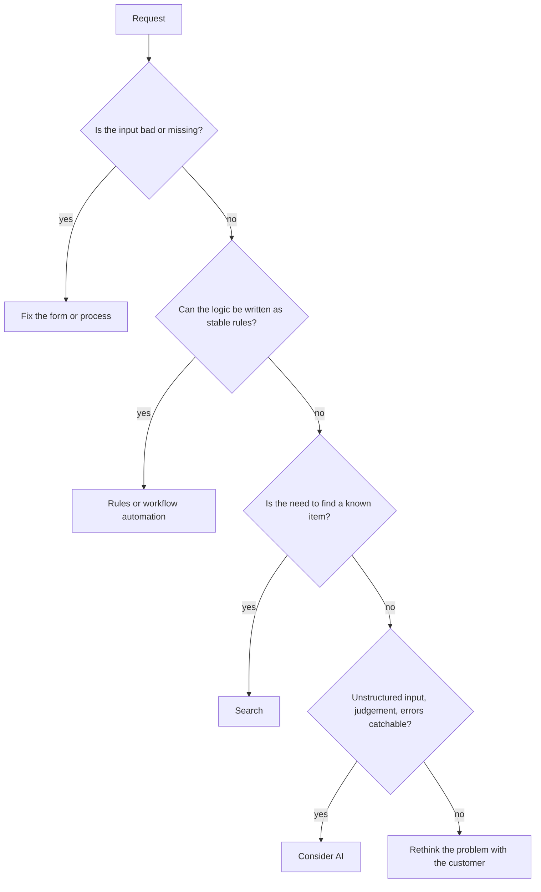

# Build, Buy, Configure or No AI

## Start with the emails that were really meter readings

Linden Water, a water company, receives 9,000 customer emails a month. Staff read each one and route it to billing, metering, leaks or complaints. Linden asked its FDE for an AI model to classify and route the emails.

The FDE's first week of discovery turned up three things:

- About 60% of the emails were customers sending a meter reading, typed in many different ways.
- Linden's customer relationship management system already had routing rules that could send a web form to the right queue. Nobody had switched them on.
- The remaining emails were varied: complaints, questions and reports of leaks, some urgent.

Call this **the AI-shaped request**: a problem that arrives asking for a model when most of it needs none.

> **What you'll learn**
>
> - Compare build, buy and configure on the same criteria.
> - Recognise when rules, search, automation or a process change beat AI.
> - Weigh an impressive solution against one that fits the way people work.
> - Explain a no-AI recommendation to a customer who asked for AI.

## The options, cheapest first

Most requests can be met in more than one way. List the options in order of cost and risk, and stop at the first one that meets the need:

1. **Change the process.** A better form, a removed step, a clearer policy.
2. **Configure what exists.** Switch on or adjust features in tools the customer already owns.
3. **Automate with rules.** Fixed logic, workflow automation or an integration between systems.
4. **Add search.** Help people find known documents or records.
5. **Buy a product.** A commercial tool that does the job, configured for the customer.
6. **Build.** Custom software, with or without AI, owned and maintained by someone.

AI can appear at steps 4 to 6. It earns its place when the input is unstructured language or images, the judgement is hard to write as rules, and mistakes can be caught or tolerated.

Google's Rules of Machine Learning open with the same advice: do not be afraid to launch a product without machine learning. A simple heuristic gives you a baseline and a working system, and a model can come later if the data supports it.

## When the simpler option wins

Figure 1 is a sorting rule for any request.

*Figure 1: Sorting a request before choosing technology. Each earlier branch is cheaper to build, test and maintain than AI.*

Typical signs that a simpler option fits:

- **Rules.** The decision follows a policy you can write down, such as a refund under £50 approved automatically. Rules are exact and easy to audit.
- **Search.** People ask for "an AI assistant" but describe looking for a policy, a form or a past case.
- **Automation.** Staff copy the same fields between two systems. An integration removes the copying.
- **Process change.** The input arrives in free text because nobody gave customers a structured way to send it, as at Linden.

Linden's first release added a meter-reading form to the website and a link in every bill, then switched on the existing routing rules for the form. Email volume fell by more than half within two months. A classifier for the remaining emails moved to the second phase, sized for 3,600 emails instead of 9,000.

> **Pitfall:** Treating "the customer asked for AI" as a requirement. The requirement is the outcome. AI is one way to reach it.

## Build, buy or configure

When the options above do not cover the need, compare buying, configuring and building on the same criteria. Score them against the customer's situation, not in general.

| Criterion | Configure what exists | Buy a product | Build custom |
| --- | --- | --- | --- |
| Fit to the need | Limited to the tool's features | Good for common needs | Exact |
| Time to first value | Days to weeks | Weeks | Months |
| Cost over three years | Lowest | Licence fees | Build plus a team to maintain it |
| Who maintains it | Customer admins | The vendor, plus admins | Someone the customer must name |
| Data and security | Stays where it is | Review where data goes | Under the customer's control |
| Exit and lock-in | Low | Contract and data export terms | Low, but knowledge leaves with people |
| Differentiation | None | None | High, if the capability matters to the business |

*Table 1: The same criteria for each option. The deciding row is usually maintenance or differentiation.*

Martin Fowler's utility and strategic split helps with the last row. **Utility** functions, like payroll or ticket routing, need to work but do not set the business apart, so buying or configuring is usually right. **Strategic** functions set the business apart, and building can pay for itself. Most FDE requests are utility.

The switcher applies the table to Linden's remaining 3,600 varied emails.

Linden still needs to route 3,600 varied emails a month after the form. Compare three options on the same criteria.

<button type="button" data-mode="configure" aria-pressed="false" aria-controls="configure-result">Configure</button>
<button type="button" data-mode="buy" aria-pressed="false" aria-controls="buy-result">Buy</button>
<button type="button" data-mode="build" aria-pressed="false" aria-controls="build-result">Build</button>

<section id="configure-result" class="mode-panel" data-announcement="Configure selected. Keyword rules route about half the emails."><h4>Configure the existing system</h4><ul><li>Keyword rules in the existing system route leaks and billing words.</li><li>Live in two weeks, maintained by Linden's admins.</li><li>About half the emails still need a person, and new wording breaks rules.</li></ul>
Cheap and quick. Leaves a manual queue.
</section>
<section id="buy-result" class="mode-panel" data-announcement="Buy selected. A classification add-on routes most emails."><h4>Buy a classification add-on</h4><ul><li>The system's vendor sells an AI classification add-on, trained on Linden's past emails.</li><li>Live in six weeks after a data-protection review.</li><li>Licence cost each year. The vendor maintains the model.</li></ul>
Most emails routed, with a known vendor and contract.
</section>
<section id="build-result" class="mode-panel" data-announcement="Build selected. A custom classifier fits exactly but needs an owner."><h4>Build a custom classifier</h4><ul><li>Fits Linden's categories exactly, including urgency for leaks.</li><li>Live in three months, with an evaluation set to build first.</li><li>Needs a named Linden team to retrain and monitor it after handover.</li></ul>
Best fit, highest ongoing cost. Right only if routing quality sets Linden apart, and it does not.
</section>

Linden chose to buy, with the keyword rule for "leak" kept as a safety net so urgent emails never wait for the model.

## Impressive or adopted

Some proposals win the demo and lose the floor. A solution that asks users to change several habits at once, learn a new screen and trust a new kind of output is impressive and disruptive. Adoption, not capability, decides whether it returns anything.

Prefer the option that fits the way people already work: inside the tool they use all day, at the step where they need it, with a way to correct it. If the impressive option is worth it, phase it: start with the part that fits the current workflow and add the rest once people trust it. The lesson on [diagnosing low adoption](/learn/forward-deployed/adoption-and-impact/diagnosing-low-adoption) covers what to do when a release goes unused.

## Recommending no AI

Telling a customer who asked for AI that they do not need it feels risky. Make it easy to accept:

- **Lead with the outcome they asked for**, and show the simpler route reaches it faster.
- **Show the numbers.** Volume removed, time to value, cost over three years.
- **Keep AI on the plan** where it fits, sized for what remains.
- **Measure the simple option first.** Its results become the baseline any later model must beat.

## Limits of this lesson

- **Option costs vary.** Licence prices and build costs differ by market. Use the customer's quotes, not general figures.
- **Rules have limits too.** Many rules interacting can become harder to maintain than a model. Watch the rule count.
- **Composite engagement.** Linden Water and its figures are illustrative, not a real customer.

## Interview angle

Each answer is an outline to say in about two minutes. Open each question and try it aloud before reading.

Interview question 1. How do you decide whether to build, buy or configure?

- **Answer:** Compare the options on the same criteria for this customer: fit, time to first value, cost over three years, who maintains it, data and security, exit terms and whether the capability sets the business apart. Configure first if it meets the need. Buy for common, utility needs. Build only when the capability is strategic and someone will own it.
- **Trade-off:** Buying is faster but ties you to a vendor. Building fits exactly but needs a team forever.
- **Follow-up to expect:** "The customer wants to own the IP." Then building may be right, if they will fund the maintenance.

Interview question 2. When is AI the wrong answer?

- **Answer:** When the input is bad and a better form would fix it, when the logic can be written as stable rules, when people need to find a known item, or when staff copy data between systems. Each is cheaper and easier to test without a model. AI fits unstructured input, judgement that resists rules and errors that can be caught.
- **Trade-off:** A no-AI answer can disappoint a customer who asked for AI. It usually delivers faster and gives a baseline for later.
- **Follow-up to expect:** "Their board wants an AI story." Keep AI on the plan where it fits the remaining work.

Interview question 3. The customer is choosing between a commercial tool, configuring their existing platform and a custom build. How do you help?

- **Answer:** Write the criteria down first and agree weights with the sponsor. Then score each option with evidence: vendor quotes, a short trial of the configuration, an estimate for the build including maintenance. Recommend one, and show which criterion decided it.
- **Trade-off:** A formal comparison takes a week or two. Skipping it lets the loudest voice choose.
- **Follow-up to expect:** "Two options score the same." Pick the one that is easier to exit.

Interview question 4. Your most impressive design would disrupt how users work. Do you propose it?

- **Answer:** Not as the first release. Adoption decides the return, so I start with the version that fits the current workflow, inside the tool people use, with a way to correct it. If the bigger design is worth it, I phase it in once people trust the first step.
- **Trade-off:** The modest version demos less well. The disruptive one risks going unused.
- **Follow-up to expect:** "The sponsor loves the demo." Show the adoption risk and a phased plan that still reaches the demo.

Interview question 5. What criteria do you use to compare solution options?

- **Answer:** Fit to the need, time to first value, cost over three years, who maintains it, data and security, exit and lock-in, and differentiation. I score each against this customer's constraints, not in general, and name the deciding criterion.
- **Trade-off:** More criteria make the comparison slower. Too few hide the cost that arrives after handover.
- **Follow-up to expect:** "Which criterion is most often missed?" Who maintains it after the FDE leaves.

## References

1. Google, [Rules of Machine Learning](https://developers.google.com/machine-learning/guides/rules-of-ml), accessed 17 November 2026. Rule 1: launching without machine learning first.
2. Martin Fowler, [Utility vs strategic dichotomy](https://martinfowler.com/bliki/UtilityVsStrategicDichotomy.html), accessed 17 November 2026. Buying utility functions and building strategic ones.
3. The site's [baselines, value and ROI](/learn/forward-deployed/scoping-an-fde-project/baselines-value-and-roi) lesson, for comparing options on cost.
4. The author's own field experience, the basis for the option order and the comparison criteria.

## Key takeaways

- List options cheapest first: process, configuration, rules, search, buy, build. Stop at the first that works.
- AI fits unstructured input, hard-to-write judgement and catchable errors.
- Compare build, buy and configure on the same criteria for this customer.
- Buy or configure utility functions. Build only strategic ones with a named owner.
- Prefer the option people will adopt, and phase the impressive one.

## Check yourself

1. Why did Linden's first release contain no AI?

Most emails were meter readings, a bad-input problem that a web form solved. Existing routing rules handled the form, so the classifier could be sized for the remaining emails.

2. Why did Linden keep a keyword rule for "leak" after buying the classifier?

As a safety net. Urgent leak reports should never depend on the model being right, and a rule for one word is exact and cheap.

3. Which row in Table 1 most often decides between buying and building?

Maintenance or differentiation: who keeps it working after handover, and whether the capability sets the business apart.

