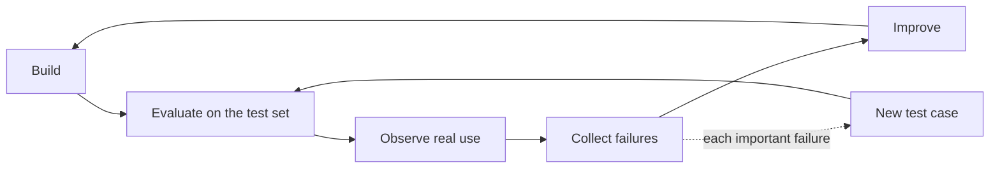

# Estimating AI Work as a Product

## Start with the afternoon demo

Lantern Learning, a fictional training company, wanted an AI mock-interview assistant. An engineer wired one chat screen to a model in an afternoon. It asked sensible questions and gave sensible feedback on three test answers. The team quoted two weeks to launch.

Two weeks later, nobody could say whether the feedback was good. Some answers got praise one day and criticism the next. Learners pasted in their own documents, and the assistant quoted stale course material. There was no test set, no tracing and no plan for when the model was slow. Call this **the afternoon estimate**: sizing an AI product by its first model call.

> **What you'll learn**
>
> - Tell predictable logic from judgement-based logic and estimate each accordingly.
> - Answer the seven questions every AI estimate must cover.
> - Size the gap between an AI prototype, an MVP and a production service.

"The model can do it" marks the start of an AI project, not its end. AI adds two jobs ordinary software estimates leave out: keeping unpredictable behaviour within bounds, and proving that behaviour is good enough. Both sit on top of the hidden work in [The System Behind the Screens](/learn/forward-deployed/scoping-an-fde-project/the-system-behind-the-screens).

## Separate predictable logic from judgement

Two kinds of logic sit in an AI product:

- **Predictable logic** gives the same output for the same input. When a payment succeeds, mark the booking paid.
- **Judgement-based logic** has several reasonable outputs. Decide whether an interview answer is strong.

Judgement cannot be tested by checking one expected value. Something has to measure quality across many cases. That measurement is the extra work, and it is why a demo that works on three examples says little about the project.

## Answer the seven questions before sizing

An AI estimate is incomplete until it can answer seven questions:

1. What exactly should the AI decide or write?
2. What information does it need, and where does it come from?
3. Which actions may it take?
4. Which of those need human approval first?
5. How many mistakes are acceptable?
6. How will quality be measured before and after launch?
7. What happens when the AI is unsure, slow, unavailable or too expensive?

Each answer adds work. Data access, action boundaries, a human fallback, tracing, cost control, failure handling and a way to improve bad answers all surround the model call.

## Size the three levels separately

The scoping guide's mock-interview assistant shows how far apart the levels are.

| Level | What it contains | Rough size |
|---|---|---|
| Prototype | One chat screen, one prompt, a fixed interview flow, a closing feedback message | A few days |
| MVP | Login, saved sessions, several modes, document lookup, a scoring guide, a structured report, history | Several weeks |
| Production | A test set, tracing, versioned prompts, regression tests, cost controls, a fallback, analytics | One to several months |

*Table 1: Three levels of the same assistant. The model call is the same in every row.*

The jump from days to months is not more prompting. It is the work of controlling and proving behaviour.

## Treat document lookup as data work

Retrieval quality is bounded by source quality. Plan time for:

- cleaning documents
- applying access rules
- labelling
- splitting into chunks
- keeping content fresh
- showing sources
- testing search

If nobody owns updates, the system drifts out of date without anyone noticing. That is what happened to Lantern's course material. For the retrieval side in depth, see [evaluating retrieval and generation separately](/learn/llm-and-retrieval/rag-from-first-principles/the-rag-lifecycle-and-a-measured-baseline).

## Write the tests before the pilot

Agree sample cases and expected behaviour before real users arrive. Include clean examples, unclear requests, missing information, unsafe requests and cases that should go to a human. After launch, turn each important failure into a new test.

AI quality comes from a loop, not a perfect prompt. Figure 1 shows it.

*Figure 1: The quality loop. Every important failure becomes a test, so the test set grows with the product.*

> **Pitfall:** An AI demo with no test set is a project with no definition of good. It can look excellent on the day and still have no way to show it is improving or regressing.

For how to size and grow a test set, see [golden sets and sample size](/learn/production-ai/evaluation-and-release-gates/golden-sets-and-sample-size).

## Worked example: pricing the mock-interview assistant

A team asks how long an AI mock-interview assistant will take. The honest answer starts with a question: which level? The switcher shows what each answer buys.

Choose a level of done for the mock-interview assistant and see what drives its size.

<button type="button" data-mode="prototype" aria-pressed="false" aria-controls="prototype-result">Prototype</button>
<button type="button" data-mode="mvp" aria-pressed="false" aria-controls="mvp-result">MVP</button>
<button type="button" data-mode="production" aria-pressed="false" aria-controls="production-result">Production</button>

<section id="prototype-result" class="mode-panel" data-announcement="Prototype selected. A few days."><h4>Prototype: a few days</h4><ul><li>A screen, a prompt and a fixed flow.</li><li>No saved data, no quality measurement.</li></ul>
Enough to show the idea could work.
</section>
<section id="mvp-result" class="mode-panel" data-announcement="MVP selected. Several weeks."><h4>MVP: several weeks</h4><ul><li>Adds login, saved sessions, document lookup and a scoring guide.</li><li>Document lookup means document cleaning. The scoring guide means writing a rubric.</li></ul>
Enough for a small group of real learners.
</section>
<section id="production-result" class="mode-panel" data-announcement="Production selected. One to several months."><h4>Production: one to several months</h4><ul><li>Adds a test set covering clear, unclear and unsafe answers, and regression tests.</li><li>Adds prompt versioning, cost limits and a fallback for when the model is slow.</li></ul>
Enough to serve learners reliably and show quality over time.
</section>

The model call is the same at all three levels. Everything that changes the estimate is control and proof.

## Limits of this lesson

- **Sizes are rough.** "A few days" and "several months" assume one small team and a well-defined use case. Your ranges depend on data and integrations.
- **The seven questions are a floor.** Regulated domains add review, audit and approval work on top.
- **Fictional data.** Lantern Learning and its figures are illustrative.

## Interview angle

Each answer is an outline to say in about two minutes. Open each question and try it aloud before reading.

Interview question 1. The prototype took an afternoon. Why do you estimate months for production?

- **Answer:** The afternoon bought the model call. Production adds the work of controlling and proving behaviour: a test set, regression tests, tracing, versioned prompts, cost controls, a fallback and analytics. Judgement-based output has no single expected value, so quality must be measured across many cases, and that measurement is the bulk of the work.
- **Trade-off:** A long estimate can lose the room. A short one sets up a launch nobody can defend.
- **Follow-up to expect:** "What can we ship sooner?" An MVP for a small group, with the test set started.

Interview question 2. What do you need to know before you can size an AI feature?

- **Answer:** Seven things: what the AI decides or writes, the data it needs and where that lives, the actions it may take, which actions need approval, the acceptable error rate, how quality is measured before and after launch, and what happens when it is unsure, slow, down or too expensive. Each answer adds work around the model call.
- **Trade-off:** Seven questions slow the first conversation. Skipping them hides most of the effort.
- **Follow-up to expect:** "Which answer moves the estimate most?" Usually the actions and approvals.

Interview question 3. The customer wants the assistant to search their documents. What do you add to the plan?

- **Answer:** Treat it as data work: cleaning documents, applying access rules, labelling, chunking, keeping content fresh, showing sources and testing search. Name an owner for updates, or the content drifts out of date unnoticed. Retrieval quality is bounded by source quality, so I check the documents before promising answer quality.
- **Trade-off:** Data work is invisible in a demo. Without it, answers are confident and wrong.
- **Follow-up to expect:** "The documents are a mess." Then cleaning them is the first workstream.

## References

1. The repository's scoping guide, *Scoping an FDE Project: Complete Guide*, Module 3 Topic 3.1 "Estimate AI as a product, not a single API call", summarised in our own words. The guide is itself based on the fdehandbook.com "Scope a Project" course.
2. The site's [golden sets and sample size](/learn/production-ai/evaluation-and-release-gates/golden-sets-and-sample-size) lesson, for building the test set.
3. The site's [evaluating retrieval and generation separately](/learn/llm-and-retrieval/rag-from-first-principles/the-rag-lifecycle-and-a-measured-baseline) lesson, for testing document lookup.

## Key takeaways

- Judgement-based logic needs a way to measure quality. That is the extra AI work.
- Answer seven questions about decisions, data, actions, approvals, error tolerance, measurement and fallbacks before sizing.
- AI prototypes, MVPs and production services differ by days against months.
- Document lookup is data work, and it decays without an owner.
- Write tests before the pilot and feed every failure back into them.

## Check yourself

1. Why does a working AI demo say little about the size of the project?

It shows the model call, which is cheap. It does not show data access, action limits, evaluation, fallbacks, cost control or the improvement loop.

2. What makes judgement-based logic harder to test than predictable logic?

Several outputs can be reasonable, so there is no single expected value. Quality must be measured across many cases.

3. What should a pre-pilot test set include?

Clean examples, unclear requests, missing information, unsafe requests and cases that should be handed to a human.

