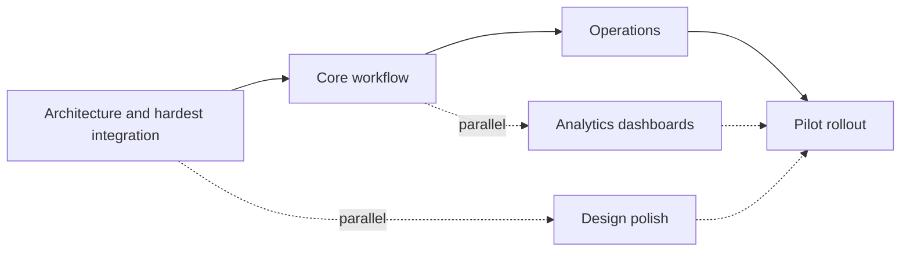

# From Estimate to Build Plan

## Start with the integration saved for last

Pellar Logistics, a fictional freight company, approved a six-week plan for a dispatch dashboard. The plan was a tidy ticket list. Screens came first because they were easy to show. The connection to Pellar's ageing route-planning system sat in week six.

In week six the route system turned out to accept updates only in nightly batches. Every screen built on live updates needed rework. The date moved by a month, and nobody had seen it coming, because nothing in the first five weeks had touched the risk. Call this **the last-week integration**: a plan ordered by what is easy to show instead of by what could break it.

> **What you'll learn**
>
> - Set milestones that each prove something rather than mark a date.
> - Protect the critical path and give engineers end-to-end ownership.
> - Run the project with four light documents and spot the signs of drift.

An estimate says how much work exists. A plan says how the team will remove risk step by step until a usable release ships. The plan rests on the range from [Estimates People Can Trust](/learn/forward-deployed/scoping-an-fde-project/estimates-people-can-trust) and is run with a few light documents and decision-making meetings.

## Make each milestone prove something

"End of week two" is a date, not a milestone. A real milestone delivers a working slice, proves a risky assumption, or unlocks the next block of work. The scoping guide's four-step pattern:

1. Check the architecture, data, login and the hardest integration.
2. Get the core happy path working end to end.
3. Add failure handling, admin operations and analytics.
4. Test, pilot, monitor and prepare the rollback.

The hardest integration sits in the first milestone on purpose. Risk found in week one is cheap. Risk found in the last week moves the date, as Pellar learned.

## Protect the critical path

Some work can run in parallel. Some blocks everything behind it. The chain of blocking work is the **critical path**, shown in Figure 1.

*Figure 1: A critical path with parallel work beside it. Solid arrows block. Dotted work can slip without moving the date, so it never displaces the solid chain.*

Connect the riskiest dependency early, keep the path visible to everyone, and never let optional polish displace work on it. Parallel work saves calendar time but not total effort.

## Give engineers a whole outcome

Do not slice work so finely that everyone owns a layer and nobody owns a result. One engineer can own booking from the user's click through to confirmation and support visibility. Another can own payment through to reconciliation and alerts. Ownership of an outcome is what makes someone notice when the pieces do not join.

Ownership for the lead is not controlling every file. Agree interfaces early, give engineers meaningful slices, review the riskiest work closely, and decide fast enough that nobody waits.

## Price every scope change

Change is normal. Silent change breaks plans. When scope rises, time rises, the team grows, or quality and risk shift. Nothing else stays fixed. Say it in those terms: it can be added, but it needs a later date, more people, or something removed.

Keep a short decision log for choices that change the shape of the project: hosted against custom, manual against automated, one customer against broad rollout, data design, safety limits. A few sentences of reasoning per decision is enough.

## Run the project with four light documents

Heavy process is not needed. Four documents usually are.

| Document | What it holds |
|---|---|
| One-page brief | Problem, user, outcome, scope and exclusions, major risks, owner, target milestone |
| Technical design | How it is built, data flow, integrations, states, trade-offs, security, rollout, open questions |
| Execution plan | Milestones, dependencies, critical path, owners, checkpoints, the estimate range |
| Decision log | Each decision, its alternatives, reasoning, date, owner, and what would reopen it |

*Table 1: Four documents that run a project. The brief is the one most people read.*

Keep the brief to one page. It names the project and owner, the problem and who feels it, the measurable target, what is in and out, the level of done, the main assumptions, the biggest risks, the estimate range with team shape, and the rollout plan.

**Use meetings to decide, not to report.** Write the needed decision down beforehand. Leave with a decision, an owner and the next checkpoint. If nothing needs deciding, send a document instead. A good outcome reads:

- **Decision:** version 1 is read-only with human approval.
- **Owner:** Priya.
- **Open question:** whether ticket history is reachable through the existing API.
- **Checkpoint:** Thursday, after the security review.

The questions that expose the real work fall into four groups:

| Group | Questions |
|---|---|
| Business | Why now, who owns the outcome, what if nothing is done, which metric matters |
| Workflow | Show the current process, the hand-offs and the usual exceptions |
| Technical | Which systems hold the data, which actions are needed, what the access limits are |
| Delivery | Who approves, which deadline is real, what can stay manual, what can be piloted |

*Table 2: Four groups of questions that expose the real work.*

> **Pitfall:** The hardest integration scheduled for the final week is a date that will slip. It is one of eight drift signs: nobody can state the outcome, stakeholders disagree on the MVP, the estimate lists no assumptions, the hardest integration comes last, nobody owns admin or support, the AI demo has no test set, scope arrives through chat without changing the plan, and the team celebrates deployment without knowing whether users succeeded.

## Worked example: planning the class-booking MVP

Take the three-to-five-week booking MVP. The walkthrough steps through its four milestones.

Plan the booking MVP milestone by milestone. Each step shows what it delivers and what it proves.

<button type="button" data-step="0" aria-pressed="false" aria-controls="milestone-step-0">1. Risk</button><button type="button" data-step="1" aria-pressed="false" aria-controls="milestone-step-1">2. Happy path</button><button type="button" data-step="2" aria-pressed="false" aria-controls="milestone-step-2">3. Operations</button><button type="button" data-step="3" aria-pressed="false" aria-controls="milestone-step-3">4. Pilot</button>

<section id="milestone-step-0" class="step-panel" aria-labelledby="milestone-heading-0"><h4 id="milestone-heading-0">1. Retire the hardest risk</h4><dl><dt>Delivers</dt><dd>Hosted login connected, and the payment-provider spike on refund rules.</dd><dt>Proves</dt><dd>Whether the hardest integration works before anything is built on it.</dd></dl></section><section id="milestone-step-1" class="step-panel" aria-labelledby="milestone-heading-1"><h4 id="milestone-heading-1">2. One flow end to end</h4><dl><dt>Delivers</dt><dd>One booking flow working from click to confirmation.</dd><dt>Proves</dt><dd>That the core path joins up across every layer.</dd></dl></section><section id="milestone-step-2" class="step-panel" aria-labelledby="milestone-heading-2"><h4 id="milestone-heading-2">3. Make it operable</h4><dl><dt>Delivers</dt><dd>The waitlist, double-booking handling, the admin portal and analytics.</dd><dt>Proves</dt><dd>That support can run the service and the team can see it working.</dd></dl></section><section id="milestone-step-3" class="step-panel" aria-labelledby="milestone-heading-3"><h4 id="milestone-heading-3">4. Pilot safely</h4><dl><dt>Delivers</dt><dd>A pilot with one studio, with monitoring and a tested rollback.</dd><dt>Proves</dt><dd>That real users succeed, and that the team can back out if they do not.</dd></dl></section>

<button type="button" data-walk="previous">Previous</button>

<button type="button" data-walk="next">Next step</button>

One engineer owns booking end to end. Another owns payment through reconciliation. When the studio asks for door access mid-project, the decision log records the choice: door access waits for a later phase, because adding it would push the date by the integration's unknown size. The plan absorbed a change without hiding its cost.

## Limits of this lesson

- **Four documents suit a small team.** Regulated or multi-team work may need more formal change control.
- **The critical path moves.** Re-draw it after each milestone, because a spike result can change which work blocks.
- **Fictional data.** Pellar Logistics and its figures are illustrative.

## Interview angle

Each answer is an outline to say in about two minutes. Open each question and try it aloud before reading.

Interview question 1. How do you order the milestones of a pilot?

- **Answer:** By risk, not by what is easy to show. The first milestone checks architecture, data, login and the hardest integration. Then the core happy path end to end, then failure handling, admin and analytics, then testing, the pilot, monitoring and the rollback. Each milestone proves a slice or an assumption, not a date.
- **Trade-off:** Early milestones look unimpressive in a demo. A late surprise moves the date.
- **Follow-up to expect:** "The sponsor wants screens in week one." Show a thin slice that also exercises the risky integration.

Interview question 2. The customer adds a feature mid-project. What do you do?

- **Answer:** Price it in time, people or other scope: it can go in, with a later date, more people, or something removed. Let the owner choose, record the decision and reasoning in the decision log, and update the plan. Never absorb it silently.
- **Trade-off:** Naming the cost can feel unhelpful. Absorbing it silently breaks the plan for everyone.
- **Follow-up to expect:** "They say it's small." Ask what it touches: permissions, data or support work.

Interview question 3. How can you tell a project is drifting before the date slips?

- **Answer:** Look for the signs: nobody can state the outcome, stakeholders disagree on the MVP, the estimate has no assumptions, the hardest integration comes last, nobody owns admin or support, the AI demo has no test set, scope arrives through chat without changing the plan, or the team celebrates deployment without knowing whether users succeeded.
- **Trade-off:** Calling drift early can feel alarmist. Calling it late leaves no room to recover.
- **Follow-up to expect:** "Which sign do you fix first?" The one that hides the most risk, often the late integration.

Interview question 4. How do you run status meetings on a delivery project?

- **Answer:** I use meetings to decide, not to report. The decision needed is written down beforehand, and each meeting ends with a decision, an owner and the next checkpoint. Status goes in the execution plan or a short note. If nothing needs deciding, I send a document and cancel the meeting.
- **Trade-off:** Fewer meetings can make some stakeholders feel out of the loop. Clear documents fix that.
- **Follow-up to expect:** "Which documents?" A one-page brief, a technical design, an execution plan and a decision log.

## References

1. The repository's scoping guide, *Scoping an FDE Project: Complete Guide*, Module 4 "Turn the Estimate Into a Build Plan" (Topics 4.1 to 4.5) and Module 7 "Run the Project Day to Day" (Topics 7.1 to 7.3 and 7.5 to 7.7), summarised in our own words. The guide is itself based on the fdehandbook.com "Scope a Project" course.
2. The site's [cross-team ownership and cadence](/learn/forward-deployed/delivery-stages-and-gates/cross-team-ownership-and-cadence) lesson, for running the plan once delivery starts.

## Key takeaways

- A milestone proves a slice or an assumption. Put the hardest integration first.
- Keep the critical path visible and protect it from polish.
- Give engineers end-to-end outcomes, and lead by interfaces, reviews and quick decisions.
- Every scope change carries a cost in time, people or other scope. Record shaping decisions in a log.
- Four light documents and decision-focused meetings are enough. Watch for the eight drift signs.

## Check yourself

1. Why does the hardest integration belong in the first milestone?

Risk found early is cheap to absorb. Found in the last week, it moves the date.

2. What should every meeting end with?

A decision, an owner and the next checkpoint. If nothing needs deciding, use a document instead.

3. Name four signs a project is drifting.

Nobody can state the outcome. Stakeholders disagree on the MVP. The estimate has no assumptions. Scope arrives through chat without changing the plan.

