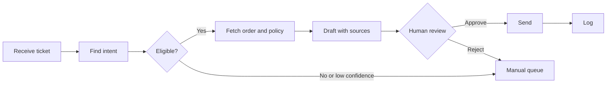

# Scoping in Practice

## Start with the request that was three projects

Rowan Home, a homeware retailer, asked its FDE for an agent that "answers customers and completes common tasks". The FDE scoped it as one project with one estimate. Drafting replies went well. Then the agent was allowed to issue refunds, and a run of wrong refunds reached customers before anyone reviewed them. Call this **the one-project illusion**: one request that hides several levels of risk, scoped as if it were one.

> **What you'll learn**
>
> - Scope a consumer product request from business question to staged estimate.
> - Scope an AI support request by narrowing risk, separating data sources and earning autonomy.
> - Run the 30-minute practice exercise and the pre-estimate checklist.

Two worked cases and one timed exercise run the whole method from [Problem, Goal, and Definition of Done](/learn/forward-deployed/scoping-an-fde-project/problem-goal-and-definition-of-done) onwards in one pass. A checklist closes the module: run it before giving anyone a date.

## Scope a product request: class booking

The request: a class-booking product with web and mobile apps, payments, memberships, community features, movement feedback and automatic physical access. It sounds like a few screens and becomes scheduling, payments, operations and physical-world limits.

**Ask what the business really is.** Is the aim discovering classes, filling studios, selling subscriptions or AI instruction? One studio or many? Do instructors, schedules and payment rules already exist? Is AI coaching needed at launch?

**Map the system.** The customer side covers discovery, schedule, booking, payment, membership and profile. The operations side covers classes, capacity, refunds, instructors, locations and support. The platform side covers login, notifications, analytics, mobile release, security and monitoring.

**Find the assumptions that could double the work.** How complex are the membership, cancellation, refund and waitlist rules? Does "AI coaching" mean generic tips, pose detection or live computer vision? How does door access reach physical devices? Are fully native apps needed, or will one shared codebase do?

**Draw a hard line around version 1.** A responsive site, hosted login, schedule, booking, hosted checkout, simple memberships, email confirmation and an admin portal, for one location. Native apps, community, live coaching and door automation wait until one location can win customers, take payment, run classes and handle support reliably.

**Estimate by stage**, for one experienced full-stack engineer with modern tools:

| Stage | Rough size | Main assumption |
|---|---|---|
| Visual prototype | 1 to 2 weeks | Fake data, no real operations |
| Booking MVP | 6 to 10 weeks | One location, hosted services, simple rules |
| Production pilot | 3 to 6 months | Admin, support, monitoring, refunds, mobile, reliability |
| Full vision | 6 to 12+ months, with a team | Movement feedback, community, hardware, many locations |

*Table 1: The class-booking product estimated by stage.*

Say it so the team can act: the website is not the main effort. Booking, payment, membership, operations, mobile and physical access are. Aim for six to ten weeks for a single-location web MVP, then re-estimate mobile, coaching and access after short spikes. Estimate the system behind the product, and keep the MVP apart from the long-term vision.

## Scope an AI request: a support copilot

The request is Rowan's: too many tickets, so build an agent that answers customers and completes common tasks. Several projects hide here. Drafting a reply for an employee is lowest risk. Sending straight to a customer is higher. Changing an order or refunding money is higher still. Treat each as a separate scope decision.

**Sit with the current workflow.** Watch agents resolve real tickets before designing anything. [Observing the work](/learn/forward-deployed/customer-discovery/observing-the-work) covers how. For this case, find which ticket categories are high-volume and low-risk, and which mistakes cause financial, legal or customer harm.

**Pick one low-risk, high-volume case.** If order-status questions are about 30 percent of volume, they are repetitive, measurable and read-only: a sensible pilot. Refunds and fraud are not. A target: draft a sourced reply for order-status tickets, cut handling time by 40 percent, and hold factual accuracy above 95 percent on an approved test set.

**Write the boundary.** In scope: order-status tickets, read-only order lookup, a draft reply with sources, human approval. Out of scope: refunds, address changes, cancellations, fraud, and sending directly to customers. Fallback: low-confidence or unsupported cases stay in the existing queue.

**Keep live data apart from reference knowledge.**

| Source | Purpose | How it is used | Main risk |
|---|---|---|---|
| Order system | Current order and shipping state | Live lookup | Wrong customer, or a stale answer |
| Support policy | Approved explanations and escalation rules | Document search | An outdated or irrelevant passage |
| Customer message | What the customer wants | Input to the AI | Unclear wording or embedded instructions |
| Ticket history | Earlier contacts and promises | Background context | Too much personal data exposed |

*Table 2: Four sources, used four ways. Each fails differently.*

**Keep the escape hatch.** Figure 1 shows the flow. A safe pilot keeps people involved and the old path alive.

*Figure 1: The pilot flow with its escape hatch. Unsupported, low-confidence or rejected drafts return to the manual queue.*

**Build the test set before connecting anything.** Gather realistic tickets: routine ones, missing data, policy exceptions, angry wording, unsafe requests and must-escalate cases, with customer data protected. Judge six things: the right policy found, a factually correct draft, the right choice to answer, ask or escalate, rules followed, clarity and usefulness, and real time saved without extra review work.

**Estimate the pilot, not the dream.**

| Workstream | Rough effort | Key assumption |
|---|---|---|
| Workflow understanding and data access | 1 week | The customer supplies experts and test access quickly |
| Core agent and order lookup | 1 to 2 weeks | The order API is documented and stable |
| Policy document search | 1 week | Policies are current and in one place |
| Testing and improvement | 1 to 2 weeks | Past examples exist |
| Support-platform integration | 1 to 2 weeks | The platform supports draft workflows |
| Pilot rollout and monitoring | 1 week | A small group, with human review kept |

*Table 3: The support-copilot pilot by workstream.*

In total, about five to eight weeks for a small team. The biggest risks are customer data access, the support-platform integration and policy quality. Fully automatic actions are excluded and would need their own safety phase.

**Earn autonomy in stages.** Test offline on past tickets, then draft in shadow while agents work normally, then let a small group review drafts, then expand as quality holds. Act on its own only for narrow, reversible actions with strong controls. [Choosing the first use case](/learn/forward-deployed/customer-discovery/choosing-the-first-use-case) teaches this ladder in full.

Make the workflow clear, measurable, narrow and safe before making the agent powerful.

> **Pitfall:** "Answer customers and complete tasks" is three projects with three risk levels. Scoping it as one hides the jump from drafting for an employee to moving a customer's money.

## Practise: a delivery model in 30 minutes

A property-management company wants an assistant that answers tenant questions, schedules maintenance and flags urgent requests. Work on paper in six timed parts.

1. **Clarify (5 minutes).** Users, the most painful workflow, the outcome that matters, which requests are high-volume and low-risk, which actions could harm.
2. **Draw the system (10 minutes).** Entities: tenant, property, unit, request, vendor, appointment, lease. States: new, triaged, scheduled, assigned, completed, escalated. Integrations: property system, calendar, text, email, vendor system. Roles: tenant, coordinator, technician, manager, admin.
3. **Find failure points (5 minutes).** At least one each for data (the wrong tenant), scheduling (a double-booked technician), safety (a gas leak treated as routine), communication (the wrong appointment time) and AI (an invented lease rule).
4. **Define the MVP (5 minutes).** Answer approved policy questions, sort maintenance requests, spot emergency keywords, and draft work orders for staff approval. Exclude auto-dispatching vendors, complex lease disputes, and closing emergencies without a person.
5. **Estimate (10 minutes).** A table of workstream, range, assumption and risk for discovery, the knowledge assistant, request sorting, the work-order integration and the pilot.
6. **Give the lead answer.** Restate the outcome, name the MVP, give the range, state assumptions, name the top risks, explain the first technical test, and describe rollout and the success measure.

A short model answer: a staff-assisted pilot at one property, not a fully automatic agent, for about six to nine weeks, assuming usable APIs and central policies. Week one tests the property API and builds an emergency test set. Success means routine handling time falls while emergency detection stays above the agreed level.

Keep practising by taking apart two products a week. Save the first scope and estimate, then revisit it after learning more.

## Check before giving any date

Run this list before a date reaches a team or a customer:

- [ ] **Problem** being solved, and the **users** who feel it
- [ ] **Success** as a measurable outcome, and the **definition of done**: prototype, MVP, pilot or production
- [ ] **Surfaces**, **entities**, **states** and end-to-end **workflows**
- [ ] **Integrations** with outside systems, and **failure modes**
- [ ] **AI uncertainty**: which behaviour is judgement-based
- [ ] **Production needs**: scale, speed, cost, security, reliability
- [ ] **Hidden work**: login, admin, migration, testing, monitoring, support
- [ ] **Unknowns** needing research or a spike
- [ ] **MVP**: the smallest useful and safe version
- [ ] **Estimate** range with its supporting assumptions
- [ ] **Plan**: milestones, dependencies, critical path, ownership
- [ ] **Rollout**: pilot, feature flag, alerts, rollback
- [ ] **Measure**: whether the original outcome improved

The customer usually knows the outcome they want. The FDE's job is to turn it into a route that can be built.

## Limits of this lesson

- **Two cases are a sample.** Real requests mix product and AI work. Run both sets of steps where they overlap.
- **Composite engagement.** Rowan Home, the property company and all figures are illustrative, not real customers.

## Interview angle

Each answer is an outline to say in about two minutes. Open each question and try it aloud before reading.

Interview question 1. A retailer wants an agent that answers customers and processes refunds. Where do you start?

- **Answer:** Split it by risk: drafting for an employee, sending to customers, and moving money are separate scopes. Watch agents work, then pilot one high-volume, read-only case such as order status, with human approval and a manual-queue fallback. Build the test set first, and earn autonomy in stages before refunds are considered.
- **Trade-off:** A drafting pilot looks modest. Starting with refunds risks real money on an unproven agent.
- **Follow-up to expect:** "When would you allow refunds?" Only for narrow, reversible cases with strong controls.

Interview question 2. You have five minutes to scope a product you have never seen. What do you say?

- **Answer:** Restate the outcome, ask what the business is, and map the customer, operations and platform sides. Name the assumptions that could double the work, draw a hard line around version 1, and estimate by stage with the main assumption beside each range. Close with the first spike.
- **Trade-off:** Five minutes forces rough ranges. Stating the assumptions keeps them honest.
- **Follow-up to expect:** "What is the main effort?" Usually not the screens.

## References

1. The repository's scoping guide, *Scoping an FDE Project: Complete Guide*, Module 6 "See the Method in Action" (Topics 6.1 to 6.3) and Module 8 "The Pre-Estimate Checklist", summarised in our own words. The guide is itself based on the fdehandbook.com "Scope a Project" course.
2. The site's [practise scoping and value questions](/learn/forward-deployed/scoping-an-fde-project/practise-scoping-and-value-questions) lesson, for timed drills.

## Key takeaways

- For a product request, find the real business, map the system, flag doubling assumptions, fence version 1, and estimate by stage.
- For an AI request, split it by risk level, pick a read-only high-volume pilot, separate live data from reference knowledge, test first and earn autonomy.
- Practise on a clock with six fixed parts, and revisit old estimates to build judgement.
- Run the pre-estimate checklist before any date leaves the team.

## Check yourself

1. Why are order-status questions a good first pilot for a support copilot?

They are high-volume, repetitive, measurable and read-only. Refunds and fraud carry far more risk.

2. Why keep the order system and the support policy as separate sources?

One is live state needing exact lookup, the other is reference text needing search. They fail differently: a wrong or stale order against an outdated passage.

3. In the class-booking case, what should be re-estimated after short spikes?

Mobile apps, AI coaching and automatic door access, once a single-location web MVP is scoped at six to ten weeks.

