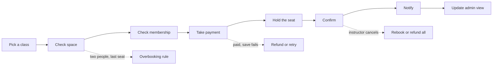
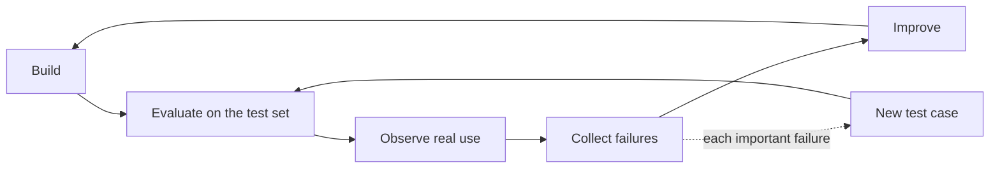

# Sizing the Work a Demo Hides

## Start with the afternoon demo

Lantern Learning, a training company, asked its FDE for an AI mock-interview assistant. The FDE wired one chat screen to a model in an afternoon, and it gave sensible feedback on three test answers. The sponsor left the demo with "two weeks to launch". Two weeks later nobody could say whether the feedback was good: the same answer got praise one day and criticism the next, learners were shown stale course material, and support could not reset a learner's session without a developer. Call this **the demo-sized estimate**: sizing a product by what the demo shows instead of by what sits underneath it.

> **What you'll learn**
>
> - Work down from surfaces to entities, states and workflows, then break the workflows on purpose.
> - Spot the properties that make a project hard regardless of its size.
> - List the operational work a demo never shows.
> - Tell predictable logic from judgement and answer the seven questions every AI estimate must cover.
> - Plan document lookup and the test set as work of their own.

A demo shows two things: the surface and, for AI, the first model call. The project is everything beneath them. Once the goal and level of done are set, as in [Problem, Goal, and Definition of Done](/learn/forward-deployed/scoping-an-fde-project/problem-goal-and-definition-of-done), dig through the product first and then through the AI.

## Dig from surfaces down to workflows

Tempo Studios, a chain of fitness studios, shows the product half of the problem. Its team counted six screens for a class-booking product (schedule, class detail, booking, checkout, account and admin) and quoted three weeks at two or three days a screen. The screens were finished on time. The product could not run, because the waitlist, refunds and cancellations lived underneath them.

Work through four layers, top to bottom. The walkthrough takes Tempo's booking product through each one.

Dig through the four layers of a class-booking product. Each step shows what the layer holds and what it adds to the estimate.

<button type="button" data-step="0" aria-pressed="false" aria-controls="layers-step-0">1. Surfaces</button><button type="button" data-step="1" aria-pressed="false" aria-controls="layers-step-1">2. Entities</button><button type="button" data-step="2" aria-pressed="false" aria-controls="layers-step-2">3. States</button><button type="button" data-step="3" aria-pressed="false" aria-controls="layers-step-3">4. Workflows</button>

<section id="layers-step-0" class="step-panel" aria-labelledby="layers-heading-0"><h4 id="layers-heading-0">1. Surfaces: what people touch</h4><dl><dt>Holds</dt><dd>Web pages and dashboards, mobile apps with their notifications and permissions, admin tools for settings and refunds, and operational views for reports, alerts and moderation.</dd><dt>Adds</dt><dd>The visible part of the estimate, and the only part a screen count sees.</dd></dl></section><section id="layers-step-1" class="step-panel" aria-labelledby="layers-heading-1"><h4 id="layers-heading-1">2. Entities: the business nouns</h4><dl><dt>Holds</dt><dd>Users, instructors, classes, sessions, studios, rooms, memberships, bookings and payments.</dd><dt>Adds</dt><dd>Data design, and the relations each screen depends on.</dd></dl></section><section id="layers-step-2" class="step-panel" aria-labelledby="layers-heading-2"><h4 id="layers-heading-2">3. States: how the nouns change</h4><dl><dt>Holds</dt><dd>A booking is never only "booked". It may be available, reserved, paid, confirmed, attended, waitlisted, promoted from the waitlist or refunded.</dd><dt>Adds</dt><dd>Rules for each transition: who may trigger it, what must already be true, what gets recorded and what happens on failure. One "Book" button can hide a dozen of these.</dd></dl></section><section id="layers-step-3" class="step-panel" aria-labelledby="layers-heading-3"><h4 id="layers-heading-3">4. Workflows: the journeys</h4><dl><dt>Holds</dt><dd>The journey in plain words, before any architecture: pick a class, check space, check membership, take payment, hold the seat, confirm, notify, update the admin view.</dd><dt>Adds</dt><dd>The failure paths you find when you break the journey on purpose.</dd></dl></section>

<button type="button" data-walk="previous">Previous</button>

<button type="button" data-walk="next">Next step</button>

Then break the workflow on purpose. Two people grab the last seat at once. Payment succeeds but saving the booking fails. The instructor cancels an hour before class. These are not edge cases. They are part of the product, and Figure 1 shows where they sit.

*Figure 1: One booking journey with three deliberate breaks. Each dotted branch is work the happy path never shows.*

## Judge complexity by interaction, not size

A page count is a poor proxy for effort. A project is hard when many rules, systems and failure paths interact. A content platform and a booking platform of similar size show the difference.

| Question | Content platform | Booking platform |
|---|---|---|
| What changes state? | Viewed, completed, subscribed | Available, reserved, paid, cancelled, refunded, waitlisted |
| Must it be real-time? | Rarely | Yes, when seats are scarce |
| What does it integrate with? | Login, billing, content | Payments, calendar, notifications, door access, maps |
| What does a failure cost? | Lost progress | A double charge, an overbooking, a locked door |
| What does operating it involve? | Managing content | Scheduling, refunds, waitlists, no-shows, support |

*Table 1: Two platforms of similar size. The booking platform is harder on every row.*

Six properties quietly inflate an estimate:

- **Concurrency.** Many users editing the same thing at once.
- **Money.** It brings refunds, reconciliation and audit trails.
- **Role-based permissions.**
- **Physical-world state.** Software that must match a room, a shipment or a person's calendar.
- **Outside systems.** Dependence on systems outside the team's control.
- **Irreversible actions.** Actions that cannot be undone.

## Count the work the demo hides

A demo shows the happy path. The production project also contains everything that keeps the service safe and runnable, and that hidden work often decides whether the system can be trusted.

Before committing to a date, check:

- login and account recovery
- roles and permissions
- admin and support tooling
- migration of existing data
- analytics, logging and alerting
- safe retries that never repeat an action
- abuse and usage limits
- a security and privacy review
- testing with a staging environment
- a rollout and rollback plan
- support with incident response

> **Pitfall:** A feature support staff cannot operate is not finished. If customers can book a class but support cannot cancel it, refund it, change capacity or see why a confirmation failed, the service does not work in practice, however good the customer screen looks.

## Separate predictable logic from judgement

Everything above applies to an AI product too. AI then adds two jobs that ordinary software estimates leave out: keeping unpredictable behaviour within bounds, and proving that behaviour is good enough. "The model can do it" marks the start of that work, not its end.

Two kinds of logic sit in an AI product:

- **Predictable logic** gives the same output for the same input. When a payment succeeds, mark the booking paid.
- **Judgement-based logic** has several reasonable outputs. Decide whether an interview answer is strong.

Judgement cannot be tested by checking one expected value. Something has to measure quality across many cases. That measurement is the extra work, and it is why Lantern's demo, which worked on three examples, said little about the project.

## Answer the seven questions before sizing

An AI estimate is incomplete until it can answer seven questions:

1. What exactly should the AI decide or write?
2. What information does it need, and where does it come from?
3. Which actions may it take?
4. Which of those need human approval first?
5. How many mistakes are acceptable?
6. How will quality be measured before and after launch?
7. What happens when the AI is unsure, slow, unavailable or too expensive?

Each answer adds work. Data access, action boundaries, a human fallback, tracing, cost control, failure handling and a way to improve bad answers all surround the model call.

The three levels of done from lesson 1 sit further apart for AI than for ordinary software. Lantern's assistant as a prototype (one screen, one prompt, a fixed flow) is a few days. As an MVP, with login, saved sessions, document lookup and a scoring guide, it is several weeks. In production, with a test set, tracing, versioned prompts, regression tests, cost controls and a fallback, it is one to several months. The model call is the same at all three levels. The jump is the work of controlling and proving behaviour.

## Treat document lookup as data work

Retrieval quality is bounded by source quality. Plan time for:

- cleaning documents
- applying access rules
- labelling
- splitting into chunks
- keeping content fresh
- showing sources
- testing search

If nobody owns updates, the system drifts out of date without anyone noticing. That is how Lantern's learners ended up reading stale course material. For the retrieval side in depth, see [evaluating retrieval and generation separately](/learn/llm-and-retrieval/rag-from-first-principles/the-rag-lifecycle-and-a-measured-baseline).

## Write the tests before the pilot

Agree sample cases and expected behaviour before real users arrive. Include clean examples, unclear requests, missing information, unsafe requests and cases that should go to a human. After launch, turn each important failure into a new test. AI quality comes from the loop in Figure 2, not from a perfect prompt.

*Figure 2: The quality loop. Every important failure becomes a test, so the test set grows with the product.*

> **Pitfall:** An AI demo with no test set is a project with no definition of good. It can look excellent on the day and still have no way to show it is improving or regressing.

Which measures belong in that test set is covered in [success metrics and evaluation data](/learn/forward-deployed/customer-discovery/success-metrics-and-evaluation-data). For how big it must be, see [golden sets and sample size](/learn/production-ai/evaluation-and-release-gates/golden-sets-and-sample-size).

## Worked example: the resume-feedback page

A manager asks for a page where people upload a resume and receive AI feedback. It looks like one screen and one model call. Dig under it with both halves of this lesson.

| Area | Hidden work |
|---|---|
| The file | Validate it, scan it for viruses, parse it |
| Storage | Store it, delete it later, protect the personal data |
| Access | User login |
| The AI call | Failure handling, content-safety checks, usage and cost limits |
| Quality | A rubric for good feedback, a test set of real resumes, regression tests |
| History | Save past feedback |
| Running it | Analytics, support tools, monitoring |

*Table 2: The work behind one upload button.*

That is more than a dozen tasks behind a single upload button, and the estimate must be built from this list, not from the screen.

Lantern's three surprises map onto the same list. Feedback that changed from day to day was judgement with no test set. Stale course material was document lookup with no owner. A session support could not reset was admin tooling nobody counted. An honest first answer would have asked which level of done the sponsor wanted, then sized that level from the list.

## Limits of this lesson

- **Layers are a checklist, not a design.** They find the work. Architecture choices come later.
- **Size still matters.** Interaction drives difficulty, but a large surface still takes time to build and test.
- **Sizes are rough.** "A few days" and "several months" assume one small team and a well-defined use case. Your ranges depend on data and integrations.
- **The seven questions are a floor.** Regulated domains add review, audit and approval work on top.
- **Composite engagement.** Lantern Learning, Tempo Studios and their figures are illustrative, not real customers.

## Interview angle

Each answer is an outline to say in about two minutes. Open each question and try it aloud before reading.

Interview question 1. A customer says the app is "only five screens". How do you check that estimate?

- **Answer:** Dig under each screen: list the entities, the states each one moves through and the rules on every transition. Trace the main workflow, then break it on purpose: concurrent users, a payment that succeeds while the save fails, a cancellation. Add the hidden work such as admin tools, migration and monitoring, then size from that list.
- **Trade-off:** The deeper list takes a day or two to build. A screen count is faster and wrong.
- **Follow-up to expect:** "Which property worries you most?" Money or irreversible actions, because failures there cost the customer directly.

Interview question 2. Two products have the same number of screens. Why might one take three times as long?

- **Answer:** Effort follows interaction, not size. One may need real-time state, payments, several outside systems and actions that cannot be undone. The other may only store and show content. I compare them on what changes state, real-time needs, integrations, the cost of a failure and what operating them involves.
- **Trade-off:** Comparing on these questions needs more discovery. It is the only way the estimate matches the real system.
- **Follow-up to expect:** "Give an example." A content site against a booking platform.

Interview question 3. What do you check before committing to a date that a demo would not show?

- **Answer:** Login and recovery, permissions, admin and support tooling, data migration, analytics and alerting, safe retries, abuse limits, a security review, staging and tests, a rollout and rollback plan, and support with incident response. I also check that support staff can operate every feature, such as cancelling or refunding a booking.
- **Trade-off:** Listing this work makes the estimate larger. Leaving it out makes the date wrong.
- **Follow-up to expect:** "The customer only wants the demo." Then agree that the level of done is a prototype.

Interview question 4. The prototype took an afternoon. Why do you estimate months for production?

- **Answer:** The afternoon bought the model call. Production adds the work of controlling and proving behaviour: a test set, regression tests, tracing, versioned prompts, cost controls, a fallback and analytics. Judgement-based output has no single expected value, so quality must be measured across many cases, and that measurement is the bulk of the work.
- **Trade-off:** A long estimate can lose the room. A short one sets up a launch nobody can defend.
- **Follow-up to expect:** "What can we ship sooner?" An MVP for a small group, with the test set started.

Interview question 5. What do you need to know before you can size an AI feature?

- **Answer:** Seven things: what the AI decides or writes, the data it needs and where that lives, the actions it may take, which actions need approval, the acceptable error rate, how quality is measured before and after launch, and what happens when it is unsure, slow, down or too expensive. Each answer adds work around the model call.
- **Trade-off:** Seven questions slow the first conversation. Skipping them hides most of the effort.
- **Follow-up to expect:** "Which answer moves the estimate most?" Usually the actions and approvals.

Interview question 6. The customer wants the assistant to search their documents. What do you add to the plan?

- **Answer:** Treat it as data work: cleaning documents, applying access rules, labelling, chunking, keeping content fresh, showing sources and testing search. Name an owner for updates, or the content drifts out of date unnoticed. Retrieval quality is bounded by source quality, so I check the documents before promising answer quality.
- **Trade-off:** Data work is invisible in a demo. Without it, answers are confident and wrong.
- **Follow-up to expect:** "The documents are a mess." Then cleaning them is the first workstream.

## References

1. The repository's scoping guide, *Scoping an FDE Project: Complete Guide*, Module 2 "Figure Out What You Are Really Building" (Topics 2.1 to 2.3) and Module 3 Topic 3.1 "Estimate AI as a product, not a single API call", summarised in our own words. The guide is itself based on the fdehandbook.com "Scope a Project" course.
2. The site's [stakeholder and workflow maps](/learn/forward-deployed/customer-discovery/stakeholder-and-workflow-maps) lesson, for tracing real workflows and their exceptions.
3. The site's [golden sets and sample size](/learn/production-ai/evaluation-and-release-gates/golden-sets-and-sample-size) lesson, for building the test set.
4. The site's [evaluating retrieval and generation separately](/learn/llm-and-retrieval/rag-from-first-principles/the-rag-lifecycle-and-a-measured-baseline) lesson, for testing document lookup.

## Key takeaways

- Work down from surfaces to entities, states and workflows, then break the workflows on purpose.
- Complexity comes from interacting states, systems and failure paths, not from page count.
- Hidden operational work decides whether a system is trustworthy. Count it before giving a date.
- Judgement-based logic needs a way to measure quality. That is the extra AI work.
- Answer the seven questions before sizing an AI feature. Each answer adds work around the model call.
- Document lookup is data work, and it decays without an owner. Write the tests before the pilot.

## Check yourself

1. Why can a small booking flow be harder than a large content site?

It has many states, real-time constraints, several outside integrations and costly failures such as double charges. The content site has few of these.

2. Name three ways to deliberately break a booking workflow while scoping it.

Two users take the last seat at once. Payment succeeds but the booking save fails. The instructor cancels shortly before class.

3. Why does a working AI demo say little about the size of the project?

It shows the model call, which is cheap. It does not show data access, action limits, evaluation, fallbacks, cost control or the improvement loop.

4. What should a pre-pilot test set include?

Clean examples, unclear requests, missing information, unsafe requests and cases that should be handed to a human.

