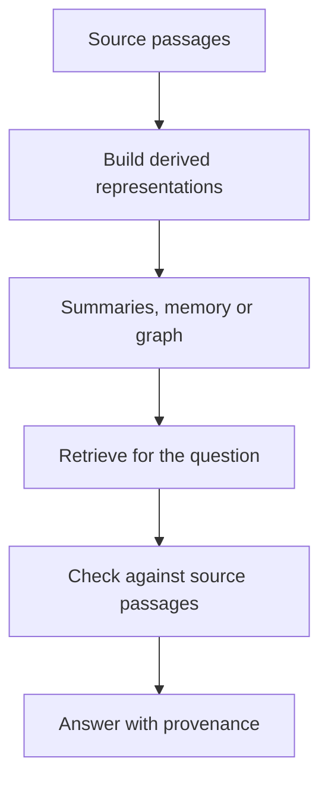

<!-- Generated by site/scripts/rag-theory-import.mjs from rag-agents-engineering. Edit the source there. -->
# Overview

A passage index finds local evidence. A question about the whole handbook may need a representation assembled from several passages before retrieval begins. The M42 notebooks build on four ideas: abstraction levels, collapsed-tree retrieval, global memory and dual-level retrieval.

Larkspur Cloud's handbook supplies the running example. A customer asks how cancellation affects data access; an operations lead asks how the handbook manages service continuity. Both questions connect policies that live in separate sections. Source passages still decide what the answer may claim.

## In short

- RAPTOR adds summaries at several levels to the retrieval corpus. Preserve their links to the passages they summarise.
- Collapsed-tree retrieval ranks leaves and summaries together. Tree traversal chooses a route through parent-child links; these are different retrieval algorithms.
- MemoRAG uses corpus memory to draft retrieval clues. Verify those clues against retrieved evidence before answering.
- LightRAG separates entity-focused retrieval from retrieval over thematic relationships, then assembles graph context and source passages.
- The lab uses four authored source passages and three representative summaries. At a two-node budget, the continuity query reaches one source identifier with leaves only and four through summary ancestry. These are fixture retrieval counts, not algorithm benchmark results.

## Mental model

Derived representations can make distributed evidence easier to find. They also introduce another place to lose an exception, merge unrelated entities or preserve a deleted policy. Keep source identifiers and versions through every transformation so a retrieved summary can lead back to its evidence.

## Interactive lab

[**Search the leaves or the whole tree**](/labs/rag/m42_hierarchical_memory_rag/collapsed-tree-lab.html): open the file in a browser. Compare the thematic question in leaf-only and collapsed modes. Move the result budget and inspect which summary or source passage enters the context. Switch to the specific export question and check whether a broad summary displaces the precise evidence.

## How it connects

- **Before:** [M11](/learn/llm-and-retrieval/rag-from-first-principles/rag-from-first-principles-overview) establishes the flat retrieval baseline. [M33](/learn/memory-and-multi-agent-rag/conversation-memory-and-conversational-rag/conversation-memory-and-conversational-rag-overview) and [M34](/learn/memory-and-multi-agent-rag/memory-and-state/memory-and-state-overview) cover conversational and persistent agent memory; this module's memory represents a document corpus.
- **Next:** [M43](/learn/hierarchical-memory-and-graph-rag/knowledge-graphs-with-neo4j/knowledge-graphs-with-neo4j-overview) makes graph modelling and queries explicit. [M44](/learn/hierarchical-memory-and-graph-rag/graphrag-techniques/graphrag-techniques-overview) compares graph traversal, community reports and graph expansion.

## Key Takeaways

- Choose a representation for the information need and compare it against the flat baseline.
- A summary's source coverage does not prove that every source fact survived compression.
- Distinguish a paper's algorithm from the simplified implementation in its teaching notebook.
- Measure retrieval, source support, update work and generation quality separately.
