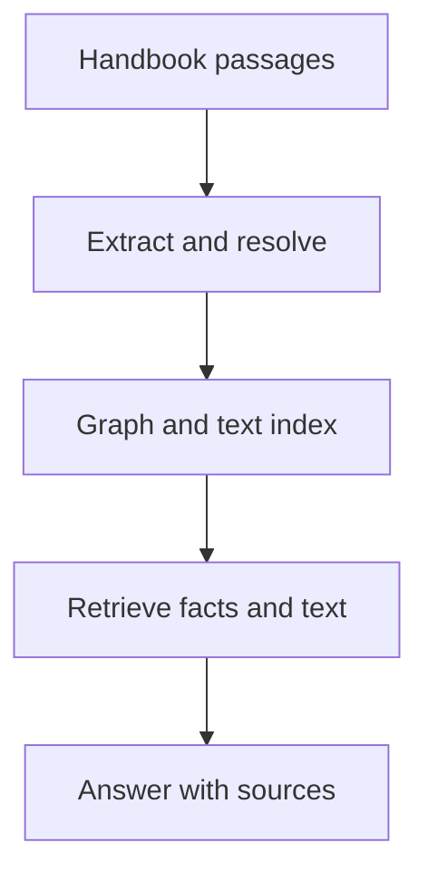

<!-- Generated by site/scripts/rag-theory-import.mjs from rag-agents-engineering. Edit the source there. -->
# Overview

A knowledge graph represents named entities and their relationships explicitly. Cypher matches those relationships; vector retrieval helps find a starting entity when a question uses different words. The M43 notebooks build on four ideas: the property graph, pattern queries, translating questions into Cypher, and combining graph facts with text retrieval.

The running example extends the fictional Larkspur Cloud handbook into plans, features, regions and supporting passages. The golden questions ask which plans support exports in the EU, which source establishes that capability, and what happens after a policy version changes. The notebooks use healthcare, historical and extraction examples; the Larkspur catalogue is a separate teaching fixture.

## In short

- Model identity, edge direction and source provenance before querying the graph.
- Bind the same plan variable across feature and region patterns when both constraints must hold.
- The 43.3 notebook executes hand-written Cypher; automatic text-to-Cypher is an explained extension.
- Vector candidates can fail exact relationship checks. In the lab, `k=2` yields no eligible plans, `k=3` yields one and `k=5` yields both.
- A stored source link helps only when retrieval carries its passage into the answer evidence.

## Mental model

Extraction turns prose into candidate facts. Stable identities let those facts connect across documents, while retained passages let a reader inspect what supports them. Retrieval must carry both the matched relationship and its supporting text into the answer.

## Interactive lab

[**Candidates and graph constraints**](/labs/rag/m43_knowledge_graphs_neo4j/graph-filter-lab.html): open the file in a browser. Increase `k` until the first EU export plan survives. Continue until both eligible plans appear, then inspect the extra candidate checks after recall stops changing. Read the ledger's rejection reason for the highest-ranked record.

## How it connects

- **Before:** [M42](/learn/hierarchical-memory-and-graph-rag/hierarchical-and-memory-augmented-retrieval/hierarchical-and-memory-augmented-retrieval-overview) compares hierarchical summaries, memory and lightweight graph retrieval.
- **Next:** [M44](/learn/hierarchical-memory-and-graph-rag/graphrag-techniques/graphrag-techniques-overview) uses graph structure for traversal, community retrieval and expansion. [M45](/learn/architecture-synthesis-and-capstone/agentic-rag-architectures-choosing-a-design/agentic-rag-architectures-choosing-a-design-overview) compares complete architecture choices.

## Key Takeaways

- Choose stable entity identities and explicit relationship meanings before import.
- Compare generated Cypher with a hand-written query and inspect rows before grading prose.
- Separate semantic candidate selection from exact graph validation and measure both stages.
- Retrieve source passages with graph assertions so each answer claim can be checked.
