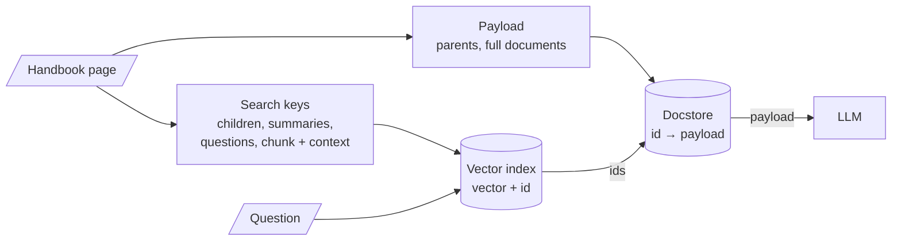

<!-- Generated by site/scripts/rag-theory-import.mjs from rag-agents-engineering. Edit the source there. -->
# Overview

Plain RAG embeds a chunk, matches the question against it and sends that same chunk to the model. M16 separates the two jobs: the text that gets embedded and matched, and the text the model reads, joined by an id. The M16 notebooks build on four ideas: the search key and the payload, the docstore that holds payloads, hypothetical questions as search keys (HyPE), and context written into each chunk before it is embedded (contextual retrieval).

The running example is one 2,184-character page of the Larkspur Cloud handbook with three sections: "Refunds and cancellations" (the [M13](/learn/ingestion-and-indexing-pipeline/chunking-and-indexing/chunking-and-indexing-overview) section), "Outages and service credits" and "Data export and retention". It has three golden questions: *How long do I have to get a full refund on an annual plan?*, *Do I get service credits automatically after an outage?* and *What happens to my data after I cancel my plan?*

## In short

- **The search key and the payload can differ.** The key is whatever gets embedded: a small child chunk, a summary, a list of generated questions, or a chunk with context prepended. The payload is what the model reads: a parent chunk, a whole document, the original chunk. An id stored with each key points at its payload.
- **Parent-document retrieval searches small and returns large.** In the lab at child 150 and parent 600, the top 2 children contain the whole answer for 0 of the 3 golden questions (about 53 tokens on average); their parents contain it for 3 of 3 (about 206 tokens).
- **Parent size is a cost dial with an edge.** With the whole page as the parent, every question costs 546 tokens. With parents of 400 characters, the parent splitter cuts the outage answer in two, and no parent returns it whole.
- **An LLM can write the key at index time.** Summaries (16.1, 16.3) and hypothetical questions (16.4) cost one LLM call per chunk or document, paid once, and are only as good as what the LLM kept.
- **Context in the chunk fixes chunks that never name their subject.** In notebook 05a a document title raises a chunk's reranker relevance from about 0.1 to 0.92. Anthropic reports that contextual embeddings reduced top-20 retrieval failures by 35%, and by 49% with contextual BM25.

## Mental model

At index time the document is written twice: once as payloads into the docstore and once as search keys into the vector index, each key carrying its payload's id. At query time the question meets only the keys, and the model meets only the payloads. Every technique in M16 is a choice of key, a choice of payload, or both; the retrieval code in between stays the same.

## Interactive lab

[**Search small, return large**](/labs/rag/m16_advanced_indexing/search-small-return-large-lab.html): open the file in a browser. Start at **150 and 600** and read the table at the bottom: children alone find 0 of 3 answers, their parents find 3 of 3. Then pick the outage question and click **150 and 400** to watch the parent boundary cut the answer, and **400 and the whole page** to see every question cost 546 tokens.

## How it connects

- **Before:** [M13](/learn/ingestion-and-indexing-pipeline/chunking-and-indexing/chunking-and-indexing-overview) ends on the trade-off this module resolves: small chunks match precisely, large ones keep facts whole. [M14](/learn/ingestion-and-indexing-pipeline/embeddings-and-model-selection/embeddings-and-model-selection-overview) turns each chunk into one vector, so a chunk that mixes topics gets a vector that averages them. [M15](/learn/ingestion-and-indexing-pipeline/vector-stores-and-index-operations/vector-stores-and-index-operations-overview) stores the vectors; the docstore here sits beside that vector store and needs the same care when documents change.
- **Next:** [M17](/learn/retrieval-quality-engineering/retrieval-hybrid-rerank/retrieval-hybrid-rerank-overview) builds BM25 indexes, which take contextual chunks as readily as embeddings do (Anthropic's contextual BM25). [M18](/learn/retrieval-quality-engineering/query-transformation-and-routing/query-transformation-and-routing-overview) writes hypothetical answers at query time (HyDE), the mirror image of HyPE. [M19](/learn/retrieval-quality-engineering/post-retrieval-optimisation-and-reranking/post-retrieval-optimisation-and-reranking-overview) reranks what the retriever returns, and any reranker must score the same text that was embedded, header included.

## Key Takeaways

- Decide the search key and the payload separately. The key should match the questions people ask; the payload should hold everything the answer needs.
- Size the parent for the answer, not for the document. Check on the golden set that no parent boundary cuts an answer, and count the tokens every parent costs.
- Treat the docstore as production storage: persistent, keyed by stable ids, updated and deleted together with the vector index.
- Keys written by an LLM (summaries, questions, context) are paid for at index time and can omit facts. Measure them against the plain index before you pay for them on every document.
