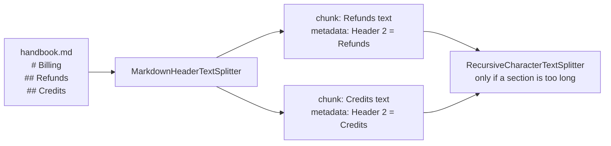

<!-- Generated by site/scripts/rag-theory-import.mjs from rag-agents-engineering. Edit the source there. -->
# Splitter fundamentals: character, recursive, token and structure-aware

*Notebooks on GitHub: [Document splitting and chunking](https://github.com/Sourav692/rag-agents-engineering/blob/main/course/p05_ingestion_and_indexing/m13_chunking/notebooks/01a_document_splitting_and_chunking.ipynb), [Document splitters and chunkers](https://github.com/Sourav692/rag-agents-engineering/blob/main/course/p05_ingestion_and_indexing/m13_chunking/optional/01b_document_splitters_and_chunkers.ipynb) (optional), [Text splitters and chunking strategies](https://github.com/Sourav692/rag-agents-engineering/blob/main/course/p05_ingestion_and_indexing/m13_chunking/optional/01c_text_splitters_and_chunking_strategies.ipynb) (optional)*

## Chunk size and overlap

`RecursiveCharacterTextSplitter` tries the separators `["\n\n", "\n", " ", ""]` in order. It splits on the first one present, merges pieces back up to `chunk_size`, and recurses into any piece that is still too long. `chunk_overlap` is how many trailing characters of one chunk it may repeat at the start of the next.

```animated
<figure class="anim sheet" aria-labelledby="anim-recursive-cap">
  <div class="anim__canvas" tabindex="0" aria-label="Recursive splitting of the refund section, scrolls sideways on a narrow screen">
    <svg viewBox="0 0 800 352" role="img" aria-labelledby="anim-recursive-title anim-recursive-desc">
      <title id="anim-recursive-title">Recursive splitting at chunk_size 300</title>
      <desc id="anim-recursive-desc">The 1,111-character refund section splits on blank lines into five pieces of 25, 262, 525, 151 and 148 characters. The first two merge into chunk 1. The 525-character paragraph is too long, so the splitter recurses to spaces, splits it into 95 words and merges them into chunks 2 and 3. The last two pieces merge into chunk 4. The answer sentence is cut between chunks 2 and 3.</desc>
      <defs><marker id="ah-recursive" viewBox="0 0 8 8" refX="7" refY="4" markerWidth="8" markerHeight="8" markerUnits="userSpaceOnUse" orient="auto-start-reverse"><path class="ah" d="M0 0 L8 4 L0 8 z"/></marker></defs>

      <text class="lane-label" x="16" y="44">Section</text>
      <text class="lane-label" x="16" y="104">Blank lines</text>
      <text class="lane-label" x="16" y="169">Spaces</text>
      <text class="lane-label" x="16" y="231">Chunks</text>
      <text class="lane-label" x="16" y="288">Answer</text>

      <g class="n-1"><rect class="box" x="140" y="24" width="640" height="32"/><text class="label" x="460" y="40">1,111 characters</text></g>
      <g class="in-2 n-2 n-3"><rect class="box" x="141" y="84" width="12.4" height="32"/><rect class="box" x="155.4" y="84" width="148.9" height="32"/><text class="fig" x="147.2" y="131">25</text><text class="fig" x="229.9" y="131">262</text></g>
      <g class="in-2 n-2 n-4"><rect class="box" x="306.3" y="84" width="300.4" height="32"/><text class="fig" x="456.5" y="131">525</text></g>
      <g class="in-2 n-2 n-7"><rect class="box" x="608.8" y="84" width="85" height="32"/><rect class="box" x="695.7" y="84" width="83.3" height="32"/><text class="fig" x="651.3" y="131">151</text><text class="fig" x="737.4" y="131">148</text></g>
      <rect class="edge dashed e-4 in-4" x="306.3" y="152" width="300.4" height="30"/>
      <g class="in-5"><path class="line" d="M310.5 156 V178 M314 156 V178 M316.3 156 V178 M318.6 156 V178 M325.5 156 V178 M327.2 156 V178 M329.5 156 V178 M333.6 156 V178 M334.7 156 V178 M339.3 156 V178 M342.2 156 V178 M346.8 156 V178 M351.4 156 V178 M352.6 156 V178 M356.6 156 V178 M358.9 156 V178 M363.5 156 V178 M366.4 156 V178 M370.4 156 V178 M373.9 156 V178 M376.2 156 V178 M379.6 156 V178 M382.5 156 V178 M384.8 156 V178 M387.7 156 V178 M390.6 156 V178 M394 156 V178 M398.1 156 V178 M401.5 156 V178 M404.4 156 V178 M411.9 156 V178 M414.2 156 V178 M416.5 156 V178 M418.8 156 V178 M420 156 V178 M422.8 156 V178 M426.9 156 V178 M428.6 156 V178 M430.3 156 V178 M434.4 156 V178 M437.2 156 V178 M441.3 156 V178 M443 156 V178 M445.9 156 V178 M447.6 156 V178 M453.4 156 V178 M455.1 156 V178 M458 156 V178 M459.7 156 V178 M462 156 V178 M466.6 156 V178 M468.9 156 V178 M471.8 156 V178 M474.7 156 V178 M477.6 156 V178 M479.9 156 V178 M481.6 156 V178 M483.3 156 V178 M488.5 156 V178 M493.7 156 V178 M497.2 156 V178 M499.5 156 V178 M501.8 156 V178 M506.4 156 V178 M508.7 156 V178 M514.4 156 V178 M516.7 156 V178 M519 156 V178 M521.9 156 V178 M524.2 156 V178 M528.3 156 V178 M531.7 156 V178 M536.3 156 V178 M539.8 156 V178 M540.9 156 V178 M543.2 156 V178 M553.6 156 V178 M556.5 156 V178 M561.1 156 V178 M562.8 156 V178 M565.7 156 V178 M567.4 156 V178 M569.7 156 V178 M574.9 156 V178 M579.5 156 V178 M583.6 156 V178 M585.9 156 V178 M588.7 156 V178 M589.9 156 V178 M591.6 156 V178 M593.4 156 V178 M598.5 156 V178 M601.4 156 V178 M603.2 156 V178"/><text class="small" x="651" y="168">95 words</text></g>
      <path class="edge e-3 in-3" d="M222.7 140 V209" marker-end="url(#ah-recursive)"/>
      <path class="edge e-6 in-6" d="M392 184 V209" marker-end="url(#ah-recursive)"/>
      <path class="edge e-6 in-6" d="M543 184 V209" marker-end="url(#ah-recursive)"/>
      <path class="edge e-7 in-7" d="M693.9 140 V209" marker-end="url(#ah-recursive)"/>
      <g class="in-3 n-3"><rect class="box" x="141" y="212" width="163.3" height="36"/><text class="label" x="222.7" y="230">#1 (287)</text></g>
      <g class="in-6 n-6"><rect class="box" x="307.5" y="212" width="169.1" height="36"/><text class="label" x="392" y="230">#2 (297)</text></g>
      <g class="in-6 n-6"><rect class="box" x="479.1" y="212" width="127.6" height="36"/><text class="label" x="543" y="230">#3 (225)</text></g>
      <g class="in-7 n-7"><rect class="box" x="609.9" y="212" width="169.1" height="36"/><text class="label" x="694.5" y="230">#4 (297)</text></g>
      <g class="in-8"><rect class="hit" x="412.5" y="278" width="81.2" height="20"/><path class="hit-line" d="M477.9 206 V304"/><text class="fig" x="477.9" y="320">113 characters in #2, 27 in #3</text><text class="small" x="477.9" y="340">cut after “used less than”</text></g>
    </svg>
  </div>
  <div class="anim__controls" hidden>
    <button class="anim__btn" type="button" data-act="prev">Previous</button>
    <button class="anim__btn" type="button" data-act="play" aria-pressed="false">Play</button>
    <button class="anim__btn" type="button" data-act="next">Next</button>
  </div>
  <ol class="anim__steps" id="anim-recursive-cap">
    <li><button type="button">Section</button><span>The splitter gets the 1,111-character refund section, with chunk_size 300 and no overlap.</span></li>
    <li><button type="button">Blank lines</button><span>It splits on the first separator present, the blank line, which gives five pieces of 25, 262, 525, 151 and 148 characters.</span></li>
    <li><button type="button">Chunk 1</button><span>The first two pieces fit together under 300, so they merge into chunk 1 (287 characters).</span></li>
    <li><button type="button">Recurse</button><span>The 525-character paragraph is over 300, so the splitter recurses into it with the next separator. A line break only peels off the blank line in front.</span></li>
    <li><button type="button">Spaces</button><span>It falls through to spaces and splits the paragraph into 95 words.</span></li>
    <li><button type="button">Chunks 2, 3</button><span>The words merge back up to 300 characters, giving chunk 2 (297) and chunk 3 (225).</span></li>
    <li><button type="button">Chunk 4</button><span>The last two paragraphs fit together as chunk 4 (297).</span></li>
    <li><button type="button">The cut</button><span>The answer sentence lands 113 characters in chunk 2 and 27 in chunk 3, cut after “used less than”.</span></li>
  </ol>
</figure>
```

At `chunk_size=300` the blank lines give five pieces of 25, 262, 525, 151 and 148 characters, each counting the blank line in front of it. The first two merge into chunk 1 (287 characters). The 525-character paragraph is too long, and a line break only peels off its leading blank line, so the splitter falls through to spaces, splits the paragraph into 95 words and merges them into chunks 2 and 3. The last two paragraphs merge into chunk 4. The cut between chunks 2 and 3 lands inside the answer sentence.


The [interactive lab](/labs/rag/m13_chunking/chunk-size-overlap-lab.html) runs a JavaScript port of the LangChain splitter on the refund section; it matches `langchain_text_splitters` exactly at all 1,061 slider positions. Five settings from the lab:

| `chunk_size` / `chunk_overlap` | Chunks | Stored ÷ source | Answer in one chunk? | Answer share of its chunk |
|---|---|---|---|---|
| 140 / 0 | 11 | 0.99× | No: the sentence is longer than the chunk | none |
| 300 / 0 | 4 | 1.00× | No: cut after "…used less than" | none |
| 300 / 150 | 5 | 1.26× | Yes, chunk 3 | 47% |
| 500 / 50 | 4 | 1.04× | Yes, chunk 2 | 28% |
| 1200 / 0 | 1 | 1.00× | Yes, the whole section | 13% |

- **A chunk smaller than the fact can never hold it.** At 140 characters, no overlap helps.
- **A boundary cut produces a confident half-answer.** At 300/0, chunk 2 says refunds are available "within 30 days of purchase, as long as the account has used less than" and stops. A retriever that returns chunk 2 gives the model the 30-day rule without the 100 GB condition.
- **Overlap only rescues a piece that fits inside it.** At 300/100 the answer is still cut, because the part left in chunk 2 is longer than 100 characters. At 300/150 it fits, and the index stores 26% more text.
- **Bigger chunks keep facts whole and dilute them.** At 1200 the answer is 13% of the chunk; the other 87% is about monthly plans, refund timing and credits. The chunk's embedding averages all of it, and the model reads all of it.

```lab
src: /labs/rag/m13_chunking/chunk-size-overlap-lab.html
title: Chunk size and overlap
```

At 500/50 the splitter leaves a 72-character stub ("to the original payment method and take 5 to 10 business days…"); tiny trailing chunks like this retrieve badly, so merge them or set a minimum size. At 300/150, chunk 4 starts mid-phrase with "GB of outbound traffic", because overlap carries whole words and ignores sentence boundaries.

Measure length in tokens when the limit that matters is the embedding model's input or the prompt budget. `RecursiveCharacterTextSplitter.from_tiktoken_encoder(...)` keeps the recursive separators and counts tokens, and the notebook makes it the default for prose. English prose runs about four characters per token, but the ratio shifts by 2× or more for code, URLs and compound words, so a character limit drifts across content types. Characters are fine for comparing settings on one document, as the lab does.

## Structure-aware splitting

Many documents already mark their own boundaries. Splitting on them keeps each section intact and gives you metadata for free.

| Content | Splitter | What it uses |
|---|---|---|
| Markdown | `MarkdownHeaderTextSplitter` | `#`, `##`, `###`; header text goes into metadata (`{"Header 2": "Refunds"}`) |
| HTML | `HTMLHeaderTextSplitter`, `HTMLSectionSplitter` | `<h1>` to `<h6>` and sections |
| Code | `RecursiveCharacterTextSplitter.from_language(Language.PYTHON, …)` | `class`, `def`, then blank lines |
| Elements from [T6.1](/learn/ingestion-and-indexing-pipeline/document-ingestion-and-metadata-design/document-ingestion-and-metadata-design-overview) | Group Unstructured elements by `parent_id` | Titles and their children |



Run a size-based splitter after the structural one, because one long section can still exceed your limit. Use the header metadata in two places. Filter on it at query time ("only the Refunds section"), and prepend it to the chunk text so the embedding knows which section a sentence came from; [T6.5](/learn/ingestion-and-indexing-pipeline/advanced-indexing-strategies/advanced-indexing-strategies-overview) calls that a contextual chunk header.

## Key Takeaways

- A chunk smaller than the fact can never hold it, and overlap rescues only a piece that fits inside it. A boundary cut hands the model a confident half-answer.
- Bigger chunks keep facts whole but dilute them: at 1200 characters the refund answer is 13% of its chunk. Merge tiny trailing chunks, and count tokens when a model limit applies.
- Split on the document's own structure first, then cap long sections with a size-based splitter. Use header metadata for filtering and as a prefix in the chunk text.

## Check yourself

<details>
<summary>1. At chunk size 300, an overlap of 100 leaves the refund answer cut, but an overlap of 150 keeps it whole. Why?</summary>

Overlap only rescues a piece that fits inside it. At 300/100 the part of the answer left in chunk 2 is longer than 100 characters, so it is still cut. At 300/150 it fits, and chunk 3 holds the whole answer, at the cost of storing 26% more text (1.26× the source).

</details>

<details>
<summary>2. You split the refund section at chunk size 1200 with no overlap. Does the answer survive, and what does it cost?</summary>

The answer survives, because the whole section becomes one chunk, but it is only 13% of that chunk. The other 87% is about monthly plans, refund timing and credits, and the chunk's embedding averages all of it while the model reads all of it. Bigger chunks keep facts whole and dilute them.

</details>

<details>
<summary>3. Your handbook is Markdown, and after splitting on headers one section is still longer than your limit. What do you do, and how do you use the header metadata?</summary>

Run a size-based splitter such as `RecursiveCharacterTextSplitter` after the structural one, so the long section is capped. Use the header metadata twice: filter on it at query time ("only the Refunds section"), and prepend it to the chunk text so the embedding knows which section a sentence came from. [T6.5](/learn/ingestion-and-indexing-pipeline/advanced-indexing-strategies/advanced-indexing-strategies-overview) calls that a contextual chunk header.

</details>
