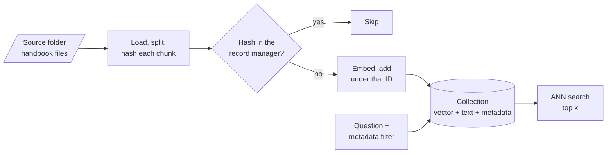

<!-- Generated by site/scripts/rag-theory-import.mjs from rag-agents-engineering. Edit the source there. -->
# Overview

A vector store is a database. Each entry holds a vector, the text it came from and that text's metadata, and you add, read, filter, delete and persist entries the way you would rows. The hard part is keeping the store in step with source files that keep changing. The M15 notebooks build on four ideas: approximate nearest-neighbour (ANN) search, collections and namespaces, metadata filters, and idempotent re-indexing.

The running example is the Larkspur Cloud handbook kept as a folder of Markdown files: `billing.md`, `refunds.md`, `outages.md`, `servers.md` and `data.md`, ten chunks in all, with the same chunk texts as the [M11](/learn/llm-and-retrieval/rag-from-first-principles/rag-from-first-principles-overview) lab. A sixth file, `support.md`, arrives later. The event that drives the module is a policy change: the refund window for annual plans drops from 30 days to 14. The golden question is *How long do I have to get a full refund on an annual plan?*, and after the change the index must return the 14-day rule and nothing else.

## In short

- A vector store can add, search, filter and delete. It cannot update text in place: new text means a new vector, so an update is a delete followed by an insert, and both need an ID that stays the same from one run to the next.
- Scores mean different things on different backends. Chroma and FAISS return a distance from `similarity_search_with_score` (lower is closer), and Pinecone's cosine index returns a similarity (higher is closer). A threshold tuned on one is meaningless on another.
- Large indexes use ANN structures such as HNSW and IVF, which trade a little recall for a lot of speed. LangChain's `FAISS.from_documents` builds an exact `IndexFlatL2`; Chroma builds HNSW.
- A metadata filter applied before ranking returns up to `k` matches. One applied after ranking can return fewer, or none. LangChain's FAISS wrapper filters after fetching 20 candidates; PGVector filters in SQL before it ranks.
- The Indexing API hashes every chunk and records the hash. In the lab, editing one refund chunk costs one embedding instead of ten, and `cleanup="incremental"` deletes the old 30-day chunk. With `cleanup=None` both rules stay in the store.

## Mental model

The store is the system of record for what retrieval can return, so every change in the source folder has to reach it. The record manager is what makes that cheap: it remembers each chunk's hash, so a run embeds only the chunks whose text or source changed, and its cleanup step deletes the chunks the folder no longer contains. A stale chunk left in the collection is as retrievable as a current one.

## Interactive lab

[**The record manager and cleanup modes**](/labs/rag/m15_vector_stores/record-manager-lab.html): open the file in a browser. Run `index()` once to embed all 10 chunks. Set `refunds.md` to **14 days** and run with cleanup **None**: 1 chunk is added, none is deleted, and the store now holds the 30-day rule and the 14-day rule side by side. Switch to **incremental** and run again to delete the stale one. Then mark `outages.md` **Deleted** and run under **incremental** (nothing is deleted) and under **full** (its 2 chunks go).

## How it connects

- **Before:** [M12](/learn/ingestion-and-indexing-pipeline/document-ingestion-and-metadata-design/document-ingestion-and-metadata-design-overview) sets the `source` metadata the record manager groups by and the flat metadata types the stores accept; [M13](/learn/ingestion-and-indexing-pipeline/chunking-and-indexing/chunking-and-indexing-overview) decides what a chunk is, and so what gets hashed; [M14](/learn/ingestion-and-indexing-pipeline/embeddings-and-model-selection/embeddings-and-model-selection-overview) picks the embedding model, which has to match the index for as long as the index lives.
- **Next:** [M16](/learn/ingestion-and-indexing-pipeline/advanced-indexing-strategies/advanced-indexing-strategies-overview) indexes more than one representation per document (parent documents, summaries), which needs the stable IDs from lesson 15.1; [M17](/learn/retrieval-quality-engineering/retrieval-hybrid-rerank/retrieval-hybrid-rerank-overview) builds retrieval strategies (MMR, thresholds, hybrid search) on top of `as_retriever()`.

## Key Takeaways

- Give every chunk an ID derived from the document: its source and position, or a hash of its content. Without one you cannot update, delete or de-duplicate.
- Read what a score means on your backend before you set a threshold, and log how many results a filtered search returned.
- Filter before the search when the filter is selective; after-search filtering silently returns fewer than `k`.
- Sync with the Indexing API and `cleanup="incremental"` keyed on `source`. Use `full` only when the loader returns the whole corpus, and never on a batch that might be empty.
