# Non-Functional Requirements

## Interview Review

### 1. What the Interviewer Is Testing

- Can you translate “fast, safe, reliable, and cheap” into measurable targets?
- Can you define targets around the workload and customer experience?
- Can you identify the constraints that change the architecture?
- Can you discuss quality, latency, cost, and risk together?

### 2. Core Mental Model

- Functional requirement: what must the system do?

- Non-functional requirement (nfr): how well must it work, and within what limits?

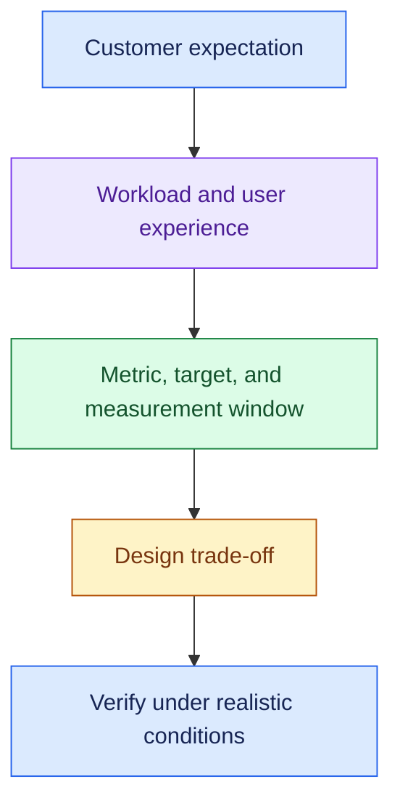

Recall nine buckets:

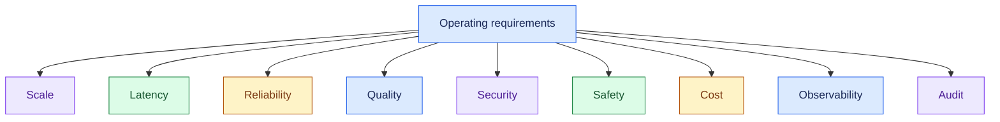

- These are a checklist, not an execution sequence.
- Prioritise what the customer cannot afford to get wrong.

### 3. Essential Concepts

#### 1. Scale: Describe the Workload

- Ask for request rate, concurrency, peak traffic, tenants, growth, and task duration.
- User count alone is insufficient.

> “For 100K users, what normal and peak request rates and concurrent agent runs should we expect?”

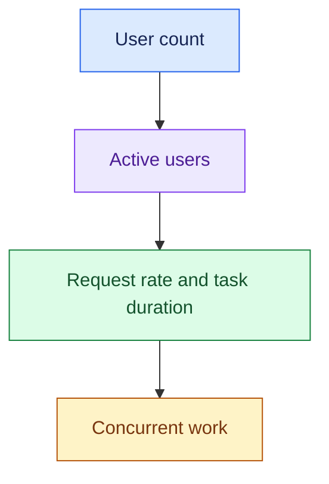

- Long tasks occupy capacity longer.
- Model-provider limits and downstream API limits can become the bottleneck before application servers do.

#### 2. Latency: Define the User's Waiting Experience

- Separate time to first useful output from total completion time.
- Define targets by workload and percentile rather than only an average.

> “For interactive chat, what first-response and total-response targets matter? Can long tasks complete asynchronously?”

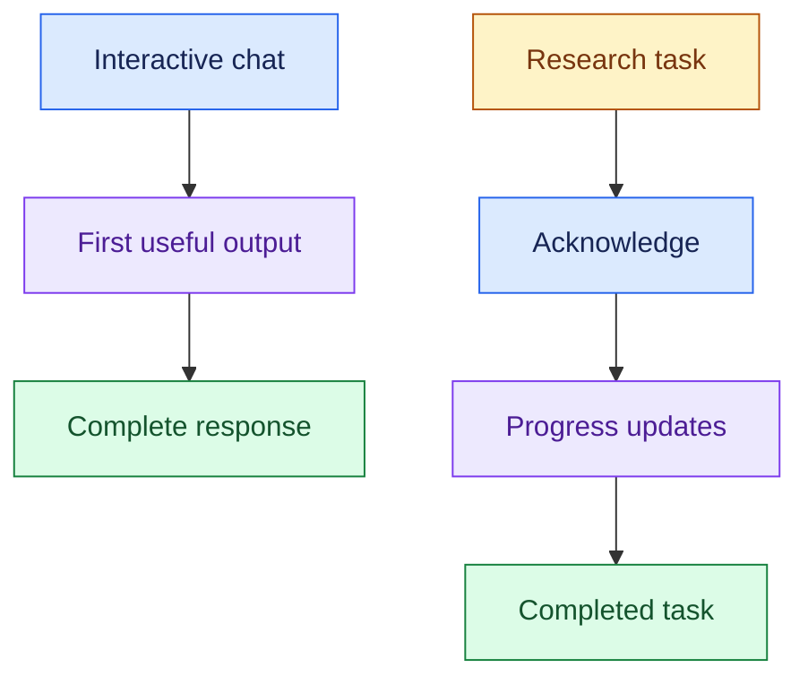

- Define the service-level objective (slo) for an agreed workload and measurement window.
- Example format: “P95 completion latency ≤ X seconds for workload Y over window Z.” P95 means 95% of measured requests meet that latency.
- Confirm X, Y, and Z with the customer.

#### 3. Reliability: Finish Correctly, Including During Failures

- Availability asks whether the service is usable; reliability also includes correct completion, recovery, and safe side effects.

> “What must still work when a model or tool fails, and how do we prevent duplicate actions?”

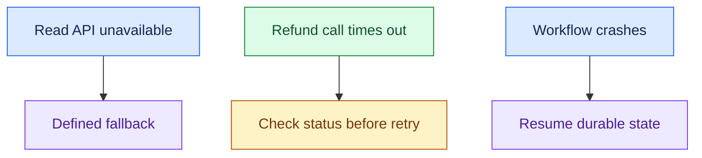

- Define availability around meaningful operations.
- An endpoint returning responses is not enough if it cannot complete the customer's task.

#### 4. AI Quality: Define Acceptable Answers and Actions

- Measure correctness, groundedness, retrieval quality, tool selection, and end-to-end task success on representative cases.

> “What quality threshold must hold before release, including difficult cases and high-risk actions?”

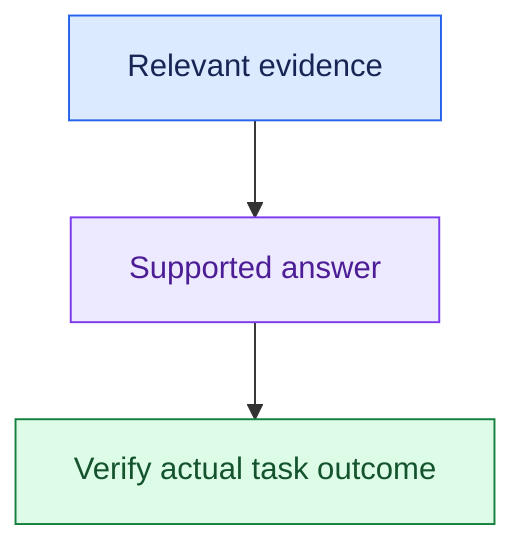

- Specify the evaluation set and scoring method alongside the target.
- Good wording does not prove that a refund or support resolution succeeded.

#### 5. Security: Enforce Identity and Access Boundaries

- Define user and tenant isolation, least-privilege tools, sensitive-data handling, and residency or retention constraints where relevant.

> “Which users can access which documents and actions, and what data may reach approved model providers?”

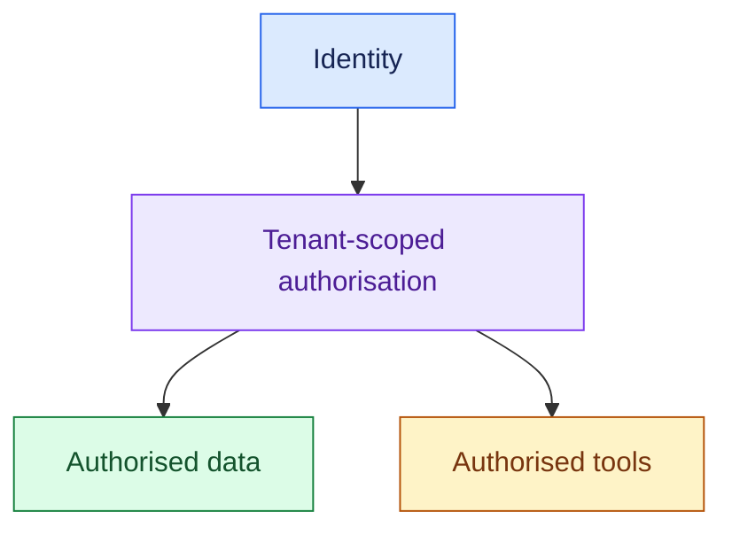

- Permission enforcement is a functional behaviour too.
- NFR discussions clarify how consistently and within which boundaries it must hold.

#### 6. Safety: Keep Actions Within Policy

- Agree on prohibited actions, approval rules, safe stopping behaviour, and the ability to disable execution.

> “Which actions require approval, and what must happen if the policy check is unavailable?”

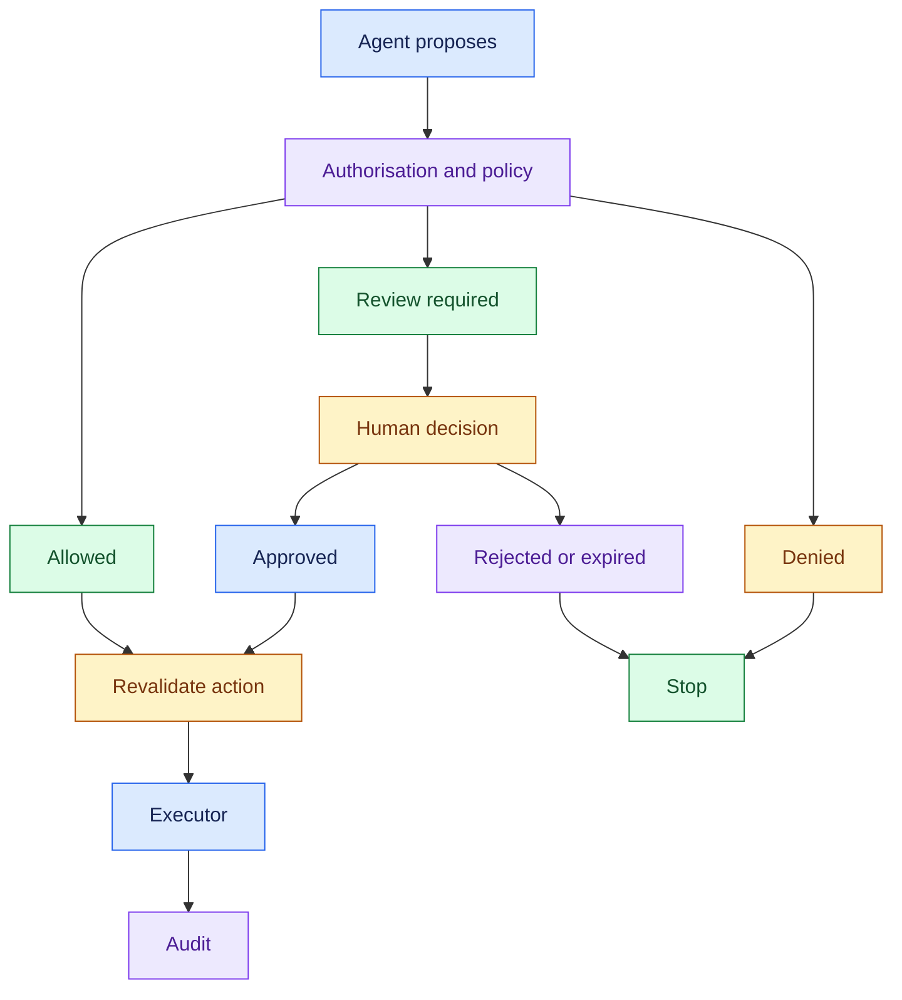

- For sensitive actions, do not treat a model's confidence as permission.
- Policy and access checks remain necessary.

#### 7. Cost: Budget for Successful Outcomes

- Include models, tokens, retrieval, tools, compute, failed attempts, retries, and human review where relevant.

> “What cost per successfully resolved case is acceptable, and what quality must we preserve?”

- Cost per successful task = total task-related cost ÷ successful tasks.

- Reducing model cost while increasing failures or manual rework may worsen the business result.

#### 8. Observability: See Where the System Breaks

- Define end-to-end traces and metrics for latency, errors, tokens, cost, tool calls, and outcomes.
- Keep sensitive information out of unrestricted logs.

> “Can we locate a slow or failed step across retrieval, model calls, and enterprise tools?”

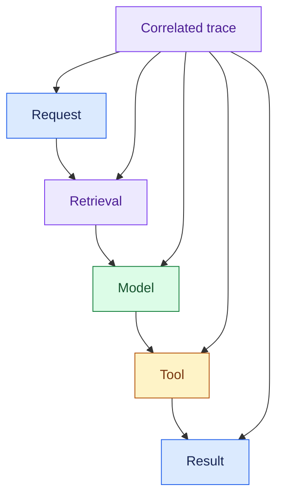

#### 9. Auditability: Reconstruct Business Decisions

- Record relevant evidence, policy decisions, approvals, action results, and versions under appropriate access and retention rules.

> “If a customer disputes a refund, can we explain what was requested, approved, and executed?”

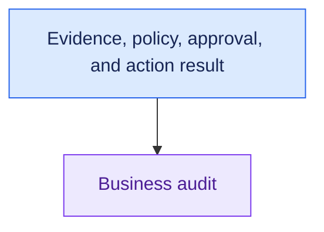

- Capture decision summaries and evidence, not private model reasoning, which is often hidden and not always faithful.

### 4. Requirement → Component Reasoning

| Customer requirement | Component / pattern | Why | Trade-off |
|---|---|---|---|
| Handle bursts within capacity limits | Admission control, queue, scalable workers | Protect processing capacity | Rejection or queue delay |
| Fast repeated policy answers | Permission-safe cache | Avoid repeated work | Freshness and isolation risks |
| Survive provider failures | Model Gateway fallback | Control provider calls | Different fallback quality |
| Resume long tasks | Durable state + checkpoints | Recover completed progress | State-management complexity |
| Prevent duplicate refunds | Idempotent execution + reconciliation | Retry without duplicate effects | Dependency support and bookkeeping |
| Prevent unauthorised access/actions | Authorisation + policy checks | Enforce boundaries | Integration and approval overhead |
| Diagnose incidents and decisions | Traces + audit records | Link behaviour and business actions | Storage, access, retention |

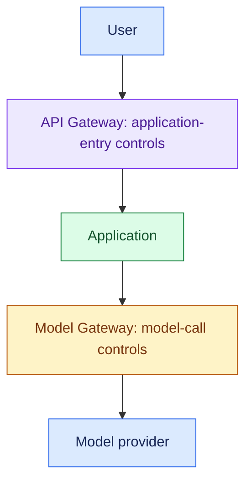

For a support system:

- Confirm peak workload and interactive latency.
- Agree on answer quality, permitted refunds, and failure behaviour.
- Set the cost target per resolved case.
- Then use those constraints to choose components.

Write each important NFR as:

> For [workload], measure [metric] against [target] over [window or dataset], including [failure and peak cases].

### 5. Important Distinctions and Gotchas

1. **Average vs tail latency:** an acceptable average can hide slow P95/P99 requests.
2. **Availability vs successful completion:** a live server can still deliver unusable answers or failed actions.
3. **Security vs safety:** who may access or act differs from whether the permitted action meets business policy.
4. **Observability vs audit:** “Why was it slow?” differs from “Why was this refund issued?”
5. **Target vs assumption:** customer-approved thresholds are requirements; invented numbers must be labelled provisional assumptions.

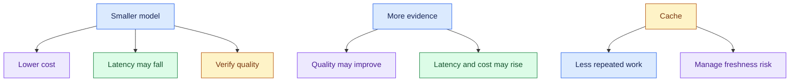

### 6. Trigger → Concept Table

| Hear… | Think… | Clarify… |
|---|---|---|
| “100K users” | Scale | Request rates, peaks, concurrency |
| “Fast” | Latency | First output, completion, percentile, workload |
| “Never refund twice” | Reliability | Idempotency and unknown-status handling |
| “Answers must be trustworthy” | Quality | Correctness, evidence, scoring method |
| “Several companies use it” | Security | Tenant isolation and access boundaries |
| “Refunds need approval” | Safety | Policy, approval, unavailable-service behaviour |
| “Too expensive” | Cost | Cost per successful task and quality floor |
| “Why did this happen?” | Observability / audit | System fault or business decision? |

### 7. Interview Phrases

> “I’d translate ‘fast’ into workload-specific first-response and completion targets.”

> “I’d confirm peaks and concurrency rather than designing from user count alone.”

> “For an action-taking system, availability is not enough; retries and recovery must preserve correct business outcomes.”

> “I’d agree on acceptable quality first, then optimise latency and cost within that boundary.”

> “These targets are provisional until the customer confirms the baseline, workload, and acceptable trade-offs.”

### 8. Practice Questions

1. The customer says, “Fast and cheap.” What questions make those NFRs measurable?
2. A service supports 50 enterprises and 100K users. Which workload and isolation details change the design?
3. A refund agent responds quickly but occasionally refunds twice. Which NFRs are failing?
4. Compare latency and reliability requirements for voice support and a ten-minute research task.
5. The system is available 99.9% of the time but often gives unsupported answers. What additional targets and measurements do you need?

---

## One-Page Memory Card: Non-Functional Requirements

- **Core question:** How well must the system work, for which workload, and within what limits?

### Recall Flow

### Checklist

| Bucket | Ask / measure |
|---|---|
| Scale | Normal/peak request rate, concurrent work, task duration, tenants, growth |
| Latency | First useful output, completion, P95/P99 by workload |
| Reliability | Usable availability, correct completion, recovery, duplicate prevention |
| Quality | Correctness, groundedness, retrieval/tool quality, task success |
| Security | Identity, permissions, tenant isolation, sensitive data, residency/retention |
| Safety | Allowed actions, policy, approval, safe stopping behaviour |
| Cost | Total cost per successful task, including retries and rework |
| Observability | Correlated traces, latency, errors, tokens, cost, outcomes |
| Audit | Evidence, policy, approval, action result, versions, controlled retention |

- An SLO is a service-level objective.
- Specify the workload, metric, target, and measurement window.
- P95 means 95% of measured requests meet that latency.

### Trigger → Concept

| Hear… | Think… |
|---|---|
| “100K users” | Clarify rates, concurrency, and peaks |
| “Fast chat / long research” | Separate latency expectations |
| “Never charge twice” | Safe execution, idempotency, reconciliation |
| “Cannot expose another company's data” | Tenant isolation and authorisation |
| “Manager approval” | Safety policy and durable approval state |
| “Too expensive” | Cost per successful outcome |
| “Why slow / why refund?” | Observability / business audit |

### Requirement → Design

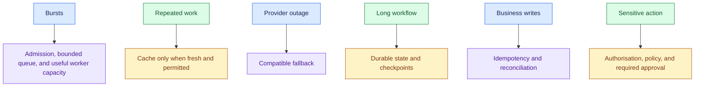

- API Gateway = User → Application control.
- Model Gateway = Application → Model control.

### Do Not Confuse

1. **FR vs NFR:** capability vs performance and operating limits.
2. **Available vs successful:** responding does not prove correct task completion.
3. **Observability vs audit:** system behaviour vs business decision and action.
4. **Average vs tail:** acceptable averages can hide slow requests. Use relevant percentiles and define what is measured.

### Fill-in Target

> “For workload ___, measure ___ against target ___ over ___, including peak/failure cases ___.”

- Confirm targets with the customer.
- Label assumptions.
- For quality, specify the representative dataset and scoring method.
- For cost, count failed attempts and relevant rework as well as model calls.

### 30-Second Answer

Practise these points as one spoken answer:

- “I’d define the workload first, then agree on latency, availability, quality, security, safety, and cost targets.”
- “I’d measure both system behaviour and successful task completion, including peak traffic and dependency failures.”
- “For business actions, I’d require safe retries and recovery.”
- “These targets would drive the architecture and evaluation criteria.”

## Sources (checked 27 Sep 2026)

- [Claude docs - Rate limits](https://platform.claude.com/docs/en/api/rate-limits): provider rate limits cap throughput
- [Chen et al. 2025, Reasoning Models Don't Always Say What They Think (arXiv 2505.05410)](https://arxiv.org/abs/2505.05410): chain-of-thought is not always faithful
