# Core Architecture Building Blocks

## Interview Review

### 1. What the Interviewer Is Testing

- Can you explain what each component owns and why it is needed?
- Can you separate request control, routing, workflow control, and model access?
- Can you choose a small architecture that meets the requirements?
- Can you identify the state and failure behaviour behind your boxes?

### 2. Core Mental Model

- **Every box needs a requirement-based reason.**

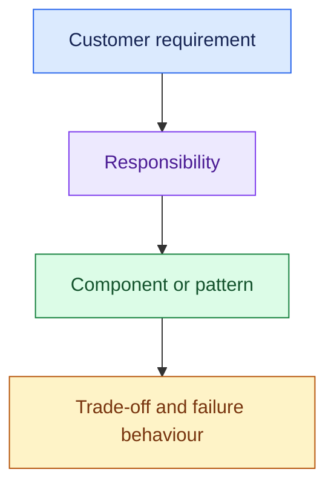

Recall seven responsibilities:

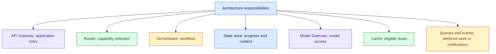

- These are logical responsibilities.
- A small implementation can combine some in one service.

### 3. Essential Concepts

#### 1. API Gateway: User → Application Control

- Enforce authentication, request validation, tenant context, and user or tenant limits at application entry.
- Coordinate with authorisation services; downstream data and tools still enforce their own access checks.

> “We need a controlled application boundary for user identity, tenant context, and request limits.”

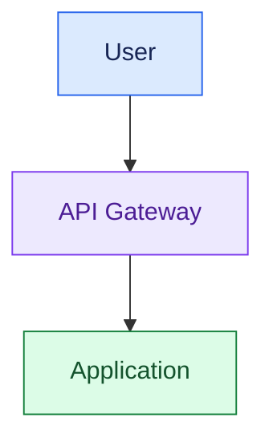

- **api Gateway = User → Application control.** It does not own model-provider selection.

#### 2. Model Gateway: Application → Model Control

- Centralise model routing and provider access when needed.
- Manage compatible fallback, bounded retries, provider limits, and token and cost tracking.

> “Because we need provider fallback and consistent model-call controls, I’d introduce a Model Gateway.”

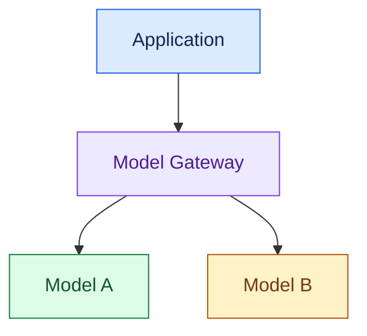

- **Model Gateway = Application → Model control.** Fallback must preserve required capabilities, data restrictions, and acceptable quality.

#### 3. Router: Choose the Capability

- Select retrieval, live tools, a workflow, or human handling.
- Use rules or classifiers where sufficient.

> “The router decides what handles the request; it does not manage the whole workflow.”

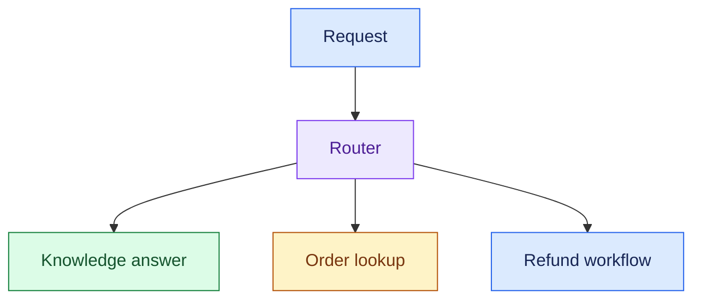

- Capability routing differs from choosing which model provider processes a model call.

#### 4. Orchestrator: Coordinate the Work

- Manage steps, branches, tool calls, timeouts, retries, checkpoints, and approval transitions.
- It may execute a fixed workflow or host a bounded agent loop.

> “We need coordination because the refund task combines data lookup, policy checks, approval, and execution.”

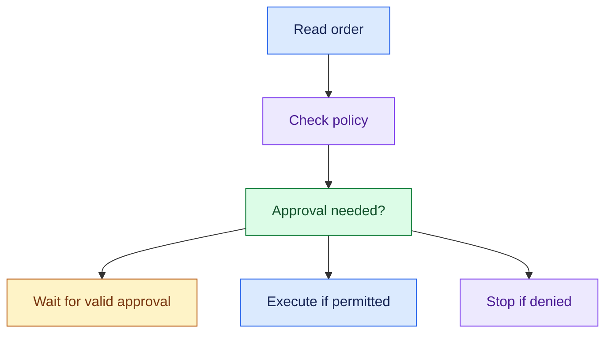

- The orchestrator coordinates; policy authorises; the executor performs the business write.

#### 5. State Store: Preserve Context and Progress

- Store relevant session, workflow, approval, and completed-operation state.
- Durable state allows restart or delayed approval without relying on process memory.

> “If approval takes hours or a worker crashes, we must recover the workflow from stored state.”

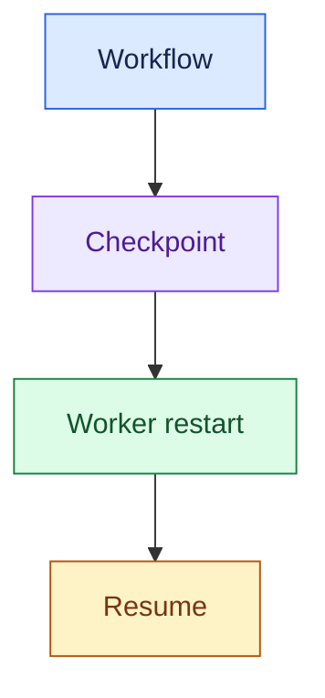

- Keep action identifiers and status checks alongside checkpoints to prevent duplicate effects.
- Record action identifiers and reconcile uncertain external results.

#### 6. Cache: Reuse Safe Results

- Cache eligible response, retrieval, or tool results.
- Choose keys, lifetime, invalidation, and tenant/permission scope to meet freshness and access requirements.

> “I’d cache repeated policy lookups only when the cache preserves freshness and access boundaries.”

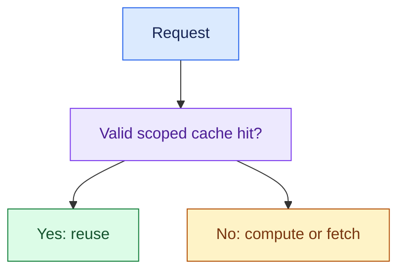

- Current transactional data needs an explicit freshness rule.
- Similar-looking requests are not automatically safe to share through a semantic cache.

#### 7. Queue / Event Bus: Decouple Work and Communication

- A work queue lets workers process tasks separately from the immediate request.
- An event bus distributes notifications about events to interested consumers.

> “This task can outlast the interactive response, so I’d accept it as a job and return a task identifier.”

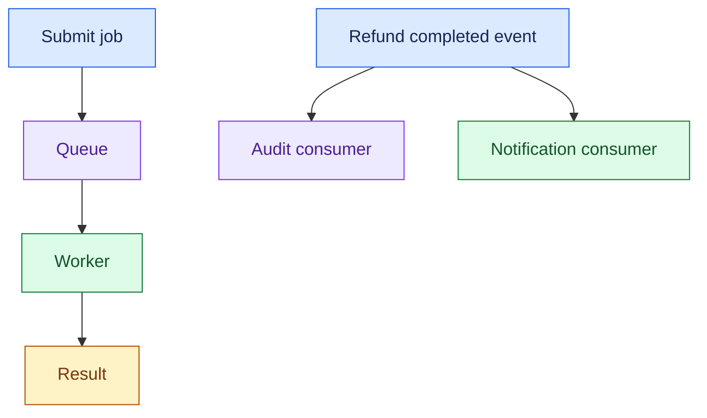

- These are patterns, not necessarily separate products.
- Queues buffer bursts but do not create processing capacity; queue depth and wait time still need limits.

### 4. Requirement → Component Reasoning

| Requirement | Component / pattern | Why | Main trade-off |
|---|---|---|---|
| User/tenant request controls | API Gateway | Enforce application entry rules | Extra boundary and operational dependency |
| Multiple model providers and fallback | Model Gateway | Standardise model calls | Capability differences and retry overhead |
| Different request categories | Router | Choose the correct path | Misrouting and classification cost |
| Multi-step task with branches | Orchestrator | Coordinate transitions | Workflow complexity |
| Resume after crash or approval | Durable state store | Preserve task progress | Consistency and retention management |
| Repeat work within freshness limits | Cache | Reduce repeated cost/latency | Stale or improperly shared data |
| Long tasks or burst absorption | Queue + workers | Decouple execution | Queue delay and duplicate delivery |
| Multiple reactions to a business event | Event distribution | Decouple consumers | Delivery and ordering management |

#### Support Example: Add Only What Is Needed

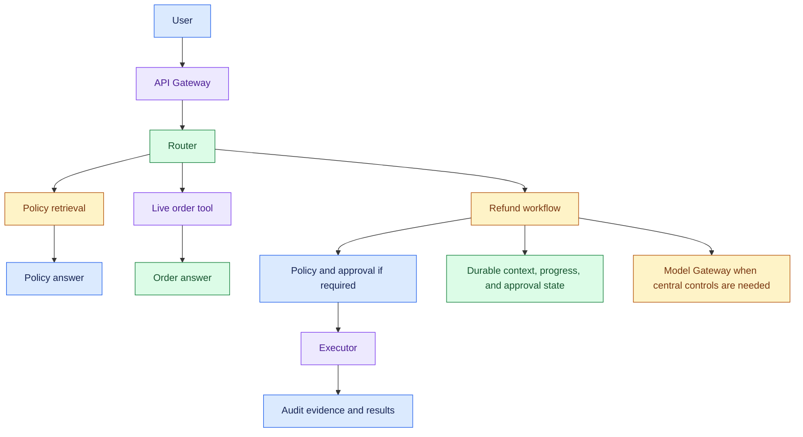

- A cache or queue is added only if repetition, freshness, task duration, or traffic requirements justify it.

### 5. Important Distinctions and Gotchas

1. **API vs Model Gateway:** user-to-application control vs application-to-model control. Neither replaces tool-level authorisation.
2. **Router vs orchestrator:** choose the path vs coordinate steps along the path.
3. **State store vs cache:** authoritative progress must be durable; cached results are reusable data that can expire or be recomputed.
4. **Queue vs event bus:** distribute work to processors vs distribute event notifications. Redelivery may occur; consumers must handle duplicates where relevant.
5. **Logical box vs separate service:** a responsibility can live inside the application. Do not add a network service without a reason.

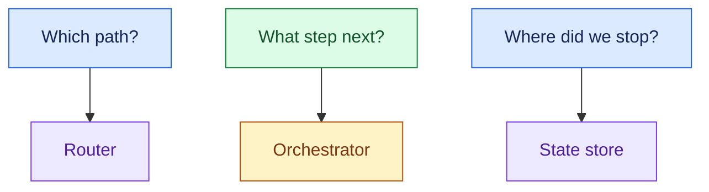

### 6. Trigger → Concept Table

| Hear… | Think… | Discuss… |
|---|---|---|
| “User quotas and tenant identity” | API Gateway | Application entry controls |
| “Three model providers” | Model Gateway | Routing, compatible fallback, limits |
| “Policy, order, refund requests” | Router | Capability selection |
| “Approval then action” | Orchestrator | Branches, state, safe transitions |
| “Resume tomorrow” | State store | Durable progress and approval state |
| “Same policy asked repeatedly” | Cache | Freshness and permission scope |
| “Ten-minute task” | Queue | Job identifier, progress, results |
| “Notify billing and support” | Events | Independent consumers and delivery handling |

### 7. Interview Phrases

> “This box exists because the customer needs ___. Without it, ___ would fail.”

> “The API Gateway controls users entering the application; the Model Gateway controls the application's model calls.”

> “Routing selects a capability; orchestration controls the steps and state of the task.”

> “I’d keep these as logical responsibilities first and split services only when scale, ownership, or isolation requires it.”

> “A queue absorbs bursts, but I still need capacity limits and a maximum acceptable wait.”

### 8. Practice Questions

1. Explain API Gateway vs Model Gateway in 30 seconds using their boundaries and responsibilities.
2. A support task reads orders, checks policy, waits for approval, and issues a refund. Which responsibilities need coordination and durable state?
3. A customer has three providers and wants fallback. What checks must hold before another model is used?
4. A research task takes ten minutes. What changes in request handling, state, and result delivery?
5. The interviewer asks, “Why is this box here?” Justify a cache, router, and queue using distinct requirements and trade-offs.

---

## One-Page Memory Card: Core Architecture Building Blocks

- **Core question:** Which responsibility does this requirement create, and what component should own it?

### Recall Flow

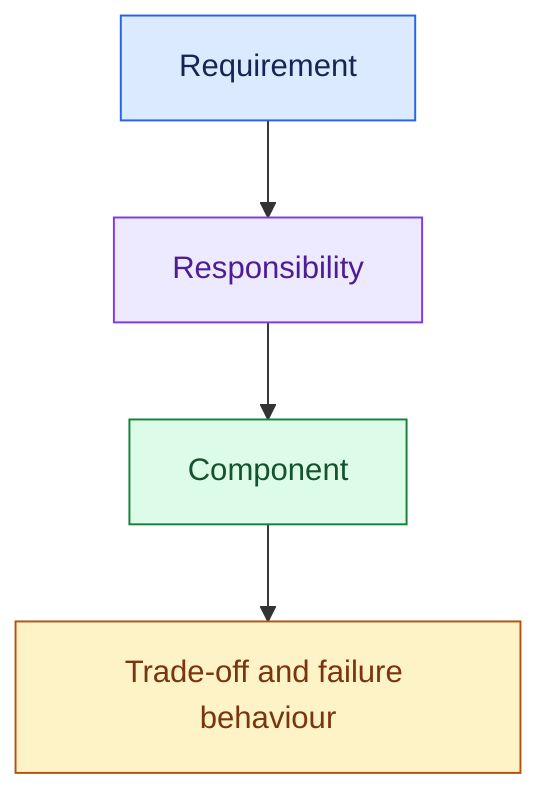

### Seven Building Blocks

| Block | Owns | Requirement trigger |
|---|---|---|
| API Gateway | Authentication, request validation, tenant context, user/tenant limits | Controlled application entry |
| Model Gateway | Model/provider routing, compatible fallback, bounded retries, limits, tokens/cost | Central model-call controls |
| Router | Capability selection | Different request types |
| Orchestrator | Steps, branches, tools, retries, checkpoints, approval transitions | Coordinated multi-step work |
| State store | Relevant session, workflow, approval, completed-operation state | Continuation and recovery |
| Cache | Safe reuse with keys, scope, lifetime, invalidation | Repeated eligible work |
| Queue / events | Deferred task processing / event distribution | Long work, bursts / independent consumers |

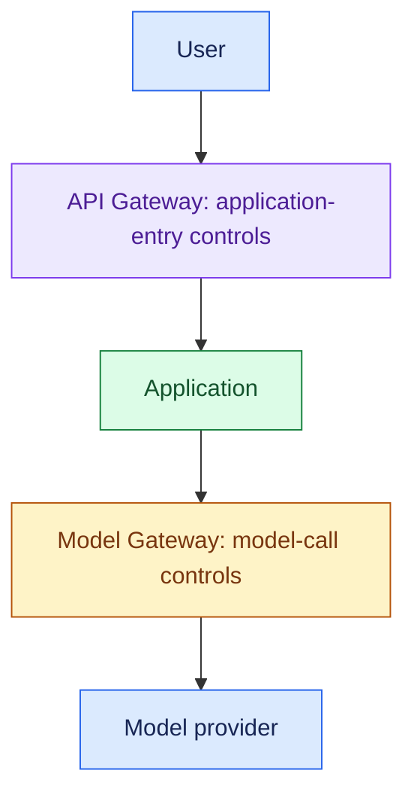

- Downstream retrieval and tools still enforce access.
- Model fallback must respect capabilities, data boundaries, and required quality.

### Trigger → Concept

| Hear… | Think… |
|---|---|
| “Tenant quotas” | API Gateway |
| “Provider fallback” | Model Gateway |
| “Different intents” | Router |
| “Branch / approve / retry” | Orchestrator |
| “Crash / resume / approval later” | Durable state |
| “Repeated safe lookup” | Cache |
| “Long task / burst” | Queue + capacity controls |
| “Several services react to a refund” | Events |

### Do Not Confuse

1. **Router vs orchestrator:** choose a capability vs coordinate its execution.
2. **State vs cache:** authoritative workflow progress vs reusable results. Expiring a cache should not erase a pending approval.
3. **Queue vs event bus:** work processing vs notification distribution. Delivery may repeat; design duplicate handling where it matters.
4. **Logical responsibility vs separate service:** boxes can share an implementation when that meets the requirements.

### Small Support Architecture

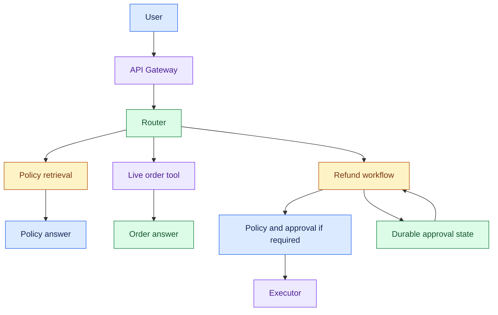

- Use the Model Gateway for centralised model-call control when justified.
- Add cache or queue only when requirements warrant them.
- Capture audit evidence and action results across the flow.

### Component Defence

> “It does ___. We need it because ___. The customer requirement is ___. Its main trade-off is ___.”

- Check failure behaviour too: a queue does not add capacity, a checkpoint does not guarantee safe external retries, and a cache does not make stale data correct.

### 30-Second Answer

Practise these points as one spoken answer:

- “I’d assign responsibilities from requirements: entry controls to the API Gateway, capability selection to the router, workflow coordination to the orchestrator, and durable progress to the state store.”
- “Model-call controls belong to the Model Gateway.”
- “I’d add caching, queues, or events only when reuse, task duration, traffic, or consumer requirements justify them.”

## Sources (checked 27 Sep 2026)

- [Temporal blog - Idempotency and durable execution](https://temporal.io/blog/idempotency-and-durable-execution): checkpoints don't stop duplicate side effects; at-least-once redelivery
- [LangGraph docs - Interrupts](https://docs.langchain.com/oss/python/langgraph/interrupts): checkpoints don't stop duplicate side effects
