# RAG and Enterprise Data

## Interview Review

### 1. What the Interviewer Is Testing

- Can you distinguish enterprise knowledge from live transactional data?
- Can you explain ingestion and retrieval as separate flows?
- Can you diagnose missing evidence, noisy retrieval, and unsupported answers?
- Can you enforce permissions before information reaches the model?

### 2. Core Mental Model

- Retrieval-augmented generation (RAG) supplies relevant evidence for the model’s answer.

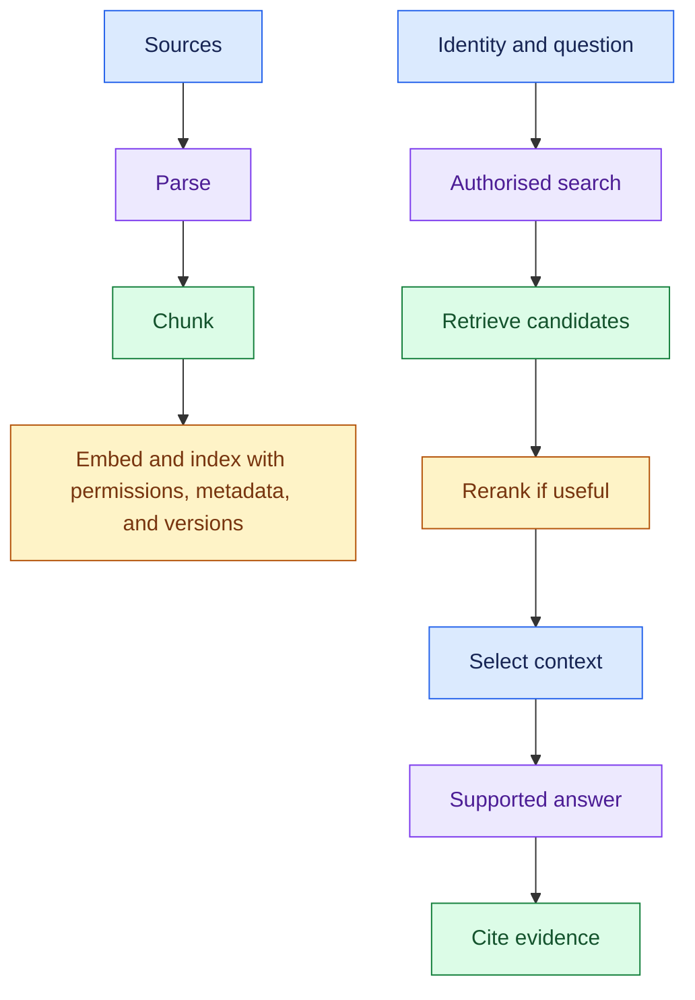

Three questions guide debugging:

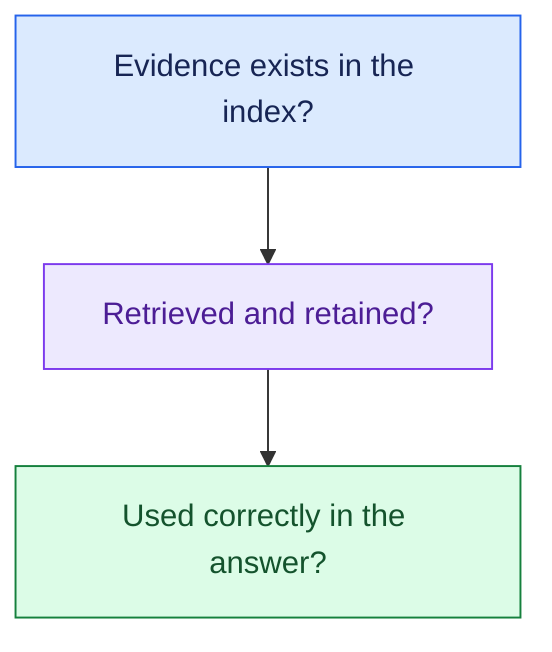

### 3. Essential Concepts

#### 1. Data Choice: Knowledge vs Live State

- Use RAG for maintained policies, manuals, and enterprise reference material.
- Query current transactional state through approved APIs or tools when freshness requires it.

> “Does the answer depend on reference knowledge or current state in an enterprise system?”

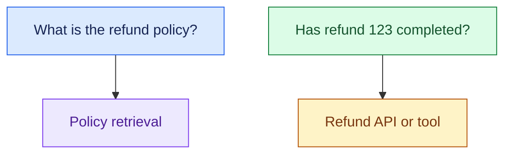

- Some requests need both: retrieve eligibility policy and read the current order before recommending a refund.

#### 2. Parse and Maintain Sources: Make Evidence Usable

- Extract content faithfully, including headings, tables, and scanned text where needed.
- Carry source identifiers, versions, timestamps, and access metadata into the index.

> “Before tuning retrieval, I’d check whether the relevant content was parsed and indexed correctly.”

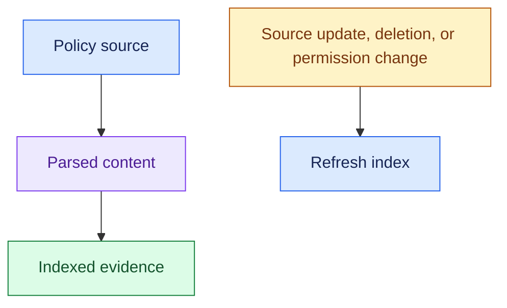

- An answer cannot reliably use evidence that was omitted, corrupted, or left outdated during ingestion.

#### 3. Chunking: Keep Enough Meaning Together

- Split content into searchable units while preserving context.
- Prefer meaningful boundaries such as sections when practical.

> “I’d choose chunking based on document structure and the questions users ask, then evaluate the result.”

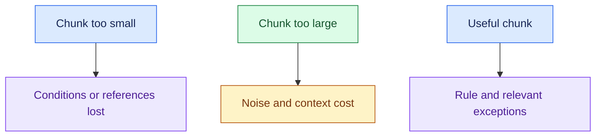

- No chunk size is universally correct.
- Preserve the link to the source and surrounding content.

#### 4. Embeddings and Search: Match Meaning and Exact Terms

- Embeddings represent content for similarity search.
- Vector search helps with related meaning; keyword search helps with exact identifiers and terms.
- Hybrid search combines signals from both.

> “For policy language and exact product codes, I’d compare vector, keyword, and hybrid retrieval on representative questions.”

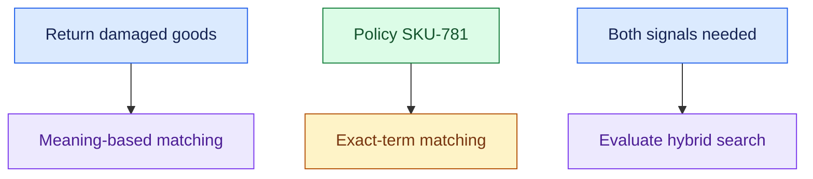

- Embedding similarity is a relevance signal, not proof that a statement is correct.

#### 5. Metadata and Permissions: Narrow the Search Safely

- Use trusted identity, tenant, and access scope to constrain retrieval.
- Metadata can also select the correct region, product, language, or policy version.

> “Only authorised evidence should enter context, and the policy version must match the customer's case.”

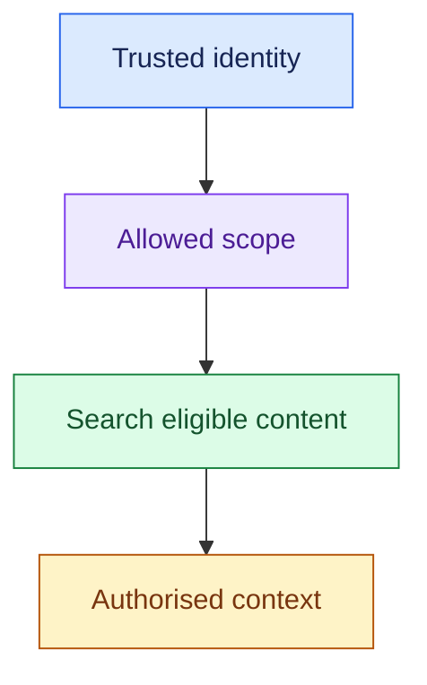

- Enforce access before content reaches the model.
- Handle permission changes and tenant-scoped caches; retrieved document instructions do not become authority to bypass controls.

#### 6. Reranking and Context Selection: Keep the Best Evidence

- Reranking reorders retrieved candidates using an additional relevance assessment.
- Context selection then chooses what fits the answer's evidence needs and model budget.

> “If relevant evidence is buried among candidates, reranking may help; it cannot recover a document that was never retrieved.”

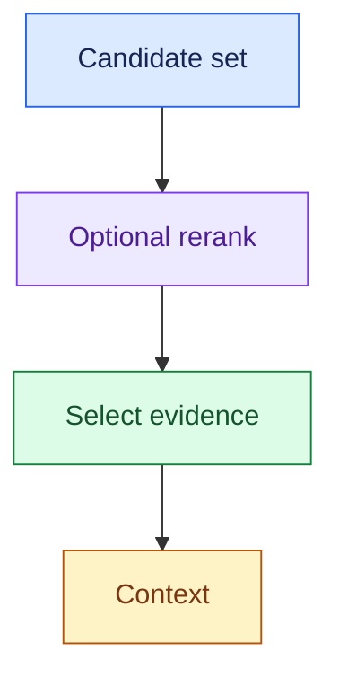

- Deduplicate and preserve important exceptions.
- More context can add noise, latency, and cost.

#### 7. Recall vs Precision: Find Enough Without Too Much Noise

- Recall: how much relevant evidence did we find?
- Precision: how much of the retrieved evidence is relevant?
- Define the evidence labels and retrieval cutoff in evaluation.

> “If we miss the answer document, I’d investigate recall; if we retrieve lots of irrelevant material, I’d inspect precision and ranking.”

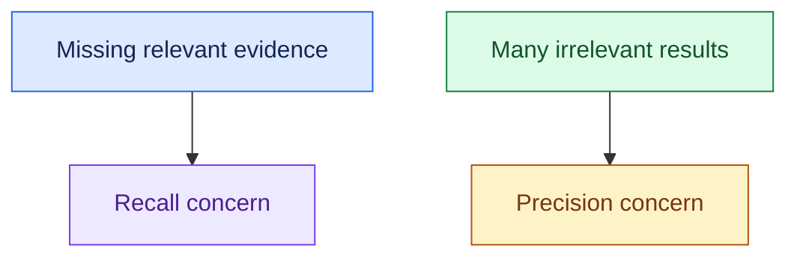

- Evaluate representative questions, including exact terms, ambiguous requests, restricted documents, and missing-answer cases.

#### 8. Groundedness: Support the Answer With Evidence

- Require the answer's claims to be supported by the selected context.
- Cite actual supporting sources and acknowledge missing or conflicting evidence.

> “I’d check whether each important claim is supported; a citation alone doesn’t show that.”

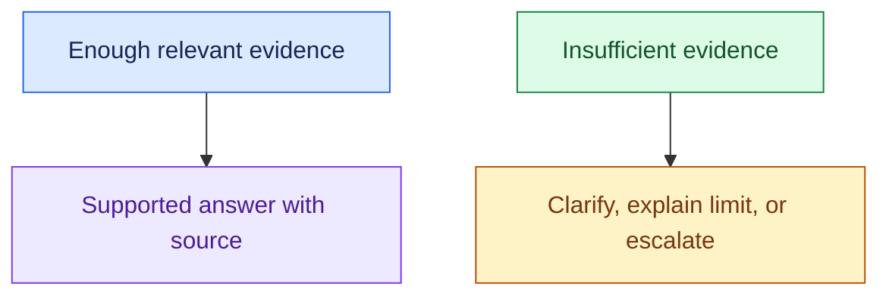

- Groundedness is not the same as truth: a faithfully quoted outdated policy can still be wrong for today's case.

#### 9. Diagnose by Stage: Do Not Blame the Model First

- Inspect the evidence path before changing models or prompts.

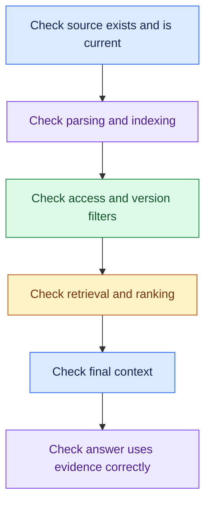

> “I’d trace the question from source to final context so we can locate whether this is a data, retrieval, or generation problem.”

### 4. Requirement → Component Reasoning

| Requirement | Component / pattern | Why | Main trade-off |
|---|---|---|---|
| Answer from maintained documents | Ingestion + searchable index | Make knowledge available for retrieval | Refresh and parsing effort |
| Match varied wording | Embeddings + vector search | Find related meanings | Exact terms may need another signal |
| Find exact IDs and names | Keyword or hybrid search | Preserve lexical matching | Ranking configuration |
| Respect tenant/user access | Trusted access filtering/enforcement | Keep unauthorised evidence out | Identity and permission integration |
| Use the right policy version | Metadata/version selection | Match context to case | Correct metadata maintenance |
| Reduce noisy candidates | Reranking + context selection | Improve evidence ordering | Extra latency/cost |
| Check current refund status | Live API/tool | Read current system state | Dependency failure |
| Explain an answer's basis | Supporting citations + evidence records | Make claims inspectable | Source tracking and retention |

#### Support Example

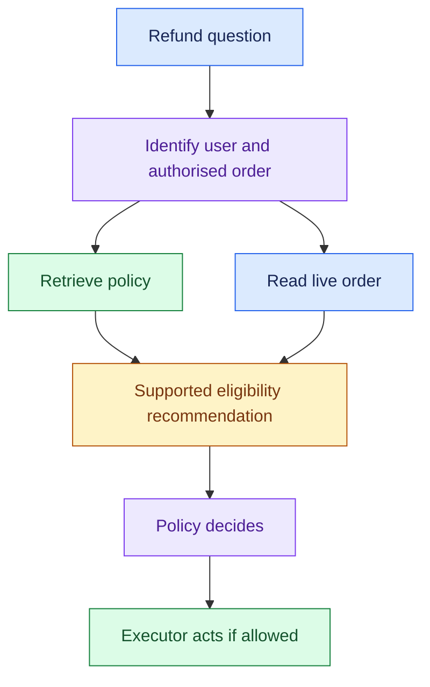

- RAG supplies evidence; it does not authorise or execute the refund.

### 5. Important Distinctions and Gotchas

1. **Ingestion vs query:** prepare searchable evidence vs retrieve it for a request. Query tuning cannot fix missing source content.
2. **Recall vs precision:** retrieve enough relevant evidence vs avoid irrelevant evidence. Increasing the result count may help one and hurt the other.
3. **Retrieval vs reranking:** find candidates vs reorder those candidates. Reranking cannot rescue absent evidence.
4. **Groundedness vs correctness:** supported by selected evidence vs correct for the actual case. Verify source freshness and applicability.
5. **Citation vs support:** a cited document may not support the claim. Check the actual evidence and enforce permissions before context construction.

### 6. Trigger → Concept Table

| Hear… | Think… | Investigate… |
|---|---|---|
| “Correct document never appears” | Recall / ingestion | Parsing, indexing, query, filters, search |
| “Many unrelated chunks” | Precision / ranking | Search signals, chunking, reranking |
| “Exact order/product code” | Keyword signal | Exact matching and hybrid retrieval |
| “Different employee permissions” | Access enforcement | Trusted scope and permission changes |
| “Old policy answer” | Freshness/version | Update pipeline and metadata |
| “Right evidence, wrong answer” | Generation / context | Selected context and claim support |
| “Current refund status” | Live tool | System-of-record access |

### 7. Interview Phrases

> “I’d separate ingestion from the query path so we can reason about freshness and retrieval independently.”

> “I’d compare search strategies on real questions, including exact identifiers and paraphrases.”

> “Permissions must be enforced before restricted information enters the model context.”

> “I’d inspect the final context before deciding the model is the problem.”

> “If the evidence is insufficient, the system should acknowledge that rather than invent an answer.”

### 8. Practice Questions

1. A correct policy document is never retrieved. Walk through your diagnosis before changing the model.
2. The right document is retrieved with many irrelevant chunks. Which stage and metrics would you inspect?
3. A policy answer is well cited but uses last year's rules. What failed, and what requirement would prevent recurrence?
4. Two employees have different access rights. How do ingestion metadata, query identity, and cache scope preserve those boundaries?
5. Design the evidence paths for a question asking both refund eligibility and current refund status. Where does RAG stop and the live tool begin?

---

## One-Page Memory Card: RAG and Enterprise Data

- **Core question:** How do we get the right authorised evidence into the answer and verify that it was used correctly?

### Recall Flow

- RAG means retrieval-augmented generation.
- It supplies evidence for generation; it does not grant permission or execute business actions.

### Checklist

| Concept | Remember |
|---|---|
| Data choice | Reference policy → RAG; current transactional state → API/tool |
| Ingestion | Parse faithfully; carry source IDs, versions, timestamps, access metadata |
| Maintenance | Updates, deletions, and permission changes must reach retrieval |
| Chunking | Preserve meaningful context; small loses meaning, large adds noise |
| Search | Vector for meaning; keyword for exact terms; hybrid when both help |
| Filters | Trusted user/tenant scope plus applicable product, region, version |
| Reranking | Reorder retrieved candidates; cannot find missing evidence |
| Context | Select relevant evidence, exceptions, and source links within budget |
| Evaluation | Recall, precision, claim support, correctness, missing-answer behaviour |

### Trigger → Concept

| Hear… | Think… |
|---|---|
| “Never finds the document” | Check ingestion and retrieval recall |
| “Too many irrelevant chunks” | Precision, ranking, context selection |
| “Exact code” | Keyword / hybrid matching |
| “Old answer” | Source freshness and version applicability |
| “Restricted documents” | Access enforcement before context |
| “Right evidence, wrong answer” | Final context and generation |
| “Current status” | Live system tool |

### Do Not Confuse

1. **Recall vs precision:** relevant evidence found vs retrieved evidence that is relevant. Specify labels and retrieval cutoff.
2. **Retrieve vs rerank:** collect candidates vs reorder them. Missing candidates need retrieval fixes.
3. **Grounded vs correct:** supported by evidence vs correct for the case. Outdated evidence can support a wrong answer.
4. **Citation vs support:** a source link alone does not verify a claim.

### Debugging Order

- Do not switch models before locating the failing stage.
- Increasing retrieved context can add noise, latency, and cost.
- Rerank only when its measured benefit justifies the overhead.

### Support Pattern

- Retrieve the refund policy and read live order data.
- Use both to support the recommendation.
- Policy decides whether execution is allowed.
- If evidence is insufficient or conflicting, clarify, explain the limitation, or escalate.
- Cache reuse must preserve freshness and access scope.

### 30-Second Answer

Practise these points as one spoken answer:

- “I’d first separate reference knowledge from live transactional data.”
- “For RAG, I’d build a maintained ingestion path with useful chunks, metadata, permissions, and versions.”
- “At query time I’d retrieve authorised evidence, rerank if useful, select context, and require supported claims.”
- “I’d evaluate retrieval separately from generation and trace failures from the source to the final answer.”

## Sources (checked 27 Sep 2026)

- [OWASP GenAI LLM07:2025 System Prompt Leakage](https://genai.owasp.org/llmrisk/llm072025-system-prompt-leakage/): access control before model context
- [OWASP GenAI LLM06:2025 Excessive Agency](https://genai.owasp.org/llmrisk/llm062025-excessive-agency/): access control before model context; untrusted retrieved and tool input
- [Liu et al. 2023, Lost in the Middle: How Language Models Use Long Contexts (arXiv 2307.03172)](https://arxiv.org/abs/2307.03172): extra context adds noise
- [Shi et al. 2023, Large Language Models Can Be Easily Distracted by Irrelevant Context (arXiv 2302.00093)](https://arxiv.org/abs/2302.00093): extra context adds noise
- [OWASP GenAI LLM01:2025 Prompt Injection](https://genai.owasp.org/llmrisk/llm01-prompt-injection/): untrusted retrieved and tool input
