# Agentic Architecture

## Interview Review

### 1. What the Interviewer Is Testing

- Can you justify an agent instead of a fixed workflow?
- Can you justify multiple agents rather than assuming more is better?
- Can you control tool access, execution budgets, and business actions?
- Can you recover long tasks and evaluate the path as well as the outcome?

### 2. Core Mental Model

- **Use an agent when choosing the next step requires flexible reasoning from observations.**

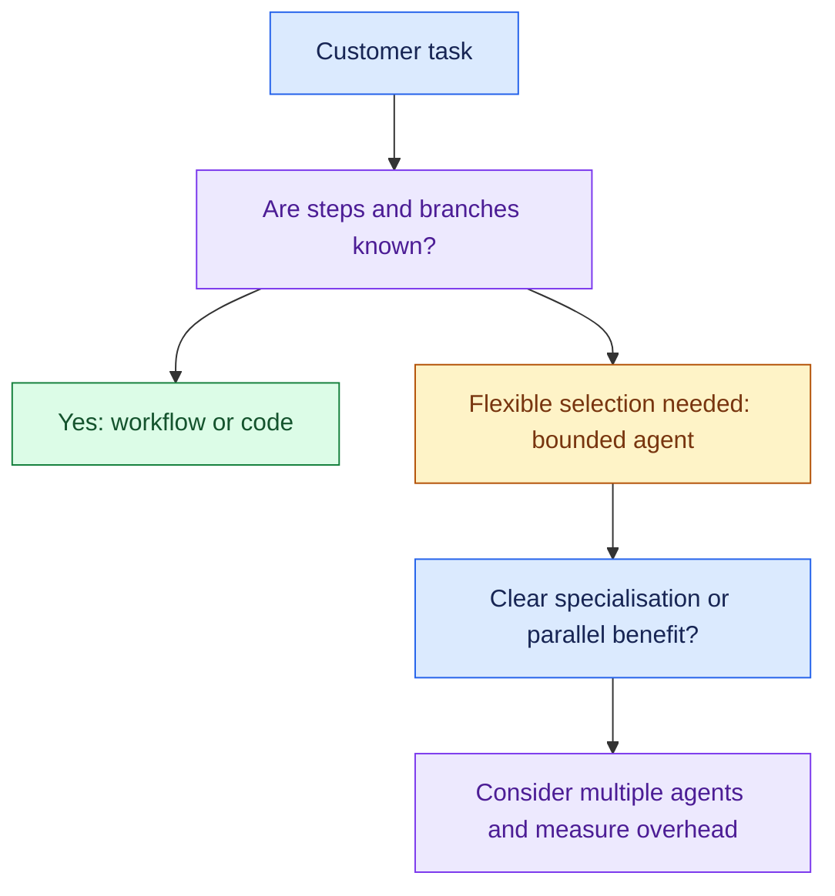

- A workflow and agent can coexist: a fixed workflow can contain a bounded reasoning step.

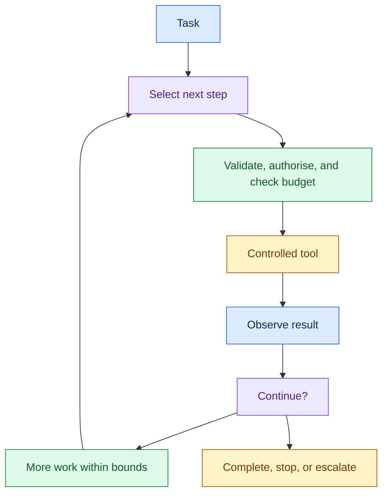

- Business actions still follow: **Agent recommends → Policy decides → Executor acts.**

### 3. Essential Concepts

#### 1. Workflow vs Agent: Match Flexibility to the Task

- A workflow follows defined steps and branches.
- An agent can choose steps or tools based on the task and results.
- Added flexibility brings more variability and evaluation needs.

> “Which part needs flexible reasoning, and which part can follow known rules?”

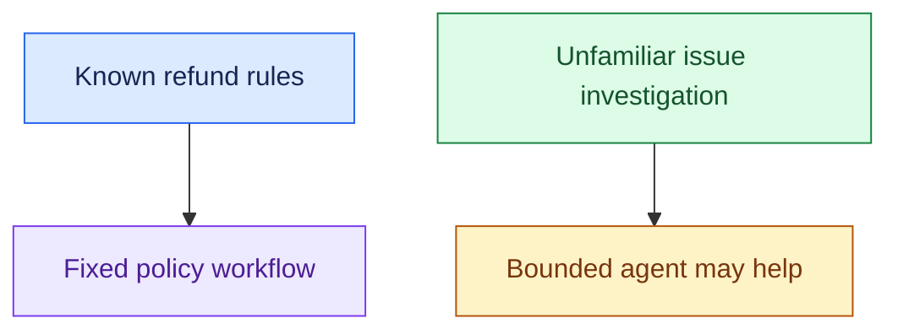

- A workflow can include a model call while keeping its steps fixed.

#### 2. Single vs Multi-Agent: Require a Concrete Benefit

- Start with the simplest design that meets the requirement.
- Consider multiple agents when distinct expertise, scoped permissions, or independent subtasks provide a measurable benefit.

> “Do these capabilities need separate reasoning contexts, or can one workflow route to tools?”

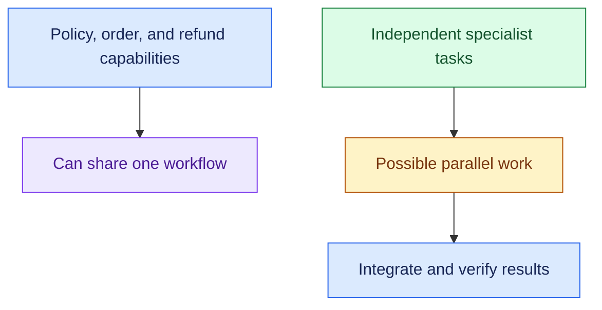

- Count the extra model calls, coordination, state, handoff errors, and evaluation work before adding agents.
- Parallel work helps only when dependencies allow it.

#### 3. Routing: Assign Work to the Right Capability

- Use explicit rules, classifiers, or reasoning according to the ambiguity.
- Pass only the task context and access scope the recipient needs.

> “I’d define the routing contract and clarify what happens if classification is ambiguous.”

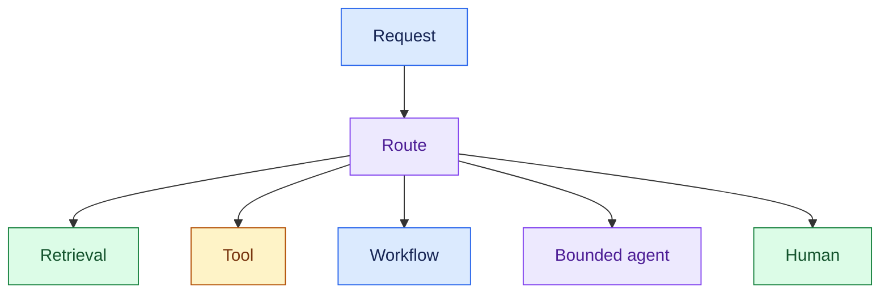

- Routing to a capability differs from model-provider routing at the Model Gateway.

#### 4. Tool Calling: Make Model Requests Controlled Operations

- Expose approved tools with clear inputs and outputs.
- Validate arguments, authorise operations, apply timeouts, and return usable results or errors.

> “The model can request a tool operation; the application validates whether that operation may execute.”

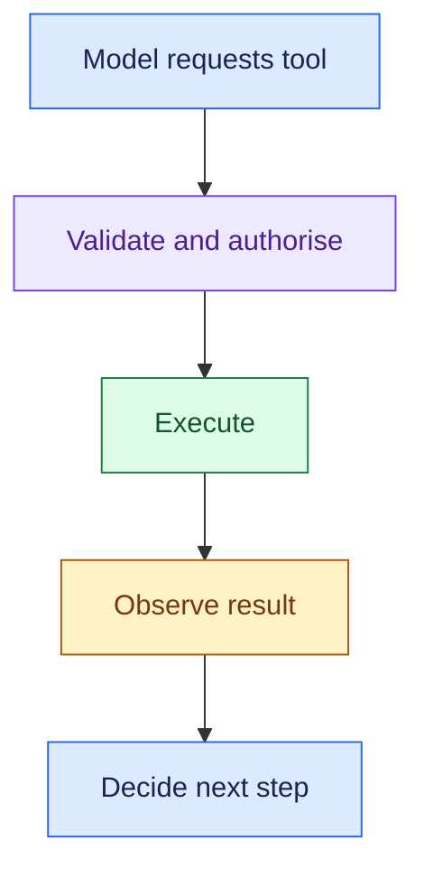

- Read tools and write tools need different controls.
- Tool output and retrieved content are data, not permission to override system rules.

#### 5. Execution Bounds: Stop Loops and Budget Runaway

- Bound steps, tool calls, tokens, retries, elapsed time, and cost.
- Define completion and no-progress stopping conditions.

> “If the task stops making progress or reaches its budget, I’d stop safely and return the status or escalate.”

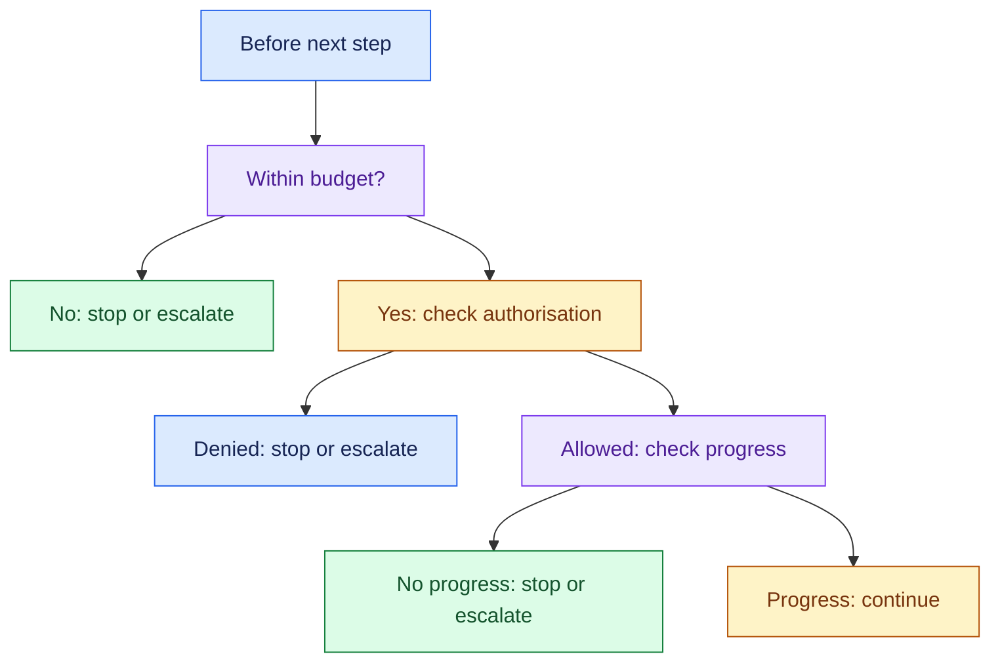

- Limits should match the workload.
- A retry budget must not reset endlessly inside a tool loop.

#### 6. State and Durable Execution: Recover Progress

- Store task identifiers, relevant context, completed steps, tool results, pending approvals, and action status when recovery is needed.

> “For a long task, I’d persist checkpoints and resume from known state rather than repeat everything after a crash.”

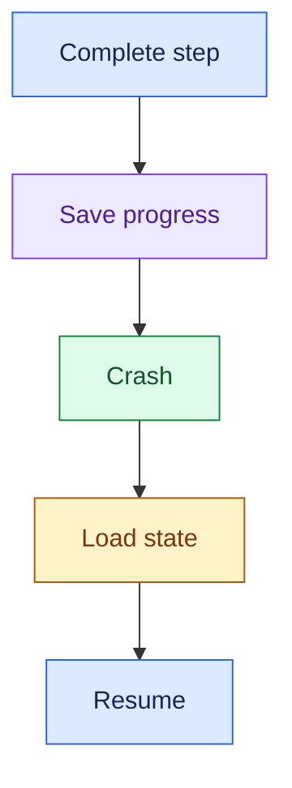

- Durable execution does not mean external actions happen exactly once automatically.
- Use idempotency and status reconciliation where writes can be repeated or become uncertain.

#### 7. Approval and Execution: Separate Reasoning From Authority

- Use deterministic policy and permission checks for business actions.
- Persist approval state if humans may respond later.

> “The agent proposes the refund; policy and approval determine whether the executor can perform it.”

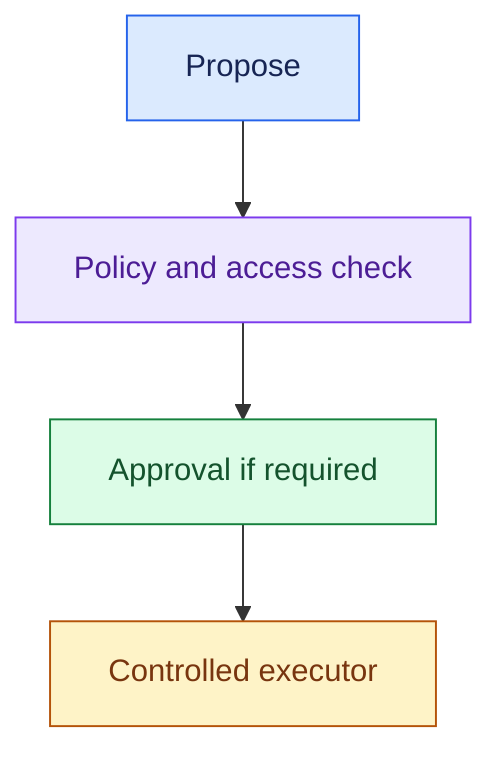

- Approval must be tied to the proposed action and relevant inputs.
- If the action changes, revalidate the approval and policy.

#### 8. Agent Trajectory: Inspect the Path, Not Private Reasoning

- The trajectory is the observable sequence of steps, tool requests/results, state transitions, and completion or escalation.

> “I’d inspect whether it chose the right tools, used valid arguments, stayed within bounds, and completed the task.”

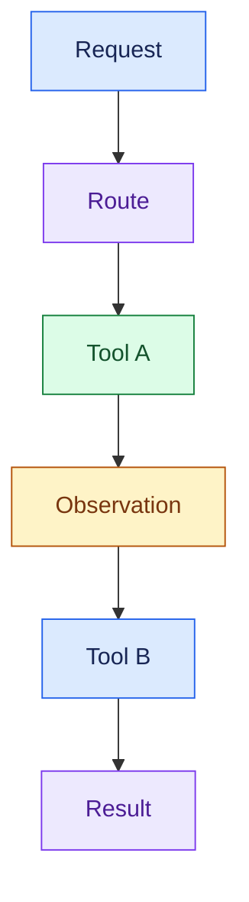

- Evaluate decision summaries, evidence, and observable tool calls.
- Private chain-of-thought is often hidden and may not faithfully explain the model’s behaviour.

#### 9. Evaluate Outcome and Efficiency: A Finished Loop Is Not Success

- Check routing, tool selection, arguments, policy compliance, recovery, task success, latency, and cost.
- Include ambiguous, failing, and malicious-input cases.

> “I’d compare the agent against a simpler workflow on task success and operating cost before adding more agents.”

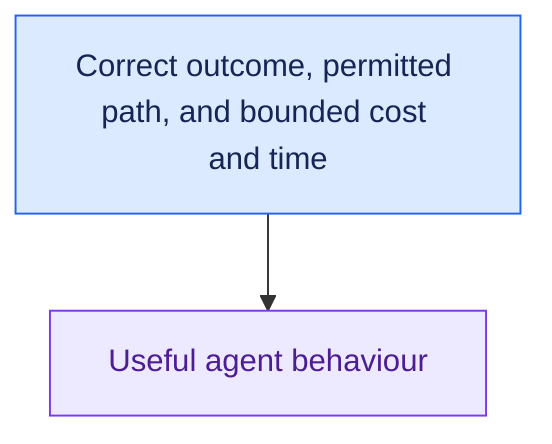

- Different valid paths can exist.
- Evaluate required constraints and outcomes rather than demanding one exact tool sequence for every task.

### 4. Requirement → Component Reasoning

| Requirement | Component / pattern | Why | Main trade-off |
|---|---|---|---|
| Known business sequence | Deterministic workflow | Predictable steps and rules | Less flexibility |
| Dynamic investigation | Bounded agent loop | Select next steps from observations | Variable paths and cost |
| Multiple capabilities | Router + clear interfaces | Assign work appropriately | Routing errors |
| Independent specialist work | Multiple agents if justified | Separate contexts or parallel subtasks | Coordination and integration |
| Live enterprise access | Controlled tool layer | Validate and authorise operations | Integration effort |
| Prevent runaway execution | Shared budget + stop rules | Bound resource use and loops | Some tasks need escalation |
| Resume long tasks | Durable state + checkpoints | Preserve progress | State consistency |
| Execute sensitive writes | Policy + approval + executor | Keep authority outside free-form reasoning | Delay and approval workflow |

#### Support Example

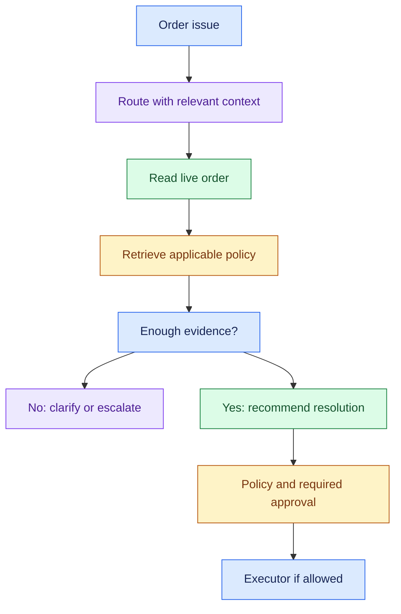

- If the task is always “check status, apply known rule, update ticket,” a fixed workflow may be sufficient.
- Preserve permissions, state, failure behaviour, audit, and outcome capture in either design.

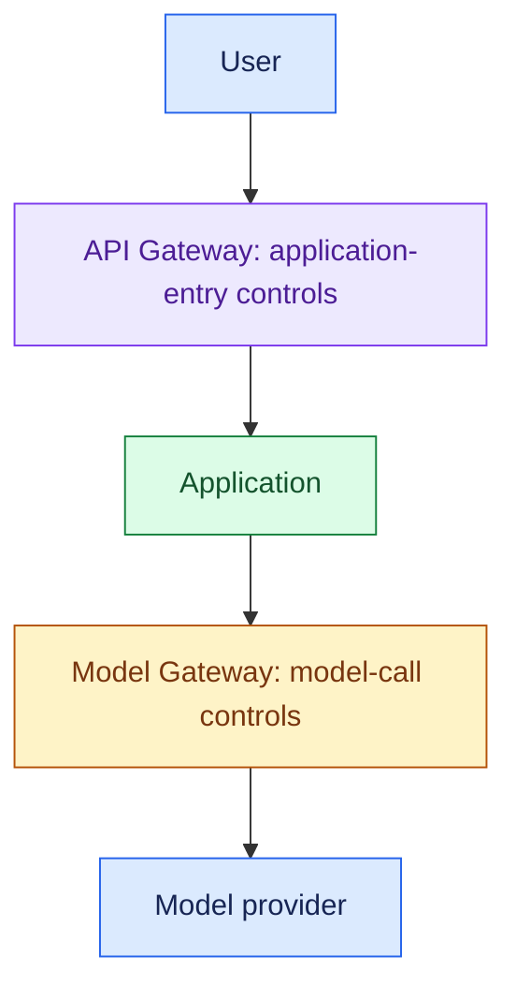

- Neither gateway grants unrestricted agent access to enterprise tools.

### 5. Important Distinctions and Gotchas

1. **Agent vs workflow:** flexible step selection vs defined sequence; a model can be used inside either.
2. **Capability vs separate agent:** policy lookup and order lookup can be tools in one workflow, not separate agents.
3. **Recommendation vs authorisation:** reasoning proposes; policy, permissions, and approval control execution.
4. **Checkpoint vs safe replay:** saved state helps recovery but does not alone prevent duplicate external writes.
5. **Trajectory vs success:** a plausible path can still fail the task. Measure outcome, permitted operations, and efficiency; do not require private model reasoning.

### 6. Trigger → Concept Table

| Hear… | Think… | Discuss… |
|---|---|---|
| “Same steps every time” | Workflow | Fixed branches and rules |
| “Steps depend on what we discover” | Agent | Observation-driven selection |
| “Separate agent for every feature” | Architecture justification | Benefit vs coordination overhead |
| “Twenty tool calls for a simple task” | Bounds / no progress | Budgets, repeated calls, stop behaviour |
| “Crash after step eight” | Durability | Checkpoints and uncertain actions |
| “Approval takes hours” | Durable approval workflow | Persist, resume, revalidate |
| “Why did it choose that tool?” | Trajectory evaluation | Tool request, inputs, evidence, result |
| “Looks helpful but fails tasks” | Outcome evaluation | Task success and constraint adherence |

### 7. Interview Phrases

> “I’d first identify which decisions need flexible reasoning and keep deterministic business rules in code or policy.”

> “I’d add multiple agents only for a clear benefit that outweighs coordination and model-call overhead.”

> “Each tool request must pass validation and authorisation before execution.”

> “I’d bound the whole task by steps, time, tools, retries, tokens, and cost, with explicit stop behaviour.”

> “Recovery must preserve progress and reconcile external side effects, not blindly replay writes.”

### 8. Practice Questions

1. A refund task follows fixed eligibility rules. Where would a workflow suffice, and where might reasoning help?
2. A customer proposes separate policy, order, refund, and escalation agents. What evidence would justify that design?
3. An agent makes 25 tool calls without resolving a simple case. What controls and diagnostic signals would you add?
4. A workflow crashes after sending a refund request but before saving the result. How do you resume safely?
5. Two agents follow different tool paths and both resolve the task correctly. What should evaluation compare, and which constraints must still hold?

---

## One-Page Memory Card: Agentic Architecture

- **Core question:** Where do we need flexible reasoning, and how do we keep execution controlled, recoverable, and useful?

### Recall Flow

### Checklist

| Concept | Remember |
|---|---|
| Workflow vs agent | Defined sequence vs observation-driven step selection |
| Single vs multi-agent | Require a benefit from context, permissions, specialisation, or independent work |
| Routing | Choose retrieval, tool, workflow, agent, or human; define ambiguity behaviour |
| Tools | Approved interfaces; validate arguments, authorise, timeout, return clear results |
| Bounds | Steps, tools, tokens, retries, elapsed time, cost, no-progress stop |
| Durable state | Task/context, completed steps, results, pending approval, action status |
| Actions | Recommendation → policy/access check → approval if needed → executor |
| Trajectory | Observable steps, tools, results, state transitions, final outcome |
| Evaluation | Correct task result, permitted path, efficiency, failure and recovery behaviour |

### Trigger → Concept

| Hear… | Think… |
|---|---|
| “Same procedure” | Deterministic workflow |
| “Investigate based on findings” | Bounded agent |
| “Agent for every capability” | Ask why separate agents help |
| “Repeated tool calls” | Budget and no-progress controls |
| “Crash / long wait” | Durable state and recovery |
| “Refund status unknown” | Reconciliation and safe replay |
| “Wrong tool / wasted steps” | Trajectory and efficiency evaluation |

### Do Not Confuse

1. **Workflow vs agent:** a model call alone does not imply agentic execution. Both can coexist in one design.
2. **Capability vs agent:** multiple tools or request types do not automatically need multiple agents.
3. **Propose vs authorise:** the agent is not the final authority for business writes. Tie approval to the specific action and revalidate changed inputs.
4. **Checkpoint vs safe replay:** durable progress does not guarantee exactly-once external effects. Use action identifiers, idempotency, and status checks where needed.

### Control Rules

- Before a tool call: validate inputs, authorise, and check the task budget.
- After a tool call: inspect the result and save relevant progress.
- Before a write: check policy and required approval, then execute safely.
- At a task limit: stop safely, report status, and escalate when needed.

- Retrieved text and tool outputs are data, not permission to bypass these controls.
- Retry limits must stay bounded across the whole task.

- API Gateway = User → Application control.
- Model Gateway = Application → Model control.
- Tool authorisation remains separate.

### Evaluation Reminder

- Inspect observable operations and evidence rather than private model chain-of-thought.
- Allow different valid paths when requirements permit them.
- Compare task success, policy compliance, latency, and cost against a simpler workflow.
- More agents or steps are not evidence of better results.

### 30-Second Answer

Practise these points as one spoken answer:

- “I’d keep known rules in a workflow and use a bounded agent where observations need to guide the next step.”
- “I’d justify multiple agents only if specialisation or independent work improves the result.”
- “Tools would be validated and authorised, actions would pass policy and approval, and long tasks would preserve state for safe recovery.”
- “I’d evaluate task success, the observable path, latency, and cost.”

## Sources (checked 27 Sep 2026)

- [Temporal blog - Idempotency and durable execution](https://temporal.io/blog/idempotency-and-durable-execution): checkpoints don't stop duplicate side effects
- [LangGraph docs - Interrupts](https://docs.langchain.com/oss/python/langgraph/interrupts): checkpoints don't stop duplicate side effects
- [Anthropic Engineering, How we built our multi-agent research system](https://www.anthropic.com/engineering/multi-agent-research-system): multi-agent overhead
- [Cemri et al. 2025, Why Do Multi-Agent LLM Systems Fail? (MAST, arXiv 2503.13657)](https://arxiv.org/abs/2503.13657): multi-agent overhead
- [Chen et al. 2025, Reasoning Models Don't Always Say What They Think (arXiv 2505.05410)](https://arxiv.org/abs/2505.05410): chain-of-thought is not always faithful
- [OWASP GenAI LLM01:2025 Prompt Injection](https://genai.owasp.org/llmrisk/llm01-prompt-injection/): untrusted retrieved and tool input
- [OWASP GenAI LLM06:2025 Excessive Agency](https://genai.owasp.org/llmrisk/llm062025-excessive-agency/): untrusted retrieved and tool input
