# Scaling AI Systems

## Interview Review

### 1. What the Interviewer Is Testing

- Can you turn user count into an actual workload?
- Can you find the bottleneck across workers, models, and tools?
- Can you protect capacity during overload and isolate tenants?
- Can you scale execution without losing state or duplicating actions?

### 2. Core Mental Model

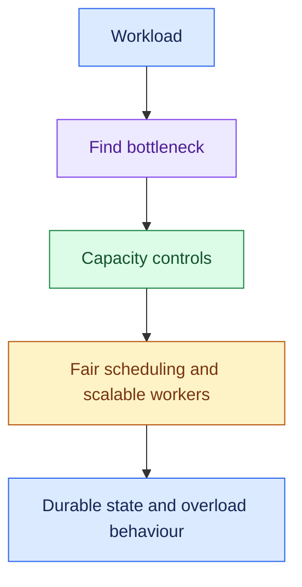

Recall:

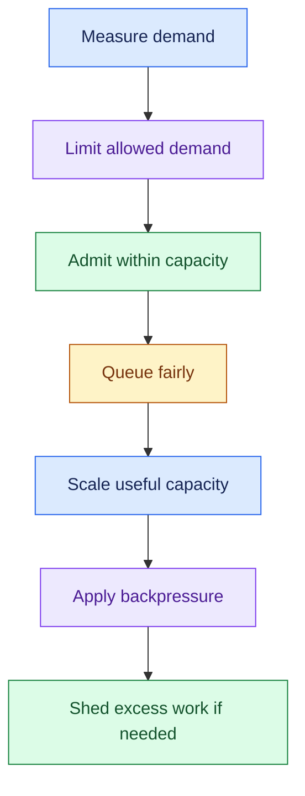

- Clarify active users, request rates, concurrency, and task duration before sizing for 100K accounts.

### 3. Essential Concepts

#### 1. Throughput and Concurrency: Translate Demand

- Throughput is work completed per unit time.
- Concurrency is work in progress at once.
- Ask about normal/peak arrivals, task duration, model calls per task, and tenant mix.

> “How many users are active at peak, and how much concurrent model and tool work does each request create?”

- In stable average conditions: concurrent work ≈ arrival rate × average time in the system.

- Use compatible units and validate with measurements.
- This average relationship does not size tail-latency headroom or overloaded queues by itself.

#### 2. Bottlenecks: Scale the Constrained Resource

- Workers, state stores, retrieval, provider token/request limits, and enterprise APIs all have capacity ceilings.

> “Before adding workers, I’d locate which dependency currently limits successful throughput.”

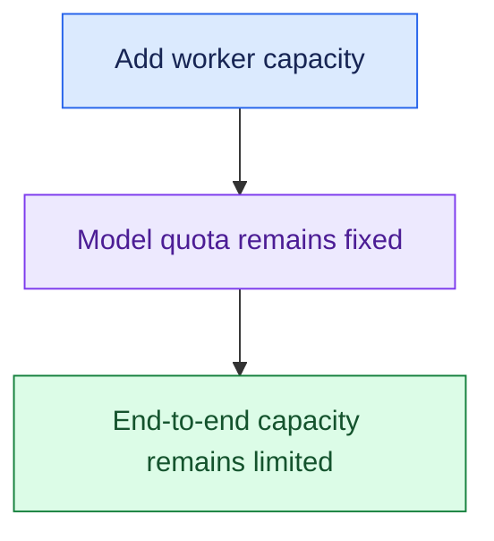

- Agent call counts and token usage can make identical request rates produce very different load.

#### 3. Stateless Workers + Durable State: Scale and Recover

- Keep authoritative task progress outside individual worker memory.
- Add workers horizontally while preserving session, workflow, approval, and action state.

> “Any eligible worker should be able to resume the task from durable state.”

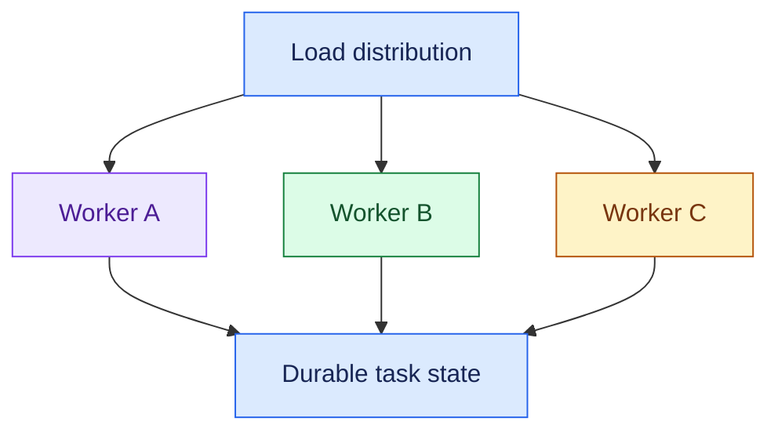

- Coordinate ownership so two workers do not execute the same action concurrently.
- Idempotency and reconciliation still protect external writes.

#### 4. Rate Limiting: Control Allowed Demand

- Enforce user or tenant request/token quotas over a defined interval.
- This protects fairness and limits excessive consumption.

> “How much traffic is this user or tenant permitted to send?”

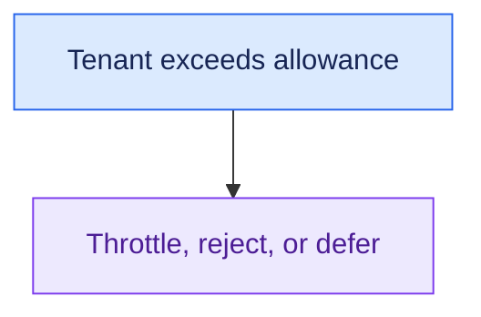

- Limits need a defined unit, scope, and burst allowance.
- Request count alone may not capture expensive long-running tasks.

#### 5. Admission Control: Protect Current Capacity

- Decide whether the system can accept more work now while meeting its operating limits.

> “Even if the tenant is within quota, do we have capacity to accept this task right now?”

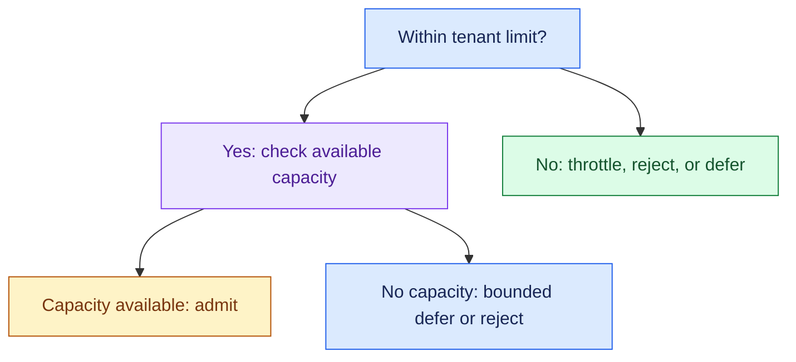

- Admission can consider active work, queue age, model limits, and task cost class.

#### 6. Queues and Backpressure: Buffer Within Limits

- Queues absorb temporary bursts or enable async processing.
- Backpressure slows or stops upstream production when downstream capacity is constrained.

> “I’d bound queue depth and wait time, then signal upstream when we cannot process more.”

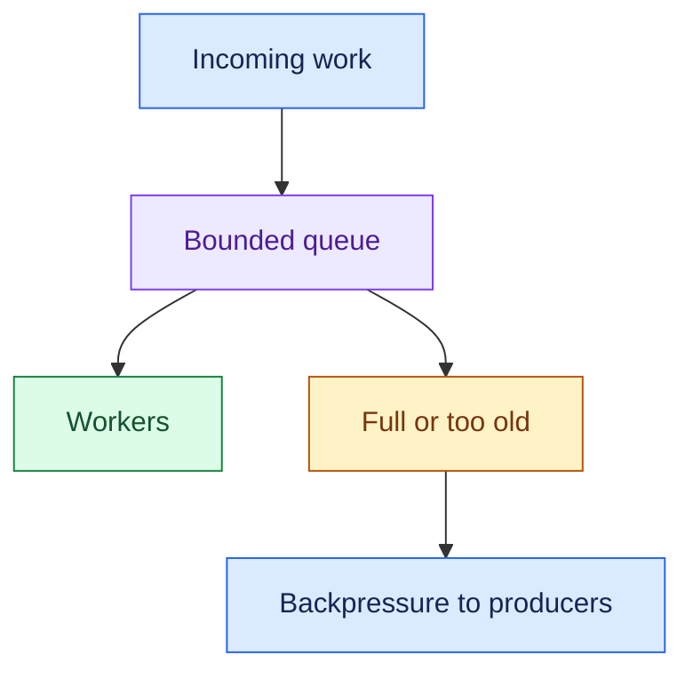

- If arrivals remain above service capacity, backlog keeps growing.
- A queue does not solve sustained overload.

#### 7. Fair Scheduling and Multi-Tenancy: Prevent Noisy Neighbours

- Use tenant-aware quotas, concurrency limits, or weighted scheduling so one tenant does not monopolise shared model and worker resources.

> “I’d separate tenant identity and data boundaries from how shared processing capacity is allocated.”

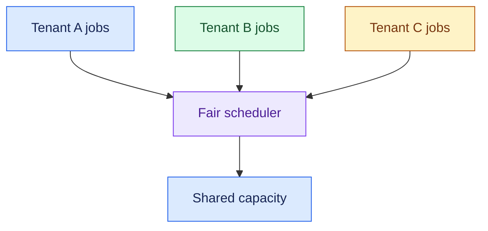

- A noisy neighbour consumes shared resources and degrades others.
- Equal request counts may still be unfair if tasks have different token/time costs.

#### 8. Autoscaling and Load Shedding: Add Capacity or Refuse Work

- Scale from signals that reflect the bottleneck, such as active work, queue age, and worker utilisation.
- When capacity cannot grow fast enough, reject or defer work according to a clear priority policy.

> “I’d scale where it helps and shed or defer excess load before it causes a system-wide slowdown.”

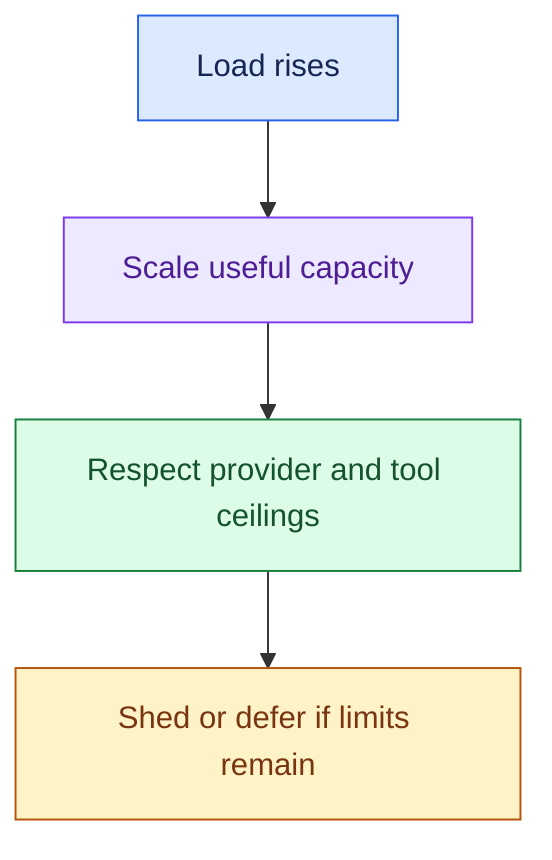

- Autoscaling takes time and cannot remove external quotas.
- Preserve critical work and communicate rejected or deferred status.

### 4. Requirement → Component Reasoning

| Requirement | Component / pattern | Why | Trade-off |
|---|---|---|---|
| More concurrent execution | Horizontal workers + durable state | Expand recoverable processing | Ownership and consistency |
| Limit tenant demand | Scoped rate limits/quotas | Enforce usage allowance | Burst rejection |
| Protect shared capacity | Admission control | Avoid accepting unserviceable work | Deferral/rejection |
| Buffer short bursts | Bounded queue | Smooth temporary mismatch | Wait time |
| Fair service across tenants | Fair scheduling + tenant concurrency limits | Prevent monopolisation | Scheduling complexity |
| Handle sustained overload | Backpressure + load shedding | Stop unbounded backlog | Some work delayed or refused |
| Track scaling behaviour | Queue/worker/dependency metrics | Locate actual bottleneck | Monitoring effort |

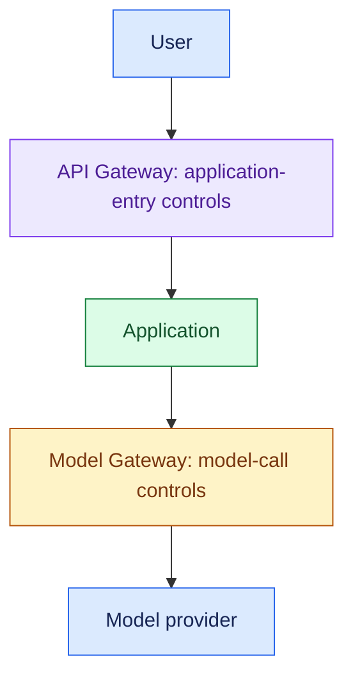

- User/tenant entry limits belong at the application boundary; model-call limits belong at the model boundary.
- End-to-end capacity controls may also live in the scheduler/orchestrator.

During a sale, order lookups and refund requests spike:
- Limit tenant demand and admit work within model and tool capacity.
- Queue eligible async tasks fairly.
- Preserve refund state and action identifiers across workers.
- Do not increase workers blindly against a fixed payment API limit.

### 5. Important Distinctions and Gotchas

1. **Users vs workload:** total accounts do not tell you peak requests, tokens, or concurrent tasks.
2. **Rate limit vs admission:** allowed tenant demand vs capacity to accept work now.
3. **Queue vs capacity:** buffering changes timing, not processing rate.
4. **Backpressure vs load shedding:** ask upstream to slow down vs discard/refuse selected work.
5. **Data isolation vs resource fairness:** tenants need both; separate data does not stop capacity monopolisation.

### 6. Trigger → Concept Table

| Hear… | Think… | Ask / inspect… |
|---|---|---|
| “100K users” | Workload | Peak activity, duration, requests, tokens |
| “One tenant hurts everyone” | Noisy neighbour | Tenant concurrency and scheduling |
| “Workers idle, model calls wait” | External bottleneck | Provider capacity and limits |
| “Queue keeps growing” | Sustained overload | Arrival/service rates and shedding |
| “Within quota but system full” | Admission control | Current capacity |
| “Worker crashed” | Durable state | Ownership, resume, safe writes |
| “Sudden spike” | Burst handling | Queue limits, headroom, scaling delay |

### 7. Interview Phrases

> “I’d translate user count into peak requests, concurrent tasks, and model/tool demand.”

> “Rate limiting controls permitted demand; admission control protects available capacity.”

> “A bounded queue can absorb bursts, but sustained overload needs capacity or reduced intake.”

> “I’d scale the actual bottleneck and protect tenants from noisy neighbours.”

### 8. Practice Questions

1. A prototype grows from 100 to 100K users. What workload details and bottleneck measurements come first?
2. One tenant consumes most model capacity. How do quotas, concurrency limits, and fair scheduling help?
3. A tenant is within quota but the system is full. What should admission control do?
4. Arrivals are 10K requests/sec and completion capacity is 5K. Why is an unbounded queue insufficient?
5. Two workers pick up the same refund task after redelivery. What state and action controls prevent duplicate execution?

---

## One-Page Memory Card: Scaling AI Systems

- **Core question:** How do we serve the workload within capacity while protecting tasks and tenants?

### Recall Flow

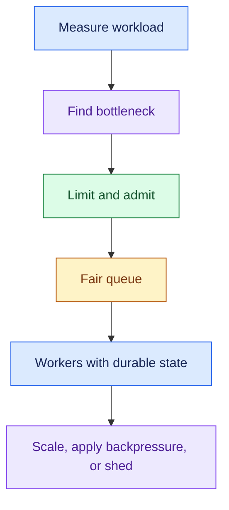

### Checklist

| Concept | Remember |
|---|---|
| Workload | Normal/peak arrivals, duration, concurrency, tenants, calls/tokens per task |
| Throughput | Completed work per unit time |
| Concurrency | Work in progress; average ≈ arrival rate × average time in stable conditions |
| Bottleneck | Workers, model limits, retrieval, tools, state; scale the constrained resource |
| Workers | Horizontal execution with external durable task state and ownership |
| Rate limit | User/tenant allowance over a defined interval |
| Admission | Can we accept this work now within operating limits? |
| Queue/backpressure | Bounded buffer; slow/stop producers when downstream fills |
| Fairness | Tenant quotas, concurrency limits, weighted scheduling |
| Shedding | Refuse or defer selected work when capacity is exhausted |

### Trigger → Concept

| Hear… | Think… |
|---|---|
| “100K users” | Peak workload, not account count |
| “Tenant A consumes capacity” | Noisy neighbour / fair scheduling |
| “Within allowance, no capacity” | Admission control |
| “Backlog keeps increasing” | Sustained overload |
| “More workers did not help” | External or shared bottleneck |
| “Crash / repeated delivery” | Durable ownership and safe replay |

### Do Not Confuse

1. **Rate limit vs admission:** permitted demand vs available capacity now.
2. **Queue vs capacity:** a buffer does not increase processing throughput.
3. **Backpressure vs shedding:** slow upstream vs refuse/discard selected work.
4. **Tenant isolation vs fairness:** data separation vs resource allocation.

### Overload Rules

- Bound queue length and age.
- If arrivals remain above completion capacity, add useful capacity or reduce intake.
- Autoscaling has delay and external api/model limits may remain fixed.
- Track queue wait, active work, successful throughput, and dependency saturation rather than worker cpu alone.

- Use durable task/context/approval state so work can move across workers.
- Coordinate task ownership and retain action identifiers; worker redelivery must not issue duplicate refunds.
- A checkpoint by itself is not safe external replay.

### Boundary Reminder

- API Gateway = User → Application control.
- Model Gateway = Application → Model control.
- Scheduler/orchestrator capacity controls connect the boundaries into one task budget.
- Token-heavy requests may need different controls from short requests.

### 30-Second Answer

Practise these points as one spoken answer:

- “I’d define peak requests, concurrency, task duration, and model/tool demand, then find the bottleneck.”
- “I’d use tenant limits and admission control, bounded fair queues where appropriate, and horizontally scalable workers with durable state.”
- “I’d scale where capacity can grow, apply backpressure or shedding during overload, and preserve tenant isolation and safe action execution.”

## Sources (checked 27 Sep 2026)

- [Claude docs - Rate limits](https://platform.claude.com/docs/en/api/rate-limits): provider rate limits cap throughput
- [Temporal blog - Idempotency and durable execution](https://temporal.io/blog/idempotency-and-durable-execution): checkpoints don't stop duplicate side effects; at-least-once redelivery
- [LangGraph docs - Interrupts](https://docs.langchain.com/oss/python/langgraph/interrupts): checkpoints don't stop duplicate side effects
- [Little 1961, A Proof for the Queuing Formula L = λW](https://pubsonline.informs.org/doi/10.1287/opre.9.3.383): Little's Law
