# Latency Optimisation

## Interview Review

### 1. What the Interviewer Is Testing

- Can you measure the actual waiting experience before optimising?
- Can you find the critical path across queues, retrieval, models, and tools?
- Can you distinguish streaming, parallelism, and asynchronous delivery?
- Can you reduce latency while preserving quality and safe actions?

### 2. Core Mental Model

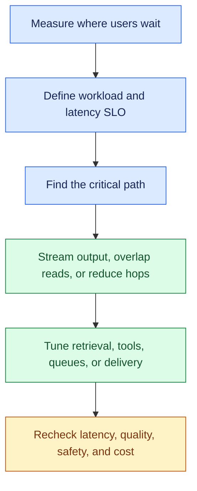

- Define the service-level objective (SLO): metric, target, workload, and measurement window.
- Trace the full request, including queue wait and repeated calls.
- Add sequential stages. For parallel work, count the slowest required branch plus overhead.
- Avoid double-counting child spans already included in a parent span.

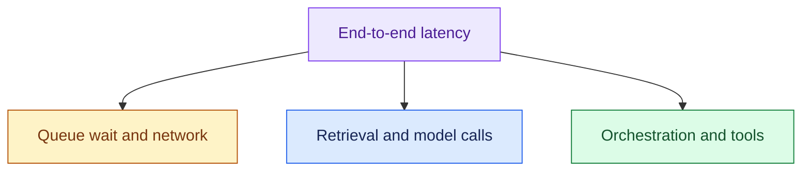

The boxes group sources of delay; the request trace determines their order and overlap.

### 3. Essential Concepts

#### 1. P50/P95/P99: Inspect the Distribution

- P50 is the median: half of requests finish at or below this time.
- P95 and P99 describe the slower tail: 95% or 99% finish at or below those times.
- Compare the same task types and measurement windows.
- Break results down by tenant and workload. An overall improvement can hide a slower experience for one group.

> “I’d segment latency by workload and inspect the tail, not just the average.”

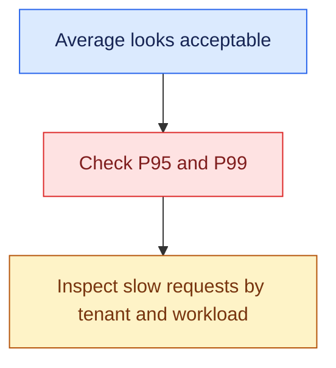

#### 2. Trace the Request: Locate the Critical Path

- Open traces for slow requests, including repeated model and tool calls.
- Separate queue, network, retrieval, model, tool, and orchestration time.
- Check which stages run in sequence and which overlap.

> “If the model takes two seconds and the task takes twelve, I’d inspect the other ten seconds before switching models.”

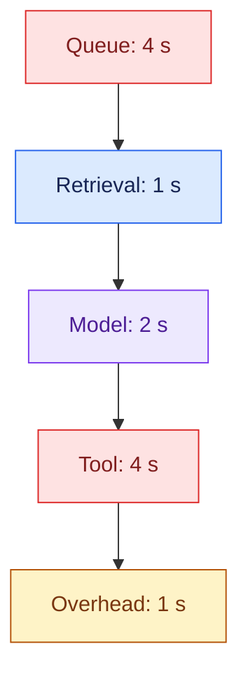

Illustrative sequential trace: 12 seconds total. Queue and tool waits account for eight seconds.

#### 3. Time to First Token and Streaming: Improve Perceived Waiting

- Time to first token (TTFT) measures when model output begins.
- First useful output may reach the user later. Track it separately from final completion.
- Streaming shows partial output while generation continues; total work may stay the same.

> “I’d track when users first get something useful and when the task finishes.”

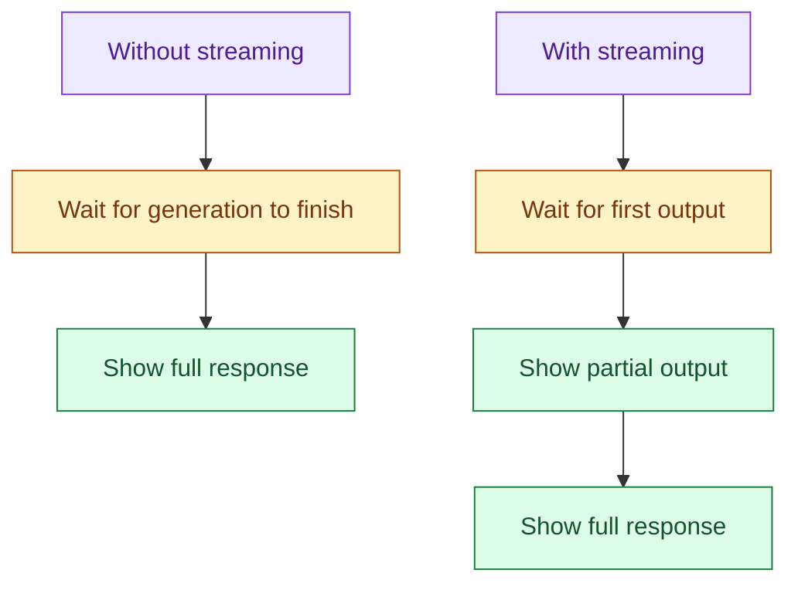

- Confirm execution before showing an action as successful.
- Keep partial output safe. Do not expose sensitive information before required checks finish.

#### 4. Parallelisation: Overlap Independent Work

- Run independent retrieval or read-tool calls together.
- Check permissions, dependency limits, and correctness first.
- Keep steps in sequence when one needs another's result.

> “I’d parallelise independent order and policy reads, but preserve sequencing where one result is needed for another.”

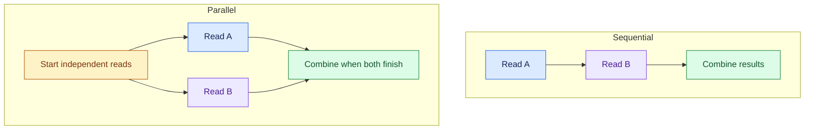

- Parallel time depends on the slowest required branch plus overhead.
- More concurrent calls increase dependency load.
- Preserve the required order of business writes.

#### 5. Reduce Sequential Model Hops: Remove Unnecessary Reasoning Calls

- Inspect router, planner, agent, critic, and writer calls.
- Ask what each call contributes before combining or replacing it.
- Use a rule or schema check where model reasoning adds no value.
- Keep required policy, authorisation, and evaluation controls.

> “Does this stage need model reasoning, or can a rule, schema check, or simpler call do it?”

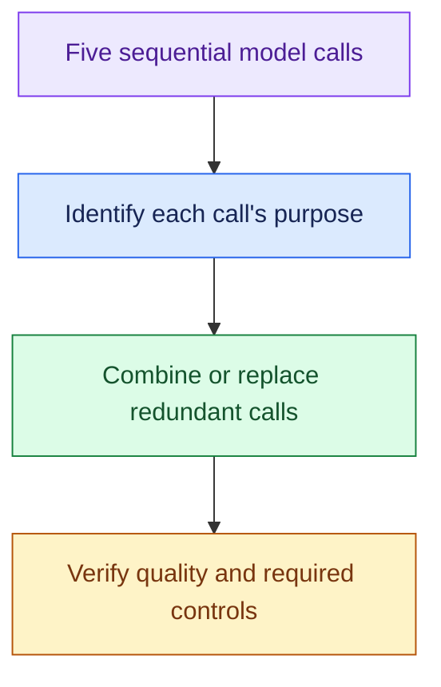

#### 6. Retrieval: Optimise the Evidence Path

- Measure query embedding, search, filtering, reranking, and context construction.
- Tune candidate counts, indexing, and caching against evidence recall and answer quality.
- Reuse cached evidence only when permissions and freshness allow it.

> “I’d check recall and answer quality as I tune retrieval, and keep access checks intact.”

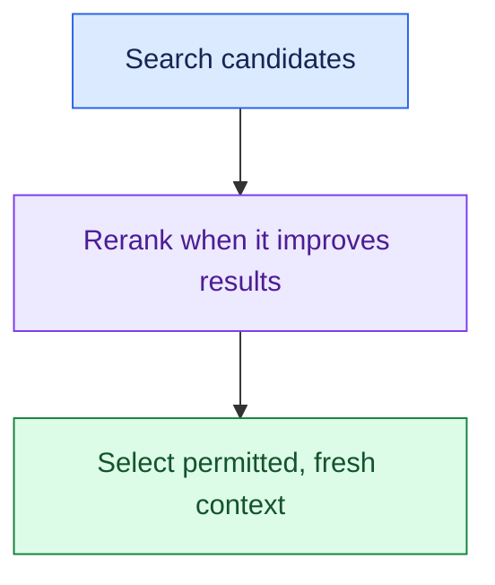

#### 7. Tools: Control Slow Dependencies

- Measure enterprise API latency and set deadlines.
- Reuse results only within their freshness limits.
- Choose a safe fallback, defer the task, or escalate when the dependency is too slow.
- For write timeouts, check the operation's status before retrying. A timeout does not automatically cancel a remote side effect.

> “A slow ERP will not become fast just because I choose a faster model.”

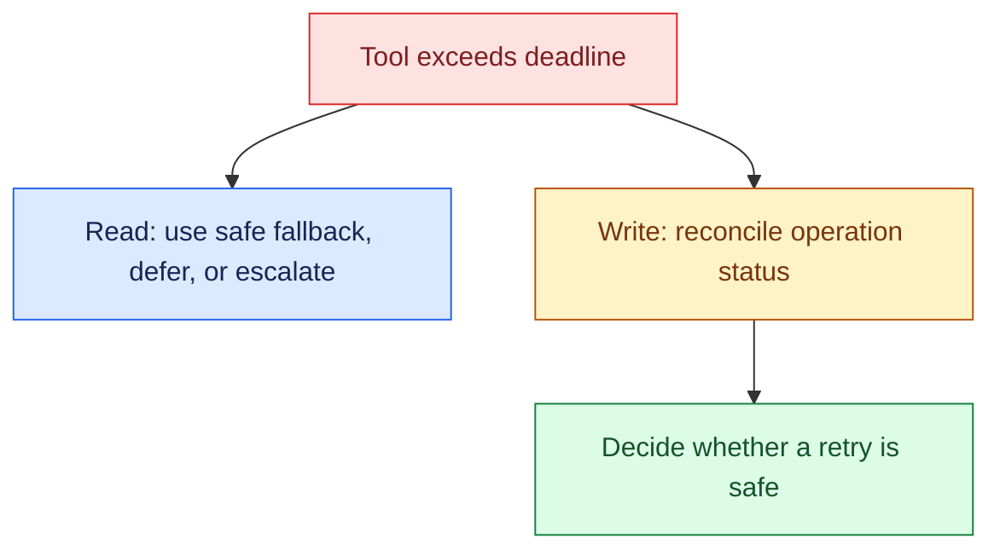

#### 8. Queue Wait: Protect Tail Latency Under Load

- Measure queue wait separately from processing time.
- Use admission control, tenant-aware limits, and bounded queues.
- Scale capacity where the bottleneck can scale.
- Define when to reject or defer excess work. An unbounded queue can make every request late.

> “If model time is stable but queue wait grows at peak, I’d address overload rather than model speed.”

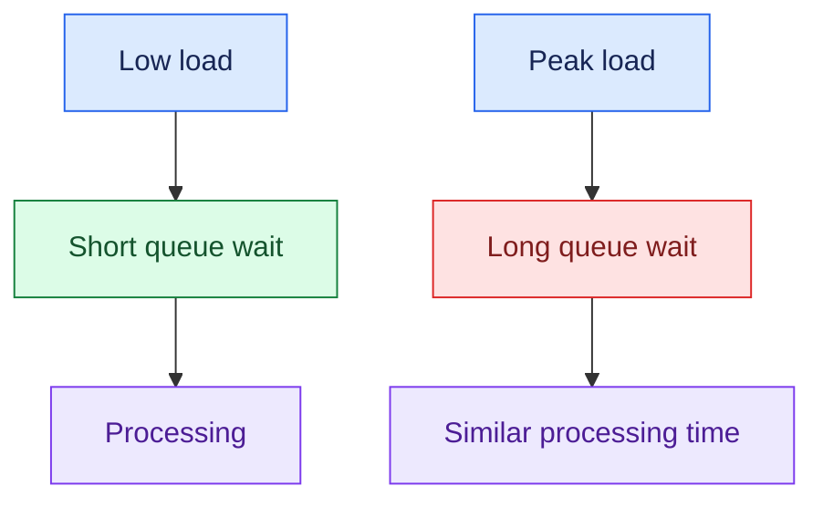

#### 9. Async Delivery: Change the Interaction for Long Tasks

- For tasks that take minutes, return a task identifier and run the work in the background.
- Provide status, progress, and a way to retrieve the result.
- Persist task state and define cancellation and timeout behaviour.
- Agree on completion expectations. Async delivery releases the client while execution continues.

> “For a five-minute research task, I’d agree on completion expectations and use asynchronous delivery.”

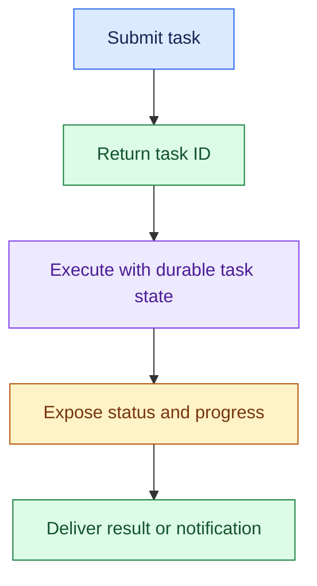

### 4. Requirement → Component Reasoning

| Requirement | Pattern / component | Why | Trade-off |
|---|---|---|---|
| Know where time goes | End-to-end traces | Identify critical path | Instrumentation effort |
| Earlier useful output | Streaming | Reduce perceived waiting | Partial-output handling |
| Independent slow reads | Concurrent execution | Overlap waiting | More concurrent dependency load |
| Too many sequential calls | Simpler routing/workflow | Remove redundant hops | Recheck answer quality |
| Repeated eligible lookups | Scoped cache | Avoid repeated retrieval/tools | Freshness and permissions |
| Peak queue delay | Admission + bounded queues + capacity | Protect waiting time | Deferral/rejection |
| Long-running task | Async jobs + durable state | Match interaction to duration | Status/result UX |

For a support request:

- Measure policy retrieval and live order lookup; overlap them if independent.
- Remove redundant model hops while keeping refund checks and confirmation.
- Investigate peak queue wait separately from processing time.

### 5. Important Distinctions and Gotchas

1. **Average vs tail:** P95/P99 expose slow experiences hidden by averages.
2. **First token vs useful output vs completion:** these are different user and system measurements.
3. **Streaming vs less computation:** showing output earlier does not necessarily reduce generation time.
4. **Parallel vs dependent work:** overlap independent operations; preserve necessary ordering and writes.
5. **Async vs faster task:** releasing the request does not shorten underlying execution.

### 6. Trigger → Concept Table

| Hear… | Think… | Inspect… |
|---|---|---|
| “Average 3s, P99 25s” | Tail latency | Slow traces, tenants, workload classes |
| “Three independent APIs sequentially” | Parallelisation | Dependencies and limits |
| “Model fast, task slow” | Critical path | Queue, tools, retrieval, overhead |
| “Long silent wait” | First useful output | TTFT, streaming, progress |
| “Five model calls” | Sequential hops | Necessity of each reasoning step |
| “Slow only at peak” | Queue/capacity | Wait age and saturation |
| “Five-minute research” | Async interaction | Task state and delivery expectations |

### 7. Interview Phrases

> “I’d trace latency end to end before deciding what to optimise.”

> “I’d measure first useful output and final completion separately.”

> “I’d overlap independent work and reduce unnecessary sequential hops.”

> “I’d recheck quality and safety after any latency optimisation.”

### 8. Practice Questions

1. Average latency is three seconds but P99 is 25 seconds. What traces and segments do you inspect?
2. CRM, order, and ticket reads are sequential. When can you parallelise them, and when can you not?
3. Model time is two seconds but total time is twelve. How do you locate the bottleneck?
4. Streaming starts quickly but completion remains slow. Which experience improved, and what remains unresolved?
5. A five-minute task has useful progress updates. Design its request, state, status, and result interaction.

---

## One-Page Memory Card: Latency Optimisation

**Core question:** Where does the user wait, and what change improves that experience without breaking quality or safe execution?

### Recall Flow

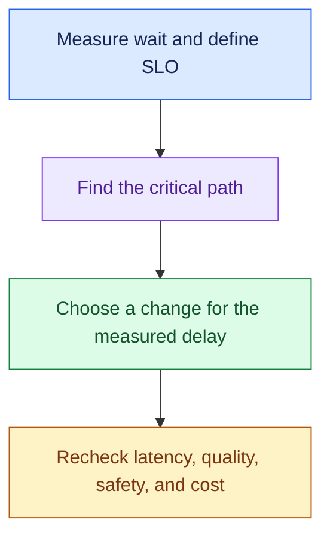

### Checklist

| Concept | Remember |
|---|---|
| P50/P95/P99 | Median and slower-tail experiences; segment by workload/tenant |
| SLO | Service-level objective: defined metric, target, workload, window |
| TTFT | Time to first token; distinguish first useful output and final completion |
| Tracing | Queue, network, retrieval, models, tool spans, repeated calls |
| Streaming | Earlier partial output; not necessarily less total computation |
| Parallelism | Overlap independent work; slowest necessary branch dominates |
| Hops | Remove/replace unnecessary sequential model calls |
| Retrieval/tools | Tune measured work with quality, freshness, access, deadlines intact |
| Queue | Wait time differs from processing; protect with capacity controls |
| Async | Task ID, durable state, progress/status, result delivery |

### Trigger → Concept

| Hear… | Think… |
|---|---|
| “Bad P99” | Tail traces and workload segments |
| “Independent APIs called one by one” | Parallel reads |
| “Model 2s, total 12s” | Other critical-path stages |
| “Long wait before output” | First useful output / streaming |
| “Many agent hops” | Reasoning-call necessity |
| “Slow at peak” | Queue wait and capacity saturation |
| “Minutes of work” | Async completion expectations |

### Do Not Confuse

1. **Average vs tail:** fast typical requests do not guarantee acceptable slow requests.
2. **TTFT vs completion:** output beginning is not a finished answer or action.
3. **Streaming vs speed:** partial delivery can improve perception without shortening execution.
4. **Async vs less work:** the client stops blocking while the task continues.

### Critical-Path Rules

- Add sequential stages; use the slowest required branch for parallel work, plus overhead.
- Avoid double-counting nested spans. Open slow-request traces as well as aggregate dashboards.
- Preserve dependencies and write ordering; check the load added by parallel calls.
- Keep policy checks and confirm actions before reporting success.
- Tune retrieval against evidence quality; cache only within permission and freshness limits.
- Reconcile a timed-out write before retrying.
- Bound queue waits and define overload behaviour. Add workers only where the bottleneck can scale.

### 30-Second Answer

Practise these points as one spoken answer:

- “I’d agree on first useful output and completion targets for each workload.”
- “Then I’d inspect P95/P99 traces and find where users spend time waiting.”
- “I’d overlap independent reads, cut redundant model calls, and tune the slow stages. Streaming can show useful output sooner.”
- “For tasks that take minutes, I’d return a task ID with progress and result retrieval.”
- “After each change, I’d recheck latency, quality, action safety, and cost.”
