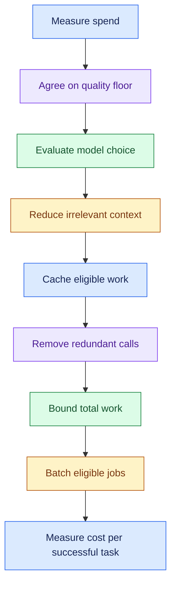
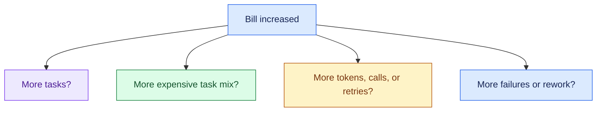
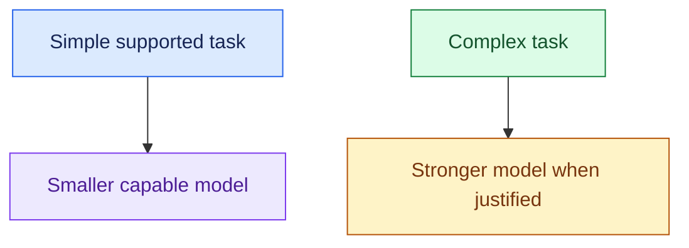
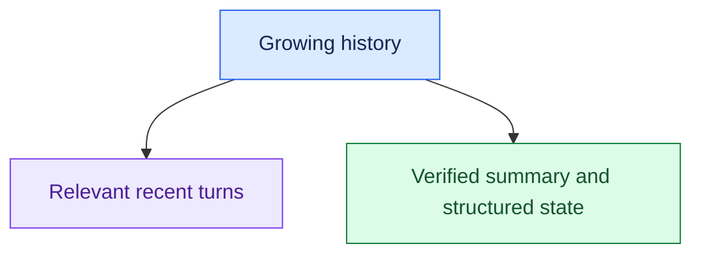
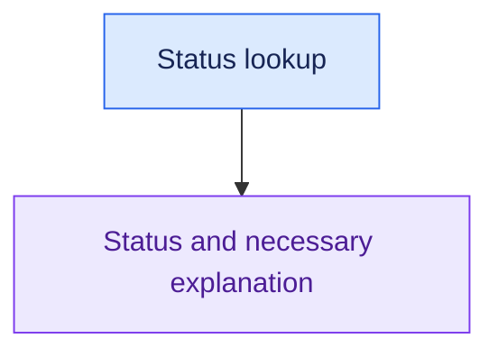
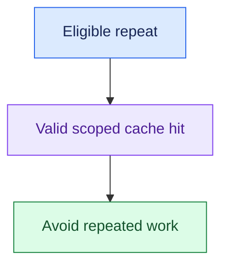
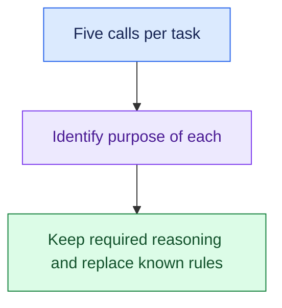
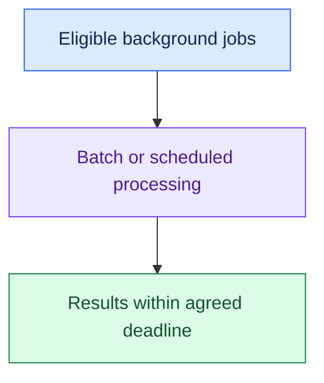
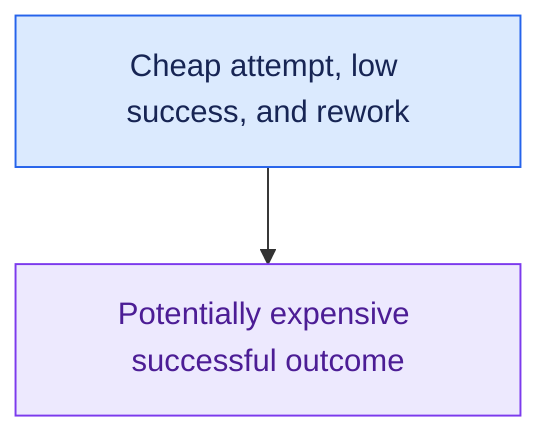
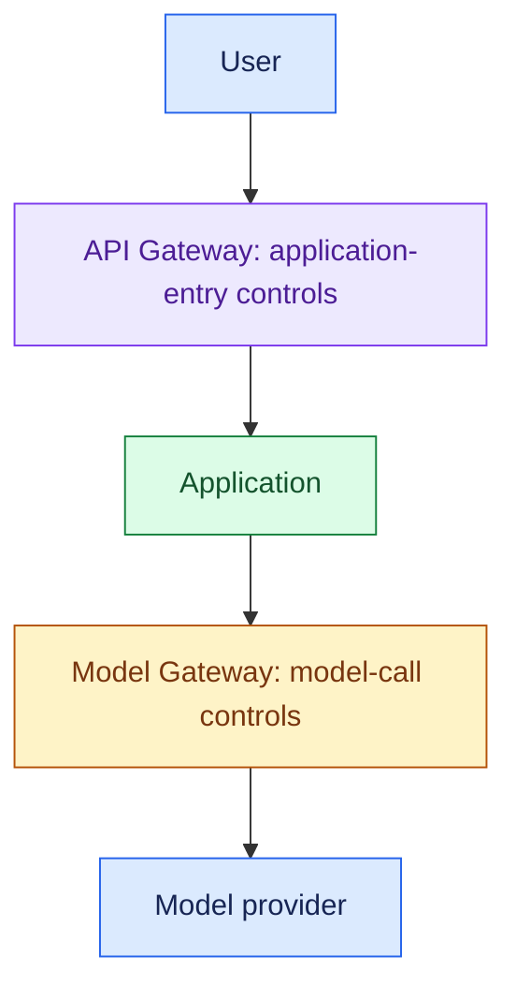

# Cost Optimisation

## Interview Review

### 1. What the Interviewer Is Testing

- Can you explain the full cost of a successful task?
- Can you locate why costs rose instead of guessing from the bill?
- Can you choose cheaper execution paths while preserving required quality?
- Can you control unbounded context, calls, retries, and agent work?

### 2. Core Mental Model

- Total task-related cost = model input/output usage + retrieval + tools + compute + retries + relevant review/rework.
- Cost per successful task = total cost across attempts ÷ successful tasks.

- Avoid double-counting model charges: input/output token charges are part of model cost, not an additional identical charge.
- Define the accounting scope and reporting window.

### 3. Essential Concepts

#### 1. Attribution: Find What Changed

- Track cost by task type, tenant, model, input/output usage, call count, tool use, retries, and outcomes.
- Compare workload mix as well as total traffic.

> “If the bill doubled, I’d separate volume growth from higher cost per attempt and lower success rates.”

- Pricing units differ across providers and tools.
- Use observed usage and applicable billing rates rather than invented universal prices.

#### 2. Model Routing: Use Sufficient Capability

- Use cheaper models for tasks they can reliably handle and stronger models when evaluation shows a need.
- Route by task and risk, with verified fallback behaviour.

> “I’d use the least expensive model that meets this task's quality and safety requirements.”

- Routing and fallback add their own calls and complexity.
- Cheap attempts followed by repeated expensive recovery may not save money.

#### 3. Context Optimisation: Send What the Task Needs

- Select relevant evidence, remove duplication, and preserve essential facts.
- For long conversations, combine recent turns with reliable summaries and structured task state.

> “I’d stop resending irrelevant history while preserving constraints, references, and pending actions.”

- Summaries can omit or distort facts.
- Check their effect on task quality; maintain authoritative action and approval state separately.

#### 4. Output Control: Avoid Unnecessary Generation

- Choose concise output formats and task-appropriate output limits.
- Long answers increase cost and may increase completion latency.

> “For a status lookup, a short factual response is enough.”

- Do not truncate essential evidence, structured tool arguments, or a required user-facing explanation to save tokens.

#### 5. Caching: Reuse Eligible Work

- Cache repeated retrieval, tool, or response results only within correct tenant/access scope and freshness limits.
- Provider prompt caching is a separate reuse mechanism with provider-specific billing behaviour.

> “I’d first identify repeated safe work, then define cache keys, expiry, and permission scope.”

- Current order state may need fresh reads.
- Cache hit rate alone is not success if reused results are stale or unauthorised.

#### 6. Reduce Calls and Use Deterministic Logic

- Ask why each router, planner, critic, or writer model call exists.
- Use rules and code for known logic, validation, and business thresholds.

> “I'd justify each model call by the reasoning it contributes, then remove redundant calls through evaluation.”

- Fewer calls can reduce both cost and latency.
- Preserve controls and check whether fewer steps increase failed attempts.

#### 7. Agent and Retry Bounds: Cap Amplification

- Set budgets for steps, tools, tokens, retries, time, and cost.
- Stop repeated no-progress behaviour with a defined status or escalation.

> “I’d cap total work per task, not just the tokens in one model response.”

- Total call cost grows with both cost per call and number of calls.

- Count nested retries and fallback attempts.
- Never save money by removing idempotency, policy, or permission checks around business actions.

#### 8. Batch Processing: Trade Urgency for Efficiency

- Group eligible background work or use batch processing when completion deadlines allow it.
- Verify whether the execution/billing mechanism saves cost.

> “For non-interactive work, I'd consider batching if the customer's completion window permits it.”

- Batching may add delay and recovery complexity.
- It is not suitable for every interactive support request, and batching alone does not guarantee a discount.

#### 9. Cost per Successful Task: Preserve the Business Outcome

- Measure attempts, failures, escalations, and human rework alongside automated success.
- Define what successful completion means before comparing designs.

> “A lower cost per request may be worse if more requests fail and require manual resolution.”

- Check quality by important task/tenant segments, not only a global average.
- For a window with no successes, report the metric as undefined rather than a misleading zero.

### 4. Requirement → Component Reasoning

| Requirement | Pattern / component | Why | Trade-off |
|---|---|---|---|
| Explain rising spend | Usage/cost attribution | Locate volume and per-task drivers | Measurement effort |
| Different task complexity | Evaluated model routing | Match capability to need | Routing errors/fallback overhead |
| Growing context costs | Relevant context + structured state | Reduce unnecessary input | Summary loss or retrieval misses |
| Repeated eligible work | Scoped cache | Avoid repeated computation | Freshness/access management |
| Known deterministic decisions | Code/policy | Avoid unnecessary reasoning calls | Rule maintenance |
| Runaway agent work | Shared task budget + stop rules | Cap amplification | More escalation for hard tasks |
| Flexible background deadline | Batch execution | Potential efficiency gains | Added delay |
| Preserve customer value | Outcome-linked cost metrics | Compare successful results | Outcome labelling |

- The Model Gateway can centralise model routing and usage tracking.
- User/tenant quotas control demand at the application boundary; neither replaces full task-cost attribution.

For support requests:

- Evaluate a cheaper path for simple policy questions.
- Reuse policy retrieval only when freshness and permissions allow it.
- Fetch current order state when required; keep refund policy in code.
- Cap investigation loops and count retries and manual rework.
- Compare cost per resolved case, including retries and manual rework.

### 5. Important Distinctions and Gotchas

1. **Cost/request vs cost/success:** cheaper failed requests can worsen business economics.
2. **Token cost vs total cost:** tools, retrieval, compute, retries, and review may dominate.
3. **Cheaper model vs cheaper task:** extra retries or escalation can erase per-call savings.
4. **Cache reuse vs freshness:** lower spend cannot justify stale or unauthorised data.
5. **Optimisation vs quality loss:** measure the quality floor and important segments after each change.

### 6. Trigger → Concept Table

| Hear… | Think… | Inspect… |
|---|---|---|
| “Bill doubled” | Attribution | Volume, mix, tokens, calls, retries |
| “Same strong model for every task” | Routing | Task quality by model |
| “History grows forever” | Context | Relevant turns, summaries, task state |
| “Same policy questions” | Cache | Scope, freshness, actual saved work |
| “Five model calls per request” | Call reduction | Purpose and measured benefit |
| “Agent keeps trying” | Bounds | Total attempts, no progress, escalation |
| “Background job can wait” | Batch | Deadline and actual economics |
| “Cheap but many failures” | Cost/success | Rework and task completion |

### 7. Interview Phrases

> “I’d attribute cost before optimising, separating traffic growth from higher cost per task.”

> “I’d choose the cheapest model that meets the task’s quality and safety requirements.”

> “I’d reduce irrelevant context and redundant calls while preserving state, evidence, and controls.”

> “I’d compare total cost per successful outcome, including retries and relevant rework.”

### 8. Practice Questions

1. The bill doubles after launching an agent. Which usage and outcome measurements distinguish the causes?
2. A cheaper model reduces per-call cost but increases fallback and human escalation. How do you compare designs?
3. Conversation tokens grow every turn. How do you compress context without losing constraints or approval state?
4. Five model calls occur for every request. How do you determine which to keep or replace?
5. Repeated policy questions and live order requests both incur cost. Which work may be cached, and what boundaries must hold?

---

## One-Page Memory Card: Cost Optimisation

- **Core question:** What does a successful task cost, and which work can we reduce while maintaining required quality?

### Recall Flow

### Checklist

| Lever | Remember |
|---|---|
| Attribution | Tenant, task type, model, tokens, calls, tools, retries, outcomes |
| Model | Cheapest capable path verified on representative tasks |
| Input context | Relevant evidence/turns, deduplication, summaries, structured state |
| Output | Task-appropriate length and format; preserve essential explanation |
| Cache | Correct tenant/access scope, keys, lifetime, invalidation, freshness |
| Calls | Keep justified reasoning; use code for deterministic rules |
| Bounds | Whole-task steps, tools, tokens, retries, elapsed time, cost |
| Batch | Eligible background work within deadline; verify actual savings |
| Outcome | Successful completion, failure, escalation, review/rework |

### Cost Equation

- Total task-related cost = model input/output usage + retrieval + tools + compute + retries + relevant review/rework.
- Cost per successful task = total cost across attempts ÷ successful tasks.

- Define accounting scope and window.
- Token charges belong inside model cost; do not count them twice.
- If no tasks succeed, the ratio is undefined, not zero.

### Trigger → Concept

| Hear… | Think… |
|---|---|
| “Bill doubled” | Volume vs task mix vs per-attempt cost |
| “Strong model for simple work” | Evaluated model routing |
| “Endless history” | Relevant context and durable state |
| “Repeated policy lookup” | Permission-safe, fresh cache reuse |
| “Five calls every time” | Call purpose and deterministic alternatives |
| “Agent keeps looping” | Whole-task budget and stop behaviour |
| “Can wait until later” | Batch eligibility |
| “Cheap request, failed task” | Cost per successful outcome |

### Do Not Confuse

1. **Cost/request vs cost/success:** failed cheap attempts and human rework still cost money.
2. **Model spend vs total spend:** retrieval, tools, compute, retries, and review matter.
3. **Cheaper call vs cheaper outcome:** fallback and failures can erase savings.
4. **Cache hit vs valid reuse:** stale or cross-permission data is not an acceptable optimisation.

### Quality Rules

- Agree on acceptable task quality first.
- Evaluate each cost change against task success, critical segments, safety, latency, and manual rework.
- Summaries can lose facts; keep authoritative action and approval state separately.
- Remove redundant reasoning calls, not authorisation, policy, or duplicate-action controls.

- API Gateway = User → Application control.
- Model Gateway = Application → Model control.
- Central model usage tracking helps, but complete attribution also includes tools, workers, retries, and outcomes.

### 30-Second Answer

Practise these points as one spoken answer:

- “I’d break cost down by workload, model usage, retrieval, tools, retries, and outcomes.”
- “With an agreed quality floor, I’d route to sufficient models, reduce irrelevant context and unnecessary calls, cache eligible work, and bound agent execution.”
- “I’d consider batching for background tasks and validate the result using cost per successful task, including relevant review and rework.”

## Sources (checked 27 Sep 2026)

- [Claude docs - Pricing](https://platform.claude.com/docs/en/about-claude/pricing): pricing units differ
- [AWS Bedrock User Guide - Use the ApplyGuardrail API](https://docs.aws.amazon.com/bedrock/latest/userguide/guardrails-use-independent-api.html): pricing units differ
- [Claude docs - Models overview](https://platform.claude.com/docs/en/about-claude/models/overview): provider prompt caching billing; batch discounts
- [OpenAI API docs - Prompt caching](https://developers.openai.com/api/docs/guides/prompt-caching): provider prompt caching billing
- [OpenAI API docs - Batch API](https://developers.openai.com/api/docs/guides/batch): batch discounts
