# Reliability and Failure Handling

## Interview Review

### 1. What the Interviewer Is Testing

- Can you describe failures at each dependency rather than only a happy path?
- Can you recover without duplicate business actions?
- Can you prevent retries from amplifying an outage?
- Can you keep safe, unaffected capabilities available?

### 2. Core Mental Model

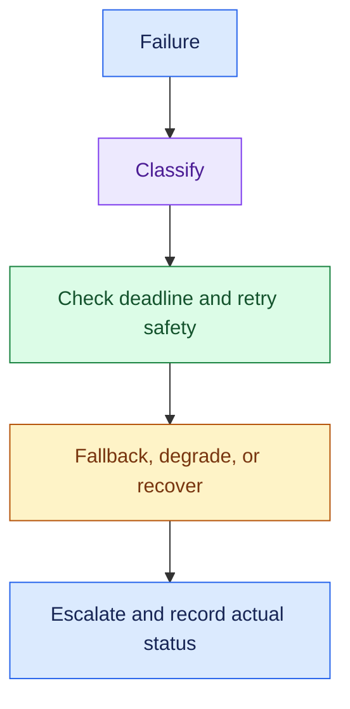

For each dependency, ask:

- What can fail?
- What status or partial result does the user see?
- How does the task recover safely?

### 3. Essential Concepts

#### 1. Timeouts: Bound Waiting

- Set dependency deadlines inside the task's total time budget.
- A timeout ends the caller's wait; it does not establish the remote outcome.

> “For a timed-out write, I’d reconcile status rather than assume failure.”

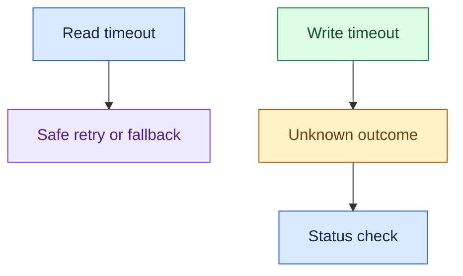

#### 2. Retry Classification: Separate Transient and Permanent Errors

- Retry eligible transient failures within a shared task budget.
- Invalid input, denied access, and policy rejection need correction or a stop, not repeated calls.

> “I’d retry only when the failure is transient and another attempt is safe.”

#### 3. Backoff and Jitter: Avoid Retry Storms

- Increase delays between retries and randomise them so clients do not retry together.
- Honour server guidance where applicable and stop at the attempt/deadline limit.

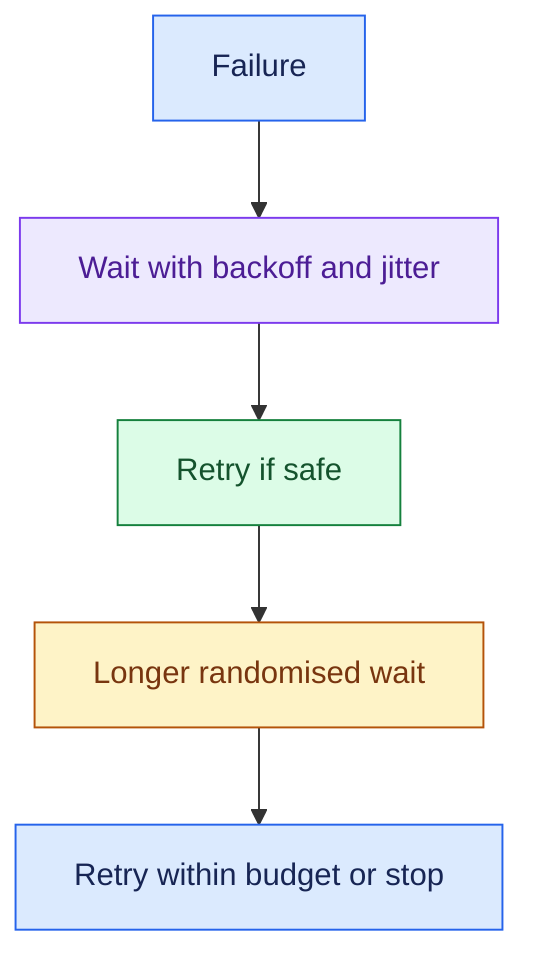

> “I’d bound retries across layers so the tool and orchestrator do not multiply attempts.”

#### 4. Circuit Breaker: Stop Hammering a Failing Dependency

- Temporarily stop normal calls after repeated failures; later allow recovery probes.
- Provide a defined unavailable, deferred, or fallback response.

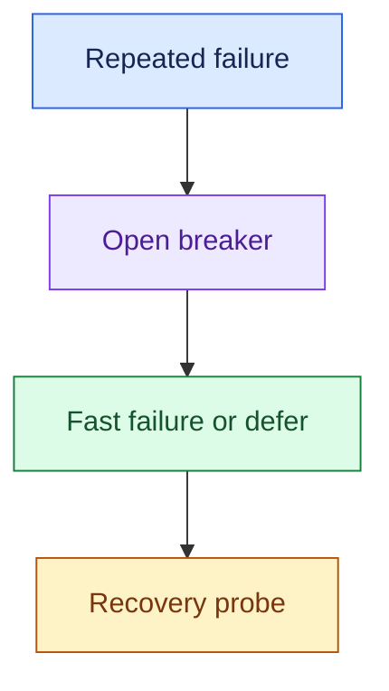

> “The breaker protects the dependency and our capacity; it does not repair the service.”

#### 5. Idempotency: Preserve Correct Side Effects

- Reuse the same logical action identifier across retries.
- Coordinate local action records and downstream idempotency support, and reconcile uncertain outcomes.

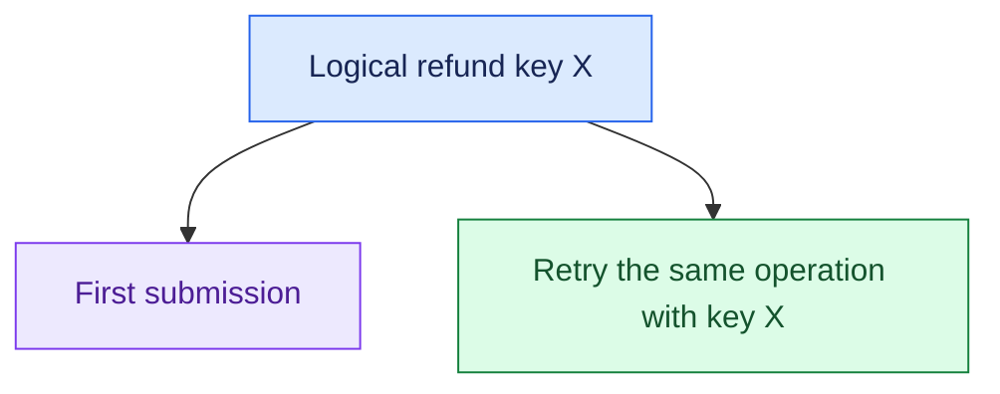

> “Recovery must not convert one refund request into two refunds.”

#### 6. Fallback and Graceful Degradation: Preserve Safe Functionality

- Use a compatible model fallback when it meets capability, quality, data, and policy requirements.
- If a noncritical capability fails, preserve independent safe functionality.

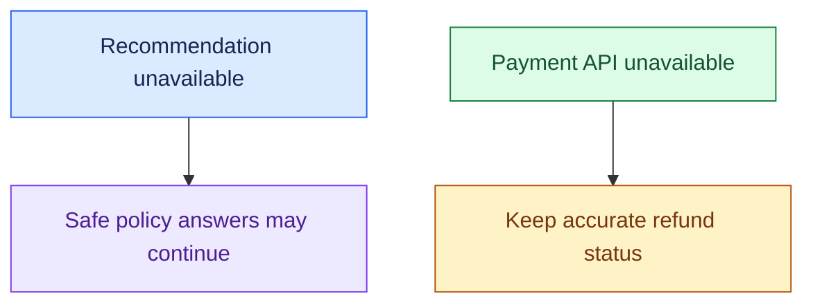

> “I’d define which capability can degrade and which action must stop.”

#### 7. Checkpoints: Resume Known Progress

- Persist task context, completed steps, approval state, and action status.
- Resume from durable state rather than rerun every step.

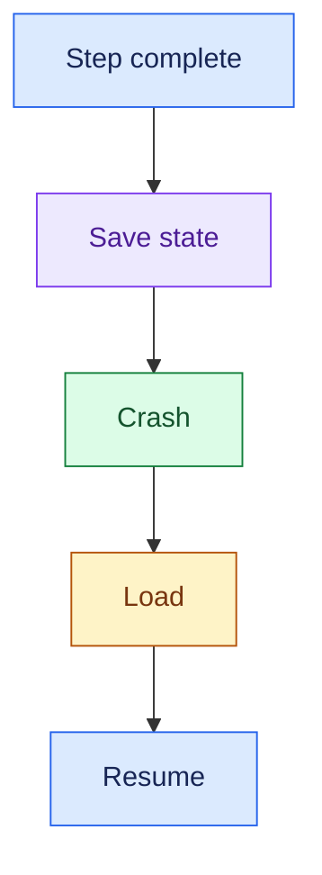

- Checkpoints alone do not guarantee safe external replay.
- Reconcile writes that may have completed before a checkpoint was saved.

#### 8. Dead-Letter Queue: Isolate Work That Cannot Complete

- After bounded unsuccessful processing, route eligible background messages to a dead-letter queue (DLQ) or equivalent failure store.
- Preserve context for diagnosis and controlled replay.

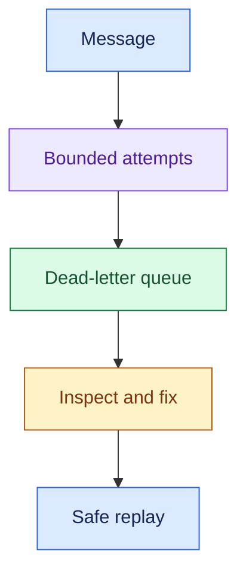

> “A DLQ needs an owner and recovery process; it is not a successful outcome.”

#### 9. Blast Radius: Limit What a Failure Can Affect

- Separate capacity, permissions, and execution paths where justified.
- Tenant limits and dependency-specific controls can prevent one failure from affecting everyone.

> “If this dependency or tenant fails, what unrelated work can continue?”

### 4. Requirement → Component Reasoning

| Requirement | Pattern | Why | Trade-off |
|---|---|---|---|
| Bounded waiting | Deadlines/timeouts | Protect task time budget | Some work stops early |
| Recover transient failures | Bounded backoff + jitter | Allow recovery without storms | Extra waiting |
| Protect failing service | Circuit breaker | Avoid repeated load | Temporary fast rejection |
| No duplicate refunds | Idempotency + reconciliation | Preserve business correctness | State and API support |
| Resume long tasks | Durable checkpoints | Recover progress | State consistency |
| Contain failed messages | DLQ + recovery owner | Separate diagnosis from normal processing | Operational backlog |
| Keep safe features running | Capability-specific degradation | Reduce blast radius | More explicit behaviour paths |

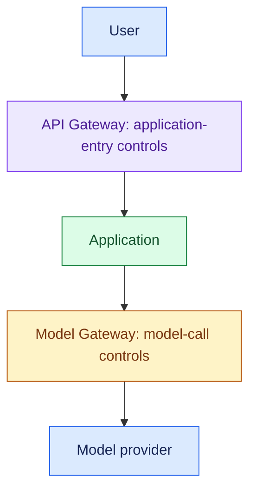

- Model fallback belongs at the model-call boundary when appropriate.
- Tool failures need their own operation-specific recovery.

- **Support example:** policy answers may continue during a payment outage, while refunds remain pending or unavailable.
- A timed-out refund becomes “status unknown” until reconciled, not “failed, retry with a new identifier.”

### 5. Important Distinctions and Gotchas

1. **Timeout vs failed operation:** remote side effects may already exist.
2. **Retry vs idempotency:** another attempt vs safe repeated business effect.
3. **Fallback vs pretending success:** unavailable evidence or actions must be disclosed.
4. **Checkpoint vs exactly-once effect:** saved progress does not prevent duplicate external writes by itself.
5. **DLQ vs completion:** failed work still needs ownership, diagnosis, and recovery.

### 6. Trigger → Concept Table

| Hear… | Think… | Discuss… |
|---|---|---|
| “Provider unavailable” | Compatible fallback | Capability, quality, data restrictions |
| “Intermittent service errors” | Bounded retry | Backoff, jitter, deadline |
| “Retries worsen outage” | Retry amplification | Shared budgets, breaker |
| “Refund call timed out” | Unknown write | Status reconciliation |
| “Worker crashed” | Checkpoint | Resume and uncertain effects |
| “Message always fails” | DLQ | Owner, diagnosis, safe replay |
| “One failure breaks everything” | Blast radius | Isolation and degradation |

### 7. Interview Phrases

> “For each dependency, I’d define the user-visible failure and safe recovery path.”

> “Retries must be bounded, transient-error aware, and safe for side effects.”

> “I’d preserve safe independent functionality while blocking unconfirmed actions.”

> “Recovery starts from known state and reconciles unknown external outcomes.”

### 8. Practice Questions

1. The primary model fails. What conditions must a fallback model satisfy?
2. A tool returns intermittent service errors. How do deadlines, backoff, and retry budgets interact?
3. A payment succeeds remotely but the worker crashes before recording it. How do you recover safely?
4. Recommendation generation fails. Which support capabilities may remain available?
5. A background event reaches the DLQ. Who owns recovery, and what makes replay safe?

---

## One-Page Memory Card: Reliability & Failure Handling

- **Core question:** What happens when a dependency fails, and how do we recover without making the business result worse?

### Recall Flow

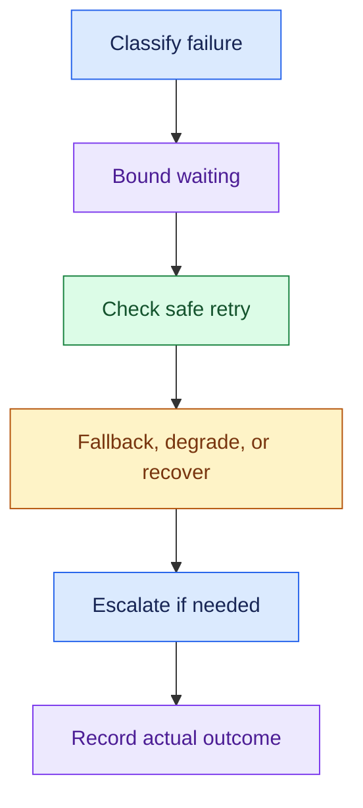

### Checklist

| Control | Remember |
|---|---|
| Timeout | Bound waiting within total task deadline; write outcome may be unknown |
| Retry | Transient and safe errors only; shared attempt/time budget |
| Backoff/jitter | Space attempts and randomise timing to avoid storms |
| Circuit breaker | Stop normal calls after repeated failure; probe recovery |
| Idempotency | Stable identifier for one logical action across retries |
| Reconciliation | Establish whether uncertain external writes completed |
| Fallback | Compatible capability, quality, permissions, data boundaries |
| Degradation | Keep safe independent features; do not fabricate success |
| Checkpoint | Durable context/progress/approval/action state |
| DLQ | Dead-letter queue for failed messages with owner and recovery plan |
| Blast radius | Limit affected dependencies, capabilities, and tenants |

### Trigger → Concept

| Hear… | Think… |
|---|---|
| “Model down” | Compatible fallback or clear unavailable state |
| “Transient error” | Bounded backoff and jitter |
| “Outage gets worse” | Retry amplification / breaker |
| “Write timed out” | Unknown outcome / reconciliation |
| “Crash midway” | Resume durable progress |
| “Always-failing message” | DLQ and controlled recovery |
| “Whole system fails” | Reduce blast radius |

### Do Not Confuse

1. **Timeout vs remote failure:** the caller may have missed a successful result.
2. **Retry vs safe repetition:** retries need idempotency or operation-specific recovery for writes.
3. **Checkpoint vs exactly-once:** durable progress is not proof an external effect happened once.
4. **DLQ vs success:** isolation of failed work is only a recovery step.

### Failure Rules

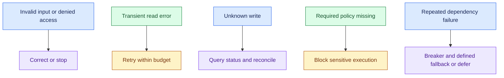

- Do not multiply retries at tool, orchestration, and provider layers.
- Preserve logical action identifiers during replay.
- A fallback must respect model capability and customer data restrictions.
- A degraded answer must explain its limitation; pending actions must retain accurate status.

- API Gateway = User → Application control.
- Model Gateway = Application → Model control.
- Model recovery does not replace enterprise-tool recovery or business-action reconciliation.

### 30-Second Answer

Practise these points as one spoken answer:

- “I’d classify each failure, bound waiting and retries, and protect failing dependencies with backoff, jitter, and circuit breakers.”
- “I’d use compatible fallbacks or preserve safe partial functionality.”
- “For long tasks, I’d resume durable progress; for uncertain writes, I’d reconcile status and preserve idempotency.”
- “Failed background work would have an owned recovery path, and users would see the actual outcome.”

## Sources (checked 27 Sep 2026)

- [Temporal blog - Idempotency and durable execution](https://temporal.io/blog/idempotency-and-durable-execution): checkpoints don't stop duplicate side effects
- [LangGraph docs - Interrupts](https://docs.langchain.com/oss/python/langgraph/interrupts): checkpoints don't stop duplicate side effects
- [Stripe API reference - Idempotent requests](https://docs.stripe.com/api/idempotent_requests): idempotency key reuse and scope
- [IETF draft-ietf-httpapi-idempotency-key-header-07 (expired) s2.7](https://www.ietf.org/archive/id/draft-ietf-httpapi-idempotency-key-header-07.html): idempotency key reuse and scope
