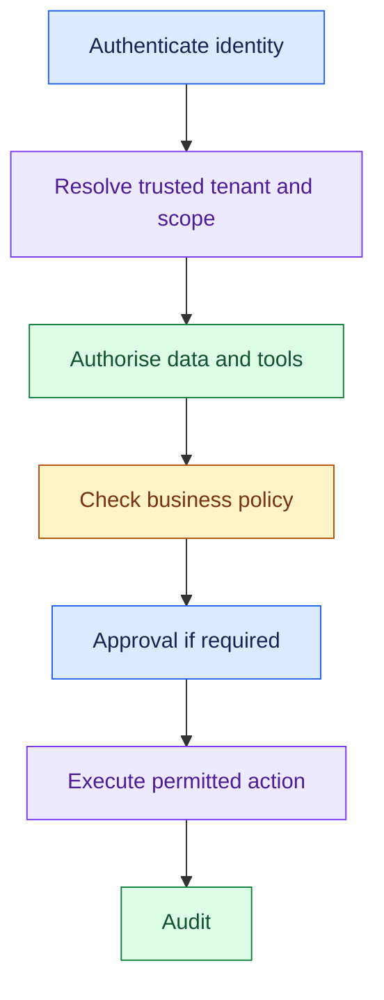
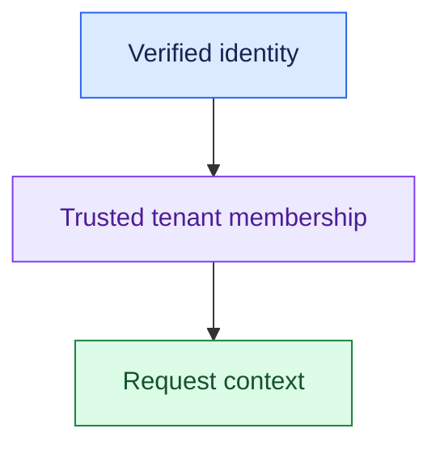
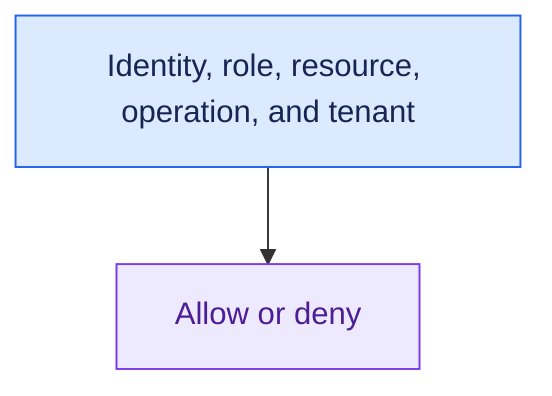
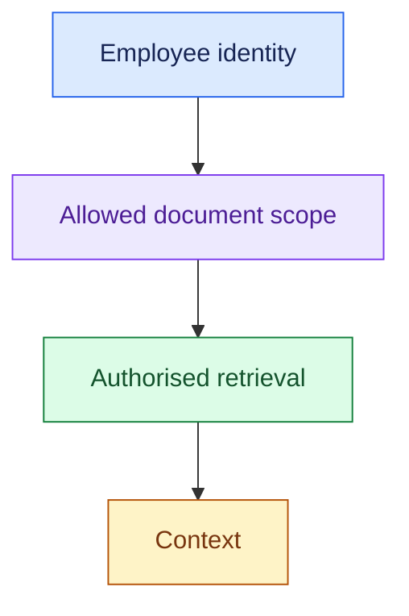
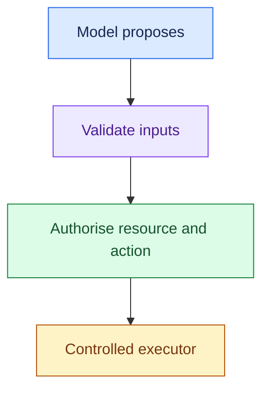
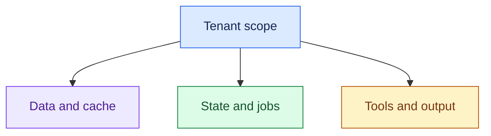
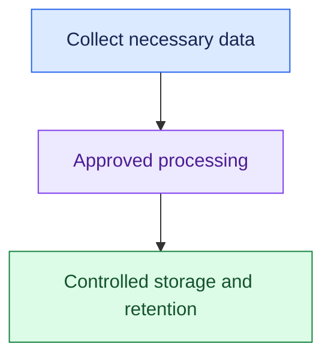
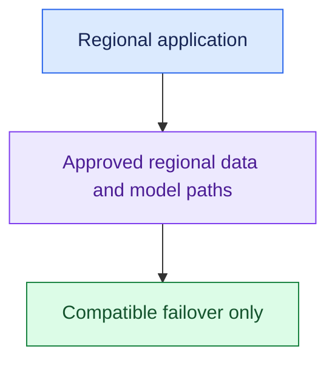
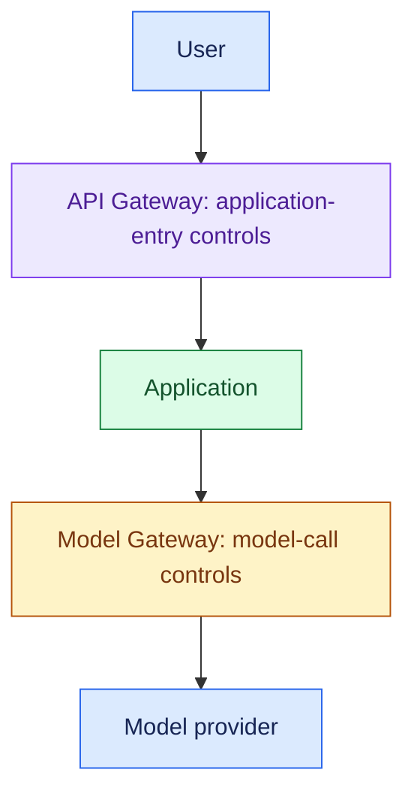

# Security and Enterprise Multi-Tenancy

## Interview Review

### 1. What the Interviewer Is Testing

- Can you enforce user and tenant boundaries across data, tools, and actions?
- Can you separate authentication, authorisation, and business policy?
- Can you protect secrets and sensitive data throughout the request path?
- Can you identify deployment constraints such as approved providers and residency?

### 2. Core Mental Model

- Enforce access at each relevant data and execution boundary.
- Keep authorisation in trusted controls outside the prompt.

### 3. Essential Concepts

#### 1. Authentication: Establish Identity

- Verify who or what is calling, including users, services, and workers.
- Derive trusted tenant context from verified identity or controlled membership, not model-generated fields.

> “I’d establish user and tenant identity before retrieval or tool execution.”

#### 2. Authorisation and RBAC: Decide Permitted Operations

- Authorisation asks what that identity may do.
- Role-based access control (RBAC) assigns permissions through roles; resource ownership and tenant scope may require additional checks.

> “An authenticated support user is not automatically authorised to read every account or issue every refund.”

- Check resource-level access, not only whether a tool name is permitted.

#### 3. Permission-Aware RAG: Keep Restricted Evidence Out

- Retrieval-augmented generation (RAG) must enforce current access before restricted content enters model context.
- Preserve source permissions through ingestion and query execution.

> “Employee B's prompt should never receive HR evidence that only Employee A may access.”

- Update permissions, deletions, and cache scope; filtering the final answer is too late to prevent unauthorised context exposure.

#### 4. Least-Privilege Tools: Limit Enterprise Reach

- Expose only necessary operations and use scoped credentials outside model context.
- Separate reads from writes and enforce access again at execution.

> “A refund task needs permitted order/payment operations, not unrestricted CRM or database administration.”

- Agent recommends → Policy decides → Executor acts.
- Human approval, where required, does not grant unrelated access.

#### 5. Tenant Isolation: Cover More Than the Database

- Scope documents/indexes, caches, state, queues, tool credentials, logs, audit records, and results.
- Choose shared or separated resources according to required isolation and operational trade-offs.

> “I’d trace tenant context end to end, including cache keys and background workers.”

- Data isolation and resource fairness are separate needs.
- A tenant can harm others' latency without accessing their data.

#### 6. Secrets: Keep Credentials in Trusted Execution

- Manage credentials through controlled secret storage and scoped runtime access.
- Do not embed them in prompts, retrieved documents, tool descriptions, or unrestricted telemetry.

> “The tool service uses the credential; the model only requests the approved operation.”

- Define rotation and access ownership appropriate to the integration.

#### 7. Sensitive Data: Minimise Across the Whole Lifecycle

- Confirm what data is necessary, which providers may process it, and retention/access requirements for prompts, outputs, caches, logs, and backups.
- Mask or redact where it preserves required functionality.

> “I’d inspect every copy of sensitive data, not only the primary database.”

#### 8. Data Residency: Follow Data Through Dependencies

- Confirm the exact regional boundary and processing/storage restrictions with the customer.
- Include models, retrieval, tools, telemetry, backups, failover, and support access where relevant.

> “If data must stay in-region, fallback and logging must respect that restriction too.”

- Do not infer a universal legal requirement from geography; translate the stated customer constraint into architecture.

#### 9. Defence in Depth: Do Not Let Text Grant Authority

- Treat user text, retrieved documents, and tool outputs as untrusted input.
- Use validation, permissions, policy, and execution controls outside model discretion.

> “A document telling the agent to expose secrets cannot change the user's authorisation.”

- Input checks + scoped retrieval + tool authorisation
- + policy + audit + execution controls

- Test denied-access, cross-tenant, credential-exposure, and instruction-bypass cases alongside normal workflows.

### 4. Requirement → Component Reasoning

| Requirement | Pattern / component | Why | Trade-off |
|---|---|---|---|
| Verified user/tenant context | Authentication + membership resolution | Trusted identity boundary | Identity integration |
| Enforce resource access | Authorisation/RBAC + resource checks | Limit permitted operations | Permission-model maintenance |
| Restricted document access | Permission-aware retrieval | Keep unauthorised context out | Source ACL integration |
| Scoped enterprise writes | Controlled tools + policy/executor | Limit actions and authority | Integration and approval overhead |
| Prevent cross-tenant leaks | Scoped storage, caches, jobs, logs/results | Preserve boundaries across copies | Isolation complexity |
| Protect credentials | Trusted secret management | Keep secrets outside model context | Rotation and runtime access |
| In-region processing | Approved regional dependencies/failover | Respect customer data boundary | Provider and availability options |

- Application-entry checks establish identity and tenant context.
- Model-call controls select permitted providers.
- Retrieval, state access, and enterprise tools still enforce their own resource boundaries.

For a support request:

- Authenticate the customer and resolve tenant and account scope.
- Retrieve only permitted policy content and order records.
- Execute a policy-approved refund using scoped credentials.
- Keep the same scope in caches, async jobs, and audit records.

### 5. Important Distinctions and Gotchas

1. **Authentication vs authorisation:** established identity vs permitted resource and operation.
2. **Authorisation vs policy:** allowed to request an action vs action meets business rules; both can be required.
3. **Pre-context access vs final-output filtering:** keeping restricted evidence out is stronger than asking the model not to reveal it.
4. **Tenant isolation vs fairness:** preventing data leaks vs preventing capacity monopolisation.
5. **Regional hosting vs end-to-end residency:** remote models, logs, backups, or fallback can cross the boundary.

### 6. Trigger → Concept Table

| Hear… | Think… | Inspect… |
|---|---|---|
| “HR access differs by employee” | Resource authorisation | Retrieval permissions and updates |
| “Model hides restricted content” | Weak boundary | Access before context construction |
| “Refund agent needs credentials” | Least privilege/secrets | Scoped executor, no prompt secrets |
| “Fifty enterprise tenants” | End-to-end isolation | Cache, state, jobs, logs, outputs |
| “One tenant hurts others” | Fairness | Limits and scheduling |
| “Data cannot leave region” | Residency | Model, telemetry, backup, failover |
| “Tool output says bypass rules” | Untrusted instructions | No authority from external text |

### 7. Interview Phrases

> “Authentication establishes identity; authorisation decides access to this resource and operation.”

> “I’d enforce document access before evidence enters model context.”

> “Tenant isolation must include caches, jobs, state, logs, and results, as well as database rows.”

> “I’d trace residency through models and failover as well as the application host.”

### 8. Practice Questions

1. Employee A can read HR documents and B cannot. How do ingestion, retrieval, caches, and permission updates preserve this?
2. Why is final-answer filtering insufficient after unauthorised documents enter context?
3. What operations, credentials, and resource checks should a refund executor receive?
4. A shared platform serves fifty tenants. Which data and execution surfaces need isolation, and which need fairness?
5. A customer requires all processing in one region. How do model fallback, logging, backups, and tool dependencies affect the design?

---

## One-Page Memory Card: Security & Enterprise Multi-Tenancy

- **Core question:** Who may access which data and operations, and how do those boundaries survive every stage of the task?

### Recall Flow

- Agent recommends → Policy decides → Executor acts.

### Checklist

| Concept | Remember |
|---|---|
| Authentication | Verify user/service identity; establish trusted tenant membership |
| Authorisation | Check role, resource, operation, ownership, tenant |
| RBAC | Role-based access control; resource-level scope may need extra checks |
| RAG permissions | Enforce before model context; update source access/deletion changes |
| Least privilege | Specific necessary read/write operations, scoped credentials |
| Tenant isolation | Documents, indexes, cache, state, queues, tools, logs, audit/results |
| Secrets | Trusted runtime storage/use; never unrestricted prompt or telemetry content |
| Sensitive data | Necessary collection, approved providers, retention/access for every copy |
| Residency | Application, models, retrieval, tools, logs, backups, failover |
| Defence in depth | Validation + authorisation + policy + execution controls + audit |

### Trigger → Concept

| Hear… | Think… |
|---|---|
| “Different employee access” | Resource authorisation and scoped retrieval |
| “Filter secrets after answer” | Unauthorised context already exposed |
| “Agent needs production access” | Specific tools and least privilege |
| “Shared tenants” | Scope every data/execution surface |
| “Noisy neighbour” | Resource fairness, separate from data isolation |
| “Stay in-region” | End-to-end dependency and fallback boundary |
| “Document says ignore policy” | External text is data, not authority |

### Do Not Confuse

1. **Authentication vs authorisation:** who you are vs what you may access or do.
2. **Authorisation vs business policy:** resource permission vs whether this action meets the rule.
3. **Isolation vs fairness:** no cross-tenant data exposure vs no shared-capacity monopolisation.
4. **Regional app vs residency:** external model, logging, backup, or failover can still cross the boundary.

### Enforcement Rules

- Derive tenant scope from trusted identity, not caller/model claims alone.
- Authorise the specific resource and operation.
- Do not retrieve restricted evidence and rely on a prompt to hide it.
- Keep permissions and cache scope current when access changes.

- Use scoped tool credentials outside model context.
- Approval must refer to the action, and execution still rechecks access and business policy.
- Carry trusted scope through background workers and result retrieval.
- Review logs, audit, backups, and caches as additional sensitive-data copies.

- API Gateway = User → Application control.
- Model Gateway = Application → Model control.
- Neither replaces resource checks in retrieval or enterprise tools.
- Provider selection and fallback must respect the customer's data restrictions.

### 30-Second Answer

Practise these points as one spoken answer:

- “I’d establish verified identity and tenant scope, then enforce resource-level access in retrieval, state, and tools.”
- “The agent would receive only necessary operations, while credentials remain in trusted execution.”
- “I’d isolate tenant data across caches, jobs, logs, and results, check business policy and approval for writes, and trace sensitive data and residency through providers, telemetry, backups, and failover.”

## Sources (checked 27 Sep 2026)

- [OWASP GenAI LLM07:2025 System Prompt Leakage](https://genai.owasp.org/llmrisk/llm072025-system-prompt-leakage/): access control before model context; permission-aware retrieval
- [OWASP GenAI LLM06:2025 Excessive Agency](https://genai.owasp.org/llmrisk/llm062025-excessive-agency/): access control before model context; untrusted retrieved and tool input
- [OWASP GenAI LLM08:2025 Vector and Embedding Weaknesses](https://genai.owasp.org/llmrisk/llm082025-vector-and-embedding-weaknesses/): permission-aware retrieval
- [European Commission: Rules on international data transfers](https://commission.europa.eu/law/law-topic/data-protection/international-dimension-data-protection/rules-international-data-transfers_en): GDPR transfers vs residency
- [OWASP GenAI LLM01:2025 Prompt Injection](https://genai.owasp.org/llmrisk/llm01-prompt-injection/): untrusted retrieved and tool input
- [Amazon Bedrock User Guide: Cross-Region inference](https://docs.aws.amazon.com/bedrock/latest/userguide/cross-region-inference.html): cross-region inference
- [Amazon Bedrock User Guide: Geographic cross-Region inference](https://docs.aws.amazon.com/bedrock/latest/userguide/geographic-cross-region-inference.html): cross-region inference
