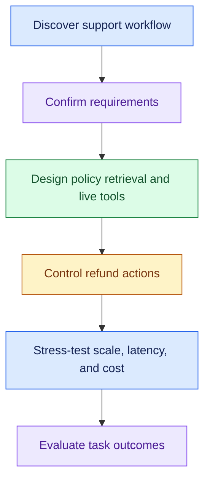
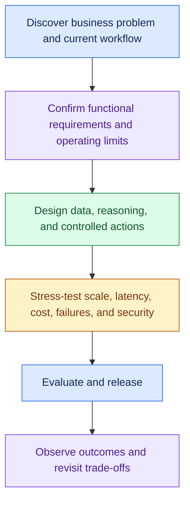
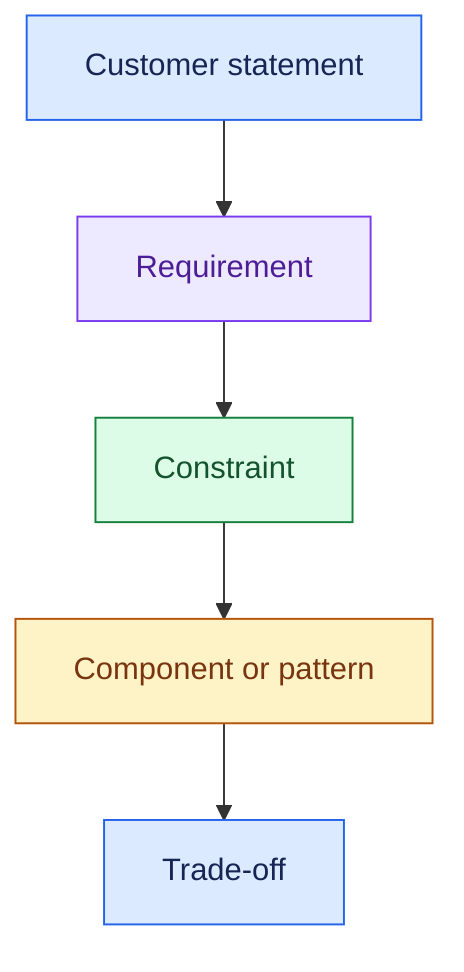
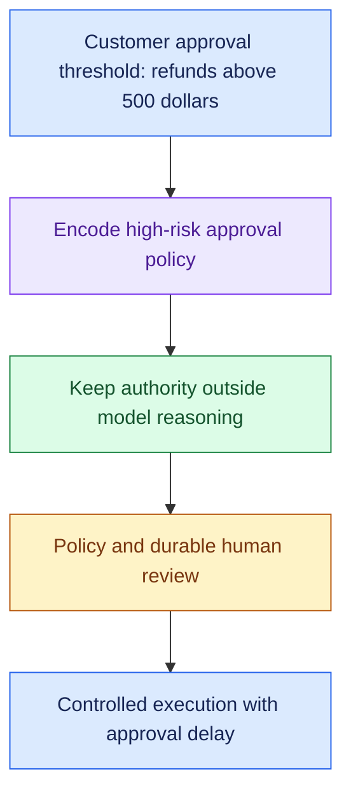
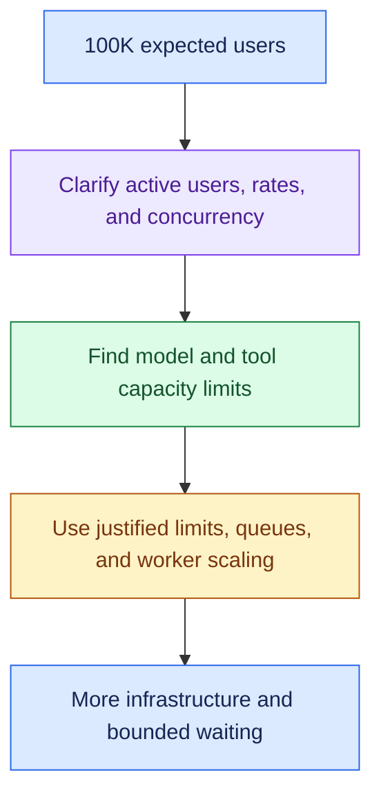

# Interview Learning Roadmap: Full Practice and Checklists

### Full Case-Study Practice

- These should be solved without looking at the earlier reviews.

#### Case 1: Customer Support Agent

> A large e-commerce company wants an AI customer-support system that can answer questions, check orders and issue refunds.

Cover:

---

#### Case 2: Enterprise Knowledge Assistant

> A multinational company wants a ChatGPT-style assistant over millions of internal documents, but employees have different access permissions.

Focus on:

- RAG
- Permission-aware retrieval
- Scale
- Latency
- Security
- Evaluation

---

#### Case 3: Logistics Exception Agent

> A logistics company wants AI to detect shipment exceptions and automatically resolve routine cases.

Focus on:

- Events
- Agents
- Tools
- Policy
- HITL
- Idempotency
- Reliability
- Audit

---

#### Case 4: SRE Incident Agent

> An enterprise wants an AI agent that investigates production incidents and can execute remediation actions.

Focus on:

- Tools
- Observability
- Agent reasoning
- Permissions
- Policy
- HITL
- Kill switch
- Audit

---

#### Case 5: Deep Research Agent

> Build an enterprise research agent that searches multiple sources and may run for 10–20 minutes.

Focus on:

- Async execution
- Queue
- Checkpoint
- Agent bounds
- Cost
- Long-running state
- Evaluation

---

#### Case 6: Multi-Tenant AI Platform

> Build a shared AI platform supporting 100 enterprise customers and multiple LLM providers.

Focus on:

- API Gateway
- Model Gateway
- Multi-tenancy
- Quotas
- Fairness
- Model routing
- Cost attribution
- Observability

---

## Recommended Learning Sequence

### Phase 1: Problem Decomposition

- Review 1 — Discovery
- Review 2 — Functional Requirements
- Review 3 — Non-Functional Requirements

- Outcome: Understand before designing.

---

### Phase 2: Architecture

- Review 4 — Core Components
- Review 5 — RAG
- Review 6 — Agents
- Review 7 — Tools
- Review 8 — Policy / HITL

- Outcome: Build the right system.

---

### Phase 3: Production Scale

- Review 9  — Scaling
- Review 10 — Latency
- Review 11 — Cost
- Review 12 — Reliability

- Outcome: Turn the poc into production.

---

### Phase 4: Production Quality

- Review 13 — Evaluation
- Review 14 — Release
- Review 15 — Observability
- Review 16 — Security

- Outcome: Safely operate the system.

---

### Phase 5: Interview Mastery

- Review 17 — Trade-Offs
- Review 18 — Full Case Studies

At this stage:

- Practise the full cases using the concepts from reviews 1–16.

---

## Trigger → Concept Cheat Sheet

- - Use each statement to identify a concern, then ask what the workload needs.
- Confirm the requirement before adding a component.

| Interviewer Says                               | Your Brain Should Trigger                                  |
| ---------------------------------------------- | ---------------------------------------------------------- |
| "100K users" | Clarify active users, peak rates, concurrency, and task duration before sizing capacity |
| "Traffic suddenly spikes"            | Queue, admission control, backpressure                     |
| "One tenant generates huge traffic"  | Noisy neighbour, quota, fair queue                          |
| "Traffic exceeds capacity"           | Admission control, load shedding                           |
| "Multiple enterprise customers"      | Multi-tenancy, isolation, quotas, cost attribution         |
| "Request sometimes takes 20 seconds" | Stage tracing, P95/P99                                     |
| "Chat feels slow"                    | Streaming, TTFT, fewer sequential hops                     |
| "Three independent APIs"             | Parallelisation                                            |
| "External API is slow"               | Timeout, cache, async, fallback                            |
| "External API keeps failing"         | Retry, backoff, circuit breaker                            |
| "Action happened twice"              | Idempotency                                                |
| "Message may arrive twice"           | At-least-once + idempotent consumer                        |
| "Background job keeps failing"       | Retry → DLQ                                               |
| "Agent runs 10 minutes"              | Async + queue + durable state                              |
| "Agent crashes halfway"              | Checkpoint + resume, reconcile uncertain actions           |
| "Human approves tomorrow"            | Durable state + HITL                                       |
| "Need conversation history"          | Session state                                              |
| "Need long-term preferences"         | Memory                                                     |
| "Prompt keeps growing"               | Bounded context + summarisation                            |
| "Repeated questions"                 | Cache                                                      |
| "Information changes frequently"     | TTL / freshness                                            |
| "Need company documents"             | RAG                                                        |
| "Need current order status"          | Live API/tool                                              |
| "RAG can't find answer"              | Recall, chunking, hybrid search                            |
| "RAG retrieves junk"                 | Precision, filtering, reranking                            |
| "Different document permissions"     | Permission-aware retrieval                                 |
| "Unsupported AI claims"              | Grounding, citations, fallback                             |
| "Different request types"            | Router                                                     |
| "Multiple workflow steps"            | Orchestrator                                               |
| "Routing is deterministic"           | Code/rules before LLM                                      |
| "Agent keeps calling tools"          | Execution bounds                                           |
| "Agent accesses production"          | Controlled tools                                           |
| "Agent modifies customer data"       | Policy + executor + audit                                  |
| "Large refund needs approval"        | Deterministic policy + HITL                                |
| "Agent has powerful credentials"     | Least privilege                                            |
| "Policy unavailable"                 | Fail-closed for risky actions                              |
| "Agent behaving dangerously"         | Kill switch                                                |
| "Multiple models/providers"          | Model gateway                                              |
| "Model provider unavailable"         | Provider fallback                                          |
| "AI bill exploded"                   | Model routing, context, cache, calls                       |
| "Who caused the spend?"              | Cost attribution                                           |
| "Need cheaper AI"                    | Cost per successful task                                   |
| "New prompt/model"                   | Offline eval + release gate                                |
| "Test on real traffic safely"        | Shadow                                                     |
| "Gradual production rollout"         | Canary                                                     |
| "Only some tenants get feature"      | Feature flag                                               |
| "New version performs badly"         | Rollback                                                   |
| "Is the agent good?"                 | Offline + online evaluation                                |
| "Good answer, task failed"           | Task success                                               |
| "Wrong tool used"                    | Trajectory/tool evaluation                                 |
| "Exact pass/fail checks"             | Deterministic evaluator                                    |
| "Semantic quality"                   | LLM/human judge                                            |
| "Why was this slow?"                 | Observability/tracing                                      |
| "Why did AI take this action?"       | Audit                                                      |
| "Latency commitment"                 | SLI → SLO → SLA                                          |
| "Worker dies"                        | Stateless compute + durable state                          |
| "Failure shouldn't affect everyone"  | Blast-radius reduction                                     |
| "Sensitive enterprise data"          | AuthN, AuthZ, least privilege, audit                       |
| "Safe enterprise agent"              | Defence in depth                                           |

---

## Final Interview Mental Model

---

## Final Interview Checklist

Before finishing any architecture, mentally ask:

- Did I understand the business problem?
- Did I understand the current workflow?
- Did I define functional requirements?
- Did I define measurable NFRs?
- Is every major architecture box justified?
- Where does data come from?
- Does AI answer, recommend or act?
- What requires human approval?
- Does it scale?
- What makes it slow?
- What makes it expensive?
- What happens when dependencies fail?
- How is it secured?
- How do I measure AI quality?
- How do I release changes safely?
- How do I observe it in production?
- What are my major trade-offs?

---

## The Core FDE Principle

Use the customer’s requirement to justify each design choice:

Example:

Another example:

> “This component meets requirement ___. Its trade-off is ___.”

---

## One-Line FDE Framework

- Start with the customer problem and confirm measurable requirements.
- Draw the smallest happy path that meets them.
- Test scale, latency, cost, failures, security, AI quality, and operations.
- Add components only when a requirement justifies them.

---

### Sources (checked 27 Sep 2026)

- [Google SRE Book - Service Level Objectives](https://sre.google/sre-book/service-level-objectives/): SLI, SLO and SLA definitions
- [Google SRE Workbook - Canarying Releases](https://sre.google/workbook/canarying-releases/): canary as a partial, time-limited rollout that is evaluated
- [AWS Builders' Library - Timeouts, retries and backoff with jitter](https://builder.aws.com/content/3EumjoZascWd1oZiEgL8ORlv3qE/timeouts-retries-and-backoff-with-jitter): retries can amplify an outage; backoff and jitter
- [Azure Architecture Center - Circuit Breaker pattern](https://learn.microsoft.com/en-us/azure/architecture/patterns/circuit-breaker): stop calling a failing dependency for a while
- [Amazon SQS Developer Guide - Dead-letter queues](https://docs.aws.amazon.com/AWSSimpleQueueService/latest/SQSDeveloperGuide/sqs-dead-letter-queues.html): retry, then move to a DLQ
- [Stripe API reference - Idempotent requests](https://docs.stripe.com/api/idempotent_requests): idempotency keys prevent a double refund on retry
- [Temporal blog - Idempotency and durable execution](https://temporal.io/blog/idempotency-and-durable-execution): at-least-once delivery; checkpoints don't stop duplicate side effects
- [OWASP GenAI LLM08:2025 Vector and Embedding Weaknesses](https://genai.owasp.org/llmrisk/llm082025-vector-and-embedding-weaknesses/): permission-aware retrieval
- [OWASP GenAI LLM06:2025 Excessive Agency](https://genai.owasp.org/llmrisk/llm062025-excessive-agency/): least privilege and controlled tools for agents
