# Interview Learning Roadmap

Use this roadmap to practise five decisions:

- What should I ask the customer?
- What requirement does the answer create?
- Which component or pattern meets it?
- Why does the system need that component?
- What trade-off does the choice introduce?

---

## 0. The FDE Interview Mental Model

Start with the customer problem, then work through the design:

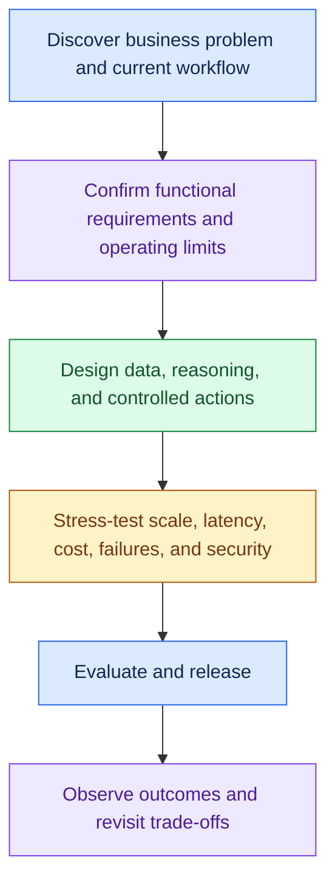

Follow this chain throughout the interview:

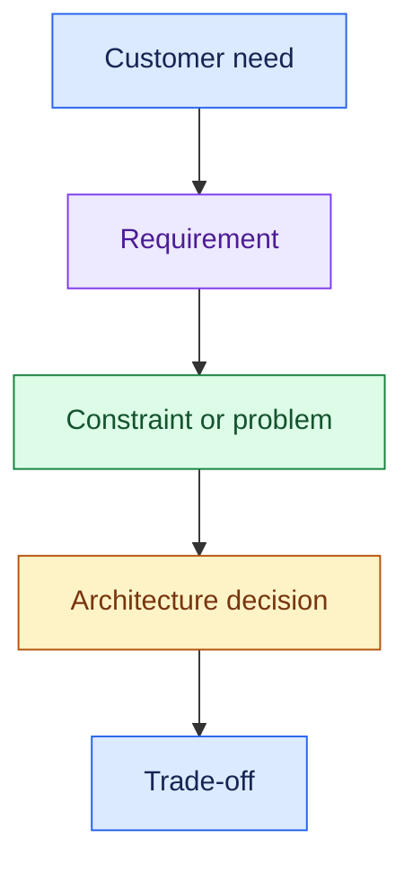

- Ask about the problem before choosing technology.

---

## Review 1: FDE Problem Decomposition

### Goal

- Take a vague customer request and turn it into a well-defined engineering problem.

### Topics

#### Business Problem

- What problem are we solving?
- Why does the customer want AI?
- What business outcome matters?
- What happens if we do nothing?

#### Current Workflow

- Existing human workflow
- Existing systems
- Manual steps
- Bottlenecks
- Current failure points

#### Users & Personas

- End customers
- Internal employees
- Administrators
- Human reviewers

#### Scale

- Number of users
- Requests/day
- Peak traffic
- Concurrency
- Expected growth

#### Data

- Structured vs unstructured
- Static vs real-time
- Data sources
- Freshness
- Permissions

#### AI Autonomy

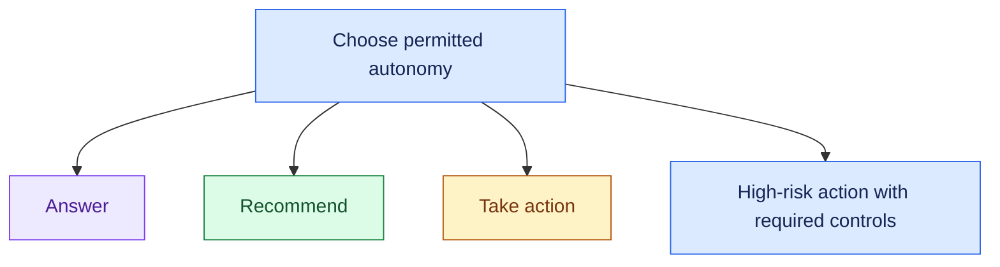

#### Success Criteria

- Business KPIs
- AI quality
- Task success
- Latency
- Reliability
- Cost

### Discovery Mental Model

- Why: business problem.
- Today: current workflow.
- Who: users.
- How much: workload and scale.
- What data: knowledge and live systems.
- How far: answer, recommend, or act.
- Success: measurable outcome.

### Practice Questions

1. A bank says, "We want an AI agent for customer support." What are the first 5–7 questions you would ask before discussing architecture?
2. A logistics customer says, "Our operations team spends too much time resolving shipment exceptions." How would you understand the current workflow before proposing AI?
3. The customer immediately says, "We want a multi-agent architecture." How would you determine whether multi-agent is required?
4. A customer says they want to reduce support cost by 30%. What additional success metrics would you define before designing the system?
5. What questions would you ask to determine whether the AI should answer, recommend, or autonomously act?

---

## Review 2: Functional Requirements

### Goal

Translate discovery into:

> What must the system do?

### Topics

#### Understand

- Accept user requests
- Understand intent
- Support required modalities

#### Maintain Context

- Session context
- Conversation history
- Workflow state

#### Retrieve

- Enterprise knowledge
- Relevant context
- Permission-aware information

#### Route

- RAG
- Agent
- Tool
- Workflow
- Human

#### Reason

- Answer
- Recommendation
- Plan
- Decision proposal

#### Use Tools

- APIs
- Databases
- CRM
- ERP
- Internal systems

#### Act

- Update tickets
- Cancel orders
- Issue refunds
- Create incidents

#### Escalate

- Missing or conflicting evidence
- High-risk actions requiring review
- Policy-required escalation
- Tool failure that cannot be recovered safely

#### Audit & Feedback

- Decisions
- Evidence
- Actions
- Approvals
- User feedback

### Functional Mental Model

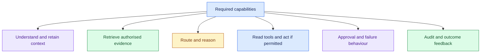

### Practice Questions

1. For an enterprise customer-support agent, define 6–8 functional requirements.
2. A support agent must answer policy questions, check order status, and issue eligible refunds. Break these into functional requirements.
3. Which requirements would tell you that the system needs conversation state?
4. How would functional requirements change if the system moves from answer-only to taking actions?
5. When should human escalation be considered a functional requirement?

---

## Review 3: Non-Functional Requirements

### Goal

Define:

> How well must the system work?

### Topics

- Scalability
- Latency
- Reliability
- AI quality
- Security
- Safety
- Cost
- Observability
- Auditability

### NFR Mental Model

- Scale
- Latency
- Reliability
- Quality
- Security
- Safety
- Cost
- Observability
- Auditability

### Practice Questions

1. The customer says, "The system should be fast." How would you turn that into a measurable NFR?
2. The system serves 50 enterprise customers and 100K total users. Which NFRs become especially important?
3. A refund agent handles financial actions. Which NFRs would you prioritise and why?
4. How would the NFRs differ between a real-time voice agent and a 10-minute deep-research agent?
5. What AI-quality NFRs would you define beyond traditional uptime and latency?

---

## Review 4: Core Architecture Building Blocks

### Goal

- Know each building block and the requirement that justifies it.

### Topics

#### API Gateway

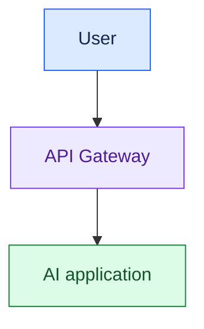

Handles:

- Authentication
- Authorisation
- Tenant context
- Rate limits
- Quotas
- Request validation

#### Model Gateway

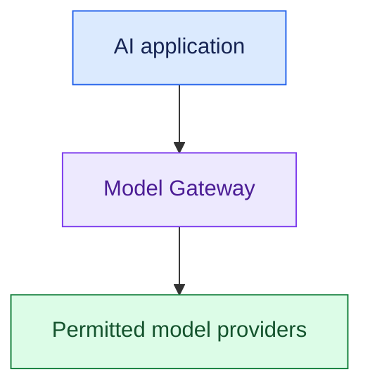

Handles:

- Model routing
- Provider abstraction
- Retry/fallback
- Provider limits
- Token/cost tracking

#### Router

- Intent routing
- Agent routing
- Tool routing

#### Orchestrator

- Workflow state
- Branching
- Tool calls
- Retry
- Checkpoints

#### State Store

- Session state
- Workflow state
- Approval state

#### Cache

- Response
- Semantic
- Retrieval
- Tool result

#### Queue / Event Bus

- Async work
- Bursts
- Background jobs
- Long-running workflows

### Component Selection Rule

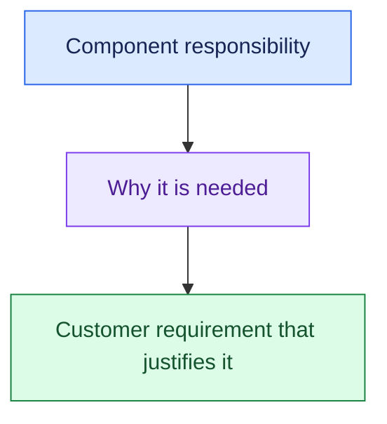

### Practice Questions

1. Explain the difference between an API Gateway and Model Gateway in 30 seconds.
2. When would you introduce an orchestrator rather than putting everything inside one agent?
3. A customer has three LLM providers and wants automatic fallback. Which component owns this responsibility?
4. When would you add a queue rather than processing the request synchronously?
5. The interviewer points to one of your architecture boxes and asks, "Why do you need this?" How would you justify components based on requirements rather than technology preference?

---

## Review 5: RAG and Enterprise Data

### Goal

- Design practical enterprise RAG without unnecessary theoretical depth.

### Core Flow

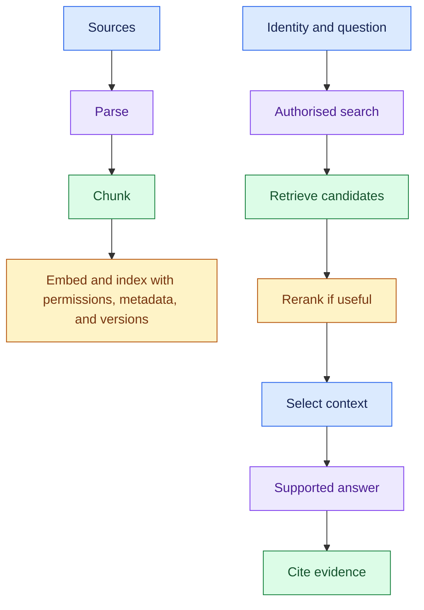

### Topics

- Chunking
- Embeddings
- Vector search
- Keyword/hybrid search
- Metadata filtering
- Reranking
- Recall
- Precision
- Permission-aware retrieval
- Static vs live data
- Groundedness

### Practice Questions

1. Your RAG system frequently fails to retrieve the correct document. What would you investigate?
2. It retrieves the correct document but also returns many irrelevant chunks. What problem is this and how would you improve it?
3. Why should current order status normally come from an API instead of RAG?
4. Two employees have different document permissions. How would you prevent unauthorised information from entering the LLM context?
5. The customer says, "The model is hallucinating." What parts of the RAG pipeline would you investigate before simply changing the model?

---

## Review 6: Agentic Architecture

### Goal

- Know when agents are useful and how to prevent uncontrolled execution.

### Topics

- Workflow vs agent
- Single vs multi-agent
- Routing
- Agent trajectory
- Tool calling
- Execution bounds
- Durable execution

### Core Flow

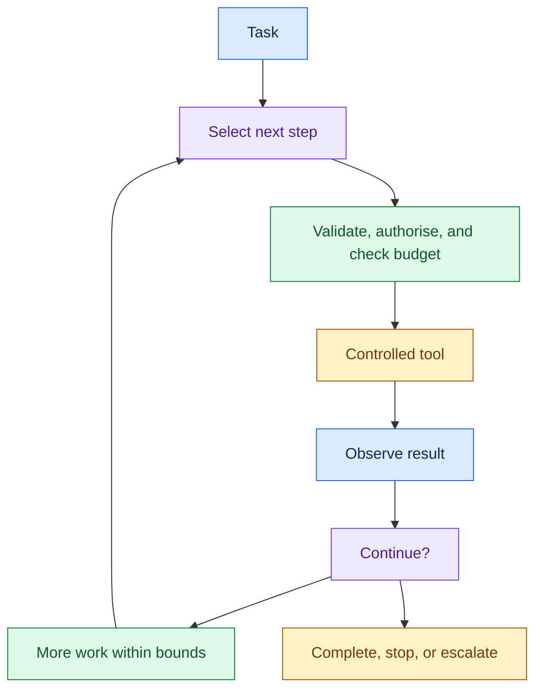

### Practice Questions

1. When would you choose a deterministic workflow instead of an agent?
2. A customer wants separate RAG, refund, order and escalation agents. Would you accept this architecture immediately? What would you ask first?
3. An agent occasionally executes 20–30 tool calls for a simple request. How would you control it?
4. What happens if a long-running agent crashes after completing 8 of 10 steps?
5. How would you explain agent trajectory and why it matters for evaluation?

---

## Review 7: Tools, Actions and Enterprise Integration

### Goal

- Move from chatbot architecture to production action-taking systems.

### Core Pattern

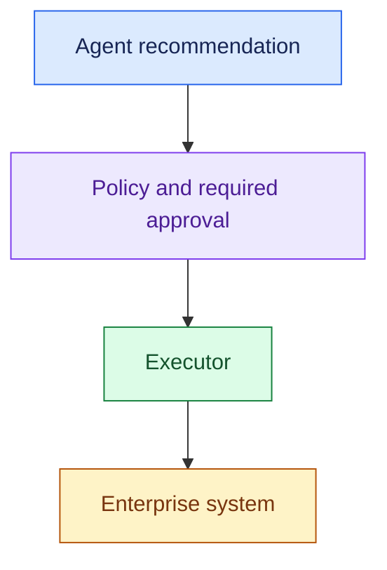

### Topics

- Controlled tool layer
- Crm/erp/api integrations
- Read vs write tools
- Executor
- Idempotency
- Timeout
- Retry
- Circuit breaker

### Practice Questions

1. Why would you avoid giving an LLM direct unrestricted access to a production CRM?
2. An agent issues a refund, the API times out, and the agent retries. How do you prevent a double refund?
3. A downstream ERP API frequently takes 30 seconds or fails. How would you protect the agent workflow?
4. Why might you separate the agent's decision from the actual execution?
5. How would you treat a read-only `get_order_status` tool differently from an `issue_refund` tool?

---

## Review 8: Guardrails, Policy and Human Approval

### Goal

- Safely allow agents to perform real business actions.

### Core Pattern

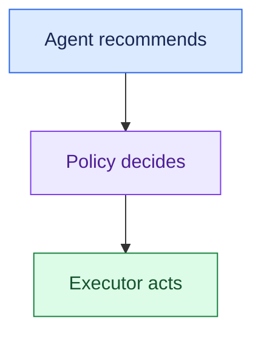

### Topics

- Deterministic policy
- Risk classification
- HITL
- Fail-open vs fail-closed
- Kill switch
- Least privilege

### Practice Questions

1. Refunds below $100 can happen automatically, while refunds above $500 require manager approval. Where should this rule live?
2. Why shouldn't the LLM itself be the final authority for a deterministic financial policy?
3. The policy service becomes unavailable during a $10,000 transaction. Should the system fail-open or fail-closed, and why?
4. How would you design a workflow where human approval may take several hours?
5. What would a kill switch disable in an action-taking agent?

---

## Review 9: Scaling AI Systems

### Goal

Handle:

> "Great. Now scale it to 100K users."

### Topics

- Throughput
- Concurrency
- Horizontal scaling
- Stateless workers
- Rate limiting
- Admission control
- Backpressure
- Queueing
- Fair queueing
- Noisy neighbour
- Load shedding
- Multi-tenancy

### Practice Questions

1. Your prototype supports 100 users. The customer now expects 100K users. Walk through what changes.
2. Tenant A suddenly consumes 70% of model capacity and Tenant B starts experiencing poor latency. What is happening?
3. Explain the difference between rate limiting and admission control.
4. Incoming traffic is 10K requests/sec but the system can process only 5K. What mechanisms would you consider?
5. Why would you prefer stateless workers + external durable state when horizontally scaling agents?

---

## Review 10: Latency Optimisation

### Goal

- Diagnose latency before optimising.

### Latency Decomposition

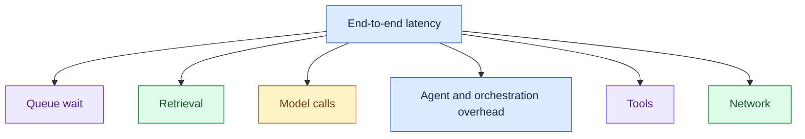

### Topics

- P50/P95/P99
- TTFT
- Streaming
- Parallelisation
- Sequential LLM hops
- Retrieval latency
- Tool latency
- Queue latency
- Async processing

### Practice Questions

1. Average latency is 3 seconds but P99 is 25 seconds. What does this tell you?
2. Your agent calls CRM, order and ticket APIs sequentially. Each takes 1 second. What obvious optimisation would you consider?
3. The model itself takes only 2 seconds but total latency is 12 seconds. How would you investigate?
4. When does streaming improve perceived latency without actually reducing total compute time?
5. A research task takes five minutes. Would you continue optimising it as a synchronous API request or change the interaction model?

---

## Review 11: Cost Optimisation

### Goal

- Understand and control AI economics.

### Cost Decomposition

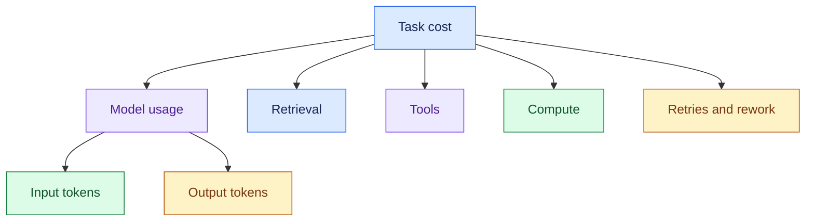

### Topics

- Model routing
- Context optimisation
- Caching
- Reduce model calls
- Deterministic logic
- Agent bounds
- Batch processing
- Cost attribution
- Cost per successful task

### Practice Questions

1. The customer's LLM bill doubles after launching an agent. What would you inspect first?
2. Why might model routing reduce cost without materially reducing quality?
3. Conversation history grows indefinitely and token cost keeps increasing. What would you change?
4. Why is cost per successful task often more meaningful than cost/request?
5. Your architecture uses five LLM calls for every request. How would you determine whether all five are necessary?

---

## Review 12: Reliability and Failure Handling

### Goal

Answer:

> "What happens when something fails?"

### Topics

- Timeout
- Retry
- Exponential backoff
- Jitter
- Circuit breaker
- Idempotency
- Graceful degradation
- Model fallback
- DLQ
- Checkpointing
- Blast radius

### Failure Mental Model

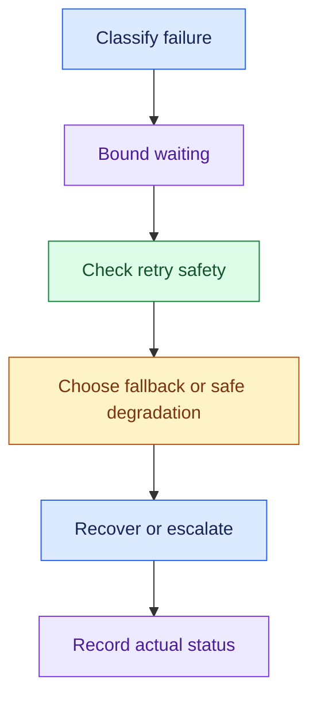

### Practice Questions

1. Your primary model provider becomes unavailable. What happens next?
2. A tool API returns intermittent 503 errors. What retry strategy would you use?
3. Why can aggressive retries make an outage worse?
4. A recommendation feature fails. Should the entire customer-support system become unavailable?
5. A background event fails processing after several retries. What should happen next?

---

## Review 13: AI Evaluation

### Goal

- Make AI quality measurable.

### Topics

#### RAG

- Retrieval relevance
- Recall
- Groundedness
- Correctness

#### Agents

- Routing
- Tool selection
- Tool arguments
- Trajectory
- Task success

#### Evaluation Types

- Deterministic
- Non-deterministic
- Offline
- Online

### Key Principle

- A good answer must still be checked against actual task completion.

### Practice Questions

1. How would you evaluate a customer-support system containing both RAG and action-taking agents?
2. Give examples of deterministic checks for an agent.
3. Which checks require semantic or non-deterministic evaluation?
4. The final response sounds perfect, but the agent used the wrong tool and never actually cancelled the order. How should evaluation catch this?
5. Why do we need both offline and online evaluation?

---

## Review 14: Release and Change Management

### Goal

- Safely ship AI changes.

### Core Flow

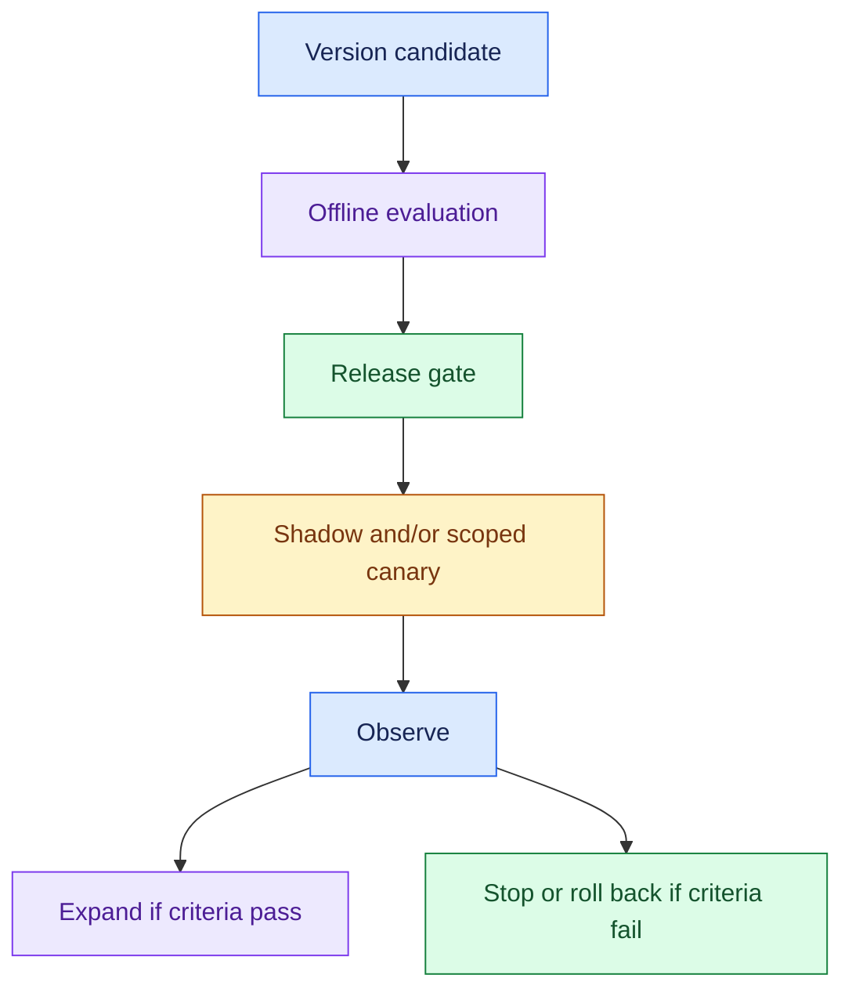

### Topics

- Versioning
- Release gates
- Canary
- Shadow traffic
- Feature flags
- Rollback
- Kill switch

### Practice Questions

1. Your team creates a new prompt that performs better on 20 examples. Would you immediately deploy it?
2. Explain when you would use shadow traffic vs canary deployment.
3. How would you release a new agent to only two enterprise customers first?
4. Which artifacts should be versioned besides the model itself?
5. Production quality suddenly drops after a new release. What mechanisms should allow you to respond quickly?

---

## Review 15: Observability and Production Operations

### Goal

- Understand what is happening inside the system after deployment.

### Topics

- Logs
- Metrics
- Distributed traces
- AI telemetry
- Audit
- SLI
- SLO
- SLA

### Trace Mental Model

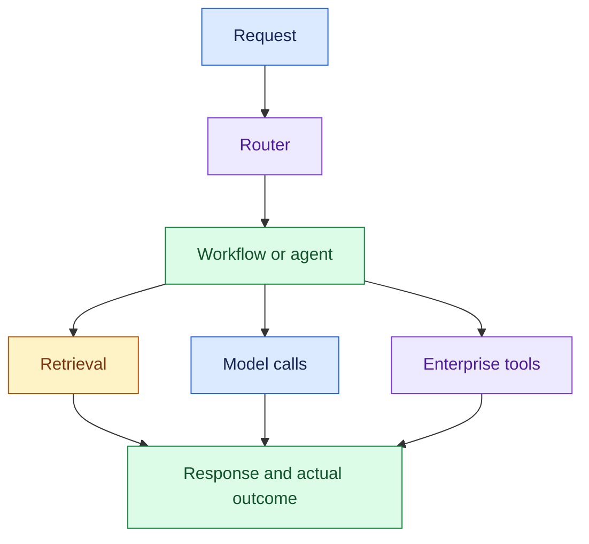

### Practice Questions

1. A user says, "My request took 18 seconds yesterday." What telemetry would you inspect?
2. Explain the difference between logging, metrics and tracing using an agent request.
3. Which AI-specific telemetry would you capture beyond normal infrastructure metrics?
4. Compliance asks, "Why did the agent issue this refund?" What information should be available?
5. Explain SLI vs SLO vs SLA using an AI assistant latency example.

---

## Review 16: Security and Enterprise Multi-Tenancy

### Goal

- Make the system enterprise-ready.

### Topics

- Authentication
- Authorisation
- RBAC
- Permission-aware RAG
- Least privilege
- Tenant isolation
- Secrets
- Sensitive data
- Data residency
- Defence in depth

### Core Mental Model

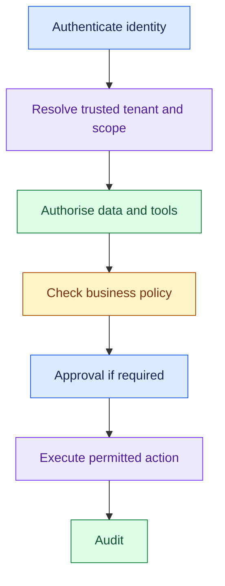

### Practice Questions

1. Employee A can access HR documents while Employee B cannot. How should this affect retrieval?
2. Why is filtering unauthorised documents after generation a weak security design?
3. What permissions would you give a refund agent following least-privilege principles?
4. A shared platform serves 50 enterprise tenants. What needs tenant isolation?
5. A European customer says their data cannot leave a particular region. What architectural concerns does this introduce?

---

## Review 17: Trade-Off Thinking

### Goal

- Explain why you made architecture decisions.

### Core Principle

> "I'm choosing X because of requirement Y. The trade-off is Z."

### Topics

#### Cost ↔ Quality ↔ Latency

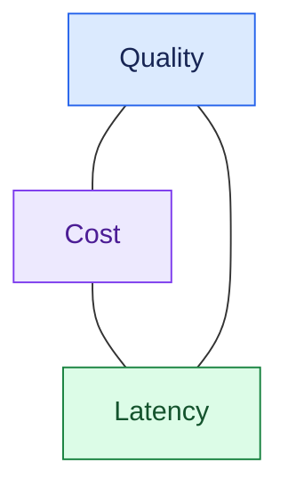

- Required security, safety, and correctness constraints still apply.

#### Common Trade-Offs

- More retrieval may improve recall; check noise, latency, and cost.
- More agents may help independent work; measure coordination and model-call overhead.
- Caching reduces repeated work; enforce freshness and permission scope.
- A stronger model may help difficult tasks; compare quality, latency, and total task cost.
- More autonomy can reduce human work; preserve policy, approval, and safe execution.
- Async delivery releases the client while work continues; it still needs capacity and completion tracking.

### Practice Questions

1. You can improve answer quality by adding another LLM critic, but it adds 3 seconds and 40% cost. How would you reason about the decision?
2. The customer wants maximum retrieval recall but also very low latency. What trade-off would you discuss?
3. When might you intentionally choose a smaller model even if a larger model performs slightly better?
4. Caching tool responses reduces latency dramatically. What new risk does caching introduce?
5. The interviewer asks, "Why did you choose this architecture instead of a simpler one?" How would you structure your answer?

---

## Review 18: End-to-End FDE Interview Execution

### Goal

- Combine everything into one repeatable interview flow.

