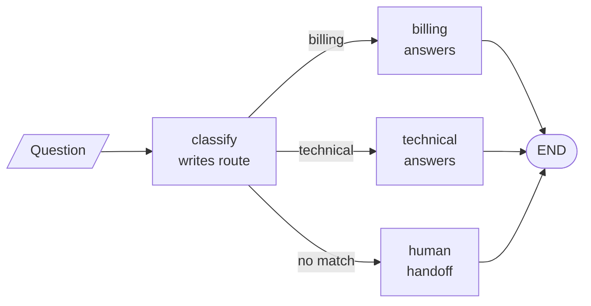

<!-- Generated by site/scripts/rag-theory-import.mjs from rag-agents-engineering. Edit the source there. -->
# Overview

A LangGraph application is a state object and the functions that update it. Nodes read the state and return a partial update, a reducer per key decides how that update merges, and edges, fixed or conditional, decide which node runs next. Agentic RAG, memory and multi-agent systems later in the course are all built from these parts. The M09 notebooks build on four ideas: the graph and its state, the reducers that merge updates, conditional edges that route on state, and `Command`, which updates and routes in one return.

The running example is a Larkspur Cloud support graph over the same handbook as [M11](/learn/llm-and-retrieval/rag-from-first-principles/rag-from-first-principles-overview) to [M13](/learn/ingestion-and-indexing-pipeline/chunking-and-indexing/chunking-and-indexing-overview). A `classify` node reads the customer's question and writes a route; a conditional edge sends it to a `billing`, `technical` or `human` node; the handler answers from the handbook. The notebooks use their own small demos (weather, comic books, a temperature alarm), and they ship without saved outputs. Every figure and error message on these pages comes from running the notebooks' code, or small variations of it, against the installed LangGraph 1.2.18, or from the lab, which matches that version's graph on all 24 of its settings.

## In short

- A `StateGraph` is a schema, nodes that return partial updates, and edges from `START` to `END`. `compile()` turns it into a runnable; `invoke` returns the final state and starts from a fresh state every call.
- Each state key can have a reducer. Without one, the last write wins. In the lab the support graph ends with 1 message and no question when nodes return only their new message, with 3 under `add_messages`, and with 7 (four copies of the question) when `operator.add` meets nodes that return the whole list.
- A conditional edge calls a router after its source node and goes to the node name it returns. A name outside the destination list raises `KeyError`, and the order of the router's rules decides close calls: *Can I export my data after I cancel my plan?* goes to billing.
- `Command(update=..., goto=...)` writes and routes in one return. Its `Literal` annotation only draws the graph; a `goto` to a node that does not exist ends the run with a logged warning and no error.
- `TypedDict` state is hints only, and Pydantic state validates the input at `invoke` before any node runs, though not what nodes write. Input and output schemas hide private keys; config and runtime context carry settings and dependencies that are not state.

## Mental model

Every node gets the whole state and returns only the keys it changes. Between nodes the graph merges each returned key with that key's reducer, so a node never sees another node's raw return value, only the merged state. The three-way choice after `classify` is a conditional edge: a plain function reads `route` and names the next node.

## Interactive lab

[**Reducers and the message list**](/labs/rag/m09_langgraph_core/reducer-lab.html): open the file in a browser. Keep the refund question and set the reducer to *None (overwrite)*: the question disappears after the first node and the billing node has nothing to answer. Switch to *operator.add* and let each node return the whole list: the state grows 1, 3, 7. Then pick *add_messages* with the same setting and watch it stay at 3. Last, try the export question and see the router send it to billing.

## How it connects

- **Before:** [M07](/learn/langchain-and-langgraph-fundamentals/langchain-core-models-prompts-and-parsers/langchain-core-models-prompts-and-parsers-overview) introduced chat models and message types, and [M08](/learn/langchain-and-langgraph-fundamentals/lcel-runnables-and-chains/lcel-runnables-and-chains-overview) composed them into LCEL chains. A chain runs one fixed path; a `StateGraph` adds shared state, branches and loops.
- **Next:** [M10](/learn/langchain-and-langgraph-fundamentals/langgraph-runtime-persistence-hitl-and-streaming/langgraph-runtime-persistence-hitl-and-streaming-overview) adds the runtime: checkpointers that save the state between steps, `interrupt()` and `Command(resume=...)` for human approval, and streaming. [M23](/learn/agentic-systems/the-agent-loop-and-tool-calling/the-agent-loop-and-tool-calling-overview) builds the tool loop from a model node and a conditional edge, [M25](/learn/agentic-systems/agentic-workflow-patterns/agentic-workflow-patterns-overview) builds its workflow patterns from reducers and routers, [M30](/learn/agentic-and-self-correcting-rag/adaptive-rag-and-query-routing/adaptive-rag-and-query-routing-overview) routes questions between knowledge bases, and [M35](/learn/memory-and-multi-agent-rag/multi-agent-architectures/multi-agent-architectures-overview) hands work between agents with `Command`.

## Key Takeaways

- Decide the reducer for every key that more than one node writes. Use `add_messages` for message lists and keep one convention for what nodes return.
- Route with a plain function of state, list every destination, and give the router a fallback; the order of its rules decides the close calls.
- Use `Command` when a node must write and route together, and test that every `goto` names a real node.
- Validate input with a Pydantic state schema, narrow what callers send and receive with input and output schemas, and keep settings and dependencies out of state.
