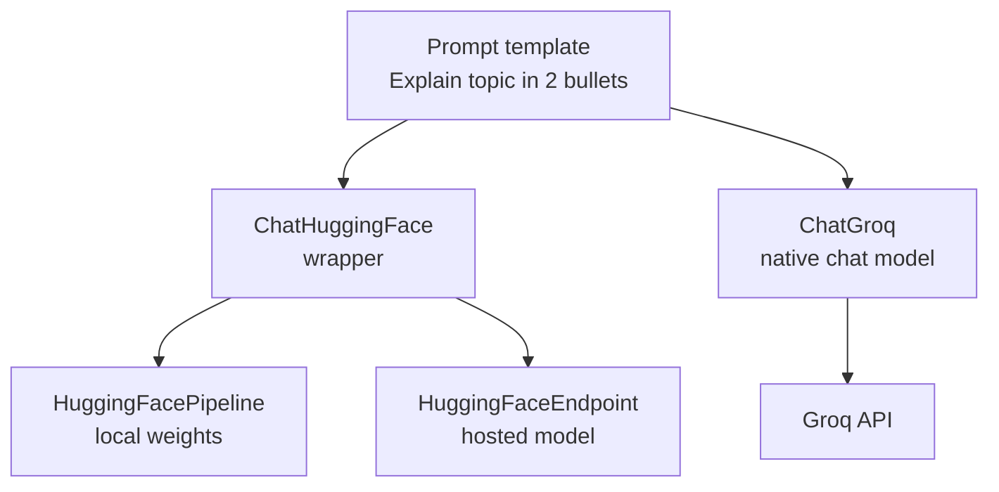

<!-- Generated by site/scripts/rag-theory-import.mjs from rag-agents-engineering. Edit the source there. -->
# Open-source LLMs: Transformers, Inference Client, Groq, LangChain

<!-- subtitle: A small project: lesson 2 of T4.1's chain on three open-model backends, one on your own machine and two hosted, and what each one changes underneath -->
<!-- format: approved -->

## The project: three open backends

> **What you'll build**
>
> - **A local backend** that downloads a 1.1B-parameter model and runs it in your own process.
> - **A hosted Hugging Face backend** that sends the same messages to a large model on Inference Providers.
> - **A Groq backend** that uses Groq's native LangChain chat model.
> - **One chain** that runs unchanged on all three.

Lesson 2 of T4.1 ran one `prompt | model` chain on commercial APIs. This project runs the same chain on open-weight models. It adds no new idea; it shows what the chat-model interface hides when the model moves to weights on your laptop, or to someone else's hardware.

For Larkspur this is the question behind a cost or data-residency review: whether the refund assistant can run on an open model without rewriting the chain. The call shape survives each move. What changes is where the tokens are computed, what the reply reports about itself, and which messages the backend accepts.

## Architecture

The two Hugging Face backends share one wrapper, and Groq needs none:

*Figure 1: The three backends. `ChatHuggingFace` gives two completion-style classes the chat interface; `ChatGroq` is already a chat model.*

| Piece | What it does | Built on |
|---|---|---|
| **Prompt template** | One human message with a `{topic}` slot | Lesson 5 of T4.1's templates |
| **`ChatHuggingFace`** | Turns messages into what a Hugging Face LLM class takes, and its output into an `AIMessage` | Lesson 4 of T4.1's LLM vs chat model split |
| **`HuggingFacePipeline`** | Loads `TinyLlama/TinyLlama-1.1B-Chat-v1.0` with `transformers` and generates on CPU, GPU or Apple silicon | The optional Transformers notebook |
| **`HuggingFaceEndpoint`** | Calls `moonshotai/kimi-k2-instruct-0905` on Hugging Face's servers | The optional Inference Client notebook |
| **`ChatGroq`** | Calls `llama-3.1-8b-instant` on Groq's hosted inference | The optional Groq notebook |

*Table 1: The project's pieces. Each optional notebook does the same job with the backend's own library, without LangChain.*

## Following one request

Invoke the chain with the topic *AI*. The template produces one `HumanMessage`, and each backend takes it from there. We traced the paths in the installed `langchain-huggingface` 1.2.3 source; no model was called:

| Step | Local pipeline | Hosted endpoint | Groq |
|---|---|---|---|
| Messages become | one string, rendered with the model's own chat template | a list of role dicts | a list of role dicts |
| Generation | in your process, greedy, up to 256 new tokens | on Hugging Face's servers, up to 1,000 new tokens | on Groq's servers, temperature 0, up to 1,000 tokens |
| Reply becomes | an `AIMessage` with the text only | an `AIMessage` with token counts from the response | an `AIMessage` with token counts |

*Table 2: One request through each backend. The settings are the notebook's.*

The first row is the one to understand. A chat model trained on roles still reads one sequence of tokens; the roles are marked with special tokens that differ by model family. The optional Transformers notebook shows TinyLlama's format, a `<|user|>` line, the question, an end-of-turn token and an open `<|assistant|>` line for the model to continue. On the local path, `ChatHuggingFace` asks the tokenizer to render the messages in that format. On the hosted paths, the server does the rendering.

The optional notebooks do the same without LangChain. The Transformers notebook renders the chat template, encodes, generates and decodes by hand, then repeats it with a one-call `pipeline`. The Inference Client notebook calls `chat_completion` on a hosted model and reads token usage from the response. The Groq notebook calls Groq's own SDK and compares two Llama 4 variants on one prompt.

## Design choices worth copying

| Choice | Why |
|---|---|
| **Keep the chain, swap the model object** | The template and everything after the model stay the same: a backend comparison changes one line ([lesson 2 of T4.1](/learn/langchain-and-langgraph-fundamentals/langchain-core-models-prompts-and-parsers/commercial-llms-natively-and-with-langchain#lesson-chat-models)) |
| **Greedy decoding for the local model** | Sampling off makes reruns repeatable, which a comparison needs |
| **A short output cap on CPU** | 256 new tokens keeps a laptop run to a reasonable wait |
| **Model ids in one place** | Hosted providers retire ids; the Groq notebook warns that they change regularly |
| **The backend's own library first** | Seeing encode, generate and decode by hand explains what the wrapper does for you |

*Table 3: Five choices and the reason for each.*

## Limits

- **No token counts locally.** The pipeline path returns the text without usage metadata. Cost and length checks that read `.usage_metadata` see nothing.
- **The last message must be human.** The local wrapper raises an error when the last message is a system or AI message, and it accepts only system, human and AI messages. Tool results ([T7.1](/learn/agentic-systems/the-agent-loop-and-tool-calling/the-agent-loop-and-tool-calling-overview)) cannot pass through it.
- **No async calls locally.** The wrapper raises `NotImplementedError` for an async call on the pipeline path, so an app that awaits its chains has to run the local model another way.
- **Replies differ by backend.** A 1.1B model on a laptop and a large hosted model give different answers to the same prompt. Re-run the golden questions before relying on any of them (the silent provider swap from lesson 2 of T4.1).

To run it, the local part needs the course's optional Hugging Face dependency group and downloads about 2 GB of weights on first use; the hosted parts need a Hugging Face token and a Groq API key in the project's environment file.

The traces in Table 2 come from reading the installed source, not from a run: no reply text, timing or token count on this page was measured.

## References

1. LangChain, [Hugging Face chat models](https://docs.langchain.com/oss/python/integrations/chat/huggingface), on `ChatHuggingFace` over a local pipeline or a hosted endpoint.
2. LangChain, [Groq chat models](https://docs.langchain.com/oss/python/integrations/chat/groq), on `ChatGroq`.
3. Hugging Face, [chat templates](https://huggingface.co/docs/transformers/main/en/chat_templating), on how a model family marks roles with special tokens.
4. Hugging Face, [Inference Providers](https://huggingface.co/docs/inference-providers/index), on running hosted models through one client.
5. The [TinyLlama 1.1B chat model card](https://huggingface.co/TinyLlama/TinyLlama-1.1B-Chat-v1.0), with its chat format.

## Run the notebooks

The code for this lesson is in these notebooks. Colab runs one in your browser: install the packages its first cell imports and set the API keys it reads. To run every notebook as written, clone the repository and use its uv environment.

| Notebook | GitHub | Colab |
|---|---|---|
| Open Source LLMs with LangChain | [Open on GitHub](https://github.com/Sourav692/rag-agents-engineering/blob/main/p03_llm_application_frameworks/m06_langchain_core/mandatory/notebook/03a_Open_Source_LLMs_with_LangChain.ipynb) | [Open in Colab](https://colab.research.google.com/github/Sourav692/rag-agents-engineering/blob/main/p03_llm_application_frameworks/m06_langchain_core/mandatory/notebook/03a_Open_Source_LLMs_with_LangChain.ipynb) |
| Open Source LLMs HF Transformers (optional) | [Open on GitHub](https://github.com/Sourav692/rag-agents-engineering/blob/main/p03_llm_application_frameworks/m06_langchain_core/optional/notebook/03b_Open_Source_LLMs_HF_Transformers.ipynb) | [Open in Colab](https://colab.research.google.com/github/Sourav692/rag-agents-engineering/blob/main/p03_llm_application_frameworks/m06_langchain_core/optional/notebook/03b_Open_Source_LLMs_HF_Transformers.ipynb) |
| Open Source LLMs HF Inference Client (optional) | [Open on GitHub](https://github.com/Sourav692/rag-agents-engineering/blob/main/p03_llm_application_frameworks/m06_langchain_core/optional/notebook/03c_Open_Source_LLMs_HF_Inference_Client.ipynb) | [Open in Colab](https://colab.research.google.com/github/Sourav692/rag-agents-engineering/blob/main/p03_llm_application_frameworks/m06_langchain_core/optional/notebook/03c_Open_Source_LLMs_HF_Inference_Client.ipynb) |
| Open Source LLMs Groq Cloud (optional) | [Open on GitHub](https://github.com/Sourav692/rag-agents-engineering/blob/main/p03_llm_application_frameworks/m06_langchain_core/optional/notebook/03d_Open_Source_LLMs_Groq_Cloud.ipynb) | [Open in Colab](https://colab.research.google.com/github/Sourav692/rag-agents-engineering/blob/main/p03_llm_application_frameworks/m06_langchain_core/optional/notebook/03d_Open_Source_LLMs_Groq_Cloud.ipynb) |

## Key Takeaways

- The same `prompt | model` chain runs on a local model, a hosted Hugging Face model and Groq; only the model object changes.
- `ChatHuggingFace` gives completion-style Hugging Face classes the chat interface. Locally it renders messages with the model's own chat template; hosted, it sends role dicts to the server.
- The interface hides real differences: the local path reports no token counts and accepts only system, human and AI messages, and every backend answers differently.

## Check yourself

1. What does ChatHuggingFace do on the local path that the hosted path leaves to the server?

It renders the message list into one string with the model's own chat template, the special tokens that mark each role for that model family. The pipeline then generates from that string. On the hosted path the wrapper sends role dicts and the server does the rendering.

2. Larkspur logs input and output tokens from every reply. What happens to those logs when the refund chain moves to the local TinyLlama backend?

They go empty. The pipeline path returns an `AIMessage` with the text only and no usage metadata, while the hosted endpoint and Groq report token counts. Cost and length checks need another source of counts on the local path.

3. The chain runs on all three backends without a code change. Which backend should Larkspur pick for structured refund answers?

The chain running proves only that the call shape is the same. Re-run the golden questions and the parser test set on each backend and compare usable answers, citation validity and latency; a small local model may follow the JSON format instructions less reliably than a large hosted one.

