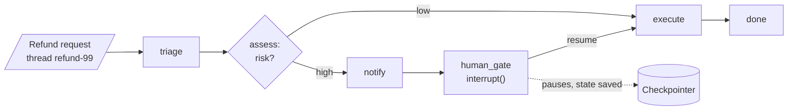

<!-- Generated by site/scripts/rag-theory-import.mjs from rag-agents-engineering. Edit the source there. -->
# Overview

[M09](/learn/langchain-and-langgraph-fundamentals/langchain-and-langgraph/langchain-and-langgraph-overview) builds a graph that runs from start to end in one call. Real workflows stop and start again: a person approves a step hours later, a payment provider times out, a deploy restarts the worker, a user wants to see progress while the graph runs. The M10 notebooks build on four ideas: the checkpointer, `interrupt()`, subgraphs and streaming modes, plus the retry policies, loop bounds and state rules that make a resumed run safe.

The running example is the refund desk of Larkspur Cloud, the fictional host whose handbook [M11](/learn/llm-and-retrieval/rag-from-first-principles/rag-from-first-principles-overview) to [M13](/learn/ingestion-and-indexing-pipeline/chunking-and-indexing/chunking-and-indexing-overview) index. A refund request enters a graph modelled on the refund agent in [`06a_LangGraph_State_Management.ipynb`](https://github.com/Sourav692/rag-agents-engineering/blob/main/course/p03_langchain_and_langgraph/m10_langgraph_runtime/notebooks/06a_LangGraph_State_Management.ipynb): triage, assess risk, refund at once when the risk is low, and wait for the billing team's approval when it is high. Two threads carry the pages and the lab, `refund-17` (low risk) and `refund-99` (high risk).

## In short

- A **checkpointer** saves the whole state after every step under a `thread_id`. The four-node low-risk refund saves 6 checkpoints, steps -1 to 4. Any process with the same saver and thread id can read them, resume from them or fork them.
- **`interrupt()`** pauses a node, saves the run and returns the payload to the caller under `__interrupt__`. `Command(resume=value)` continues it, and the node **runs again from its first line**, so code above the `interrupt()` call runs twice.
- A **subgraph** is a compiled graph used as a node. With shared keys you add it directly; with different keys a wrapper node maps parent state in and out. Keys the parent does not declare are dropped on the way out.
- **Streaming modes** decide what the caller sees while a run is in flight. For the same four-node run, `values` yields 5 chunks, `updates` 4, `checkpoints` 6, `tasks` 8 and `debug` 14. `messages` yields LLM tokens from every model call inside every node.
- Every resumed or retried node can repeat a side effect. In the lab, a refund whose provider response is lost reaches the customer twice unless the call carries an idempotency key.

## Mental model

The checkpointer writes after every step. At the gate, the first `invoke` returns while `refund-99` waits at `human_gate`, and nothing runs until somebody calls `Command(resume="approve")` on the same thread, minutes or days later, from any worker that can reach the saver. Everything this module adds is about what happens between those two calls and after them: which code runs again, what the caller sees, and what the outside world receives twice.

## Interactive lab

[**What runs twice on resume**](/labs/rag/m10_langgraph_runtime/resume-side-effects-lab.html): open the file in a browser. Pick the high-risk refund with no fault and guards off: the billing team gets 2 approval notices for one request, because the notice sits above `interrupt()`. Then choose *Response lost, RetryPolicy*: the retry that saves the run also refunds the customer twice. Turn the guards on and both counts drop to 1, with the same number of client calls.

## How it connects

- **Before:** [M09](/learn/langchain-and-langgraph-fundamentals/langchain-and-langgraph/langchain-and-langgraph-overview) builds the graphs this module pauses and resumes: state, reducers, nodes, conditional edges. [M07](/learn/langchain-and-langgraph-fundamentals/langchain-core-models-prompts-and-parsers/langchain-core-models-prompts-and-parsers-overview) and [M08](/learn/langchain-and-langgraph-fundamentals/lcel-runnables-and-chains/lcel-runnables-and-chains-overview) supply the chat models and tools inside the nodes.
- **Next:** [M11](/learn/llm-and-retrieval/rag-from-first-principles/rag-from-first-principles-overview) starts the RAG pipeline these graphs will orchestrate. [M24](/learn/agentic-systems/react-agents-and-langchain-create-agent/react-agents-and-langchain-create-agent-overview)'s `HumanInTheLoopMiddleware` and [M27](/learn/agentic-systems/human-approval-and-applied-single-agent-builds/human-approval-and-applied-single-agent-builds-overview)'s approval gate are built on `interrupt()`. [M29](/learn/agentic-and-self-correcting-rag/self-correcting-rag-crag-and-self-rag/self-correcting-rag-crag-and-self-rag-overview)'s grade-and-retry loops need the bounds from lesson 10.5, [M33](/learn/memory-and-multi-agent-rag/conversation-memory-and-conversational-rag/conversation-memory-and-conversational-rag-overview) keeps conversations in checkpointer threads, and [M35](/learn/memory-and-multi-agent-rag/multi-agent-architectures/multi-agent-architectures-overview) to [M37](/learn/memory-and-multi-agent-rag/multi-agent-applied-builds-and-deep-agents/multi-agent-applied-builds-and-deep-agents-overview) compose agents as subgraphs.

## Key Takeaways

- Compile with a checkpointer and pass a `thread_id` whenever a run may pause, crash or continue later; use a durable, shared saver in production.
- Treat every node as code that can run more than once. Keep side effects after `interrupt()` or in their own node, and give every external write an idempotency key.
- Pick the stream mode for the screen: `updates` for progress, `messages` filtered by node for typing, `values` when the client renders whole state.
- Bound every loop twice: a counter that a node increments and the router reads, and an explicit `recursion_limit` as the backstop.
