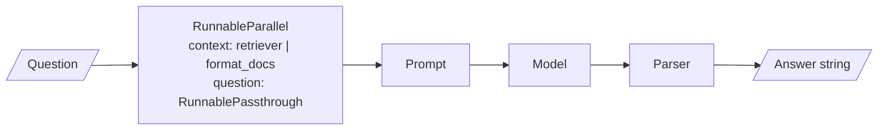

<!-- Generated by site/scripts/rag-theory-import.mjs from rag-agents-engineering. Edit the source there. -->
# Overview

LCEL is how LangChain 1.x composes work: prompts, models, parsers and retrievers snap together with `|`, and the result runs with the same methods as each piece. Every RAG chain from [M11](/learn/llm-and-retrieval/rag-from-first-principles/rag-from-first-principles-overview) onwards is one of these pipes. The M08 notebooks build on four ideas: the one interface every component shares, the pipe that joins components into a sequence, the parallel and branching shapes a pipe can take, and map-reduce for documents longer than one prompt.

The running example is the Larkspur Cloud handbook used from [M11](/learn/llm-and-retrieval/rag-from-first-principles/rag-from-first-principles-overview) onwards: a support assistant that answers refund and outage questions, triages tickets, and summarises handbook sections. The lab summarises three handbook documents of 1,111, 1,833 and 2,746 characters.

## In short

- A Runnable has one interface: `invoke` for one input, `batch` for a list, `stream` for chunks, and an async twin of each. Prompts, models, parsers, retrievers and whole chains all have it.
- `a | b` is Python's `__or__` returning a `RunnableSequence`. A dict inside a pipe becomes a `RunnableParallel`, so `{"context": retriever | format_docs, "question": RunnablePassthrough()} | prompt | llm | parser` is a complete RAG chain.
- `RunnableParallel` runs its branches on the same input at once: notebook 03a's description, pros and cons chains plus a merge chain make 4 model calls in 2 rounds. `RunnableBranch` runs the first branch whose condition is true.
- `LLMChain`, `RetrievalQA` and `load_summarize_chain` now live in `langchain-classic`, deprecated with removal set for 2.0.0. Each rewrites as a short pipe.
- Map-reduce trades calls for a small prompt. In the lab the whole handbook at `chunk_size=400` is 10 chunks: map-reduce makes 11 calls in 4 rounds at `max_concurrency=4`, refine makes 10 calls in 10 rounds, and stuff makes 1 call that reads all 2,746 characters.

## Mental model

This is the RAG chain from notebook 04a, and every box in it is a Runnable. The dict fans the question out to two branches and hands one dict to the prompt; each later step takes the previous step's output as its only input. Because the whole pipe is also a Runnable, the chain you build here can sit inside a bigger pipe, a `RunnableBranch` or a LangGraph node without changes.

## Interactive lab

[**Stuff, map-reduce or refine**](/labs/rag/m08_lcel_runnables_and_chains/summarise-strategy-lab.html): open the file in a browser. Pick *Whole handbook* and slide the chunk size from 1200 down to 200: refine's rounds climb from 3 to 21 while map-reduce stays at 2 to 7. Then set `max_concurrency` to 1 and watch map-reduce take one round more than refine. Finally pick *Refunds section* to see the router send a short document to stuff.

## How it connects

- **Before:** [M07](/learn/langchain-and-langgraph-fundamentals/langchain-core-models-prompts-and-parsers/langchain-core-models-prompts-and-parsers-overview) covers the pieces this module pipes together: chat models, prompt templates and output parsers.
- **Next:** [M09](/learn/langchain-and-langgraph-fundamentals/langchain-and-langgraph/langchain-and-langgraph-overview) and [M10](/learn/langchain-and-langgraph-fundamentals/langgraph-runtime-persistence-hitl-and-streaming/langgraph-runtime-persistence-hitl-and-streaming-overview) move control flow into LangGraph, where a Runnable can be a node. [M11](/learn/llm-and-retrieval/rag-from-first-principles/rag-from-first-principles-overview) composes its baseline RAG chain as exactly this pipe (notebook 05a), and [M13](/learn/ingestion-and-indexing-pipeline/chunking-and-indexing/chunking-and-indexing-overview) explains the splitter the map step depends on. [M25](/learn/agentic-systems/agentic-workflow-patterns/agentic-workflow-patterns-overview) turns `RunnableParallel` into the parallelisation workflow pattern, and [M42](/learn/hierarchical-memory-and-graph-rag/hierarchical-and-memory-augmented-retrieval/hierarchical-and-memory-augmented-retrieval-overview) applies recursive summarisation to a whole corpus.

## Key Takeaways

- Every component and every chain shares one interface, so test each step alone with `.invoke()` before you pipe it.
- Build data flow with dicts: a dict fans one input out, and `RunnablePassthrough.assign()` adds a key while keeping the rest.
- Write new chains as pipes. Treat `langchain_classic` imports as a staging post for old code, never as a destination.
- Choose a summarisation strategy by length and latency: stuff when it fits, map-reduce when it does not, refine only when order should matter.
