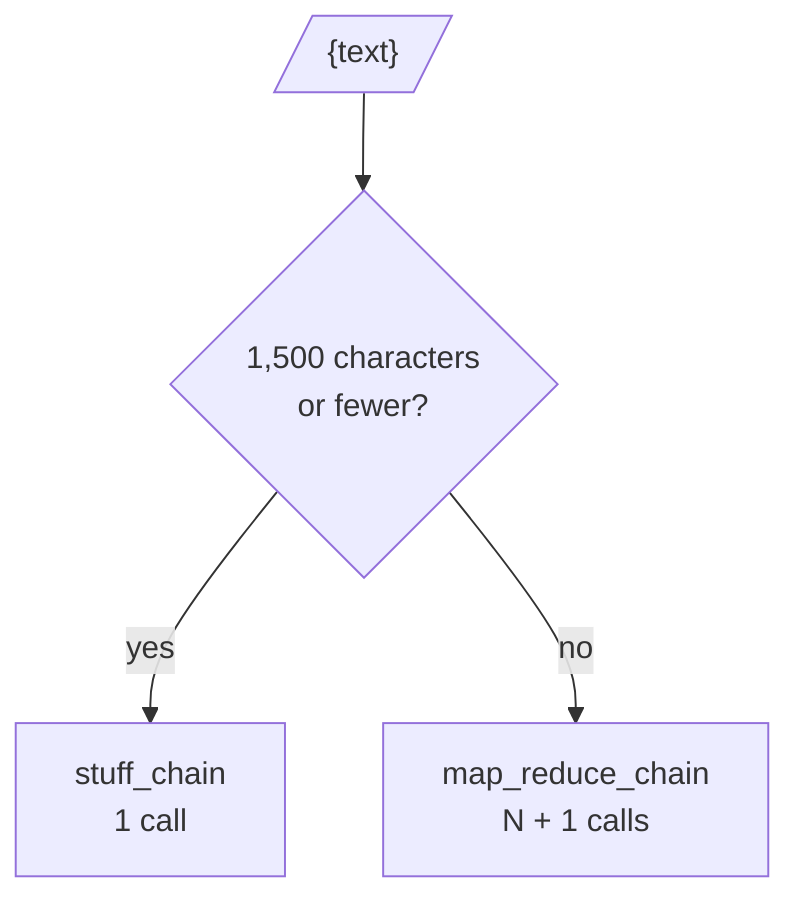

<!-- Generated by site/scripts/rag-theory-import.mjs from rag-agents-engineering. Edit the source there. -->
# Summarisation: stuff, map-reduce, refine

<!-- subtitle: Three ways to get a document longer than one prompt through a model, what each costs in calls and rounds, and a router that picks one per input -->

## Map-reduce summarisation

> **What you'll learn**
>
> - **Explain** stuff, map-reduce and refine as three short LCEL patterns.
> - **Count** the model calls and rounds each strategy needs for a given chunk size and concurrency cap.
> - **Diagnose** when chunks are too small and when the reduce step itself overflows.
> - **Build** a router that sends short inputs to stuff and long ones to map-reduce.

Lesson 4 of T4.2 left one legacy call to replace: `load_summarize_chain(llm, chain_type=...)`, which hid three strategies behind one string. Larkspur's weekly digest summarises handbook changes. In a quiet week that is one section of 1,111 characters; in a release week it is the whole handbook, 2,746 characters across refunds, outages, exports and server sizing, and a real handbook runs far longer than one prompt can hold. A model reads a finite context window. The digest needs a way to summarise text that does not fit, and a way to avoid paying for that when the text does fit.

Notebook 05b writes each strategy out in a few lines of LCEL:

- **Stuff**: join the documents, fill one prompt, call once. It is the cheapest strategy and the least lossy, because nothing is summarised twice, and it works only while the text fits.
- **Map-reduce**: summarise each chunk on its own (the map), then summarise the summaries (the reduce). The map calls are independent, which lets `batch` run them on a thread pool.
- **Refine**: summarise the first chunk, then revise that summary once per remaining chunk. Each call needs the previous answer, which forces the calls to run one after another.

In map-reduce the map step is one summarising chain batched over every chunk with a `max_concurrency` cap, and the reduce step is a second chain invoked once on the map outputs joined with blank lines. On the whole Larkspur handbook (2,746 characters) split at `chunk_size=400` with an overlap of 20, that is 10 chunks:

```animated
<figure class="anim sheet" aria-labelledby="anim-mapreduce-cap">
  <div class="anim__canvas" tabindex="0" aria-label="Map-reduce summarisation, scrolls sideways on a narrow screen">
    <svg viewBox="0 0 800 320" role="img" aria-labelledby="anim-mapreduce-title anim-mapreduce-desc">
      <title id="anim-mapreduce-title">Map-reduce summarisation</title>
      <desc id="anim-mapreduce-desc">The 2,746-character handbook splits into 10 chunks. With max_concurrency 4 the map step summarises them in three rounds of 4, 4 and 2 calls. One reduce call combines the 10 summaries into the final summary: 11 calls in 4 rounds.</desc>
      <defs>
        <marker id="ah-mapreduce" viewBox="0 0 8 8" refX="7" refY="4" markerWidth="8" markerHeight="8" markerUnits="userSpaceOnUse" orient="auto-start-reverse"><path class="ah" d="M0 0 L8 4 L0 8 z"/></marker>
      </defs>

      <g class="n-1">
        <rect class="box" x="16" y="128" width="110" height="56"/>
        <text class="label" x="71" y="148">Handbook</text>
        <text class="fig" x="71" y="170">2,746 chars</text>
      </g>

      <path class="edge e-2" d="M126 156 H155" marker-end="url(#ah-mapreduce)"/>
      <g class="in-2">
        <rect class="chunk" x="160" y="40" width="40" height="14"/>
        <rect class="chunk" x="160" y="64" width="40" height="14"/>
        <rect class="chunk" x="160" y="88" width="40" height="14"/>
        <rect class="chunk" x="160" y="112" width="40" height="14"/>
        <rect class="chunk" x="160" y="136" width="40" height="14"/>
        <rect class="chunk" x="160" y="160" width="40" height="14"/>
        <rect class="chunk" x="160" y="184" width="40" height="14"/>
        <rect class="chunk" x="160" y="208" width="40" height="14"/>
        <rect class="chunk" x="160" y="232" width="40" height="14"/>
        <rect class="chunk" x="160" y="256" width="40" height="14"/>
        <text class="small" x="180" y="290">10 chunks</text>
      </g>
      <g class="in-3"><rect class="hit" x="160" y="40" width="40" height="14"/><rect class="hit" x="160" y="64" width="40" height="14"/><rect class="hit" x="160" y="88" width="40" height="14"/><rect class="hit" x="160" y="112" width="40" height="14"/></g>
      <g class="in-4"><rect class="hit" x="160" y="136" width="40" height="14"/><rect class="hit" x="160" y="160" width="40" height="14"/><rect class="hit" x="160" y="184" width="40" height="14"/><rect class="hit" x="160" y="208" width="40" height="14"/></g>
      <g class="in-5"><rect class="hit" x="160" y="232" width="40" height="14"/><rect class="hit" x="160" y="256" width="40" height="14"/></g>

      <text class="lane-label" x="258" y="44">Round 1</text>
      <g class="in-3 n-3">
        <rect class="box" x="250" y="60" width="90" height="34"/><text class="fig" x="295" y="77">map 1</text>
        <rect class="box" x="250" y="112" width="90" height="34"/><text class="fig" x="295" y="129">map 2</text>
        <rect class="box" x="250" y="164" width="90" height="34"/><text class="fig" x="295" y="181">map 3</text>
        <rect class="box" x="250" y="216" width="90" height="34"/><text class="fig" x="295" y="233">map 4</text>
      </g>
      <text class="lane-label" x="378" y="44">Round 2</text>
      <g class="in-4 n-4">
        <rect class="box" x="370" y="60" width="90" height="34"/><text class="fig" x="415" y="77">map 5</text>
        <rect class="box" x="370" y="112" width="90" height="34"/><text class="fig" x="415" y="129">map 6</text>
        <rect class="box" x="370" y="164" width="90" height="34"/><text class="fig" x="415" y="181">map 7</text>
        <rect class="box" x="370" y="216" width="90" height="34"/><text class="fig" x="415" y="233">map 8</text>
      </g>
      <text class="lane-label" x="498" y="44">Round 3</text>
      <g class="in-5 n-5">
        <rect class="box" x="490" y="60" width="90" height="34"/><text class="fig" x="535" y="77">map 9</text>
        <rect class="box" x="490" y="112" width="90" height="34"/><text class="fig" x="535" y="129">map 10</text>
      </g>
      <text class="small" x="415" y="290">max_concurrency = 4, so four map calls per round</text>

      <path class="edge e-6" d="M592 60 V250"/>
      <path class="edge e-6" d="M592 156 H617" marker-end="url(#ah-mapreduce)"/>
      <g class="n-6">
        <rect class="box" x="620" y="128" width="90" height="56"/>
        <text class="label" x="665" y="148">Reduce</text>
        <text class="fig" x="665" y="170">1 call</text>
      </g>

      <path class="edge e-7" d="M710 156 H729" marker-end="url(#ah-mapreduce)"/>
      <g class="in-7">
        <rect class="doc" x="732" y="128" width="60" height="56"/>
        <path class="line" d="M740 142 H784"/>
        <path class="hit-line" d="M740 156 H780 M740 170 H770"/>
        <text class="small" x="762" y="204">summary</text>
      </g>
    </svg>
  </div>
  <div class="anim__controls" hidden>
    <button class="anim__btn" type="button" data-act="prev">Previous</button>
    <button class="anim__btn" type="button" data-act="play" aria-pressed="false">Play</button>
    <button class="anim__btn" type="button" data-act="next">Next</button>
  </div>
  <ol class="anim__steps" id="anim-mapreduce-cap">
    <li><button type="button">Document</button><span>The whole Larkspur handbook, 2,746 characters, is too long for the lab’s 1,500-character limit.</span></li>
    <li><button type="button">Split</button><span>RecursiveCharacterTextSplitter with chunk_size=400 and chunk_overlap=20 cuts it into 10 chunks.</span></li>
    <li><button type="button">Round 1</button><span>map_chain.batch() starts the first four map calls at once.</span></li>
    <li><button type="button">Round 2</button><span>When a slot frees, the next four chunks go out.</span></li>
    <li><button type="button">Round 3</button><span>The last two chunks run. Ten map calls took three waits on the model.</span></li>
    <li><button type="button">Reduce</button><span>One more call reads the ten summaries joined together.</span></li>
    <li><button type="button">Summary</button><span>Eleven calls in four rounds. Refine would need ten rounds, one per chunk.</span></li>
  </ol>
</figure>
```

*Figure 1: Map-reduce on the whole handbook at chunk size 400 and `max_concurrency=4`.*

A round is one wait on the model: calls in the same round run at the same time. Wall time grows with rounds, and cost grows with calls. The three strategies on the same 10 chunks:

| Strategy | Model calls | Rounds (`max_concurrency=4`) | Most source text in one call | Parallel |
|---|---|---|---|---|
| Stuff | 1 | 1 | 2,746 characters | nothing to parallelise |
| Map-reduce | 11 | 4 | 399 characters | the map step |
| Refine | 10 | 10 | 399 characters, plus the running summary | no, by design |

*Table 1: Calls and rounds on the whole handbook at chunk size 400, as the lab computes them.*

Notebook 05b gives the general form: stuff is 1 call, map-reduce N + 1 calls, refine N calls. The [interactive lab](/labs/rag/m07_lcel_runnables_and_chains/summarise-strategy-lab.html) computes all three on three handbook documents, splitting them with a port of LangChain's `RecursiveCharacterTextSplitter` that matches the library on every chunk size from 200 to 1200. We reran the library splitter on the lab's three texts and got the same chunk counts. The numbers show where each strategy wins:

- **Chunk size sets the call count.** On the whole handbook, chunk size 1200 gives 3 chunks and chunk size 200 gives 21. Refine's rounds climb from 3 to 21; map-reduce at `max_concurrency=4` goes from 2 rounds to 7, and at 16 it needs only 3 rounds for all 22 calls.
- **Concurrency is what makes map-reduce fast.** At `max_concurrency=1` the map step is a loop, and map-reduce takes N + 1 rounds, one more than refine. Rate limits often force a low cap, so measure at the cap you can run in production.
- **Small chunks cost calls without adding much.** Notebook 05a splits its 630-character sample at `chunk_size=100`: 11 chunks, and five of them are 31 characters or fewer, the smallest 13 and 18. Map-reduce then makes 12 calls on a text that one stuff call reads whole. We call this **confetti chunking**: chunks so small that the overlap fragments become calls of their own.

```lab
src: /labs/rag/m07_lcel_runnables_and_chains/summarise-strategy-lab.html
title: Stuff, map-reduce or refine
```

### Where each strategy breaks

Each strategy has one failure that the call counts do not show:

| Strategy | Failure | What happens |
|---|---|---|
| Stuff | the text outgrows the context window | the call fails or the input is cut, with no partial result |
| Map-reduce | **reduce overflow**: the joined map summaries no longer fit | the reduce call hits the same limit stuff did |
| Refine | **order bias**: later chunks get more say | the summary changes when the chunks are reordered |

*Table 2: The failure each strategy leaves behind.*

The fix for reduce overflow is to reduce in groups and reduce the results again, the recursive summarisation that [T13.1's RAPTOR](/learn/hierarchical-memory-and-graph-rag/hierarchical-and-memory-augmented-retrieval/hierarchical-and-memory-augmented-retrieval-overview) builds into a tree. Order bias is a feature only when later text should override earlier text, such as a changelog where the newest entry wins. Notebook 05b suggests running its refine loop with the documents reversed to see the effect.

Writing the strategies out also opens choices the loader could not express: a smaller model for the many map calls and a larger one for the single reduce, or a retry wrapped around the map chain so one failed chunk does not sink the batch.

## Routing by length

Stuff is the best strategy whenever it fits, which means the summariser should decide per input. This is the module's lab brief in miniature: rebuild `load_summarize_chain` as LCEL, then add a branch that routes short and long inputs differently. The branch is a `RunnableBranch` with one condition, the text is 1,500 characters or fewer, which sends the input to the stuff chain; the default is the map-reduce chain:



*Figure 2: The length router. Stuff for what fits, map-reduce for the rest.*

We ran a real `RunnableBranch` with that condition on the lab's three documents and on the edges of the limit:

| Input length | Strategy chosen |
|---|---|
| 1,111 (refunds section) | stuff |
| 1,500 | stuff |
| 1,501 | map-reduce |
| 1,833 (refunds and outages) | map-reduce |
| 2,746 (whole handbook) | map-reduce |

*Table 3: The length router on the lab's documents. The lab's routing matches on all three.*

The 1,500-character limit stands in for a context budget. In production, count tokens with the model's tokenizer and set the limit to the context window minus the prompt template and the room the answer needs.

The two branches return the same type, a summary string, and callers never see which strategy ran. Log it anyway: when the share of map-reduce runs rises, documents have grown, and cost and latency will follow.

## In practice: the weekly digest

The digest job puts the page together:

1. Join the week's changed sections into one text, the step `load_summarize_chain` used to do for you.
2. Route it by length. A quiet week (the 1,111-character refunds section) goes to stuff: 1 call.
3. A release week (the whole handbook at chunk size 400) goes to map-reduce: 10 map calls, 4 at a time, then 1 reduce call, 11 calls in 4 rounds.
4. If the joined map summaries exceed the budget, reduce them in groups and reduce again.
5. Log the strategy and the call count for every run.

## Run the notebooks

The code for this lesson is in these notebooks. Colab runs one in your browser: install the packages its first cell imports and set the API keys it reads. To run every notebook as written, clone the repository and use its uv environment.

| Notebook | GitHub | Colab |
|---|---|---|
| Summarisation Essentials | [Open on GitHub](https://github.com/Sourav692/rag-agents-engineering/blob/main/p03_llm_application_frameworks/m07_lcel_runnables_and_chains/mandatory/notebook/05a_Summarization_Essentials.ipynb) | [Open in Colab](https://colab.research.google.com/github/Sourav692/rag-agents-engineering/blob/main/p03_llm_application_frameworks/m07_lcel_runnables_and_chains/mandatory/notebook/05a_Summarization_Essentials.ipynb) |
| Doc Chains to LCEL LangChain v1 | [Open on GitHub](https://github.com/Sourav692/rag-agents-engineering/blob/main/p03_llm_application_frameworks/m07_lcel_runnables_and_chains/mandatory/notebook/05b_Doc_Chains_to_LCEL_LangChain_v1.ipynb) | [Open in Colab](https://colab.research.google.com/github/Sourav692/rag-agents-engineering/blob/main/p03_llm_application_frameworks/m07_lcel_runnables_and_chains/mandatory/notebook/05b_Doc_Chains_to_LCEL_LangChain_v1.ipynb) |

## Key Takeaways

- Stuff makes 1 call, map-reduce N + 1 and refine N. Cost grows with calls and wall time with rounds, and only map-reduce can run its calls in parallel.
- Chunk size sets the call count, and concurrency is what makes map-reduce fast. Measure at the concurrency cap your rate limit allows, and avoid confetti chunking.
- Route by length: stuff whatever fits and map-reduce the rest. Set the limit from a token budget, and log which strategy ran.

## Check yourself

<details>
<summary>1. Why is stuff the best summarisation strategy whenever the text fits in one call?</summary>

It is the cheapest and the least lossy. It joins the documents into one prompt and calls the model once, so nothing is summarised twice. Map-reduce and refine exist only because a long text does not fit, which is why the router sends short inputs to stuff.

</details>

<details>
<summary>2. The Larkspur handbook splits into 10 chunks at chunk size 400. How many model calls and rounds does map-reduce need at a max concurrency of 4, and how does refine compare?</summary>

Map-reduce makes 11 calls in 4 rounds: 10 map calls, 4 at a time over 3 rounds, then 1 reduce. Refine makes 10 calls in 10 rounds, because each call needs the previous summary. At `max_concurrency=1` map-reduce would take N + 1 rounds, one more than refine.

</details>

<details>
<summary>3. Your length router sends anything over 1,500 characters to map-reduce. In production, what should replace that limit, and what should you log?</summary>

A token budget: count tokens with the model's tokenizer and set the limit to the context window minus the prompt template and the room the answer needs. Log which strategy ran, because a rising share of map-reduce runs means documents have grown, and cost and latency will follow.

</details>
