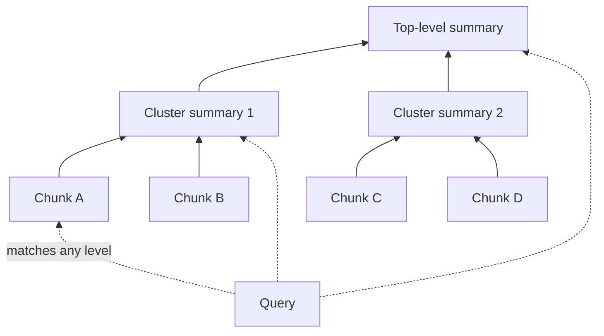
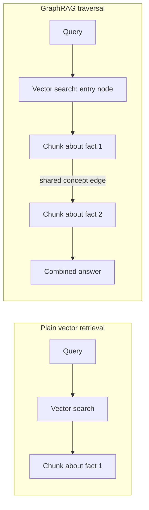

# Advanced Index Structures

*Trees, graphs, and image indexes answer questions a flat chunk index cannot, but each adds a construction pipeline that must be rebuilt or maintained as the corpus changes.*

A flat index of equal chunks answers questions whose answer sits inside one chunk; some questions do not. This lesson covers the index structures that add levels, links, or images, and how to tell when a corpus has earned one, building on [Retrieve Small, Return Large](/learn/llm-and-retrieval/chunking-and-indexing/retrieve-small-return-large).

**Objectives:**

- describe hierarchical indices and when a summary layer helps;
- explain how RAPTOR builds a tree of cluster summaries, and when it degenerates;
- explain how GraphRAG answers questions that join facts across documents;
- choose between captioning and direct visual embedding for figures and charts.

---

## Search Summaries First With a Hierarchical Index

A hierarchical index keeps two vector indexes. One holds summaries of documents or sections. The other holds the original detailed chunks. A query searches the summaries first to find the right region, then searches only the detailed chunks under the matched summaries.

The summary layer acts as coarse routing. It cuts how many detailed chunks a query must be compared against. The RAG fundamentals notes describe the same shape as hierarchical chunking: document, section, and paragraph levels, with a summary chunk above detailed sub-chunks. They recommend it for manuals, contracts, and reports.

## Build a Tree of Summaries With RAPTOR

RAPTOR (recursive abstractive processing and thematic organisation for retrieval) generalises the hierarchical index to as many levels as the content supports. It embeds all chunks and clusters similar ones. An LLM summarises each cluster. The summaries are then clustered and summarised again, up to a maximum number of levels.

Every level is indexed, not just the leaves. So a broad question, such as what the greenhouse effect is, can match a high-level summary. A narrow one, such as the exact CO₂ figure, can match a leaf chunk in the same index. Use it when questions range from broad themes to specific facts across a large corpus and the right number of levels is not known in advance.

The dotted lines show one query matching any level of the same index.

The clustering uses a Gaussian mixture model, a soft method that gives each chunk a probability of belonging to each cluster. A paragraph about climate policy affecting agriculture can then belong to both an agriculture theme and a policy theme.

> **Warning: RAPTOR silently collapses on small or uniform corpora.** The notebook sets the cluster count to the smaller of 10 and half the remaining texts. With 8 chunks, level one gets only 4 clusters. If everything embeds close together, the model converges to one or two clusters. By level two the tree is one summary of everything. Check cluster counts per level before trusting the tree's depth. For small corpora, cap the levels or fall back to a two-level hierarchical index.

## Link Facts Across Documents With GraphRAG

Some questions need two facts from different documents joined together. Plain retrieval finds either fact alone, but not the link between them. Retrieving more chunks does not fix that. It is a traversal problem, not a bigger-k problem.

GraphRAG builds an explicit graph. An LLM extracts concepts from each chunk. Chunks become nodes, and an edge joins two chunks when their shared concepts or embedding similarity clear a threshold; the notebook used 0.8. At query time, vector search finds the best entry nodes. The engine then walks outward along edges. After each hop it checks whether the gathered context fully answers the question.

Plain retrieval stops at the first fact; the graph walk reaches the second through a shared concept.

The cost is real. Entity and edge extraction runs an LLM over every document, and the graph needs ongoing maintenance. Choose it when questions genuinely require connecting information across documents. Keep plain chunk retrieval when answers live inside one chunk.

## Weigh Rebuild Costs Before Choosing a Structure

The advanced techniques notebooks rebuild both RAPTOR's tree and GraphRAG's graph from scratch, in memory, on every run. None shows re-clustering only a changed subtree or merging new entities into an existing graph. The tutorial flags that as exactly what breaks first at scale.

So weigh maintenance before adopting either. A corpus that changes daily, as in [Vector Indexes in Production](/learn/llm-and-retrieval/chunking-and-indexing/vector-indexes-in-production), needs an incremental update story for the tree or graph. Without one, every change means a full rebuild.

## Handle Figures by Captioning or Visual Embedding

PDFs with figures and charts offer two routes. The first generates a text caption for each image with a vision model and embeds the caption like any other chunk, with page metadata. The second embeds the page image directly with a model built for visual similarity, such as a ColPali-style late-interaction model, and skips captioning.

Captioning is the pragmatic default. Everything downstream of the caption is the existing text pipeline, unchanged. Direct visual embedding needs a retriever built for image vectors. Choose it only when a caption provably loses the information that answers the question, such as exact numbers in a chart.

## Worked Example: Questions That Outgrow a Flat Index

The RAPTOR notebook's climate corpus draws two kinds of question. "What is the greenhouse effect, broadly?" needs a theme. "What is the exact CO₂ ppm figure?" needs one fact. A flat chunk index answers the second well and the first badly, because no single chunk holds the theme.

RAPTOR fits: its upper summaries answer the broad question and its leaves answer the narrow one. Check the cluster counts first. If the corpus is small and uniform and level one yields only two clusters, a two-level hierarchical index gives the same benefit with less machinery. A third question type would change the answer again. A question that joins a fact from one document with a fact from another needs a graph. The structure follows the failing question type, not the other way round.

---

## Key Takeaways

- A hierarchical index searches summaries first, then only the detailed chunks beneath the matches.
- RAPTOR recursively clusters and summarises, indexes every level, and degenerates on small or uniform corpora.
- GraphRAG traverses concept links between chunks to join facts that sit in different documents.
- The source notebooks rebuild trees and graphs from scratch, so plan incremental updates before adopting either.
- Caption figures by default; embed page images directly only when captions lose the answer.

## Check Yourself

1. **When is RAPTOR worth building over a two-level hierarchical index?**
   When questions range from broad themes to specific facts across a large corpus and the needed depth is unknown. On small or uniform corpora it collapses, so use the simpler index.

2. **Why can't a larger k solve a multi-hop question that GraphRAG handles?**
   The two facts sit in separate chunks with nothing to link them. Retrieving more chunks does not find the connection; traversing a shared-concept edge does.

3. **When should a figure be embedded as an image instead of captioned?**
   Only when the caption provably loses what answers the question, such as exact values in a chart.

