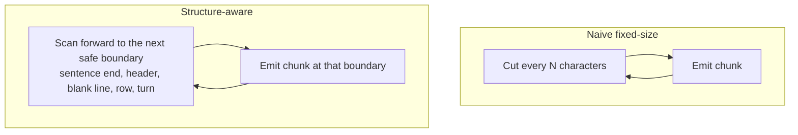
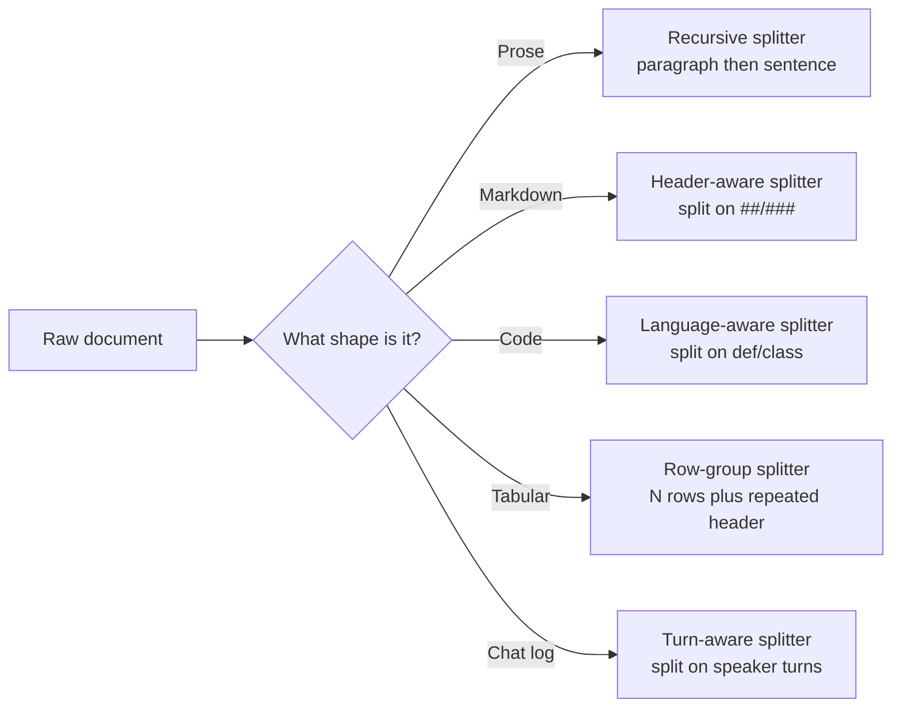

# Chunking by Document Type

*One fixed splitter is fast to ship and works on anything, but it cuts through the headers, functions, rows, and turns that give each document type its meaning.*

◷ 10 min

No single splitter suits every document. Route each document to a splitter that cuts only at that type's safe boundaries, using the size and overlap ideas from [Why Retrieval Needs Chunks](/learn/llm-and-retrieval/chunking-and-indexing/why-retrieval-needs-chunks).

**Objectives:**

- name the safe boundary for prose, Markdown, code, PDFs, HTML, tables, and chat logs;
- explain why a structure-aware splitter produces variable chunk sizes, and why that is correct;
- choose between fixed-size, structure-aware, and semantic chunking for a given corpus;
- detect broken boundaries in production without reading chunks by hand.

---

## Cut at Safe Boundaries, Not Fixed Offsets

A fixed-size splitter counts characters and stops. It has no idea what sits at that position. A structure-aware splitter scans forward to the next safe boundary and cuts there, even if one chunk ends up 76 characters and the next 213.

A cut placed by a counter cannot respect a grammar it never reads. Every document type has places where a cut loses nothing. Prose breaks at a sentence end. Markdown breaks before a new header. Code breaks at a blank line between top-level functions or classes. Tables break at the end of a row, with the header repeated in each chunk. Chat logs break between speaker turns, never mid-turn.

The two approaches share one loop shape: cut, emit a chunk, repeat. Only the stopping rule differs, and that rule decides whether a chunk is clean or broken.

Only the box at the top of each loop differs.

## Read the Lab's Evidence

The chunking lab ran five document types through a naive 130-character splitter and through a structure-aware one.

| Document type | Source length | Naive chunks | Naive broken cuts | Aware chunks | Aware broken cuts |
|---|---|---|---|---|---|
| Prose | 790 chars | 7 | 5 | 6 | 0 |
| Markdown | 675 chars | 6 | 5 | 4 | 0 |
| Code | 703 chars | 6 | 5 | 2 | 0 |
| Tabular | 403 chars | 4 | 3 | 3 | 0 |
| Chat log | 623 chars | 5 | 4 | 4 | 0 |

The naive splitter broke a boundary on 72 to 83% of its cuts, depending on type. The aware splitter broke none. It also produced fewer chunks, not more, because it may run past a fixed offset to reach a real boundary. It never wastes a chunk on a tiny leftover fragment.

## Match the Splitter to Each Type

The chunking reference pairs each type with a boundary priority, a size, an overlap, and a typical failure.

The first question is always the document's shape; the table gives each branch's settings.

| Document type | Boundary priority | Typical size | Overlap | What breaks without it |
|---|---|---|---|---|
| Prose | Paragraph, then sentence, then word | 500–1,000 chars | 10–20% | A chunk ends mid-sentence, so the vector holds half an idea |
| Markdown | Header hierarchy, then characters | 500–800 chars per section | Low | A warning or code sample is separated from the header that explains it |
| Code | Class, then function, then block | 300–800 chars | Small, 20–50 chars | A docstring is returned without its function body |
| PDF | Page, then paragraph, then characters | 500–1,000 chars | 10–20% | Tables flatten and multi-column text comes out in the wrong order |
| HTML | DOM heading, then characters | 500–800 chars | 10–15% | Navigation, footers, and ads are chunked as content |
| Tables and CSV | Row, never split | Rows, not characters (20–50 rows) | About zero | The header is detached from its rows, or a row loses trailing columns |
| Chat logs | Speaker turn | Not given | Not given | A customer's question and the agent's answer land in different chunks |

A few rules sit behind the table. Prose has no markup, so the splitter uses typography as a proxy: blank lines first, then punctuation. The recursive splitter that does this is the right default for genuinely unstructured text, not the wrong one. Markdown headers already encode topic boundaries and ride along as free metadata. A header-only pass can still yield a 5,000-character section, so always chain a size-bounded second pass.

Code needs language-aware separators such as `\nclass ` and `\ndef `. For large files with deep nesting, the reference suggests one chunk per function or class from the parsed syntax tree. HTML must be cleaned first: keep the `<main>` or `<article>` content and drop boilerplate nodes before splitting.

> **Warning: treating a CSV as plain text is the most common chunking mistake.** A character splitter has no concept of a row. It will cut a row at character 500, leaving one chunk with a header and no data and another with data and no header. Chunk tables by row or row group, and store a row id with each.

## Extract PDFs Carefully Before Splitting

A PDF's visual layout does not map to a linear text stream. The splitter sees only the string the loader hands it, so bad extraction produces bad chunks however good the splitter is.

Three habits help. Keep page-number metadata on every chunk; it is the only anchor back to the source when extraction is uncertain. Validate extraction order on multi-column documents, which often interleave columns wrongly. Extract embedded tables separately with a table-aware tool and chunk them as structured rows, not prose. In practice, extraction quality is often a bigger problem than the splitter itself.

## Use Semantic Chunking Where Topics Drift

Semantic chunking cuts where meaning changes rather than where a counter runs out. It embeds consecutive sentences and splits where similarity between neighbours drops below a threshold. Proposition chunking goes further: an LLM rewrites text into single, self-contained factual statements, each embedded separately.

Both cost more. Semantic chunking adds an embedding pass at indexing time; proposition chunking adds LLM calls. Reach for them on long prose where topic shifts do not align with paragraph breaks, such as interviews, meeting transcripts, and legal text. Use them when baseline failures visibly cut through ideas, not by default.

The sources describe a natural path. The RAG fundamentals notes suggest starting with fixed-size chunks for speed and moving to semantic or hierarchical chunking as quality needs grow. The parent document tutorial agrees: when retrieval quality plateaus, the next lever is structure-aware chunking, not a bigger embedding model.

## Route Mixed Documents by Region

Real files mix types. A Markdown page may embed code blocks; a mostly-prose PDF may embed a table. One rule for the whole file fails on the embedded part. Detect each sub-region and apply its own rule locally.

The chunking lab gives a concrete trap. A header-aware splitter sees `##` inside a comment in a fenced code block and treats it as a header. It cuts inside the block, leaving one chunk with an unterminated fence and another with a dangling closing fence. Fix it by tracking whether the parser is inside a fence and suppressing header detection there. Alternatively, protect code blocks first, split the rest, and reinsert them.

## Write One Chunker and Many Parsers

At enterprise scale the input is never uniform Markdown. The FDE Handbook's scaling chapter, planning for 20 million documents, states the rule that generalises. Split on the format's natural unit of meaning, carry its structure into the chunk, and fall back to a fixed-size window only when no structure exists. The format decides where a cut is allowed. Size and overlap decide how big each piece is.

The chapter adds formats the earlier table does not cover.

| Format | Natural unit | What breaks if ignored |
|---|---|---|
| Word documents | Paragraphs, with heading styles mapped to heading levels | Concatenated paragraphs lose the structure; strip tracked changes first |
| Slides | One slide, prefixed with its title, with the speaker notes appended | Orphaned notes lose the slide they explain |
| Email, chat, tickets | One turn, or a question with its resolving answer | A window that cuts a question from its answer is the worst failure for support retrieval |
| Images | Text only after OCR, kept only above a confidence threshold | Charts need multimodal embeddings when the visual structure is the meaning |
| Spreadsheets | Logical row groups, such as an account or a time window | Wide tables flatten to sentences so relationships survive |

Do not write six chunkers. Write one parser per format that produces a common intermediate form: text with its heading hierarchy, or explicit table, slide, or message boundaries. Then send every format through the same heading-aware packer. A new format then costs one parser, not a new chunking strategy.

## Check Boundaries Automatically

Broken boundaries are silent. Nothing throws an error; the model just sees worse text. Build a boundary-integrity check per document type at ingestion. For code, verify that each chunk starts at a `def`, a `class`, or a blank line. For tables, verify that each chunk's column count matches the header.

Track the percentage of chunks failing the check, by document type, and alert on it. A rising rate is often the first sign that a new document type slipped in without a matching splitter rule. The chunking reference calls this drift: a strategy that worked for early documents degrades as, say, more table-heavy filings arrive. Sample chunks for a periodic manual audit as a backstop, not as the main check.

## Worked Example: Insurance Guides and Scanned Policies

An insurance client's knowledge base mixes Markdown underwriting guides with scanned policy PDFs that arrive as raw prose. There is one sprint to ship chunking for both.

Detect the type at ingestion, by file extension or a light structure check. Route the guides to a header-aware splitter followed by a size-bounded pass, so each underwriting rule stays with its header. Route the PDFs to a recursive splitter with page metadata, and check extraction quality before trusting any boundary. Applying one fixed splitter to both would separate header context from the rules and cut PDF prose mid-sentence.

A related question has the same shape. A fintech client has two weeks before launch. Ship fixed-size chunking for genuinely unstructured text first, with monitoring in place. Add structure-aware splitters after launch for the highest-volume or highest-risk types, such as transaction tables and contract clauses. Each custom splitter is one more thing that breaks when a source format changes.

---

## Key Takeaways

- A structure-aware splitter cuts at the next safe boundary, so variable chunk sizes are the expected output.
- In the lab, a naive 130-character splitter broke 72 to 83% of its cuts; the aware splitter broke none and made fewer chunks.
- Each document type has its own boundary, size, and overlap; tables are chunked by row with no overlap.
- PDF extraction quality limits chunk quality, so keep page metadata and extract tables separately.
- Semantic and proposition chunking track meaning at an indexing cost; use them where baseline cuts visibly break ideas.
- Mixed documents need per-region rules, such as fence-aware header splitting.
- At scale, write one parser per format into a common form and share one chunker.
- Broken boundaries are silent, so check them automatically per type and alert on the failure rate.

## Check Yourself

1. **Why does a structure-aware splitter often produce fewer chunks than a fixed-size one?**
   It may run past a fixed offset to reach a real boundary, so it does not waste a chunk on a small leftover fragment.

2. **What goes wrong when a CSV is split with a character-based splitter, and what is the fix?**
   Rows are cut mid-way and headers are separated from data. Chunk by row or row group, repeat the header, and use zero overlap.

3. **How do you notice broken boundaries without reading chunks?**
   Run an automated boundary check per document type at ingestion, track the failure rate by type, and alert when it rises.

## References

**Sources:** `chunking-lab-and-drills.md`: the safe-boundary mechanism, the lab results table, the per-type strategy table, "When to use structure-aware splitting", and interview questions 1, 3, 4, and 5. `chunking-reference-by-doc-type.md`: §3 "Document-Type Breakdown", §4 "Comparison Table", §5 "Decision Framework", §6 (drift), and §7 "Pitfalls and Best Practices Checklist". `Module_01_RAG_Fundamentals_Core_Components.md`: Topic 3 "Fixed-size vs semantic vs hierarchical chunking". `08_advanced_rag_techniques_INTERVIEW_TUTORIAL.md`: §1.3 "Structure-aware chunking". `parent_document_retrieval_INTERVIEW_TUTORIAL.md`: the "Fixed chunk_size vs. structure-aware chunking" trade-off. `06_Scaling_To_20M_Documents.md` (FDE Handbook, cross-cutting concerns): §7 "Chunking by document type".
