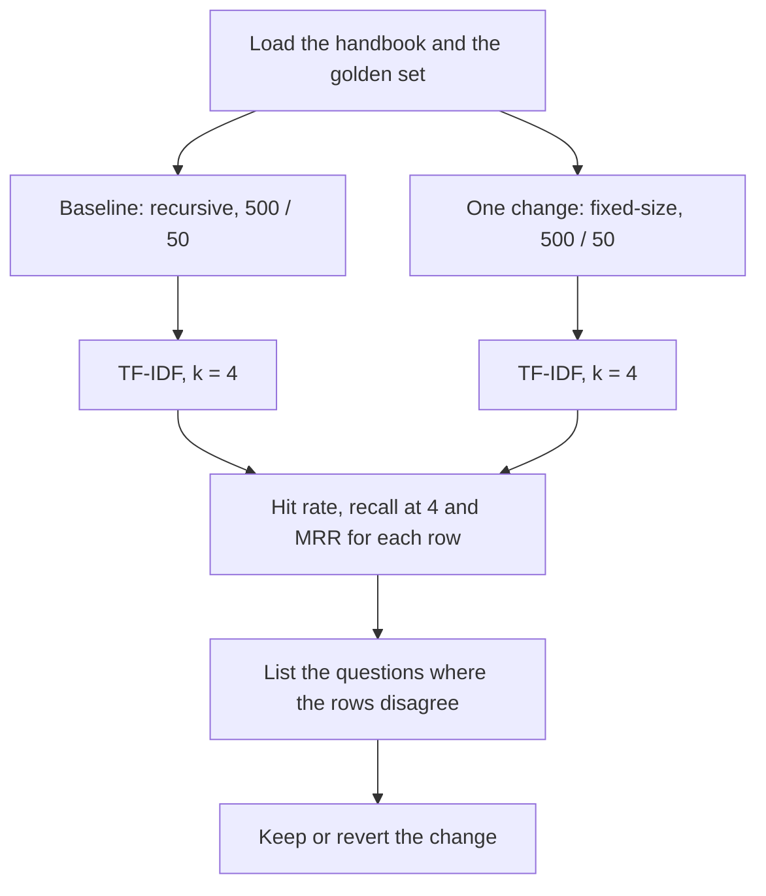

<!-- Generated by site/scripts/rag-theory-import.mjs from rag-agents-engineering. Edit the source there. -->
# Exercise: a measured baseline and two chunkings

## Problem statement

Larkspur Cloud wants its handbook assistant to stop giving half-answers. Before anyone changes the pipeline, you build the retrieval half of the baseline over the handbook, record its recall at k on the golden set, and then test one change: a different way of cutting the text into chunks.

The rule you apply comes from lesson 5 of T5.1: keep a change only if it improves the questions it targets without breaking the others. A higher mean is not enough if one question that used to hit now misses.

## What you will learn

- Record a TF-IDF baseline row at `k = 4` on the 25 scored golden questions.
- Compare a fixed-size split against it while holding everything else fixed.
- Find a boundary cut and quote where the chunk ends.
- Decide whether to keep a change from the per-question rows, not only the means.
- Explain when chunk overlap rescues a cut answer and when it does not.

## Before you start

### Lessons

- [T5.1 Why RAG & the RAG Lifecycle](/learn/llm-and-retrieval/rag-from-first-principles/rag-from-first-principles-overview): lesson 2 of T5.1 [Indexing from scratch with TF-IDF and nearest neighbours](/learn/llm-and-retrieval/rag-from-first-principles/indexing-from-scratch-with-tf-idf-and-nearest-neighbours) for top-k retrieval, and lesson 5 of T5.1 [The RAG lifecycle and a measured baseline](/learn/llm-and-retrieval/rag-from-first-principles/the-rag-lifecycle-and-a-measured-baseline) for hit rate, recall at k, MRR and the baseline loop.
- [T5.3 Chunking Strategies](/learn/llm-and-retrieval/chunking-and-indexing/chunking-and-indexing-overview): lesson 1 of T5.3 [Splitter fundamentals](/learn/llm-and-retrieval/chunking-and-indexing/splitter-fundamentals-character-recursive-token-and-structure-aware) for chunk size, overlap and boundary cuts, and lesson 4 of T5.3 [Choosing chunk size empirically](/learn/llm-and-retrieval/chunking-and-indexing/choosing-chunk-size-empirically-retrieval-quality-faithfulness-latency).

### Dataset

The Larkspur Cloud handbook (13 files) and its 30-question golden set, in [data/](https://github.com/Sourav692/rag-agents-engineering/blob/main/p04_rag_foundations/exercise/data/README.md). 25 questions have evidence spans. The other 5 are out of corpus and are not scored for retrieval.

### Code

`load_handbook`, `load_jsonl`, `tfidf_retriever`, `hit_rate`, `recall_at_k`, `mrr` and `is_hit` from [src/lab_kit.py](https://github.com/Sourav692/rag-agents-engineering/blob/main/src/lab_kit.py), and the splitters from `langchain_text_splitters`.

### Environment

The course's default environment (`uv run jupyter lab`), or Colab after cloning the repository. Everything runs offline: TF-IDF retrieval, no model calls and no API keys.

## Experiment workflow

The corpus, the retriever, `k` and the questions stay fixed. Only the splitter changes between the two main rows.



Extension: a third row, recursive 300 / 0, scored the same way.

## Implementation tasks

### 01 Load the data

Load the handbook and the golden set from `data/larkspur/`.

### 02 Build the baseline row

Split every handbook file with the recursive splitter, build a TF-IDF retriever over the chunks and retrieve for every golden question. Keep the results as a map from question id to the retrieved chunks, in rank order, then score them with `hit_rate`, `recall_at_k` and `mrr`.

```python
RecursiveCharacterTextSplitter(chunk_size=500, chunk_overlap=50)
tfidf_retriever(chunks, k=4)
```

### 03 Change one thing: the splitter

Split the handbook again with a fixed-size split that ignores blank lines, line breaks and spaces. Repeat task 02 with the new chunks: same `k`, same retriever, same questions.

```python
CharacterTextSplitter(separator="", chunk_size=500, chunk_overlap=50)
```

*New here:* lesson 1 of T5.3 describes this behaviour for the pure token splitter, and `separator=""` gives the same cut in characters.

### 04 Read the disagreements

List every question where the two chunkings disagree on a hit. For each one, find the chunk that should have held the evidence and read where it ends.

### 05 Decide

Keep the fixed-size split only if it improves the questions it targets without breaking the others.

### 06 Extension: smaller chunks

Run the recursive splitter at `chunk_size=300` and `chunk_overlap=0` and add it as a third row. This row changes size and overlap together, so it shows the combined effect, not either one alone.

## Record results

| Chunking | Chunks | Hit rate | Recall at 4 | MRR | Questions lost against the baseline |
|---|---|---|---|---|---|
| Recursive 500/50 (baseline) | | | | | none |
| Fixed-size 500/50 | | | | | |
| Recursive 300/0 (extension) | | | | | |

Hit rate asks whether any retrieved chunk held evidence. Recall at 4 is the share of the evidence spans the top 4 covered. MRR is how high the first evidence chunk ranked.

## Done when

- Your table has the baseline row and the fixed-size row, both at `k = 4` on the same 25 questions.
- You can name each question the fixed-size split loses and quote where its chunk is cut.
- You can say which chunking you keep and why, from the per-question rows and not only the means.
- You can explain why a 50-character overlap did not save the lost answer.

## Common mistakes

### Comparing means only

A change can raise the average and still break a question, which is why lesson 5 of T5.1 asks for the per-question rows.

### Changing two things at once

For example the splitter and `k`. Then the row cannot say which change moved it.

### An overlap shorter than the cut

Overlap only rescues a piece of the answer that fits inside it (lesson 1 of T5.3).

### Scoring out-of-corpus questions

The 5 out-of-corpus questions have no evidence spans, and `lab_kit` skips them for retrieval.

## Interview angle

"How would you choose a chunk size for a new corpus?"

Fix a golden set, record a baseline row, change one setting, compare per question, and keep the change only when nothing it did not target gets worse.

## Worked solution

The worked solution is [solution/p04_exercise_solution.ipynb](https://github.com/Sourav692/rag-agents-engineering/blob/main/p04_rag_foundations/exercise/solution/p04_exercise_solution.ipynb) ([open in Colab](https://colab.research.google.com/github/Sourav692/rag-agents-engineering/blob/main/p04_rag_foundations/exercise/solution/p04_exercise_solution.ipynb)). Locally, open it from `exercise/solution/` so `../data/` resolves, and run it top to bottom with the default environment. In Colab, clone the repository first, because the notebook reads the corpus and `src/lab_kit.py` from it.

Our run: scikit-learn 1.9.1 and langchain-text-splitters 1.1.3, offline.

| Chunking | Chunks | Hit rate | Recall at 4 | MRR | Questions lost against the baseline |
|---|---|---|---|---|---|
| Recursive 500/50 (baseline) | 30 | 0.96 | 0.94 | 0.89 | none |
| Fixed-size 500/50 | 29 | 0.92 | 0.90 | 0.82 | g15 |
| Recursive 300/0 (extension) | 50 | 0.92 | 0.84 | 0.82 | g04 |

The fixed-size split loses g15, "How do I rotate an API key without downtime?". Its chunk ends at "…keys can be rotated from Settings, then API keys, without downtime:", and the rest of the answer, that the old key keeps working for 24 hours, starts the next chunk. That is a boundary cut, and the 50-character overlap is shorter than the cut-off piece.

The fixed-size split wins no question back, so it is reverted and recursive 500/50 stays the baseline. Recursive 300/0 loses g04 outright, and finds only one of two evidence spans for g01, g17 and g19, which is why its recall falls further than its hit rate. The baseline row matches the TF-IDF reference in [data/larkspur/README.md](https://github.com/Sourav692/rag-agents-engineering/blob/main/p04_rag_foundations/exercise/data/larkspur/README.md).
