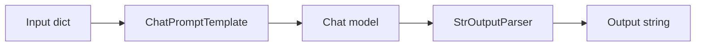
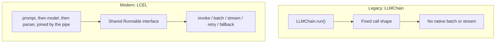
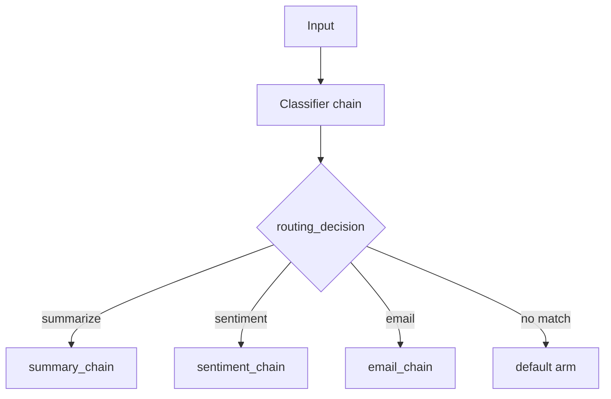
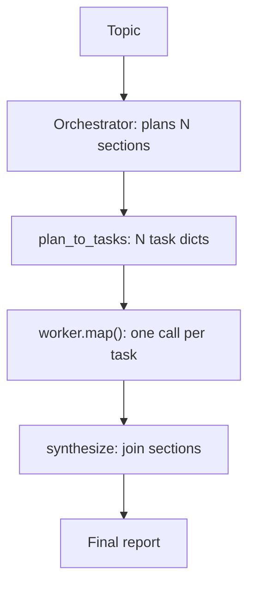

# Composing Pipelines with LangChain

*One shared interface makes every part swappable and every pipeline batchable, but it adds a layer of primitives to learn before the first line of real logic.*

LangChain's value is not the pipe symbol. It is that every part of a pipeline answers the same calls, so a model, a retriever or a parser can be swapped, batched, streamed or retried without special cases. This lesson builds on [What a Framework Buys You](/learn/llm-and-retrieval/langchain-and-langgraph/what-a-framework-buys-you).

**Objectives:**

- trace one RAG request through LangChain's parts;
- explain the `Runnable` interface and LCEL composition;
- choose between parsing output and constraining it, and between routing and fan-out.

---

## Trace One Request Through the Parts

A LangChain RAG pipeline is an assembly line. Each station hands its output to the next.

| Station | Job | Examples from the sources |
|---|---|---|
| Document loaders | Read raw content into `Document` objects: text in `page_content` plus `metadata` | PDFs, web pages, databases, S3, Notion |
| Text splitters | Cut documents into chunks | `RecursiveCharacterTextSplitter`, `TokenTextSplitter` |
| Embedding models | Turn text into vectors behind one interface | OpenAI, HuggingFace, Cohere |
| Vector stores | Save and search vectors, hiding approximate nearest-neighbour search behind `similarity_search` | Pinecone, Weaviate, FAISS, Chroma, Qdrant |
| Retrievers | Add filtering, re-ranking or multi-query expansion on top of a store | Any store-backed retriever |
| Prompt, model, parser | Fill the prompt with chunks and question, call the model, shape the output | `ChatPromptTemplate`, a chat model, an output parser |

At query time one request runs: question, retriever (embed the question, find the top-k chunks), prompt template, model, output parser, answer. How chunking and indexing work underneath is covered in [T2.3 Chunking and indexing](/learn/llm-and-retrieval/chunking-and-indexing).

## Compose With One Interface

LCEL, the LangChain Expression Language, joins parts with the `|` operator. The left side's output becomes the right side's input. The point is the shared `Runnable` interface: every part, and the composite, exposes `invoke` for one input, `batch` for a concurrent list, and `stream` for token-by-token output.



Each arrow is one `|`: the output of one part is the input of the next.

```python
chain = ChatPromptTemplate.from_template("Explain {topic} in 1 line") | chatgpt | StrOutputParser()
chain.invoke({"topic": "Generative AI"})
```

Because every link shares the interface, batching, streaming, retries and fallbacks work on the whole chain. Retrievers follow it too: call `.invoke(query)`. Older code used `.get_relevant_documents()`.

Older LangChain expressed pipelines as chain classes such as `LLMChain`, `SimpleSequentialChain` and `RetrievalQA`. Each hid its steps behind a fixed `.run()` call with no native batching or streaming. Migration is mechanical once each class is read as "prompt, then model, then maybe a parser". `LLMChain(llm=llm, prompt=prompt)` becomes `prompt | llm | parser`. `RetrievalQA` becomes an explicit pipe with the retriever as one step. Read legacy chains; write LCEL.



Moving to the shared interface is what makes batching and streaming work on the whole pipeline.

## Treat Messages and Prompts as Code

Every model call is a list of typed messages, not a string. LangChain's four message classes match the roles a chat API accepts. `SystemMessage` sets behaviour. `HumanMessage` is user input. `AIMessage` is model output and carries any `tool_calls`. `ToolMessage` returns a tool result, keyed by `tool_call_id` to the call that asked for it. An agent's whole state is this growing list, which is why the two identifiers must line up.

A prompt template turns a dictionary of variables into that message list, so prompts are versioned code rather than string concatenation. `MessagesPlaceholder` reserves a slot for a variable-length list, such as chat history, inside an otherwise fixed template. Few-shot templates insert example question and answer pairs before the real question.

Model choice belongs in configuration. `init_chat_model("provider:model")` returns the same interface for any vendor. A provider outage or price change then becomes a one-line configuration change rather than a refactor. Use a direct provider class only when a provider-specific constructor argument is needed.

## Constrain Output Rather Than Parse It

Free text must be re-parsed before code can trust it. Parsers such as `StrOutputParser`, `JsonOutputParser` and `PydanticOutputParser` extract structure after the model has answered. A malformed response is a separate, parse-time failure. `with_structured_output(Schema)` instead constrains the model's own decoding, through tool calling or JSON mode, and returns a validated object.

Constrain when the provider supports it, which most do. Parse when it does not, or when the raw text must be kept alongside the parsed object. The failure shrinks from "the model forgot to close a brace" to "the schema does not fit the answer".

## Separate Routing From Fan-Out

Real pipelines branch. `RunnableParallel` runs several chains on the same input at once and returns a dictionary of results. `RunnablePassthrough.assign` carries the input forward while adding a key. `RunnableBranch` checks condition and runnable pairs in order and runs the first match. It has no implicit `else`, so the default arm is required, and the most specific condition must come first.



Exactly one arm runs, and the default arm catches anything unmatched.

Routing and fan-out look alike and need different primitives. A branch picks one of N known paths and runs it once. Fan-out runs an unknown number of copies of one path. The LangChain notebooks stage the mistake on purpose: a five-section plan fed into a `RunnableBranch` printed "big-report branch ran ONCE". The fix is `.map()`, which turns any runnable into one that accepts a list and runs once per element, concurrently. An orchestrator decides how many sections exist; `worker.map()` writes them; a synthesis step joins them.



The orchestrator decides N at runtime, and `.map()` runs the worker once per task.

Two more patterns reuse the same pieces. An evaluator-optimizer loop drafts, grades the draft with structured output, and feeds the feedback back in, always under a hard iteration cap such as `MAX_ITERATIONS = 5`. Map-reduce summarisation splits text that does not fit one context window, summarises each chunk with `.batch()`, then summarises the summaries. "Stuff" summarisation, one call over everything, is simpler and breaks once the text exceeds the window.

> **Warning: `RunnableBranch` is not a loop.** It runs exactly one matched branch, once, whatever the input contains. A plan whose length is only known at runtime needs `.map()`, not a branch with a length check.

## Worked Example: A Multilingual Ticket Pipeline

The LangChain interview tutorial's mock design triages tickets in four languages. Detect the language, classify the intent, route, then draft and translate back. In LCEL that is `detect_language_chain | RunnablePassthrough.assign(intent=classifier_chain) | RunnableBranch(...)`, and each step is its own `prompt | llm | StrOutputParser()`.

The router names `refund`, `account_closure` and `general`, with `general` as the required default, so an unrecognised intent never falls through silently. Swapping the classifier's model is a configuration string. Running a morning backlog is `.batch()` on the same chain. Nothing in the pipeline needed special code for any of that, which is exactly what one shared interface buys.

---

## Key Takeaways

- A RAG request runs loader, splitter, embedder, store, retriever, prompt, model and parser, each a swappable station.
- LCEL's value is the shared `Runnable` interface: `invoke`, `batch` and `stream` work on any part and on the whole chain; legacy chain classes migrate mechanically.
- Messages are typed, prompts are templates, and the model is chosen by a configuration string.
- Constrain output with `with_structured_output` when the provider allows it; parse after the fact when it does not.
- Route with `RunnableBranch` to pick one known path; fan out with `.map()` when the number of copies is data.

## Check Yourself

1. **What does LCEL give a chain beyond shorter syntax?**
   One interface across every part, so `batch`, `stream`, retries and fallbacks work on the composite without special-casing what is inside it.

2. **When would you still use `PydanticOutputParser` over `with_structured_output`?**
   When the provider lacks tool-calling or JSON-mode support, or the raw text must be kept alongside the parsed object.

3. **An orchestrator plans a variable number of report sections. Which primitive writes them, and why not `RunnableBranch`?**
   `.map()` on the worker, which runs once per list element. `RunnableBranch` picks one runnable and runs it once, so a five-section plan would produce one output.

