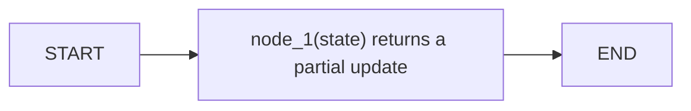
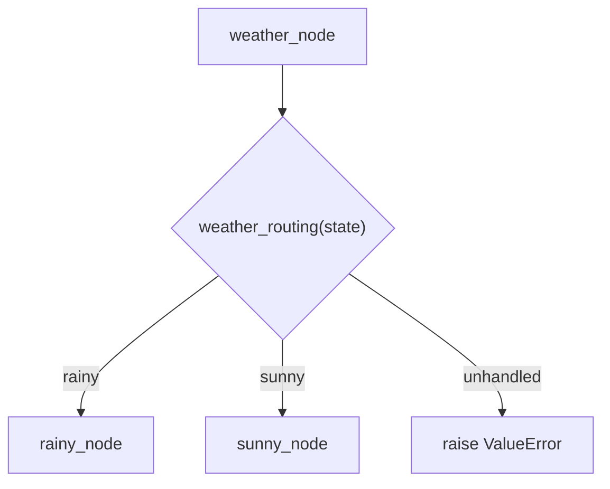
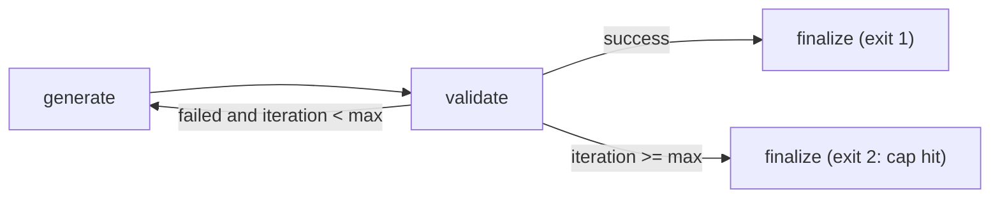
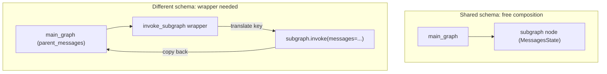

# Modelling Workflows as State Graphs

*An explicit graph makes branches, loops and state inspectable, but every field's merge rule and every loop's exit must now be declared rather than assumed.*

A chain is a straight line, and real workflows are not. LangGraph replaces an implicit call stack with an explicit data structure of state, nodes and edges; [What a Framework Buys You](/learn/llm-and-retrieval/langchain-and-langgraph/what-a-framework-buys-you) covers when that trade is worth making.

**Objectives:**

- build a graph from state, nodes and edges;
- choose a reducer per state field and a schema style per graph;
- route with conditional edges and guard every cycle.

---

## Start From the Three Primitives

A LangGraph application has three parts. State is the shared data every step reads and writes. Nodes are plain Python functions that transform it. Edges decide the order in which nodes run.



Even the smallest graph names its start and end explicitly.

```python
builder = StateGraph(State)
builder.add_node("node_1", node_1)
builder.add_edge(START, "node_1")
builder.add_edge("node_1", END)
graph = builder.compile()
```

A node returns only the fields it wants to change, a partial update. LangGraph merges that update into the shared state. `compile()` turns the builder into a runnable with the same `invoke` and `stream` calls as any LangChain runnable.

A chain struggles with five things a graph handles naturally: branching on a result, loops and retries, state that builds across steps, pauses for a human, and parallel steps. Those are the reasons to reach for a graph.

## Declare How Each Field Merges

A reducer decides how a node's returned value merges into existing state. With no reducer, the default is last write wins: a later node's value replaces the field. That default silently erases data. In the LangGraph notebooks, a three-node chain where each node returned `{"messages": "..."}` ended with only the last string; the user's original input was gone.

Opt into accumulation per field with `Annotated[type, reducer]`. `Annotated[list, add_messages]` appends chat messages; `Annotated[list, operator.add]` appends to any list. A counter with no reducer overwrites, which is exactly what a counter wants. One state object can mix both behaviours.

```python
class AgentState(TypedDict):
    messages: Annotated[list, add_messages]   # appends
    iterations: int                            # overwrites
```

## Choose a Schema for the Boundary

State can be a `TypedDict` or a Pydantic `BaseModel`. `TypedDict` annotations are documentation only. In the notebooks, `invoke({"name": 123})` ran every node and failed only when one tried to add a string to an integer, deep inside node logic. A `BaseModel` raises a `ValidationError` at `invoke`, before any node runs. Use `TypedDict` for internal graphs whose every input the team controls; switch to Pydantic once input comes from a user or an API.

A single schema also leaks bookkeeping. Every scratch field becomes part of what callers send and receive. Split the schemas: `StateGraph(state_schema=OverallState, input_schema=InputState, output_schema=OutputState)` keeps a private field such as `llm_calls` out of the public contract.

Per-request settings that should never be checkpointed, such as a user id or a feature flag, travel separately. A node can declare a `Runtime[ContextSchema]` parameter and read `runtime.context.user_id`. The sources disagree on one detail: the tutorial's self-check lists `config["configurable"]` as an acceptable home, while its gotchas section says `configurable` is reserved for the checkpointer's own `thread_id` and `checkpoint_id`. Follow the gotcha and use `context=`.

## Route With Conditional Edges

A conditional edge calls a routing function after a node runs. The function reads state and returns the name of the next node, which must match a registered node exactly.



The routing function's return value picks the next node, and an unhandled value raises.

```python
graph_builder.add_conditional_edges("weather_node", weather_routing, ["rainy", "sunny"])
```

Any decision can drive the branch: a business rule, a regular expression, or a model's classification. When a model routes, constrain its output to a schema with fixed categories, such as `Literal["billing", "technical", "general"]`, so the edge trusts a typed field instead of parsing free text. Route on an existing field when the signal already exists as clean data, because a classifier costs a model call on every request. An unhandled case should raise loudly rather than fall through.

`Command` is the alternative when the update and the routing decision come from the same logic. A node returns `Command(update={...}, goto="warn_user")`, and the type hint `Command[Literal["warn_user", "success"]]` documents every possible destination. No separate edge function is needed for that transition.

## Guard Every Cycle

A cycle is a conditional edge whose "not done" branch points back to a node already visited. The same shape drives retry-until-valid, such as generate, validate and loop on a failing test, and iterative refinement, such as research, generate questions and loop deeper. The interesting engineering is entirely in the guard.



Two exits leave the loop, and only one of them means success.

```python
def should_continue(state) -> Literal["generate", "end"]:
    if state["success"]:
        return "end"
    elif state["iteration"] >= state["max_iterations"]:   # the guard
        return "end"
    return "generate"
```

If a validator exists, loop on pass or fail plus a cap. If none exists, as in open-ended research, loop on a depth counter alone.

> **Warning: the recursion limit is a backstop, not a guard.** LangGraph raises `GraphRecursionError` after about 25 super-steps by default. Raising the limit only delays the same failure. Check an iteration counter in the routing function itself, alongside the success condition.

## Compose Graphs From Graphs

A compiled graph can be a node in a parent graph. When parent and child share key names, for example both use `MessagesState`, `add_node("subgraph", subgraph)` works with no glue. When the parent's key is named differently, the subgraph silently sees nothing. Write one wrapper node that calls `subgraph.invoke(...)` with translated keys and copies the result back. That wrapper is the whole integration cost of a reusable subgraph.



The wrapper is needed only when key names differ.

## Worked Example: A Self-Correcting RAG Graph

The GenAI Engineering notes sketch a RAG graph that checks its own work. Its nodes are `retrieve`, `evaluate_retrieval`, `rewrite_query`, `generate` and `evaluate_answer`.

Start at `retrieve`, then `evaluate_retrieval`. A conditional edge checks the retrieval score: if it is low and retries remain, go to `rewrite_query` and back to `retrieve`; otherwise go to `generate`. After `generate`, `evaluate_answer` checks faithfulness. If it is low and retries remain, loop back to `generate` with a stricter prompt; otherwise finish at `END`.

State carries the query, the retrieved chunks, the answer and a `retry_count`, which is what ends both loops. Multi-hop questions fit the same mould: decompose into sub-questions, retrieve for each, synthesise. Every behaviour the flowchart promised, two backward arrows and two decision diamonds, is an edge or a field the graph declares and a reviewer can read.

---

## Key Takeaways

- A graph is state, nodes returning partial updates, and edges; it handles branches, loops, shared state, pauses and parallel steps that a chain cannot.
- Fields overwrite by default; declare `add_messages` or `operator.add` where data must accumulate.
- Use Pydantic state at external boundaries, split input and output schemas, and pass per-request settings as runtime context.
- Conditional edges map state to a node name; `Command` combines update and routing; typed classifier output makes model-driven routing safe.
- Every cycle needs its own iteration guard; the recursion limit only backs it up.
- Subgraphs compose freely when key names match and need one wrapper node when they do not.

## Check Yourself

1. **Three sequential nodes each return `{"messages": ...}` and only the last survives. Why, and what is the fix?**
   The field has no reducer, so each update overwrites. Annotate it as `Annotated[list, add_messages]`.

2. **A self-correcting loop never ends on tasks that can never pass. What is missing?**
   An iteration cap checked in the same routing function that checks success. The recursion limit is only a backstop.

3. **Where should a per-request user id live so nodes can read it but it is never checkpointed?**
   In runtime context, passed with `context=` and read through a typed `Runtime[ContextSchema]` parameter, not in state or in `configurable`.

