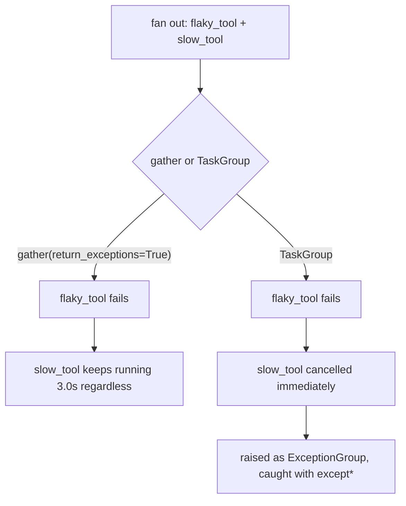

# Retries, Fan-Out, and Streaming

*Retrying, parallelising and streaming make a pipeline feel fast and resilient, but each one multiplies side effects, cost or failure surface when it is applied without a scope.*

A pipeline that works once in a notebook is not a production pipeline. Both frameworks ship primitives for retries, fallbacks, parallel work and streaming, and each has one trap that the sources demonstrate on purpose.

**Objectives:**

- scope retries and fallbacks to the failures they can fix;
- fan out work and decide what happens when one branch fails;
- stream output at the right granularity, and trace it.

---

## Retry Only the Failure You Expect

LangChain wraps any runnable with `.with_retry(...)` and `.with_fallbacks([...])`. A retry re-invokes on a matching exception. A fallback runs an alternative runnable only after retries are exhausted, so a hard failure degrades instead of raising.

```python
safe_extract = (...).with_retry(
    retry_if_exception_type=(KeyPointsRejected,),
    stop_after_attempt=3,
    wait_exponential_jitter=False,   # no backoff: the gate is not rate-limited
).with_fallbacks([RunnableLambda(fail_validation)], exceptions_to_handle=(KeyPointsRejected,))
```

Scope the retry with a custom exception, not a bare catch. A quality gate rejecting vague output is a different failure from a rate limit. Retrying a validation error like a network error only adds latency to something that will never succeed. Note that `stop_after_attempt=3` counts the first attempt, so it means three tries in total. Jitter defaults on, and the notebook turns it off because the failure is business logic, not rate limiting.

`.with_retry()` re-runs the whole wrapped runnable, not just the step that raised. In the notebooks, an attempt log upstream of the validation step grew on every retry. Any upstream side effect, a database write or a webhook, repeats too. Make such steps idempotent first, or wrap only the step that can fail.

LangGraph attaches retries per node with `RetryPolicy`. On a matching exception it waits `initial_interval * backoff_factor^attempt`, capped at `max_interval`, and retries up to `max_attempts` times. `retry_on` scopes it to named exception types. Keep `jitter=True` where many callers might fail together. Without jitter, every caller retries at the same instant and floods the service again.

## Stop Calling a Service That Is Down

Retries assume the next call might succeed. A circuit breaker assumes it will not, for a while. It is a three-state machine. Closed lets calls through. Too many failures trip it open, and calls are rejected immediately without touching the service. After `recovery_timeout`, half-open lets one probe through to test recovery.

The breaker trades a slow failure for a fast one. Once open, calls fail in microseconds instead of waiting out a timeout, which protects the caller's latency budget and the struggling service. The reference implementation has a flaw the notebooks call out: one successful probe resets the failure count to zero. Against a flapping service, track a rolling failure rate instead.

A fallback chain tries models in priority order and caches successful responses so a repeated query returns for free. Fallbacks have a cost too. A cheaper fallback model can give a materially different answer silently, and the caller cannot tell which model served it.

| Option | Costs | Buys | Pick when |
|---|---|---|---|
| `RetryPolicy` or `.with_retry()` | No memory that a service is down | Almost no code | Transient, independent failures: timeouts, rate limits |
| Circuit breaker or fallback chain | State-machine or chain logic to maintain | Stops hammering a dead service; degrades to another model | A dependency can stay down, or a fallback is worth trying |

## Decide What a Failed Branch Does to the Rest

Independent work should run concurrently. Three lookups awaited one after another cost the sum of their latencies. Run together with `asyncio.gather`, they cost roughly the slowest one. The notebook measured about 15 seconds for a sequential five-step agent against roughly one step's time with fan-out. The planning and summarising calls stay sequential because each depends on the previous output. Cap unbounded fan-out with a `Semaphore`, or the provider's rate limit will cap it for you.

The real design question is what one failure does to its siblings, and each primitive answers differently.



`gather` lets the slow sibling finish; `TaskGroup` cancels it at once.

| Primitive | When one item fails |
|---|---|
| LangChain `.map()` | The whole call raises; the successful results are lost |
| LangChain `.batch(inputs, return_exceptions=True)` | The exception takes the failed item's place; the rest are kept |
| `asyncio.gather(..., return_exceptions=True)` | Siblings keep running to completion; nothing tells them to stop |
| `asyncio.TaskGroup` (Python 3.11+) | Every sibling is cancelled at once; failures surface as an `ExceptionGroup` caught with `except*` |

In the notebooks, `flaky.map().invoke([0, 1, 2])` raised `ZeroDivisionError` and discarded `"ok-0"` and `"ok-2"`. With `gather`, a three-second `slow_tool` kept running after a sibling failed at 0.3 seconds. Use `.batch(return_exceptions=True)` when partial results are acceptable. Use `TaskGroup` for real tool calls, where "still running" can mean "still charging the API".

Inside a LangGraph graph, the `Send` API fans a variable number of parallel invocations of one node out, and a reducer on the shared field merges their results.

> **Warning: a demo that never runs concurrently hides the production failure.** The LangChain notebooks build every chain synchronously and never call `ainvoke`, `astream` or `abatch`. A concurrent server needs the async variants, because the synchronous API blocks for the whole of each model call.

## Stream at the Granularity the User Needs

Streaming shows output as it is generated, which cuts perceived latency even when total time is unchanged. Every LCEL chain and every `create_agent` agent exposes `.stream()`, and every part has an async `a`-prefixed twin. In a web API, return a FastAPI `StreamingResponse` with `text/event-stream`, server-sent events.

Only the model's tokens stream. Retrieval and reranking happen first and cannot. Send a "Searching documents..." message while retrieval runs, then start streaming tokens.

LangGraph streams at three granularities. `stream_mode="messages"` yields individual tokens, which suits a typing effect; chunks support `+` to reassemble a full message. `stream_mode="updates"` yields one dictionary per finished node, which suits a progress display such as "searching knowledge base". `stream_mode="values"` yields full state after every step. Converting a node to `async def` with `await model.ainvoke(...)` is the only change needed for non-blocking runs; the graph's structure stays the same.

## Trace Every Run

LangSmith traces every LangChain runnable once `LANGSMITH_TRACING=true` and an API key are set in the environment. Tracing needs no change to the chain, which is what makes it safe to switch on in production. Name and tag runs through the call configuration, for example `run_name`, `tags` and `metadata={"user_id": ...}`, so a trace is searchable rather than a wall of spans.

One quiet risk sits beside tracing. In a notebook, ending a cell with a bare `create_agent` object renders the graph through `draw_mermaid_png()`, which posts the graph structure to a public rendering service. Print `agent.get_graph().nodes`, or use `draw_mermaid()` for text, wherever an unexpected outbound call is unacceptable.

## Worked Example: A Triage Pipeline Under Load

The LangChain tutorial's mock design must triage tickets at a p95 latency under three seconds. Its budget is roughly 200 ms for language detection, 300 ms for classification, 1.5 s for drafting and 500 ms for back-translation. Drafting dominates, so stream it to cut perceived latency.

Wrap every model-calling step with `.with_retry(retry_if_exception_type=(RateLimitError,), stop_after_attempt=3)`. Add `.with_fallbacks([secondary_provider_chain])` to the classifier, the one step that must never strand a ticket. Process bursts with `.batch()` and a `max_concurrency` cap sized to the provider's rate limit, or move to an async endpoint calling `ainvoke` per ticket. Tag each trace with the ticket id and intent so a bad triage leads straight to the step that caused it. Each primitive in this lesson appears once, scoped to the one failure it can fix.

---

## Key Takeaways

- Scope retries to the exception they can fix; `.with_retry()` re-runs the whole wrapped chain, so upstream side effects must be idempotent.
- A circuit breaker turns slow failures into fast ones; a fallback chain degrades to another model but can change answers silently.
- Choose the fan-out primitive by its failure behaviour: `.map()` loses everything, `.batch(return_exceptions=True)` keeps partials, `TaskGroup` cancels siblings.
- Stream only model tokens, pick `messages`, `updates` or `values` by what the user needs, and use async calls in concurrent servers.
- Trace through environment configuration and tags, and avoid notebook renders that call out to the network.

## Check Yourself

1. **A retried chain duplicates a webhook on every attempt. Why, and how is it fixed without disabling retries?**
   `.with_retry()` re-runs the whole wrapped chain from the start, including the webhook upstream of the failing step. Make the webhook idempotent, or wrap only the step that can fail.

2. **One worker in a ten-way `.map()` fan-out throws. What happens to the other nine?**
   Their results are lost, because `.map()` raises on the first exception. Use `.batch(inputs, return_exceptions=True)` if partial results are acceptable.

3. **A support team wants to see agent progress live, not a token stream. Which stream mode?**
   `stream_mode="updates"`, which yields one update per finished node, so the display shows each named step as it completes.

