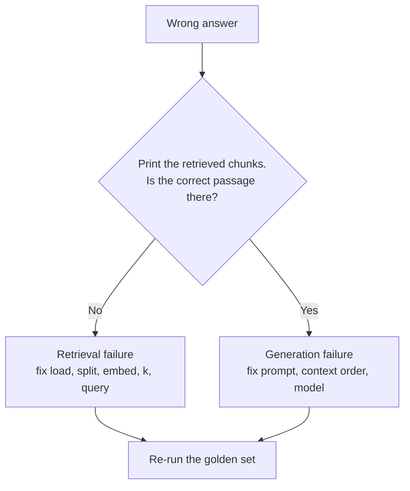

<!-- Generated by site/scripts/rag-theory-import.mjs from rag-agents-engineering. Edit the source there. -->
# The RAG lifecycle and a measured baseline

*Notebooks on GitHub: [RAG lifecycle and baseline](https://github.com/Sourav692/rag-agents-engineering/blob/main/course/p04_rag_foundations/m11_rag_lifecycle/notebooks/05a_rag_lifecycle_and_baseline.ipynb)*

## Indexing vs retrieval vs generation

The lifecycle has seven steps in two phases. Each step has one job and one typical failure.

| Phase | Step | Job | Typical failure | Fixed in |
|---|---|---|---|---|
| Indexing | Load | Turn files into `Document`s with metadata | Garbled PDF text, missing metadata | [T6.1](/learn/ingestion-and-indexing-pipeline/document-ingestion-and-metadata-design/document-ingestion-and-metadata-design-overview) |
| Indexing | Split | Cut documents into retrievable chunks | A fact split across two chunks | [T6.2](/learn/ingestion-and-indexing-pipeline/chunking-and-indexing/chunking-and-indexing-overview) |
| Indexing | Embed | Turn each chunk into a vector | Model cannot tell paraphrases apart, or blurs exact codes | [T6.3](/learn/ingestion-and-indexing-pipeline/embeddings-and-model-selection/embeddings-and-model-selection-overview) |
| Indexing | Store | Index vectors for nearest-neighbour search | Chunk count ≠ vector count; no metadata filters | [T6.4](/learn/ingestion-and-indexing-pipeline/vector-stores-and-index-operations/vector-stores-and-index-operations-overview) |
| Query | Retrieve | Return the top-k chunks with scores | Evidence ranked below the cut-off, or not at all | [T7.1](/learn/retrieval-quality-engineering/retrieval-hybrid-rerank/retrieval-hybrid-rerank-overview) to [T7.3](/learn/retrieval-quality-engineering/post-retrieval-optimisation-and-reranking/post-retrieval-optimisation-and-reranking-overview) |
| Query | Augment | Format the chunks into the prompt | Sources dropped, so no citations | [T8.1](/learn/complete-rag-applications/end-to-end-rag-systems/end-to-end-rag-systems-overview) |
| Query | Generate | Answer from the supplied context | Ignores the evidence, or answers beyond it | [T8.1](/learn/complete-rag-applications/end-to-end-rag-systems/end-to-end-rag-systems-overview), [T10.1](/learn/agentic-and-self-correcting-rag/agentic-rag-foundations-grading-and-query-rewriting/agentic-rag-foundations-grading-and-query-rewriting-overview) and [T10.2](/learn/agentic-and-self-correcting-rag/self-correcting-rag-crag-and-self-rag/self-correcting-rag-crag-and-self-rag-overview) |

When an answer is wrong, one question tells you which half to debug:



Tuning the prompt cannot fix a retrieval failure, because the model never saw the evidence. Lesson 5 of T5.1's notebook prints chunks with their scores (`similarity_search_with_score`) for this check.

## Baseline-first optimisation

Every later module in this course changes one stage of the pipeline: chunking, embeddings, hybrid search, reranking, query rewriting. Without a baseline, you cannot tell whether a change helped, hurt, or only moved the failure to another question.

The method:

1. **Fix a golden set.** 20 to 50 real questions, each with its evidence chunks and a reference answer. Freeze it, and add questions when production shows a new failure.
2. **Build the plain pipeline.** Default loader, recursive splitter, one embedding model, top-k similarity, a simple prompt.
3. **Record the baseline row.** Retrieval metrics (recall@k, hit rate, MRR), answer metrics (correctness, faithfulness), latency and cost per question.
4. **Change one stage, re-run, compare.** Keep the change only if the row improves on the questions it targets without breaking the others.

```animated
<figure class="anim sheet" aria-labelledby="anim-baseline-cap">
  <div class="anim__canvas" tabindex="0" aria-label="The baseline loop, scrolls sideways on a narrow screen">
    <svg viewBox="0 0 880 340" role="img" aria-labelledby="anim-baseline-title anim-baseline-desc">
      <title id="anim-baseline-title">Baseline-first optimisation</title>
      <desc id="anim-baseline-desc">A golden set runs through the plain pipeline to give the baseline row, recall@2 0.50 and precision@2 0.50. Raising k to 5 and re-running gives recall@5 0.50 and precision@5 0.20, which is worse, so the change is reverted. A change that beats the baseline with no regressions is kept and becomes the new baseline.</desc>
      <defs>
        <marker id="ah-bl" viewBox="0 0 8 8" refX="7" refY="4" markerWidth="8" markerHeight="8" markerUnits="userSpaceOnUse" orient="auto-start-reverse"><path class="ah" d="M0 0 L8 4 L0 8 z"/></marker>
      </defs>

      <g class="n-1">
        <path class="box" d="M30 36 a80 10 0 0 0 160 0 v52 a80 10 0 0 1 -160 0 z"/>
        <ellipse class="box" cx="110" cy="36" rx="80" ry="10"/>
        <text class="label" x="110" y="64">Golden set</text>
        <text class="small" x="110" y="82">3 questions</text>
      </g>
      <path class="edge e-2" d="M110 98 V125" marker-end="url(#ah-bl)"/>
      <g class="n-2"><rect class="box" x="30" y="128" width="160" height="44"/><text class="label" x="110" y="150">Plain pipeline</text></g>
      <path class="edge e-2" d="M110 172 V201" marker-end="url(#ah-bl)"/>
      <g class="n-2 n-6">
        <rect class="box" x="20" y="204" width="220" height="76"/>
        <text class="small" x="130" y="222">Baseline row</text>
      </g>
      <g class="in-2">
        <text class="fig" x="130" y="246">recall@2 0.50</text>
        <text class="fig" x="130" y="266">precision@2 0.50</text>
      </g>

      <path class="edge e-3" d="M240 230 C272 230 268 62 297 62" marker-end="url(#ah-bl)"/>
      <g class="n-3">
        <rect class="box" x="300" y="40" width="160" height="56"/>
        <text class="label" x="380" y="60">Change one stage</text>
      </g>
      <text class="fig in-3" x="380" y="82">k: 2 to 5</text>

      <path class="edge e-4" d="M460 62 H537" marker-end="url(#ah-bl)"/>
      <g class="n-4"><rect class="box" x="540" y="40" width="160" height="44"/><text class="label" x="620" y="62">Re-run golden set</text></g>
      <g class="in-4">
        <text class="fig" x="790" y="54">recall@5 0.50</text>
        <text class="fig" x="790" y="74">precision@5 0.20</text>
      </g>

      <path class="edge e-5 e-6" d="M620 84 V151" marker-end="url(#ah-bl)"/>
      <g class="n-5 n-6">
        <path class="box" d="M620 154 L690 190 L620 226 L550 190 Z"/>
        <text class="small" x="620" y="183">Better, no</text>
        <text class="small" x="620" y="199">regressions?</text>
      </g>

      <path class="edge e-5" d="M550 190 C505 190 505 282 463 282" marker-end="url(#ah-bl)"/>
      <text class="small" x="522" y="230">No</text>
      <g class="n-5"><rect class="box" x="300" y="260" width="160" height="44"/><text class="label" x="380" y="282">Revert</text></g>
      <path class="edge e-5" d="M380 260 V99" marker-end="url(#ah-bl)"/>
      <text class="small in-5" x="522" y="246">precision fell</text>

      <path class="edge e-6" d="M620 226 V257" marker-end="url(#ah-bl)"/>
      <text class="small" x="638" y="244">Yes</text>
      <g class="n-6"><rect class="box" x="560" y="260" width="120" height="44"/><text class="label" x="620" y="282">Keep</text></g>
      <path class="edge e-6" d="M620 304 V324 H130 V283" marker-end="url(#ah-bl)"/>
      <text class="small in-6" x="470" y="316">becomes the new baseline</text>

      <circle class="tok" cx="0" cy="0" r="7"/>
    </svg>
  </div>
  <div class="anim__controls" hidden>
    <button class="anim__btn" type="button" data-act="prev">Previous</button>
    <button class="anim__btn" type="button" data-act="play" aria-pressed="false">Play</button>
    <button class="anim__btn" type="button" data-act="next">Next</button>
  </div>
  <ol class="anim__steps" id="anim-baseline-cap">
    <li><button type="button" data-tok="30,36">Golden set</button><span>Freeze a golden set. The lab’s has three questions, each with two evidence chunks.</span></li>
    <li><button type="button" data-tok="20,204">Baseline</button><span>Run the plain pipeline over it and record the baseline row: recall@2 0.50, precision@2 0.50.</span></li>
    <li><button type="button" data-tok="300,40">Change</button><span>Change one stage. Here, raise k from 2 to 5.</span></li>
    <li><button type="button" data-tok="540,40">Re-run</button><span>Re-run the golden set: recall@5 0.50, precision@5 0.20.</span></li>
    <li><button type="button" data-tok="300,260">Compare</button><span>Compare with the baseline. Recall did not move and precision fell, so revert.</span></li>
    <li><button type="button" data-tok="560,260">Keep</button><span>A change that beats the row on the questions it targets, and breaks none, is kept and becomes the new baseline.</span></li>
  </ol>
</figure>
```

At `k = 2` the [top-k lab](/labs/rag/m11_rag_lifecycle/top-k-retrieval-lab.html)'s baseline row is mean recall@2 = 0.50 and mean precision@2 = 0.50. That number already points at the next modules: the export question is solved, the refund question needs better term matching ([T6.3](/learn/ingestion-and-indexing-pipeline/embeddings-and-model-selection/embeddings-and-model-selection-overview), [T7.1](/learn/retrieval-quality-engineering/retrieval-hybrid-rerank/retrieval-hybrid-rerank-overview)), and the outage question needs paraphrase-aware retrieval ([T6.3](/learn/ingestion-and-indexing-pipeline/embeddings-and-model-selection/embeddings-and-model-selection-overview), [T7.2](/learn/retrieval-quality-engineering/query-transformation-and-routing/query-transformation-and-routing-overview)).

The lifecycle notebook ends with the map from symptom to module:

| What you observe | Likely cause | Where it is fixed |
|---|---|---|
| Question worded unlike the documents; evidence never retrieved | Vocabulary mismatch | [T6.3](/learn/ingestion-and-indexing-pipeline/embeddings-and-model-selection/embeddings-and-model-selection-overview) embeddings, [T7.2](/learn/retrieval-quality-engineering/query-transformation-and-routing/query-transformation-and-routing-overview) query transformation |
| Exact codes or names missed (`ORD-88213`) | Dense retrieval blurs rare tokens | [T7.1](/learn/retrieval-quality-engineering/retrieval-hybrid-rerank/retrieval-hybrid-rerank-overview) hybrid search |
| Half an answer; one fact found, another missed | Question needs several chunks | [T7.2](/learn/retrieval-quality-engineering/query-transformation-and-routing/query-transformation-and-routing-overview) query decomposition |
| Evidence retrieved but ranked low | Ranking noise | [T7.3](/learn/retrieval-quality-engineering/post-retrieval-optimisation-and-reranking/post-retrieval-optimisation-and-reranking-overview) reranking |
| Retrieved chunk holds half the fact | Chunk boundary | [T6.2](/learn/ingestion-and-indexing-pipeline/chunking-and-indexing/chunking-and-indexing-overview) chunking |
| Answer contradicts the retrieved chunk | Generation | [T8.1](/learn/complete-rag-applications/end-to-end-rag-systems/end-to-end-rag-systems-overview) per-claim citations, [T10.2](/learn/agentic-and-self-correcting-rag/self-correcting-rag-crag-and-self-rag/self-correcting-rag-crag-and-self-rag-overview) Self-RAG |

## Key Takeaways

- RAG runs in two phases: indexing (load, split, embed, store) and query (retrieve, augment, generate). Each step has one job and one typical failure.
- Debug a wrong answer by printing the retrieved chunks first. If the evidence is missing, no prompt change can help.
- Freeze a golden set of 20 to 50 questions, record a baseline row, and keep a change only when it helps its target questions without breaking others.

## Check yourself

<details>
<summary>1. An answer is wrong. What one check tells you whether to debug retrieval or generation?</summary>

Print the retrieved chunks and look for the correct passage. If it is missing, retrieval failed: fix loading, splitting, embedding, `k` or the query. If it is there, generation failed: fix the prompt, the context order or the model.

</details>

<details>
<summary>2. A teammate rewrites the prompt and the refund question is still wrong. The refund chunk never appears in the top-k. Why did the rewrite not help?</summary>

The model never saw the evidence, so no prompt can make it use that evidence. This is a retrieval failure. The refund question needs better term matching ([T6.3](/learn/ingestion-and-indexing-pipeline/embeddings-and-model-selection/embeddings-and-model-selection-overview) embeddings, [T7.1](/learn/retrieval-quality-engineering/retrieval-hybrid-rerank/retrieval-hybrid-rerank-overview) hybrid search), measured against the golden set.

</details>

<details>
<summary>3. A new chunking strategy lifts recall@2 on two questions and breaks a third. Do you keep it?</summary>

Not as it stands. The loop keeps a change only when the row improves on the questions it targets without breaking the others. Revert it, or fix the regression and re-run the golden set before it becomes the new baseline.

</details>
