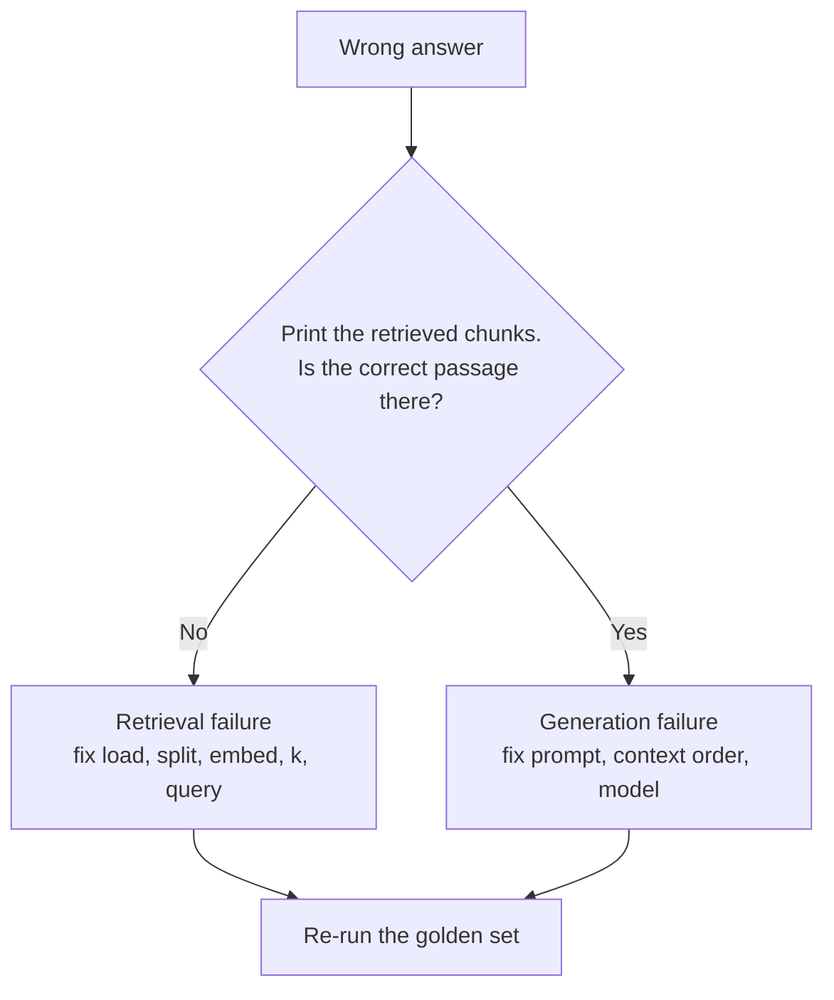
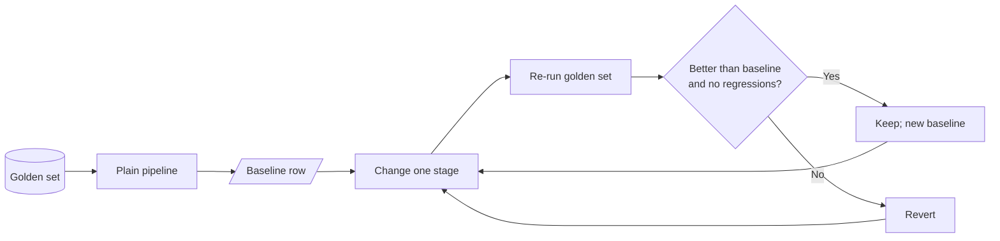

<!-- Generated by site/scripts/rag-theory-import.mjs from rag-agents-engineering. Edit the source there. -->
# The RAG lifecycle and a measured baseline

*Notebooks: [`05a_rag_lifecycle_and_baseline.ipynb`](https://github.com/Sourav692/rag-agents-engineering/blob/main/course/p04_rag_foundations/m11_rag_lifecycle/notebooks/05a_rag_lifecycle_and_baseline.ipynb)*

## Indexing vs retrieval vs generation

The lifecycle has seven steps in two phases. Each step has one job and one typical failure.

| Phase | Step | Job | Typical failure | Fixed in |
|---|---|---|---|---|
| Indexing | Load | Turn files into `Document`s with metadata | Garbled PDF text, missing metadata | [M12](/learn/ingestion-and-indexing-pipeline/document-ingestion-and-metadata-design/document-ingestion-and-metadata-design-overview) |
| Indexing | Split | Cut documents into retrievable chunks | A fact split across two chunks | [M13](/learn/ingestion-and-indexing-pipeline/chunking-and-indexing/chunking-and-indexing-overview) |
| Indexing | Embed | Turn each chunk into a vector | Model cannot tell paraphrases apart, or blurs exact codes | [M14](/learn/ingestion-and-indexing-pipeline/embeddings-and-model-selection/embeddings-and-model-selection-overview) |
| Indexing | Store | Index vectors for nearest-neighbour search | Chunk count ≠ vector count; no metadata filters | [M15](/learn/ingestion-and-indexing-pipeline/vector-stores-and-index-operations/vector-stores-and-index-operations-overview) |
| Query | Retrieve | Return the top-k chunks with scores | Evidence ranked below the cut-off, or not at all | [M17](/learn/retrieval-quality-engineering/retrieval-hybrid-rerank/retrieval-hybrid-rerank-overview) to [M19](/learn/retrieval-quality-engineering/post-retrieval-optimisation-and-reranking/post-retrieval-optimisation-and-reranking-overview) |
| Query | Augment | Format the chunks into the prompt | Sources dropped, so no citations | [M20](/learn/complete-rag-applications/end-to-end-rag-systems/end-to-end-rag-systems-overview) |
| Query | Generate | Answer from the supplied context | Ignores the evidence, or answers beyond it | [M20](/learn/complete-rag-applications/end-to-end-rag-systems/end-to-end-rag-systems-overview), [M28](/learn/agentic-and-self-correcting-rag/agentic-rag-foundations-grading-and-query-rewriting/agentic-rag-foundations-grading-and-query-rewriting-overview) and [M29](/learn/agentic-and-self-correcting-rag/self-correcting-rag-crag-and-self-rag/self-correcting-rag-crag-and-self-rag-overview) |

When an answer is wrong, one question tells you which half to debug:

Tuning the prompt cannot fix a retrieval failure, because the model never saw the evidence. Lesson 11.5's notebook prints chunks with their scores (`similarity_search_with_score`) for this check.

## Baseline-first optimisation

Every later module in this course changes one stage of the pipeline: chunking, embeddings, hybrid search, reranking, query rewriting. Without a baseline, you cannot tell whether a change helped, hurt, or only moved the failure to another question.

The method:

1. **Fix a golden set.** 20 to 50 real questions, each with its evidence chunks and a reference answer. Freeze it, and add questions when production shows a new failure.
2. **Build the plain pipeline.** Default loader, recursive splitter, one embedding model, top-k similarity, a simple prompt.
3. **Record the baseline row.** Retrieval metrics (recall@k, hit rate, MRR), answer metrics (correctness, faithfulness), latency and cost per question.
4. **Change one stage, re-run, compare.** Keep the change only if the row improves on the questions it targets without breaking the others.

At `k = 2` the [top-k lab](/labs/rag/m11_rag_lifecycle/top-k-retrieval-lab.html)'s baseline row is mean recall@2 = 0.50 and mean precision@2 = 0.50. That number already points at the next modules: the export question is solved, the refund question needs better term matching ([M14](/learn/ingestion-and-indexing-pipeline/embeddings-and-model-selection/embeddings-and-model-selection-overview), [M17](/learn/retrieval-quality-engineering/retrieval-hybrid-rerank/retrieval-hybrid-rerank-overview)), and the outage question needs paraphrase-aware retrieval ([M14](/learn/ingestion-and-indexing-pipeline/embeddings-and-model-selection/embeddings-and-model-selection-overview), [M18](/learn/retrieval-quality-engineering/query-transformation-and-routing/query-transformation-and-routing-overview)).

The lifecycle notebook ends with the map from symptom to module:

| What you observe | Likely cause | Where it is fixed |
|---|---|---|
| Question worded unlike the documents; evidence never retrieved | Vocabulary mismatch | [M14](/learn/ingestion-and-indexing-pipeline/embeddings-and-model-selection/embeddings-and-model-selection-overview) embeddings, [M18](/learn/retrieval-quality-engineering/query-transformation-and-routing/query-transformation-and-routing-overview) query transformation |
| Exact codes or names missed (`ORD-88213`) | Dense retrieval blurs rare tokens | [M17](/learn/retrieval-quality-engineering/retrieval-hybrid-rerank/retrieval-hybrid-rerank-overview) hybrid search |
| Half an answer; one fact found, another missed | Question needs several chunks | [M18](/learn/retrieval-quality-engineering/query-transformation-and-routing/query-transformation-and-routing-overview) query decomposition |
| Evidence retrieved but ranked low | Ranking noise | [M19](/learn/retrieval-quality-engineering/post-retrieval-optimisation-and-reranking/post-retrieval-optimisation-and-reranking-overview) reranking |
| Retrieved chunk holds half the fact | Chunk boundary | [M13](/learn/ingestion-and-indexing-pipeline/chunking-and-indexing/chunking-and-indexing-overview) chunking |
| Answer contradicts the retrieved chunk | Generation | [M20](/learn/complete-rag-applications/end-to-end-rag-systems/end-to-end-rag-systems-overview) per-claim citations, [M29](/learn/agentic-and-self-correcting-rag/self-correcting-rag-crag-and-self-rag/self-correcting-rag-crag-and-self-rag-overview) Self-RAG |
