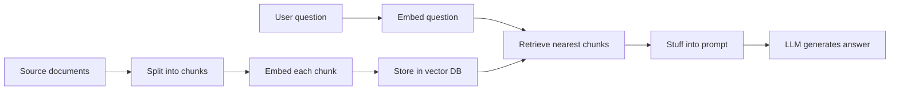

# The RAG Pipeline End to End

*Splitting RAG into an offline flow and a per-request flow lets ingestion be slow and thorough, but anything ingestion gets wrong is served to every later query.*

RAG is two flows that run at different times, not one script. Learn both, and the positions in the query flow that carry its security, building on [What RAG Is and When to Use It](/learn/llm-and-retrieval/rag-from-first-principles/what-rag-is-and-when-to-use-it).

**Objectives:**

- draw the naive RAG pipeline and say which stage each later technique improves;
- separate the ingestion flow from the query flow and explain why the timing matters;
- place the two security positions, authorise and enforce, in the query flow.

---

## Start From the Naive Pipeline

The simplest working RAG has four stages. Split documents into chunks. Embed each chunk into a vector. Store the vectors in a database. At query time, embed the question, pull the nearest chunks, and stuff them into a prompt for the model.



The interview tutorial's line for it: naive RAG is index, then retrieve, then stuff. Every later technique improves exactly one of those stages. A different split changes indexing. A rewritten query or an extra search index changes retrieval. A second relevance pass changes what gets stuffed. Holding that map makes a long list of techniques easy to place.

| Stage | Where it is taught |
|---|---|
| Chunking, embedding and indexing | [Chunking and indexing](/learn/llm-and-retrieval/chunking-and-indexing) |
| Hybrid search, query rewriting and reranking | [Retrieval: hybrid, rerank, query transformation](/learn/llm-and-retrieval/retrieval-hybrid-rerank) |
| Loading and cleaning documents | [Ingestion and Preprocessing](/learn/llm-and-retrieval/rag-from-first-principles/ingestion-and-preprocessing) |
| Prompting and answering | [Grounded Generation](/learn/llm-and-retrieval/rag-from-first-principles/grounded-generation) |

## Run Ingestion Offline and Queries Online

The production pipeline has two flows, and they run at completely different times.

```
 source systems        ┌──────────┐   ┌─────────┐   ┌──────────┐   ┌────────────┐
 (Confluence,   ────>  │  load +  │──>│ validate│──>│  chunk   │──>│  embed +   │──> vector DB
  Zendesk, ...)        │ normalise│   │  ACLs   │   │          │   │   index    │
                       └──────────┘   └─────────┘   └──────────┘   └────────────┘
```

Ingestion runs on a schedule. It can be slow, batched and re-run. Its job is to turn documents into searchable chunks tagged with their permissions, and it refuses any document whose permissions cannot be determined. Once a document is in the index, it will be found.

```
  question ──> authorize ──> plan ──> retrieve ──> enforce ──> rerank ──> grade ──> generate ──> verify ──> answer
```

The query flow runs per request. It has a latency budget and a user waiting. That difference is the point of the split. Expensive, careful work belongs offline, where nobody waits for it.

## Place Authorise First and Enforce Before the Model

Two positions in the query flow are the security property of the whole system. Authorise sits first: before any search, the system resolves who is asking and what they may read. Enforce sits before the model sees anything: whatever retrieval returns is re-checked against the full policy before a single token enters the prompt.

The rest of the line divides cleanly. Plan, retrieve and rerank are about quality. Grade, generate and verify are about honesty: is there enough to answer, and are the citations valid and grounded?

> **Warning: a stage that moves breaks the guarantee.** Search before authorise and the system has already looked through documents the user may not read. Generate before enforce and a restricted passage can reach the prompt. Each of these boxes is built in [Enterprise RAG in production](/learn/production-ai/enterprise-rag-in-production).

## Learn the Vocabulary Once

| Term | Meaning |
|---|---|
| Retrieval | Finding the passages relevant to a question, from a corpus too large to put in the prompt |
| Augmented generation | Asking the model to answer using the retrieved passages, ideally with citations |
| Ingestion | The offline pipeline that turns source documents into indexed, permission-tagged chunks |
| Chunk | A passage-sized piece of a document; the unit of retrieval |
| Vector database or index | The store that holds chunk embeddings and answers "nearest chunks to this query" |
| ACL | Access-control list: who may read a document, carried from the source system into every chunk |
| Authorise and enforce | The two security positions in the query flow: resolve permissions first, re-check before generation |

## Worked Example: Tracing One Question Through Both Flows

Take the Vertex Financial question from the previous lesson. Last night, ingestion loaded the ticket, the post-mortem and the contract. It translated each source system's permissions into tags, chunked and embedded each document, and indexed the chunks. A wiki page with no readable permissions was refused.

This morning a Tier-1 agent asks the question. Authorise resolves that this agent may read tickets only. Retrieve searches only that slice. Enforce re-checks every returned chunk, so no post-mortem or contract text survives. Rerank orders the ticket chunks. Grade decides there is enough to answer the narrow question. Generate writes "Platform-side backlog. Credits go to the account manager." Verify confirms each citation points at a chunk the agent may read.

Each box did one job. Ingestion decided what could ever be found, and the query flow decided what this person could see.

---

## Key Takeaways

- Naive RAG is index, retrieve, then stuff, and every later technique improves one of those stages.
- Ingestion runs offline and can be slow; the query flow runs per request against a latency budget.
- Authorise sits first and enforce sits before the model, and together they are the system's security property.
- Plan, retrieve and rerank serve quality; grade, generate and verify serve honesty.

## Check Yourself

1. **Why do ingestion and query run at different times, and why does it matter?**
   Ingestion is offline and can be batched and re-run; the query flow has a user waiting. Expensive work moves offline, and ingestion's mistakes reach every later query.

2. **Where do authorise and enforce sit, and what goes wrong if either moves?**
   Authorise is first, before any search; enforce is just before generation. Move authorise later and the search has already crossed permissions. Move enforce later and restricted text reaches the prompt.

3. **Why does ingestion refuse a document whose permissions it cannot determine?**
   Once a document is indexed it will be found. Without usable permissions there is no safe way to decide who may see it.

