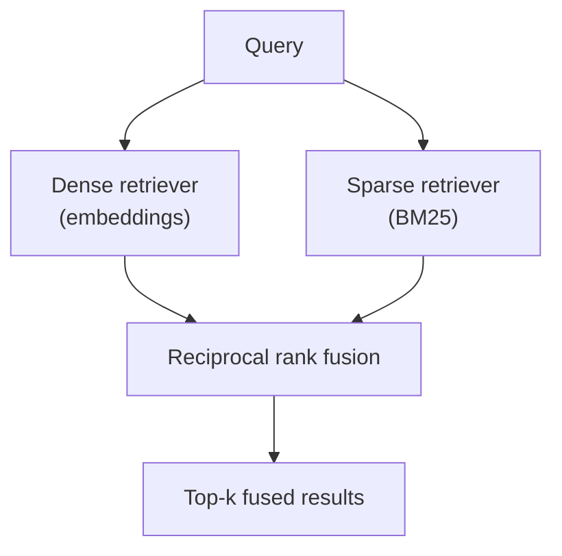
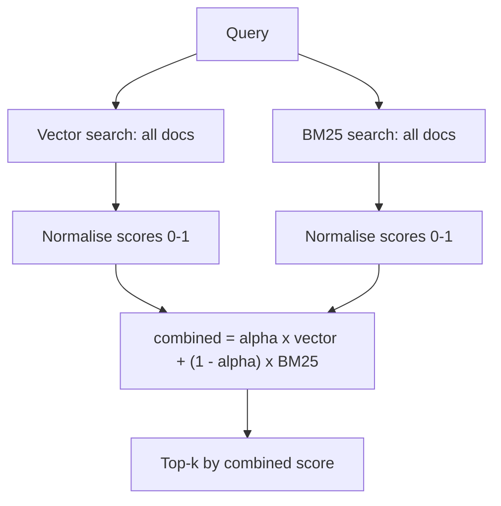

# Hybrid Search and Rank Fusion

*Meaning-based search handles paraphrase and keyword search handles exact identifiers, and neither alone survives a corpus that mixes the two, so the real work is merging two lists whose scores mean different things.*

◷ 8 min

Dense search is not "the modern option" and keyword search "the legacy one". Run both, merge them by rank, and tune the merge on labelled queries, using the failure map in [Measuring and Diagnosing Retrieval](/learn/llm-and-retrieval/retrieval-hybrid-rerank/measuring-and-diagnosing-retrieval) to decide when this is the fix.

**Objectives:**

- explain why dense search misses exact identifiers and why BM25 misses paraphrase;
- compute a reciprocal rank fusion result by hand and say what its constant `k` controls;
- choose between rank fusion and weighted score blending, and name the cost of each.

---

## Know What Each Search Finds

Dense search embeds the question and finds the nearest chunks. Texts with similar meanings land near each other, so it is strong on paraphrase. "Ways to reduce costs" finds "cost optimisation strategies". "Car" and "automobile" sit close together.

Dense search is weak on exact identifiers. `MRD-5031`, `MRD-5030` and `MRD-4290` look alike, so they embed to nearly the same place. Embeddings smooth over surface form. A query for one ticket ID can return a neighbour's guide.

BM25 is classic keyword scoring. It weighs term frequency, how often a word appears in a document, against inverse document frequency, how rare the word is across all documents. A rare token is strong evidence, so `MRD-5031` is found at once. BM25 is very fast, needs no model, and is easy to explain. But to BM25 "car" and "automobile" are unrelated words, and "data not showing up" shares nothing with "commit lag".

| Question | Dense search | BM25 |
|---|---|---|
| "What is MRD-5031?" | MRD-5030 guide (wrong) | MRD-5031 guide (right) |
| "Why is my data not showing up?" | Backpressure guide (right) | Nothing (no shared words) |

## Run Both When the Query Type Is Unknown

Neither search wins alone. Enterprise corpora are full of error codes, SKUs, ticket IDs, clause numbers and person names. Their users still ask in plain language. Most real systems cannot predict which kind of query comes next, so run both and merge. That is hybrid search.

Both retrievers answer the same query; fusion turns their two ranked lists into one.

The FDE Handbook goes further: hybrid is the baseline, not the advanced option. Its one-line test is memorable. If a query could reasonably be answered by Ctrl-F, dense retrieval alone will eventually miss it. The case for hybrid is strongest in support tickets, code, and documents full of error codes and version strings.

Hybrid has a price. It adds a second index and a fusion weight to tune. A dense-only stack is simpler, and stays right for prose-heavy corpora with few exact codes. The RAG fundamentals guide also describes a lighter option: fall back to keyword search only when dense retrieval finds nothing above the similarity threshold.

## Keep Identifiers Whole in the Keyword Index

BM25 only helps if its tokens match how identifiers are written. The FDE Handbook's enterprise platform keeps hyphenated identifiers like `MRD-5031` as single tokens. Splitting on the hyphen would destroy the one signal BM25 exists to catch.

The same platform keeps paraphrased rewrites away from BM25. Its dense search fans out over several rewrites of the question; its BM25 search sees only the original question and any sub-questions. Paraphrases dilute rare identifiers, as [Query Transformation](/learn/llm-and-retrieval/retrieval-hybrid-rerank/query-transformation) explains.

## Merge by Rank, Not by Score

Dense search reports "0.82 similarity". BM25 reports "14.3". The two numbers live on different scales and cannot be added. Reciprocal rank fusion (RRF) ignores the scores and uses only positions. Each document scores `1 / (k + rank)` in every list it appears in, and the scores are summed. The conventional `k` is 60. The enterprise platform writes the same formula as `1 / (k + rank + 1)` because it counts ranks from zero.

| Dense list | BM25 list | RRF result |
|---|---|---|
| 1. A | 1. C | 1. B (second in both lists) |
| 2. B | 2. B | 2. A |
| 3. D | 3. E | 3. C |

A document ranked second by both retrievers beats one ranked first by only one. Agreement between independent retrievers is the signal worth having, and RRF gets it without normalising anything.

The constant `k` sets how much a first place dominates. At `k=60`, rank 1 earns about 0.0164 and rank 4 about 0.0156, barely different. So appearing in many lists outweighs topping one. A small `k` makes rank 1 dominate, close to trusting the single best list. A large `k` flattens differences until fusion barely changes the order.

RRF merges provenance too. The enterprise platform records which retrievers found each surviving chunk, in a `retrieved_by` field, and shows it in the trace. The same formula merges the result lists of several query rewrites, which is what RAG-Fusion means.

> **Warning: key fusion by content, not by object.** One source notebook keyed fused scores by the printed form of each document object. Two chunks with identical text were then counted as different documents. Downstream code also received an unusable string instead of the document. Key and return by the chunk's content or a stable content hash, and keep a lookup back to the real document.

## Weigh Rank Fusion Against Score Blending

The sources describe two ways to merge, and they disagree on which is better.

| Method | How it merges | Cost |
|---|---|---|
| Weighted RRF (an ensemble retriever) | Ranks fused by RRF, each retriever given a weight such as 0.4 keyword and 0.6 semantic | No normalisation needed |
| Score blending | Both score sets normalised to 0–1, then `alpha × vector + (1 − alpha) × BM25` | Normalisation needs the full score distribution |

The advanced-RAG tutorial's score-blending notebook fetches every indexed document on every query to compute the minimum and maximum. Latency then grows with the corpus even when only five results are returned. Its own fix is to cache global score statistics or switch to rank fusion. The FDE Handbook and the retrieval-strategies tutorial use rank fusion from the start.

The two normalise steps are the ones that need the full score distribution on every query.

Whichever method is used, the weight is not a constant to guess. The sources show 0.4/0.6, 0.3/0.7 and `alpha` 0.5. Each says to tune it on a labelled set that mixes natural-language and exact-token queries. The right value differs by corpus: tickets skew token-heavy, wiki articles skew semantic.

Check the platform before building fusion by hand. The retrieval-strategies tutorial notes that Databricks Vector Search's hybrid mode, and stacks that pair Elasticsearch with dense vectors, already do this fusion natively.

## Worked Example: An Error Code in a Support Search

A customer types "What is MRD-5031?" into a support search. Dense-only search ranks the MRD-5030 guide first, because the two codes embed almost on top of each other. BM25 ranks the MRD-5031 guide first, since the token is rare. Dense-only search would never have surfaced the right guide at the top. After RRF, the right guide is in the fused candidate list, where a reranker can judge it properly.

Now take "why is my data not showing up?". BM25 finds nothing, since no words are shared. Dense search finds the backpressure guide, and it survives fusion. One merge handles both queries, which is why hybrid is the default whenever the query type cannot be predicted.

---

## Key Takeaways

- Dense search finds meaning and misses identifiers; BM25 finds identifiers and misses paraphrase.
- Run both whenever the query type is unknown, which is most real systems.
- Keep identifiers whole in the keyword index and keep paraphrases out of it.
- Merge by rank with RRF, because scores from different retrievers are not comparable; `k` sets how much one first place counts.
- Score blending needs normalisation over the whole index; whatever the method, tune the weight on labelled queries.

## Check Yourself

1. **Why does RRF use rank position instead of similarity score?**
   Scores from different retrievers, or from different query variants, sit on different scales. Ranks are comparable.

2. **Why can a document ranked second twice beat one ranked first once?**
   RRF sums a contribution from every list. With `k=60` a first place adds little more than a second, so agreement across lists dominates.

3. **Hybrid search p99 latency grows with corpus size although it returns five results. Why?**
   Score-blending fusion is normalising against every document in the index on each query. Cache the score statistics or switch to rank fusion.

