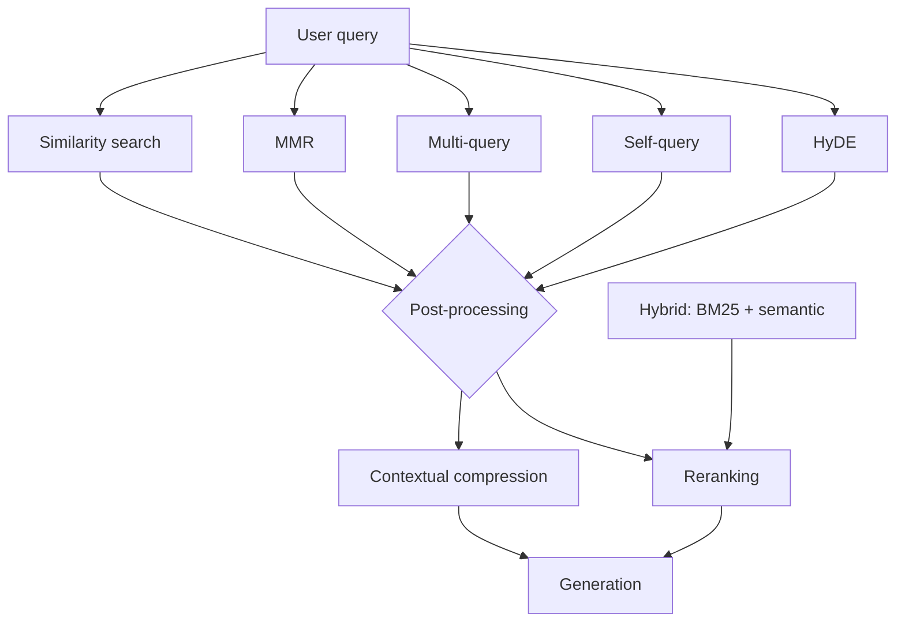
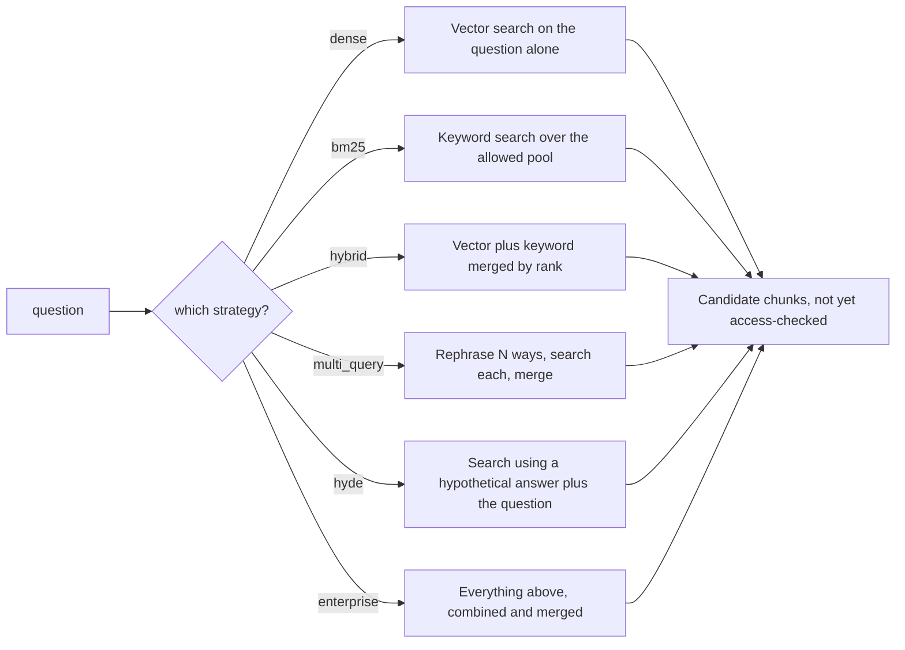

# Production Retrieval Pipelines

*Each extra retrieval stage lifts quality on hard queries but adds latency, cost and a new way to fail, so every stage must earn its place and be safe to lose.*

Real systems rarely use one retrieval strategy alone. Compose hybrid search, reranking and optional rewriting into one pipeline, keep the strategies swappable, and make every model-dependent step degrade instead of failing.

**Objectives:**

- assemble a composite retriever and size each stage's pool;
- keep strategies interchangeable behind one interface so an evaluation harness can compare them;
- set a latency budget, degrade gracefully on partial failure, and estimate cost per query.

---

## Compose Hybrid, Rerank, Then Trim

The retrieval-strategies tutorial gives a common, well-tested default: hybrid retrieval, a generous candidate pool, cross-encoder reranking, then compression. In its example, BM25 and dense search each return 10 results, weighted 0.3 and 0.7 and fused. A cross-encoder keeps the best 5. Compression is added only if prompt size is still a problem after that.

Every query-time strategy feeds the same post-processing stage before generation.

The FDE Handbook's enterprise platform uses larger pools. Dense and BM25 each return 40 candidates, fusion keeps 50, and the reranker keeps 6. The two configurations agree on the shape. Recall comes from a wide, cheap first stage. Precision comes from a narrow, expensive second stage, as [Reranking and Post-Retrieval Filtering](/learn/llm-and-retrieval/retrieval-hybrid-rerank/reranking-and-post-retrieval-filtering) explains.

The retrieval-strategies tutorial's checklist orders the build. Start with plain similarity search and measure. Add MMR for redundant chunks, multi-query for paraphrase misses and self-query for metadata filters. Add reranking when the right chunk is retrieved but ranked low, and hybrid for mixed exact and semantic queries. Add HyDE for short questions over dense prose. Compression comes last, for long chunks full of filler.

## Put Strategies Behind One Signature

The enterprise platform runs six strategies behind one function signature: dense, BM25, hybrid, multi-query, HyDE and an "enterprise" combination. The pipeline can choose one at runtime. The evaluation harness can compare all six on the same questions.

Every branch returns candidates that are not yet access-checked, so authorisation still runs after this step.

| Strategy | What it does | Failure it targets |
|---|---|---|
| Dense | Vector search on the raw question; the baseline | — |
| BM25 | Keyword search over the authorised pool | Exact identifiers, error codes, ticket IDs |
| Hybrid | Dense plus BM25, merged by RRF | Identifiers and paraphrase in one corpus |
| Multi-query | Several rephrasings, each searched, then fused | User wording differs from corpus wording |
| HyDE | A hypothetical answer as the probe, fused with the literal question | Question and answer written differently |
| Enterprise | Rewrites, the HyDE probe and sub-questions through dense; the original question and sub-questions through BM25; all fused | Everything above; reranked downstream |

All six share one context object. It carries the user, the compiled access filter, the model client, and fields for tracing such as generated queries and the HyDE passage. Every store call inside every strategy carries the filter, so no path skips it.

## Measure Before Promoting a Strategy

The platform ran all six strategies against one golden set.

| Strategy | Recall@k | Mean reciprocal rank | Grounded | Refusal accuracy | Leaks | p50 ms | Cost |
|---|---|---|---|---|---|---|---|
| Dense | 1.00 | 0.958 | 1.00 | 0.917 | 0 | 6259 | $0.0133 |
| BM25 | 1.00 | 0.944 | 1.00 | 1.000 | 0 | 5200 | $0.0157 |
| Hybrid | 1.00 | 0.958 | 1.00 | 0.917 | 0 | 7339 | $0.0153 |
| Multi-query | 1.00 | 0.958 | 1.00 | 1.000 | 0 | 8313 | $0.0153 |
| HyDE | 1.00 | 1.000 | 0.929 | 0.917 | 0 | 8850 | $0.0163 |
| Enterprise | 1.00 | 0.958 | 1.00 | 0.917 | 0 | 10908 | $0.0200 |

Read it honestly. The corpus has 22 documents, so retrieval is easy and the differences are noise. The table does not show that HyDE or multi-query earn their keep. "Enterprise" is simply the slowest and most expensive, and dense would be the right choice for this corpus. The number that matters is the zero in the leaks column. The value is that the harness exists and gates every release. On a 200,000-document corpus the same table decides whether HyDE earns its latency.

## Degrade Every Model-Dependent Step

Nothing in retrieval should turn a provider blip into a failed request. On the platform, each model-dependent step catches an unavailable model and falls back. Multi-query falls back to the original question alone. HyDE falls back to plain dense search. Decomposition falls back to no sub-questions. The LLM reranker falls back to fusion order. The run is marked degraded, so the trace records it.

The same rule covers the stores. Put a hard timeout and a fallback on every retrieval call. If the reranker or one index times out, degrade to vector-only or to whichever source answered in time. If one backend of a hybrid retriever is down, use the survivor with a lower-confidence flag rather than failing the turn. The source notebooks lack all of this: their retrieval calls are synchronous, sequential and unguarded.

Run independent calls concurrently. Multi-query sub-searches and the two halves of a hybrid search do not depend on each other. Profile which part is slow before optimising either.

> **Warning: rerank only what the user is allowed to see.** The platform builds its BM25 index over the user's authorised pool and reranks after access enforcement. A restricted user's top 6 is then the best of their own documents. Post-filtering instead would rerank documents they cannot see, waste top-k slots, and hand them an empty or thin context. Building BM25 per request is correct but does not scale. [Enterprise RAG in production](/learn/production-ai/enterprise-rag-in-production) covers access control in full.

## Budget Latency and Cost Per Stage

State the latency budget explicitly rather than treating it as unbounded. One source design for a two-second support assistant splits it like this.

| Stage | Budget |
|---|---|
| Embed the query | 50 ms |
| Retrieve | 150 ms |
| Rerank | 200 ms |
| Generate | 1200 ms |

The whole retrieval stage gets a hard 400 ms cap. On timeout, it uses whichever source returned in time. Generation dominates, so stream it.

Cost scales with model calls per query. Count them: query rewriting, HyDE, an LLM reranker, Self-RAG's three or four calls, and Corrective RAG's grading. Multiply by volume and per-call token cost. A "smart" retrieval loop can cost 5 to 10 times a plain retriever per query. Index-time techniques bill differently. Contextual retrieval or HyPE cost one model call per chunk, so budget them as chunks times call cost, scaling with the corpus rather than with traffic. Two levers cut steady-state cost: cache query embeddings, since support questions cluster heavily, and rerank only when the top scores are close.

## Log Enough to Explain Any Answer

For every retrieval call, log the query sent and the strategy used. Log the chunk IDs and scores returned, and which chunks reached the final prompt. Tie each line to a run ID. That is enough to answer "why did it retrieve that?" after the fact. When a customer reports one wrong answer, investigate in stage order. Were the retrieved documents relevant? If so, was context lost in reranking or compression? If not, retrieval itself failed.

Answers should be checkable too. Carry chunk metadata, such as source file and page, through the pipeline, and have the generation prompt cite by ID. When nothing clears a relevance threshold, say "I don't have that in my docs" instead of letting the model guess.

Alert when a search returns fewer results than it asked for. Some vector stores quietly shrink the result count when the collection holds fewer items than `k`. Chroma, in the agent fundamentals tutorial's notebook, logs only a warning and returns one result for a request of two. In a demo with a one-document collection that is harmless. In production it usually means the index is nearly empty or the filter matched almost nothing, and a log line nobody reads will hide it.

## Worked Example: A Two-Second Support Assistant

The prompt: answer customer questions from product documentation and internal runbooks, in under 2 seconds, for 10,000 users a day. Some questions need both sources. One source design answers it like this.

Keep two separate vector indexes, product documentation and runbooks, each with BM25, so an exact error code or SKU still surfaces. A semantic router, a cheap embedding lookup rather than a model call, decides which indexes to query. Retrieve 20 per source concurrently, and rerank the merged set to 5 only when the top scores are close. Cache query embeddings. Cap retrieval at 400 ms and fall back to whichever source answered.

Generation cites which source each claim came from. It refuses when nothing crosses the threshold. A weekly recall@k check, against a growing labelled set built from real tickets, gates every retrieval change. Every stage in the design maps to a named failure, a fallback and a number.

---

## Key Takeaways

- Compose hybrid retrieval, a wide pool, reranking and optional compression; retrieve wide, keep few.
- Put strategies behind one signature so the harness can compare them, and let the measurements decide.
- Degrade every model-dependent step and every store call; run independent calls concurrently.
- Rerank after access enforcement, never before.
- Budget latency per stage and cost per model call, and use caching and conditional reranking to cut both.
- Log query, strategy, chunks, scores and prompt contents per call, cite sources in answers, and alert when a search returns fewer than `k` results.

## Check Yourself

1. **Why should the six-strategy comparison table not be used to justify HyDE?**
   The corpus has 22 documents, so every strategy scores near-perfectly and the differences are noise.

2. **The multi-query step cannot reach the model. What should retrieval do?**
   Fall back to the original question alone, mark the run degraded, and carry on.

3. **Why must reranking run after access filtering?**
   Otherwise it ranks documents the user cannot see, wastes top-k slots and leaves them a thin context.

