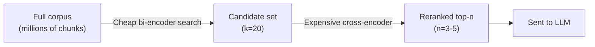
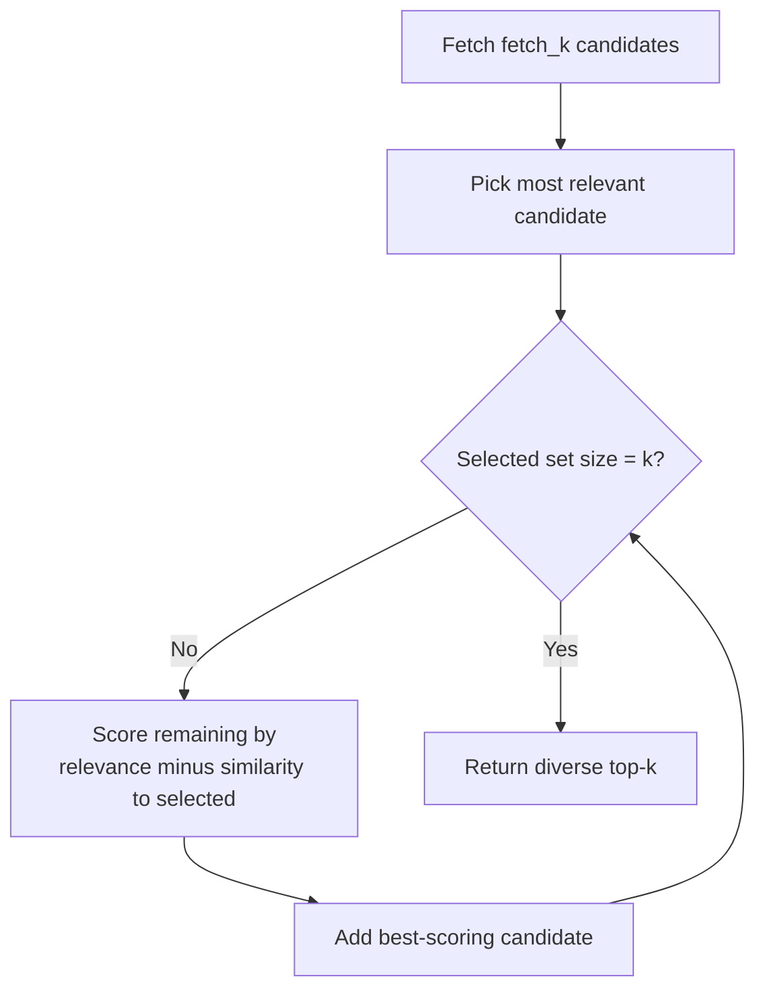

# Reranking and Post-Retrieval Filtering

*A careful relevance judgement is too slow to run over a whole corpus and too valuable to skip, so retrieve wide and cheap, then judge narrow and expensive.*

◷ 8 min

The six passages the model sees should be the six best, not merely the six nearest. Over-fetch candidates with the searches in [Hybrid Search and Rank Fusion](/learn/llm-and-retrieval/retrieval-hybrid-rerank/hybrid-search-and-rank-fusion), then rerank, diversify, filter and trim them before generation.

**Objectives:**

- explain why a cross-encoder judges relevance better than the embedding search that found the candidates;
- size the candidate pool and the final cut, and choose between a cross-encoder and an LLM reranker;
- remove near-duplicates with MMR and trim noise with thresholds, compression, segment extraction and filters.

---

## Retrieve for Recall, Rerank for Precision

First-stage retrieval is built to be fast over millions of chunks. That makes it approximate. It shrinks the corpus to a shortlist, but the order within the shortlist is often wrong. Reranking is a second, slower pass over that shortlist only.

The FDE Handbook calls reranking the biggest single quality win. The shape is always the same. Retrieve broadly for high recall, then rerank tightly for high precision.

| Source | Candidates retrieved | Kept after reranking |
|---|---|---|
| FDE Handbook foundations | About 20 from 1,000,000 chunks | 6 |
| FDE Handbook enterprise platform | 40 dense plus 40 BM25, fused to 50 | 6 |
| RAG fundamentals guide | 20 to 50 | 5 |
| Retrieval-strategies tutorial | 20 to 50 | 3 to 5 |

Most systems rerank around 10 to 50 candidates.

Each stage costs more per item and sees far fewer items, which keeps the total cost bounded.

## Let the Reranker Read Query and Passage Together

The usual embedding model is a bi-encoder. It encodes the query and each document separately, then compares two vectors. Document vectors can be computed in advance, which is why it scales to a whole corpus. But the query and the document never see each other.

A cross-encoder takes the query and one document together as a single input and outputs one relevance score. Dense search compares two summaries; a reranker reads the actual pair. It has strictly more information, so its judgement is stronger. It cannot be precomputed, which is why it only runs on the shortlist.

The question the reranker answers matters. The enterprise platform scores each candidate 0 to 10 on "does this passage actually answer this question?". It does not ask whether the passage is well written or important.

| Approach | Speed | Accuracy | Typical use |
|---|---|---|---|
| BM25 only | Very fast | Moderate | Keyword-heavy search |
| Dense retrieval (bi-encoder) | Fast | Good | Large-scale semantic search |
| Dense retrieval plus reranker | Medium | High | Production RAG systems |
| Cross-encoder only | Very slow | Very high | Small datasets or evaluation |

## Choose the Reranker by Volume and Latency

Two kinds of reranker appear in the sources.

| Option | Costs | Buys | Pick when |
|---|---|---|---|
| Cross-encoder, a small local model | A model to host; a slightly lower ceiling on nuance | Milliseconds per candidate; no per-call API cost | High query volume; latency-sensitive paths |
| LLM as reranker | Model calls and their latency | Nuanced, intent-aware relevance with a reason per candidate | Lower volume, or the highest-value queries |

The sources disagree on the default. The advanced-RAG tutorial treats an LLM judge as one API call per candidate, and reserves it for expensive mistakes. The FDE Handbook's enterprise platform uses an LLM reranker by default. It makes one batched JSON call that scores every candidate with a one-line reason, so it needs no model hosting. A local cross-encoder is a one-line swap behind the same interface. If the model is unavailable, the platform falls back to fusion order.

Reranking adds latency. Its cost depends on model size, the number of candidates, CPU versus GPU, and batching. Shrink the candidate set before optimising the model, since cost scales with candidates times queries. One source design reranks only when the top similarity scores are close together. A clear winner skips the reranker and saves tail latency.

Reranking also cannot fix a recall problem. When the right document never entered the candidate set, no reordering will surface it. When offline metrics improve but answers do not, check that the new order actually reaches the prompt.

## Remove Near-Duplicates With MMR

Plain top-k search often returns k near-duplicates, five chunks restating one fact. They waste the context budget. Maximal marginal relevance (MMR) reranks candidates to balance relevance against difference from what is already picked.

MMR repeatedly picks the candidate with the best `λ × relevance − (1 − λ) × similarity to already-selected results`. At λ=1 it is plain similarity search; at λ=0 it maximises diversity alone. A common setting is `k=3` or `k=4`, `fetch_k=20` and λ=0.5. Use it when the corpus holds overlapping versions of documents, or chunks with heavy overlap. Its cost is close to zero.

Each pick is penalised for resembling what is already selected, so the loop trades relevance for coverage one item at a time.

> **Warning: MMR needs a pool larger than its output.** MMR picks its diverse set from `fetch_k` candidates. If `fetch_k` equals or barely exceeds `k`, there is nothing to trade, and results match plain search even with λ turned down. Set `fetch_k` to several times `k`, such as 20 for a `k` of 3.

## Trim What Reaches the Prompt

The model tries to use everything it is given, so noise becomes wrong answers. Five tools cut the noise after retrieval.

**Similarity threshold.** Drop chunks below a minimum similarity. If nothing passes, answer "I don't have information on this" instead of letting the model guess.

**Contextual compression.** A model reads each retrieved chunk and keeps only the sentences relevant to the question. It shrinks the prompt and helps with the "lost in the middle" problem, where a model under-uses text buried mid-context. But it costs one model call per retrieved document. The retrieval-strategies tutorial calls it the most expensive strategy per query, so it is not a default. Skip it when `k` is already small and chunks are already short.

**Relevant segment extraction (RSE).** Some answers span several adjacent chunks. RSE scores every chunk's relevance and subtracts a penalty, such as 0.2, from each. It then finds the best contiguous run of chunks, a constrained maximum-sum problem. The notebook caps a segment at 20 chunks and the total at 30, with a minimum value of 0.7. It returns one coherent span instead of fixed chunks. The 0.2 penalty was found by trial; sweep it per corpus against labelled questions.

**Multi-faceted filtering.** After one wide search, four cheap filters run in sequence. They check exact metadata matches, a similarity floor, required keywords and near-duplicates. Each takes and returns document-score pairs, so they chain. Filtering already-fetched candidates is cheaper than querying again.

**Context enrichment.** The opposite move, retrieving small and returning neighbouring chunks, belongs to indexing. See [Chunking and indexing](/learn/llm-and-retrieval/chunking-and-indexing).

## Worked Example: The Answer at Position 14

A query returns 20 candidates from dense search. The best answer sits at position 14, because its embedding was slightly off. Sent straight to the model with a top-5 cut, it would never be seen. A cross-encoder reads each of the 20 candidates with the query. It recognises the passage at 14 as the best and moves it to position 1.

The remaining top five still hold two near-duplicates of the same paragraph. MMR, run over the reranked pool, swaps one for a different relevant passage. A similarity threshold then drops a weak fifth hit. The model receives four passages, all relevant and none repeated. That is the lesson's argument in one query: recall came from the wide net, precision from the careful judge.

---

## Key Takeaways

- First-stage retrieval is approximate by design; rerank a shortlist of about 10 to 50 down to about 5 or 6.
- A cross-encoder reads query and passage together, so it judges relevance better than comparing two vectors.
- Use a cross-encoder for volume and latency, an LLM reranker for nuance; the sources disagree on the default.
- MMR removes near-duplicates, but only when `fetch_k` is several times `k`.
- Thresholds, compression, segment extraction and filters trim noise; compression costs a model call per document.

## Check Yourself

1. **What can a cross-encoder do that a bi-encoder cannot?**
   Read the query and document together and score the pair directly. A bi-encoder only compares two separately computed vectors.

2. **p95 latency doubled after adding a reranker. What is the first change?**
   Confirm the reranker is the cause, then shrink the candidate set it scores, before swapping models.

3. **MMR returns the same results as plain search. Why?**
   `fetch_k` is not much larger than `k`, so there is no pool of alternatives to choose from.

## References

**Sources:** `02_Chunking_Retrieval_Fusion.md` (FDE Handbook): "Reranking — the biggest single quality win". `04_Retrieval_Hybrid_Rerank.md` (FDE Handbook): "Reranking — the biggest single quality win" and "In the code" (pool sizes). `Module_01_RAG_Fundamentals_Core_Components.md`: Topic 7 "How do you reduce noisy or irrelevant context?" and Topic 8 "What is re-ranking", "Bi-encoder vs cross-encoder" and "Speed vs accuracy trade-offs". `04_rag_and_retrieval_INTERVIEW_TUTORIAL.md`: §1.11 "Cross-encoder reranking", §1.12 "MMR", §2 gotcha on `fetch_k`, §3 "Adding a reranker", §4 question 4 on reranker latency (which cites an external latency-budget article; summarised in our own words), §5.1 answer on reranking versus chunking and §6 worked answer (rerank only when scores are close). `08_advanced_rag_techniques_INTERVIEW_TUTORIAL.md`: §1.8 "Reranking", §1.9 "RSE", §1.10 "Contextual compression", §1.20 "Multi-faceted filtering", §2 RSE gotcha, §3 "Cross-encoder rerank vs. LLM-as-judge rerank" and §5.1 answers on rerankers and compression. `rag_retrieval_strategies.md`: §2 "MMR", §5 "Contextual Compression" and §9 "Reranking".
