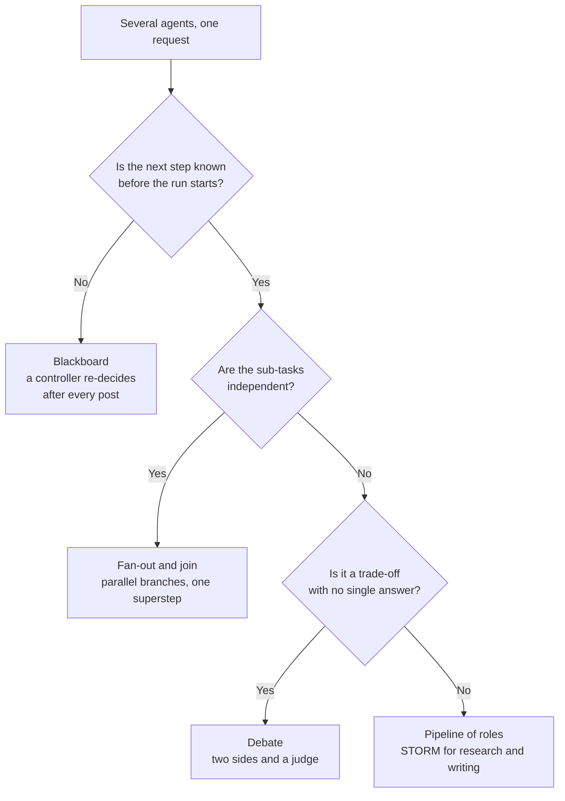

<!-- Generated by site/scripts/rag-theory-import.mjs from rag-agents-engineering. Edit the source there. -->
# Overview

[M35](/learn/memory-and-multi-agent-rag/multi-agent-architectures/multi-agent-architectures-overview) put several agents behind a supervisor. This module changes how they work together: through a shared board, by arguing, by interviewing each other, and by running at the same time. The M36 notebooks build on four ideas: a blackboard that every agent reads and a controller that re-decides after each contribution, a debate judged by a third agent, STORM's perspective interviews, and LangGraph's superstep model for parallel branches.

The running example is the Larkspur Cloud handbook from [M11](/learn/llm-and-retrieval/rag-from-first-principles/rag-from-first-principles-overview) to [M13](/learn/ingestion-and-indexing-pipeline/chunking-and-indexing/chunking-and-indexing-overview). One compound support question carries the parallel lessons and the lab: *"I'm cancelling my annual plan after this week's outages. Can I get a full refund, how long will it take, can I still export my data, and do I get credits for the outages?"* It splits into four sub-questions whose evidence is the handbook's refund-window, refund-timing, export and retention, and SLA chunks. The blackboard lesson uses an outage escalation from the same handbook; debate and STORM use a decision and an article about it.

## In short

- A **blackboard** is one shared list that every specialist reads and appends to. A controller re-reads it after every contribution and picks the next specialist, so it can skip a branch that a fixed pipeline always runs. Guard it with a typed decision and a call cap (the notebook stops at 6 specialist calls, with a recursion limit of 20 behind it).
- **Debate** gives two agents opposite sides and a judge who reasons past both. It costs `2N + 1` calls for `N` rounds (7 at `N = 3`), so keep it for trade-offs; a factual question is better answered in one call.
- **STORM** researches from several perspectives before it writes: personas, simulated interviews, one merged outline, one draft per section. Its cost is countable: `1 + P × (2T + 1) + 1 + S + 1` calls, 22 to 24 in the notebook.
- LangGraph runs parallel branches in **supersteps**: every node of a step runs at once and the next step starts when the slowest one ends. In the lab, the four sub-questions take 5.7 s one at a time, 3.4 s in parallel, and 2.7 s once the outage rewrite moves inside its agent node.
- Parallel branches need a **join** that waits (a list edge or `defer=True`) and a **reducer** on every key they share; without them the synthesizer answers from half the evidence, or the run raises `InvalidUpdateError`.

## Mental model

The patterns differ in who decides what runs next and when that decision is made. A pipeline and STORM fix the order when you build the graph. A fan-out fixes the shape but lets the branches overlap in time. A blackboard leaves the order to a controller at run time, which buys flexibility and costs a model call per step. All four write to one shared state, so all four need the same guards: typed decisions, reducers on shared keys and a cap on the number of steps.

## Interactive lab

[**Parallel sub-question agents**](/labs/rag/m36_collaboration_parallel_agents/parallel-subquestions-lab.html): open the file in a browser. It opens on a parallel run with the outage rewrite as its own node and separate edges into the synthesizer: the synthesizer runs twice, and its first run saw 3 of 4 sub-answers. Switch the join to a list edge and it runs once, at 3.4 s. Then move the rewrite inside the agent and the answer lands at 2.7 s, against 5.7 s one at a time. Finally drag `max_concurrency` down to 1 and watch the parallel graph give the time back.

## How it connects

- **Before:** [M35](/learn/memory-and-multi-agent-rag/multi-agent-architectures/multi-agent-architectures-overview) builds supervisors and handoffs; this module adds shared-state collaboration and parallel execution to them. [M10](/learn/langchain-and-langgraph-fundamentals/langgraph-runtime-persistence-hitl-and-streaming/langgraph-runtime-persistence-hitl-and-streaming-overview) covers the LangGraph runtime (streaming, retries, checkpoints) that 36.5 relies on, and [M18](/learn/retrieval-quality-engineering/query-transformation-and-routing/query-transformation-and-routing-overview) decomposes a question into the sub-questions the lab runs in parallel. The lab reports against the baseline from [M11](/learn/llm-and-retrieval/rag-from-first-principles/rag-from-first-principles-overview).
- **Next:** [M37](/learn/memory-and-multi-agent-rag/multi-agent-applied-builds-and-deep-agents/multi-agent-applied-builds-and-deep-agents-overview) builds full multi-agent applications, including a research system that dispatches a variable number of workers with `Send` and streams the run.

## Key Takeaways

- Choose the collaboration pattern by who decides the next step and when: fixed at build time (pipeline, STORM), shaped but overlapping (fan-out), or decided at run time (blackboard).
- Give every LLM controller a typed decision, a call cap enforced in code and a computed check of what actually ran.
- Parallel branches cost as much as the slowest task in each superstep; keep branches the same length, join with a list edge or `defer=True`, and put a reducer on every shared key.
- Debate and STORM multiply calls by design. Count them, run the cheap baseline beside them, and keep them for trade-offs and research where the trail is the product.
